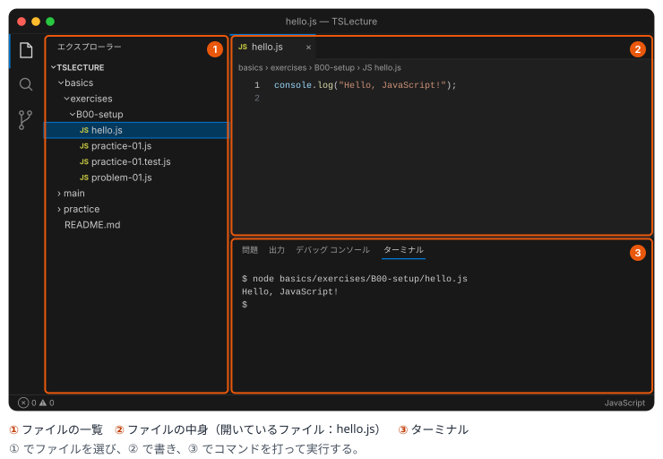
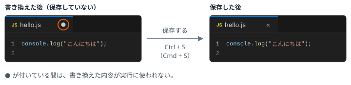
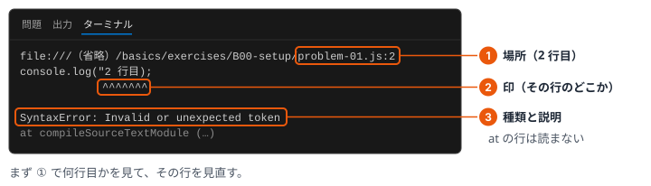

# 基礎編 第0章 準備

- **この章で学ぶこと**
  - プログラムを書く道具と、動かす道具を用意する
  - プログラムのファイルを実行する
  - 書き間違えたプログラムを実行すると、何が起きるか

---

基礎編では、変数・条件分岐・繰り返し・関数・配列といったプログラミングの基礎を、JavaScript で手を動かしながら確かめ直します。前に学んだことを覚えていなくても進められるように、一から説明します。講座で学ぶ技術どうしのつながりは、[学ぶ技術の関係](../../overview.md) にまとめてあります（今は読まなくても進めます）。

## 0.1 必要なもの

使う道具は 3 つです。どれも無料です。

| 道具 | 用途 | 入手先 |
| --- | --- | --- |
| Visual Studio Code（VS Code） | プログラムを書く | [code.visualstudio.com](https://code.visualstudio.com/) |
| Node.js | プログラムを動かす | [nodejs.org/ja](https://nodejs.org/ja) |
| Git | 教材を受け取る | 研修で入れたものを使います |

Node.js は「LTS」と書かれた版（長期サポート版）を選びます。VS Code と Node.js は、ダウンロードしたファイルを開き、画面の案内のとおりに進めればインストールできます。設定は最初のままで構いません。

## 0.2 ターミナルを開く

**ターミナル**は、文字で命令を打ち込んで、コンピューターを動かす画面です。打ち込む命令を**コマンド**と呼びます。プログラムはターミナルで実行します。

VS Code を起動し、メニューの「ターミナル」→「新しいターミナル」を選びます（英語の表示では「Terminal」→「New Terminal」）。画面の下にターミナルが開きます。

ターミナルに次のコマンドを打ち、`Enter` キーを押します。

```sh
node --version
```

`v26.` のように、24 以上の数字が表示されれば、Node.js は正しく入っています。

うまくいかないときは、次の表を見てください。

| 表示 | 対処 |
| --- | --- |
| `command not found` や「認識されません」「認識されていません」 | Node.js が入っていないか、VS Code が Node.js をまだ見つけていません。VS Code を一度終了して、起動し直します。それでも同じなら、0.1 の入手先から Node.js を入れます |
| `v24.` より小さい数字 | 古い Node.js が入っています。0.1 の入手先から、もう一度インストールします |

## 0.3 教材を用意する

教材は 1 つのフォルダにまとまっています。基礎編も、その後の本編・実践編も、このフォルダで進めます。

1. ターミナルで、次のコマンドを打つ。`<このリポジトリのURL>` には、研修で案内された URL を入れます。ターミナルが開いているフォルダ（VS Code でフォルダを開いていないときは、ホームフォルダ）の中に、`TSLecture` という名前のフォルダができます。

   ```sh
   git clone <このリポジトリのURL>
   ```

2. メニューの「ファイル」→「フォルダーを開く」（英語の表示では「File」→「Open Folder」）で、できた `TSLecture` フォルダを選ぶ。画面の左側に `basics`（基礎編のフォルダ）や `README.md` が並べば、開けています。
   - 名前が `.test.js` で終わるファイルは答え合わせ用なので、書き換えません
3. 「このフォルダー内のファイルの作成者を信頼しますか?」と聞かれたら、「はい、作成者を信頼します」を選ぶ。
4. もう一度「ターミナル」→「新しいターミナル」でターミナルを開き、次のコマンドを打つ。`npm` は Node.js と一緒に入る道具です。このコマンドで、教材が使う部品を入れます。少し時間がかかります。

   ```sh
   npm install
   ```

   `added 〜 packages` のような表示の後、入力を待つ状態に戻れば完了です（打つのは最初の 1 回だけです）。`npm warn` で始まる行が出ても構いません。

> **コラム: フォルダの中のほかのファイル**
> フォルダには、`package.json` や `scripts` など、ほかのファイルやフォルダもあります。教材を動かすための部品なので、触りません。`main` と `practice` は、基礎編の後に進む講座のフォルダです。

## 0.4 プログラムを実行する

画面の左側で、`basics` → `exercises` → `B00-setup` の順にフォルダを開き、`hello.js` をクリックします。次の 1 行が書かれています。

```js
console.log("Hello, JavaScript!");
```

これが JavaScript のプログラムです。`console.log(...)` は、かっこの中に書いたものをターミナルに表示する命令です。

ターミナルで次のコマンドを実行します。

```sh
node basics/exercises/B00-setup/hello.js
```

```
Hello, JavaScript!
```

`node` の後ろにファイルの場所を書くと、そのファイルのプログラムが実行されます。ファイルの場所は、フォルダの名前を `/` で区切って書きます。

ここまでの画面を、次の図に示します。



> **コラム: 長いコマンドを楽に打つ**
> - ファイルの場所は、途中まで打って `Tab` キーを押すと、残りが補われます（`node ba` まで打って `Tab` を押すと、`node basics/` になります）。
> - `↑` キーを押すと、前に打ったコマンドが出てきます。同じコマンドをもう一度実行するときに使います。

### 試す

`hello.js` の `Hello, JavaScript!` を好きな言葉に書き換えてください。前後の `"` は残します。

書き換えたら、ファイルを保存します（Windows は `Ctrl`+`S`、macOS は `Cmd`+`S`）。保存していないファイルは、画面の上のファイル名の横に ● が付きます。



もう一度同じコマンドを実行すると、表示が書き換えた言葉に変わります。

**プログラムを書き換えたら、保存してから実行する。** この後の章でも、この順で進めます。

## 0.5 書き間違えたとき

**書き方の決まりに合わない所が 1 つでもあると、プログラムは 1 行も実行されません。** Node.js は、実行を始める前にファイルの全体を読んで、書き方を調べます。決まりに合わない所が見つかると、実行せずに、どこがおかしいかを表示します。

## 問題 1：書き間違えたプログラム

問題は、**答えを開く前に、自分の予測を書き留めてから**実行します。この教材では、考えて答えるものを「問題」と呼びます。当たらなくても構いません。予測と結果の違いから学びます。

`basics/exercises/B00-setup/problem-01.js`

```js
console.log("1 行目");
console.log("2 行目);
console.log("3 行目");
```

2 行目は後ろの `"` を書き忘れています。

`node basics/exercises/B00-setup/problem-01.js` を実行すると、何が表示されるか予測してください。

<details>
<summary>答えと解説</summary>

```
file:///（省略）/basics/exercises/B00-setup/problem-01.js:2
console.log("2 行目);
            ^^^^^^^

SyntaxError: Invalid or unexpected token
（この下に、at で始まる行と、Node.js の版を示す行が続きます）
```

「1 行目」も表示されません。2 行目が書き方の決まりに合わないので、プログラムは 1 行も実行されません（0.5）。

この表示が**エラー**です。プログラムが間違っているときに、Node.js が「どこがどうおかしいか」を知らせます。読む所は 3 つです。



`SyntaxError` は、「書き方の決まりに合わない」という種類のエラーです。説明は英語ですが、今は読めなくて構いません。まず何行目かを見て、その行を見直します。`at` で始まる行は、エラーが起きるまでに通った場所の一覧です。ほとんどが Node.js の中の場所なので、読みません。

`^` の印が出ないこともあります。説明が `Invalid or unexpected token` なら、この例のような `"` の閉じ忘れか、全角の記号（日本語入力のまま打った `（` や `”`）を疑います。

2 行目を `console.log("2 行目");` に直して保存し、もう一度実行してください。3 行が表示されます。

</details>

## 演習 1：2 行を表示する

この教材では、プログラムを書いたり直したりするものを「演習」と呼びます。

`basics/exercises/B00-setup/practice-01.js` に 1 行足して、次の 2 行を表示するプログラムにします。

```
基礎編を始めます
よろしくお願いします
```

**進め方**

1. `basics/exercises/B00-setup/practice-01.js` を開く
   - **こうなれば OK**：`console.log("基礎編を始めます");` の行が見える
2. 最後の行の下に、「よろしくお願いします」と表示する行を書いて、保存する
   - **こうなれば OK**：画面の上のファイル名の横の ● が消える
3. 実行する
   ```sh
   node basics/exercises/B00-setup/practice-01.js
   ```
   - **こうなれば OK**：上の表示と同じになる
4. 答え合わせをする
   - 答え合わせのコマンドは `npm test` です。テスト（書いたプログラムが正しく動くかを調べるプログラム）を動かします
   - `B00` は、基礎編 第0章の章ID です（フォルダの名前 `B00-setup` の先頭と同じ）。その章の演習を答え合わせします
   ```sh
   npm test B00
   ```
   - 表示の上に出る `>` で始まる 2 行は、読まなくて構いません
   - **こうなれば OK**：次のように表示される

   ```
   演習 1  合格

   結果: この章の演習は、すべて合格です。
   ```

<details>
<summary>ヒント</summary>

すでに書いてある `console.log("基礎編を始めます");` の行をまねて、`"` の中の言葉を変えます。

</details>

<details>
<summary>うまくいかないとき</summary>

| 表示 | よくある原因 |
| --- | --- |
| 「実際の表示」が 1 行だけ | ファイルを保存していません。保存してから、もう一度実行します |
| `SyntaxError: Invalid or unexpected token` | `"` や `(` `)` を全角（日本語入力のまま）で打っています。記号は、日本語入力を切ってから打ちます |
| `SyntaxError: missing ) after argument list` | 行の終わりの `)` を書き忘れているか、全角の `）` を打っています |
| 「期待した表示」と「実際の表示」が同じに見える | 言葉が 1 文字違っています。「お願い」と「おねがい」の違いなどを見比べます |

</details>

解答例：[basics/solutions/B00-setup/practice-01.js](../solutions/B00-setup/practice-01.js)

---

## チェックリスト

- [ ] `node ファイルの場所` で、プログラムを実行できる
- [ ] 書き換えたファイルを保存してから実行している
- [ ] エラーの表示から、何行目がおかしいかを読み取れる
