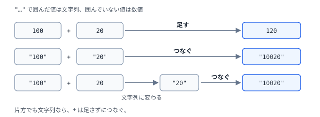

# 基礎編 第1章 値と計算

- **この章で学ぶこと**
  - 数値と文字列という 2 種類の値
  - 計算の書き方と、計算される順番
  - 文字列の中に、計算の結果を入れる書き方

本文のコード例は、`basics/exercises/B01-values/try.js` に自分で打って実行します。

- 最初に書いてあるコメントの行と、前に打ったコード例は、消してから打ちます
- `// →` から後ろは、表示される内容を示すメモです。打たなくて構いません

```sh
node basics/exercises/B01-values/try.js
```

章ごとのフォルダ（`basics/exercises/B01-values/` など）には、次の 4 種類のファイルがあります。`NN` の所には、問題や演習の番号が入ります。

| ファイル | 中身 | 自分で書き換えるか | 使うコマンド |
| --- | --- | --- | --- |
| `try.js` | 本文のコード例を打つ所（第1〜10章にある） | 書き換える | `node` で実行する |
| `problem-NN.js` | 問題のコード（ファイルがない問題は、`try.js` に打つ） | 答えに「直して」とあるときだけ直す | `node` で実行する |
| `practice-NN.js` | 演習のプログラム | 書き換える | `node` で実行し、`npm test` で答え合わせをする |
| `practice-NN.test.js` | 答え合わせ用のテスト | 書き換えない | なし（`npm test` が使う） |

---

## 1.1 プログラムは上から順に実行される

プログラムは上から 1 行ずつ実行されます。

```js
console.log("1 つ目");
console.log("2 つ目");
// → 1 つ目
// → 2 つ目
```

- 1 つの命令の終わりには `;` を書きます。
- `//` から行の終わりまでは**コメント**です。人が読むためのメモで、実行されません。

## 1.2 数値と計算

数はそのまま書きます。これを**数値**と呼びます。数値は記号を使って計算できます。

```js
console.log(7 + 3); // → 10
console.log(7 - 3); // → 4
console.log(7 * 3); // → 21
console.log(7 / 2); // → 3.5
```

| 記号 | 計算 |
| --- | --- |
| `+` | 足し算 |
| `-` | 引き算 |
| `*` | 掛け算 |
| `/` | 割り算 |

掛け算と割り算の記号は、算数と違います。`×` と `÷` は使えません。

計算の順番は算数と同じです。掛け算と割り算は、足し算と引き算より先に計算されます。先に計算したい部分は、`( )` で囲みます。

```js
console.log(10 - 2 * 3);   // → 4
console.log((10 - 2) * 3); // → 24
```

`7 + 3` のように、計算して 1 つの結果になるものを**式**と呼びます。`console.log(7 + 3)` は、先に式を計算し、その結果の `10` を表示します。

### 試す

最初のコード例の 4 行を実行した後、2 行目を `console.log(3 - 7);` に変えて実行します。

結果は `-4` です。0 より小さい数も扱えます。

## 1.3 文字列

文字の並びは `"` で囲んで書きます。これを**文字列**と呼びます。

```js
console.log("こんにちは"); // → こんにちは
console.log("120 円");     // → 120 円
console.log(120);          // → 120
```

`"` は、文字列の始まりと終わりを示す印です。表示には出ません。`"` の中は計算されず、書いたとおりに表示されます。

数値と文字列のように、プログラムが扱うデータを**値**と呼びます。

| 値の種類 | 書き方 | 例 |
| --- | --- | --- |
| 数値 | そのまま書く | `120`、`3.5`、`-4` |
| 文字列 | `"` で囲む | `"こんにちは"`、`"120 円"` |

### 試す

1 行目の `"` を 2 つとも消して、`console.log(こんにちは);` にして実行してください。

```
ReferenceError: こんにちは is not defined
```

エラーになります。`"` で囲んでいない言葉は、文字列ではなく、何かの名前として扱われます。`is not defined` は、「その名前のものは、どこにもない」という意味です。名前の付け方は、第2章で扱います。

このエラーが出た行より下は実行されないので、`120 円` と `120` も表示されません。

## 1.4 文字列の `+` は、つなぐ

**`+` の左右のどちらかが文字列なら、`+` は足し算をせずに文字列をつなぎます。** 数値は、文字列に変わってからつながります。

```js
console.log("りん" + "ご");     // → りんご
console.log("りんご: " + 120); // → りんご: 120
```

`+` が 2 つ以上あるときは、左から順に 1 つずつ処理されます。`10 + 20 + "円"` は、先に数値どうしの `10 + 20` で `30` になり、その後で `"円"` とつながります。

```js
console.log(10 + 20 + "円");          // → 30円
console.log("りんご: " + 120 + "円"); // → りんご: 120円
```

## 問題 1：計算と文字列

`basics/exercises/B01-values/problem-01.js`

```js
console.log(2 * 3 + 4 * 5);   // ①
console.log(2 * (3 + 4) * 5); // ②
console.log("2 + 3");         // ③
console.log("2" + "3");       // ④
console.log("100" + 20);      // ⑤
```

`node basics/exercises/B01-values/problem-01.js` を実行すると、①〜⑤ でそれぞれ何が表示されるか予測してください。

<details>
<summary>答えと解説</summary>

```
26
70
2 + 3
23
10020
```

**① 先に `2 * 3` と `4 * 5` を計算して `6` と `20`、足して `26` です。**

掛け算は足し算より先に計算されます（1.2）。左から順に `2 * 3 + 4` を先に計算するのではありません。

**② 先に `( )` の中の `3 + 4` を計算して `7`、それに `2` と `5` を掛けて `70` です。**

**③ `2 + 3` と、書いたとおりに表示されます。**

`"2 + 3"` は文字列なので、計算されません（1.3）。

**④ `"2"` と `"3"` は、どちらも文字列です。つないで `23` です。**

**⑤ 数値の `20` が文字列の `"20"` に変わってからつながり、`10020` です。**

`"100"` は、見た目は数ですが、`"` で囲んであるので文字列です（1.3）。



計算の結果がおかしいときは、数値のつもりの値が文字列になっていないかを見直します。

</details>

## 問題 2：つなぐ順番

`basics/exercises/B01-values/try.js` に打ちます。

```js
console.log("合計: " + 120 + 80);   // ①
console.log("合計: " + (120 + 80)); // ②
```

`node basics/exercises/B01-values/try.js` を実行すると、① と ② でそれぞれ何が表示されるか予測してください。

<details>
<summary>答えと解説</summary>

```
合計: 12080
合計: 200
```

**① `合計: 12080` です。**

`+` は左から順に処理されます（1.4）。まず `"合計: " + 120` で、文字列の `"合計: 120"` になります。次の `+ 80` は文字列と数値の `+` なので、つながります。

**② `合計: 200` です。**

`( )` の中が先に計算されます（1.2）。数値どうしの `120 + 80` で `200` になり、その後で `"合計: "` とつながります。

</details>

## 1.5 テンプレート文字列

文字列の中に計算の結果を入れるときは、**テンプレート文字列**を使います。`+` でつなぐより読みやすく書けます。

`"` の代わりに `` ` ``（バッククォート）で囲み、結果を入れたい所に `${式}` と書きます。

```js
console.log(`合計: ${120 + 80}円`);    // → 合計: 200円
console.log("合計: " + (120 + 80) + "円"); // → 合計: 200円
```

2 行は同じ表示です。テンプレート文字列では、`${ }` の中だけが計算され、その結果が文字列に入ります。`${ }` の外は、書いたとおりに表示されます。


`` ` `` は、日本語のキーボードでは `Shift`＋`@`、英語のキーボードでは `1` の左のキーで打ちます。`"` とは別の記号です。

### 試す

1 行目の `` ` `` を 2 つとも `"` に変えて実行してください。

```
合計: ${120 + 80}円
合計: 200円
```

変わったのは 1 行目です。`"` で囲んだ文字列では、`${ }` は働きません。書いたとおりに表示されます。

---

## 演習 1：間違いを直す

`basics/exercises/B01-values/practice-01.js` には、間違いが 2 つあります。直して、次の 3 行を表示するプログラムにします。

```
りんご: 120円
みかん: 80円
合計: 200円
```

**進め方**

1. 実行して、エラーを読む
   ```sh
   node basics/exercises/B01-values/practice-01.js
   ```
   - **こうなれば OK**：`practice-01.js:` の後ろに行番号が付いた行と、`SyntaxError` で始まる行が表示される
2. エラーが示す行を直して、保存する
   - **こうなれば OK**：画面の上のファイル名の横の ● が消える
3. もう一度実行する
   - 2 つ目のエラーは、`りんご: 120円` と `みかん: 80円` の 2 行が表示された後に出ます。この種類のエラーでは、上の行が先に実行されます。そのまま、エラーが示す行を直します
   - エラーは一度に 1 つしか表示されません。別のエラーが出たら、同じように直します
   ```sh
   node basics/exercises/B01-values/practice-01.js
   ```
   - **こうなれば OK**：エラーが出なくなる
4. 答え合わせをする
   - 後ろの `practice-01` は、演習のファイルの名前です（`.js` は付けません）。その演習だけを答え合わせします。
   ```sh
   npm test B01 practice-01
   ```
   - **こうなれば OK**：`演習 1  合格` と表示される

<details>
<summary>ヒント 1：1 つ目のエラー</summary>

```
SyntaxError: missing ) after argument list
```

`missing ) after argument list` は、「かっこの中に並べた値（argument list）の後ろに、`)` が足りない」という意味です。`^` の印の真下だけでなく、エラーが示す行の全体で `(` と `)` の数を数えます。

</details>

<details>
<summary>ヒント 2：2 つ目のエラー</summary>

```
ReferenceError: consol is not defined
```

「`consol` という名前のものは、どこにもない」という意味です。その行のつづりをほかの行と見比べます。

</details>

<details>
<summary>うまくいかないとき</summary>

| 表示 | よくある原因 |
| --- | --- |
| 直したのに、同じエラーが出る | ファイルを保存していないか、`)` を全角の `）` で打っています |
| `SyntaxError: Invalid or unexpected token` | 直すときに、`"` などの記号を全角で打っています。記号は、日本語入力を切ってから打ちます |
| 「期待した表示」と「実際の表示」が違う | `"` の中の言葉まで書き換えています。直すのは、記号とつづりの 2 か所です |

</details>

解答例：[basics/solutions/B01-values/practice-01.js](../solutions/B01-values/practice-01.js)

## 演習 2：計算の式を完成させる

1 冊 120 円のノートを 3 冊と、1 本 80 円のペンを 2 本買います。`basics/exercises/B01-values/practice-02.js` の `____` を書き換えて、次の 3 行を表示するプログラムにします。

```
360
160
520
```

1 行目はノートの小計、2 行目はペンの小計、3 行目は合計です。

**進め方**

1. `basics/exercises/B01-values/practice-02.js` を開き、3 か所の `____` を数値か式に書き換える
   - 合計の行には `160` と書かず、ペンの小計の式を書きます
   - **こうなれば OK**：コメント以外の行に `____` が残っていない
2. 実行する
   ```sh
   node basics/exercises/B01-values/practice-02.js
   ```
   - **こうなれば OK**：上の表示と同じになる
3. 答え合わせをする
   ```sh
   npm test B01 practice-02
   ```
   - **こうなれば OK**：`演習 2  合格` と表示される

<details>
<summary>ヒント</summary>

- ノートの小計の行：ノートは 3 冊です。
- ペンの小計の行：ペンは 1 本 80 円です。
- 合計の行：掛け算は足し算より先に計算されるので、`( )` は要りません（1.2）。

</details>

<details>
<summary>うまくいかないとき</summary>

| 表示 | よくある原因 |
| --- | --- |
| `ReferenceError: ____ is not defined` | `____` が残っています。エラーが示す行を見ます |
| `SyntaxError: missing ) after argument list` | 掛け算を `×` で書いているか、行の終わりの `)` が足りません。掛け算は `*` です（1.2） |
| 表示は合っているのに不合格 | 合計の行に `160` と書いています。`80 * 2` の式を書きます |

</details>

解答例：[basics/solutions/B01-values/practice-02.js](../solutions/B01-values/practice-02.js)

## 演習 3：レシートを表示する

演習 2 と同じ買い物を、説明の付いた形で表示します。`basics/exercises/B01-values/practice-03.js` に 2 行足して、次の 3 行を表示するプログラムにします。

```
ノート: 360円
ペン: 160円
合計: 520円
```

**進め方**

1. `basics/exercises/B01-values/practice-03.js` を開き、ノートの行にならって、ペンの行と合計の行を書く
   - 使う書き方は、テンプレート文字列（1.5）：`` `合計: ${120 + 80}円` ``（`` ` `` は、日本語キーボードは `Shift`＋`@`）
   - 金額は `160` や `520` と書かず、`${ }` の中に式を書きます
   - **こうなれば OK**：`console.log` の行が 3 行になる
2. 実行する
   ```sh
   node basics/exercises/B01-values/practice-03.js
   ```
   - **こうなれば OK**：上の表示と同じになる
3. 答え合わせをする
   - 後ろにファイルの名前を付けないと、この章の演習をすべて答え合わせします。
   ```sh
   npm test B01
   ```
   - **こうなれば OK**：`結果: この章の演習は、すべて合格です。` と表示される

<details>
<summary>ヒント</summary>

ペンの行は、ノートの行の「ノート」を「ペン」に、`120 * 3` をペンの小計の式に変えたものです。合計の行は、`${ }` の中に、演習 2 の合計の行と同じ式を書きます。

</details>

<details>
<summary>うまくいかないとき</summary>

| 表示 | よくある原因 |
| --- | --- |
| `ペン: ${80 * 2}円` と、そのまま表示される | `` ` `` ではなく `"` で囲んでいます（1.5 の「試す」） |
| `ペン: 80 * 2円` と表示される | 式を `${ }` で囲んでいません |
| `ペン:160円` と `ペン: 160円` の違いで不合格 | `:` の後ろの空白が抜けています。「期待した表示」と 1 文字ずつ見比べます |
| 「ペンと合計の行を、テンプレート文字列で書く」が不合格 | `+` でつないでいます。ノートの行と同じく `` ` `` で囲み、式を `${ }` の中に書きます |

</details>

解答例：[basics/solutions/B01-values/practice-03.js](../solutions/B01-values/practice-03.js)

---

## チェックリスト

- [ ] `2 * 3 + 4 * 5` と `2 * (3 + 4) * 5` の計算の順番を説明できる
- [ ] `"100" + 20` が `120` にならない理由を説明できる

## 詳しく学ぶ

読まなくても、先に進めます。もっと知りたいときに開きます。

- JavaScript Primer：[データ型とリテラル](https://jsprimer.net/basic/data-type/)、[演算子](https://jsprimer.net/basic/operator/)、[コメント](https://jsprimer.net/basic/comments/)
