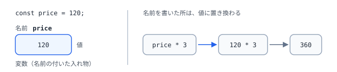

# 基礎編 第2章 変数

- **この章で学ぶこと**
  - 値に名前を付けて、後の行で使う
  - 変数の値を入れ直すと、何が起きるか
  - `const` と `let` の使い分け

この章のコード例は、次のコマンドで実行します（前のコード例は消してから打ちます）。

```sh
node basics/exercises/B02-variables/try.js
```

---

## 2.1 値に名前を付ける

`const 名前 = 値;` と書くと、値に名前を付けられます。名前を付けた値の入れ物を**変数**と呼びます。変数を作ることを、変数を**宣言する**と言います。

```js
const price = 120;
console.log(price);     // → 120
console.log(price * 3); // → 360
```

変数の名前を書いた所は、実行するときに、その変数の値に置き換わります。`price * 3` は、`120 * 3` として計算されます。



```js
const price = 120;
const count = 3;
console.log(`小計: ${price * count}円`); // → 小計: 360円
```

### 試す

上の 3 行を実行した後、1 行目を `const price = 150;` に変えて実行します。

表示は `小計: 450円` に変わります。3 行目は書き換えていません。

## 2.2 名前の付け方

変数の名前は自分で決めます。決まりと習慣は次のとおりです。

決まりに合わない名前はエラーになります。習慣は守らなくても動きますが、この教材では守ります。

| 種類 | 内容 | 良い例 | 悪い例 |
| --- | --- | --- | --- |
| 決まり | 数字で始めない | `item1` | `1item`（エラー） |
| 決まり | 空白を入れない | `taxRate` | `tax rate`（エラー） |
| 習慣 | 英語で付け、英字で始める | `price` | `値段` |
| 習慣 | 2 語以上は、2 語目から先頭を大文字にする | `taxRate`、`totalPrice` | `taxrate` |
| 習慣 | 中身が分かる名前にする | `price`、`count` | `a`、`x` |

- 大文字と小文字は区別されます。`price` と `Price` は別の名前です。
- `const` や `let` のように、JavaScript が使う言葉は名前にできません。

## 問題 1：変数と文字列

`basics/exercises/B02-variables/problem-01.js`

```js
const price = 120;
const count = 3;

console.log(price + count * 10);  // ①
console.log("price * count");     // ②
console.log(`${price + count}円`); // ③
```

`node basics/exercises/B02-variables/problem-01.js` を実行すると、①〜③ でそれぞれ何が表示されるか予測してください。

<details>
<summary>答えと解説</summary>

```
150
price * count
123円
```

**① `price` と `count` が `120` と `3` に置き換わり、`120 + 3 * 10` を計算して `150` です。**

掛け算が先なので、`3 * 10` の `30` に `120` を足します（第1章の 1.2）。

**② `"` の中に書いた変数の名前は、値に置き換わりません。**

`"price * count"` は文字列です。`"` の中は、書いたとおりに表示されます（第1章の 1.3）。

**③ `${ }` の中は、数値どうしの `120 + 3` として計算されて `123` です。**

`${ }` の中は式です。先に計算され、その結果が文字列に入ります（第1章の 1.5）。`price` と `count` は数値なので、つながって `1203` にはなりません。

</details>

## 2.3 `let`：値を入れ直せる変数

`const` の代わりに `let` で宣言した変数は、後から別の値を入れ直せます。変数に値を入れることを**代入**と呼びます。

```js
let count = 1;
console.log(count); // → 1
count = 5;
console.log(count); // → 5
```

3 行目の `count = 5;` が代入です。`count` の値は `5` になり、前の値の `1` は残りません。

- `let` を書くのは、宣言するときの 1 回です。入れ直すときは、名前から書きます。
- `=` は「等しい」という意味ではありません。**右の値を左の変数に入れる**命令です。

## 2.4 今の値を使って、入れ直す

代入の右側には、その変数自身を書けます。

```js
let total = 100;
total = total + 50;
console.log(total); // → 150
```

2 行目は、算数の式としては正しくありません。プログラムでは次の順に実行されます。

1. `=` の右側の `total + 50` を、今の値で計算する（`100 + 50` で `150`）。
2. その結果を `total` に入れる。

「今の値に足す」「今の値から引く」には、短い書き方があります。

```js
let total = 100;
total += 50; // total = total + 50 と同じ
total -= 30; // total = total - 30 と同じ
console.log(total); // → 120
```

## 問題 2：値を追う

`basics/exercises/B02-variables/problem-02.js`

```js
let total = 0;
total = total + 500;
total = total + 300;
total = total - 200;
console.log(total);
```

それぞれの行を実行した後の `total` の値を表に書いてください。最後に、5 行目で何が表示されるかを答えてください。

| 行 | コード | 実行した後の `total` |
| --- | --- | --- |
| 1 | `let total = 0;` | ？ |
| 2 | `total = total + 500;` | ？ |
| 3 | `total = total + 300;` | ？ |
| 4 | `total = total - 200;` | ？ |

<details>
<summary>答えと解説</summary>

| 行 | コード | 実行した後の `total` |
| --- | --- | --- |
| 1 | `let total = 0;` | `0` |
| 2 | `total = total + 500;` | `500` |
| 3 | `total = total + 300;` | `800` |
| 4 | `total = total - 200;` | `600` |

5 行目では `600` が表示されます。


**変数の値は代入のたびに入れ直されます。右側の計算に使われるのは、その時点の値です。**

3 行目の右側は、`500 + 300` として計算されます。1 行目の `0` ではなく、2 行目で入れ直した後の値が使われます。

この教材では、変数の値を 1 行ずつ書き出すことを「値を追う」と呼びます。プログラムが思ったとおりに動かないときは、値を追うと原因が見つかります。

途中の値は、`console.log` を足せば見られます。2 行目の下に `console.log(total);` を足して実行してください。`500` が表示された後、最後の `console.log(total);` で `600` が表示されます。

</details>

## 問題 3：変数から変数へ

`basics/exercises/B02-variables/problem-03.js`

```js
let a = 10;
let b = a;
a = 20;
console.log(a); // ①
console.log(b); // ②
```

① と ② でそれぞれ何が表示されるか予測してください。問題 2 のように、行ごとの `a` と `b` の値を書き出すと考えやすくなります。

<details>
<summary>答えと解説</summary>

```
20
10
```

**① 3 行目で `a` に `20` を入れ直したので、`20` です。**

**② `let b = a;` は、その時点の `a` の値を `b` に入れます。`a` と `b` はつながりません。**

2 行目を実行するとき、`a` は `10` に置き換わります（2.1）。`b` に入るのは、`10` という値です。3 行目で `a` を入れ直しても、`b` の値は変わりません。


</details>

## 2.5 `const` は入れ直せない

`const` で宣言した変数に代入すると、エラーになります。

```js
const price = 120;
price = 150;
```

```
TypeError: Assignment to constant variable.
```

### 試す

上の 2 行を実行して、エラーを見てください。その後、1 行目の `const` を `let` に変えて実行します。エラーは出なくなります（表示する行がないので、何も表示されません）。

### 使い分け

**変数は、まず `const` で宣言します。入れ直すときだけ、`let` にします。**

`const` の変数は、後の行で入れ直されることがありません。`let` の変数は、どこかで入れ直されているかもしれないので、読むときに値を追う必要があります。`const` が多いほど、プログラムは読みやすくなります。

| 宣言 | 入れ直し | 使う場面 |
| --- | --- | --- |
| `const` | できない | 基本はこちら。値段、個数、計算の結果など |
| `let` | できる | 合計や残高のように、途中で値を変えていくもの |

変数に関係するエラーは、次の 4 つがよく出ます。`price` の所には、実際の変数の名前が入ります。

| エラーの表示 | 原因 |
| --- | --- |
| `price is not defined` | その名前の変数がない。つづりの間違いか、宣言の書き忘れ |
| `Assignment to constant variable.` | `const` の変数に代入した |
| `Identifier 'price' has already been declared` | 同じ名前の変数を 2 回宣言した |
| `Cannot access 'price' before initialization` | 宣言した行より上で、その変数を使った |

---

この章以降の演習には、次の決まりがあります。

- 計算した結果の数を直接書きません。答え合わせは、ファイルの先頭の変数を別の値に変えた場合も実行して、表示を検査します。
- 先頭の変数は、値を変えて試して構いません。答え合わせの前に元の値に戻します。行の形（`const 名前 = 値;`）は変えません。
- ヒントのコードの `...` は、続きを自分で書く所です。

## 演習 1：間違いを直す

`basics/exercises/B02-variables/practice-01.js` は、1 個 1200 円の品物を 2 個買い、300 円引きのクーポンを使ったときの合計を表示するプログラムです。間違いが 2 つあります。直して、次のように表示させます。

```
合計: 2100円
```

**進め方**

1. 実行して、エラーを読む
   ```sh
   node basics/exercises/B02-variables/practice-01.js
   ```
   - **こうなれば OK**：何行目か（`practice-01.js:` の後ろの数）と、エラーの説明が分かる
2. 原因の行を直して、保存する
   - 原因の行は、エラーが示す行と違うことがあります。2.5 の表の説明を見ます
   - **こうなれば OK**：画面の上のファイル名の横の ● が消える
3. もう一度実行する
   - 別のエラーが出たら、同じように直します
   ```sh
   node basics/exercises/B02-variables/practice-01.js
   ```
   - **こうなれば OK**：エラーが出なくなる
4. 答え合わせをする
   ```sh
   npm test B02 practice-01
   ```
   - **こうなれば OK**：`演習 1  合格` と表示される

<details>
<summary>ヒント 1：1 つ目のエラー</summary>

2.5 の表で、エラーの表示を探します。直す所は、エラーが示す行ではなく、その変数を宣言した行です。

</details>

<details>
<summary>ヒント 2：2 つ目のエラー</summary>

`is not defined` は、「その名前の変数がない」という意味です。エラーが示す行の変数の名前を、宣言した行と 1 文字ずつ見比べます。

</details>

<details>
<summary>うまくいかないとき</summary>

| 表示 | よくある原因 |
| --- | --- |
| `合計: 2400円` と表示される | クーポンの行（`total = total - 300;`）を消しています。この行は残します |
| `Identifier 'total' has already been declared` | クーポンの行の先頭に `let` や `const` を足しています。入れ直すときは、名前から書きます（2.3） |
| 「答え合わせが price を 500、count を 3 に変えた場合」が不合格 | `2100` や `2400` を直接書いています。`price * count` の式は残します |

</details>

解答例：[basics/solutions/B02-variables/practice-01.js](../solutions/B02-variables/practice-01.js)

## 演習 2：税込の金額を計算する

`basics/exercises/B02-variables/practice-02.js` の `____` を変数の名前に書き換えて、税と税込の金額を表示するプログラムにします。

```
税: 80円
税込: 880円
```

**進め方**

1. `basics/exercises/B02-variables/practice-02.js` を開き、4 か所の `____` を変数の名前に書き換える
   - 税は、「税抜きの金額 × 税率（%） ÷ 100」で計算します
   - **こうなれば OK**：コメント以外の行に `____` が残っていない
2. 実行する
   ```sh
   node basics/exercises/B02-variables/practice-02.js
   ```
   - **こうなれば OK**：上の表示と同じになる
3. 答え合わせをする
   ```sh
   npm test B02 practice-02
   ```
   - **こうなれば OK**：`演習 2  合格` と表示される

<details>
<summary>ヒント</summary>

- `tax` の行：「税抜きの金額」と「税率（%）」を表す変数は、ファイルの上のほうで宣言されています。
- `total` の行：税込の金額は、税抜きの金額に税を足したものです。
- 最後の行：表示したいのは、税込の金額を入れた変数です。

</details>

<details>
<summary>うまくいかないとき</summary>

| 表示 | よくある原因 |
| --- | --- |
| `税込: 1600円` と表示される | `total` の行で、`tax` ではなく `price` を足しています |
| `税込: 80円` と表示される | 最後の行で、`total` ではなく `tax` を表示しています |
| `Cannot access 'total' before initialization` | `tax` の行で、まだ宣言していない `total` を使っています（2.5 の表） |

</details>

解答例：[basics/solutions/B02-variables/practice-02.js](../solutions/B02-variables/practice-02.js)

## 演習 3：残高を更新する

最初の残高が 5000 円です。次の 3 つの出来事のたびに、残高を更新して表示します。

1. 1200 円使う
2. 800 円使う
3. 3000 円もらう

```
残高: 3800円
残高: 3000円
残高: 6000円
```

**進め方**

1. `basics/exercises/B02-variables/practice-03.js` を開き、書いてある 1 つ目の出来事の 2 行を読む
   - **こうなれば OK**：`balance` を入れ直す行と、表示する行が見つかる
2. 同じ形で、2 つ目と 3 つ目の出来事を書き足す
   - 使う書き方は、今の値を使って入れ直す形（2.4）：`balance = balance - 100;`、または `balance -= 100;`
   - **こうなれば OK**：`console.log` の行が 3 行になる
3. 実行する
   ```sh
   node basics/exercises/B02-variables/practice-03.js
   ```
   - **こうなれば OK**：上の表示と同じになる
4. 答え合わせをする
   ```sh
   npm test B02 practice-03
   ```
   - **こうなれば OK**：`演習 3  合格` と表示される

<details>
<summary>ヒント</summary>

1 つの出来事は、「`balance` を入れ直す行」と「表示する行」の 2 行です。使うときは引き、もらうときは足します。

</details>

<details>
<summary>うまくいかないとき</summary>

| 表示 | よくある原因 |
| --- | --- |
| 3 行とも `残高: 3800円` | `balance` を入れ直す行を書かずに、表示する行だけを足しています |
| 2 行目が `残高: 4200円` | `balance - 800` ではなく `start - 800` と書いています。引く相手は今の残高です |
| `Identifier 'balance' has already been declared` | 入れ直す行に `let` を付けています |
| 表示が 1 行しかない | 入れ直した後に、表示する行（`console.log`）を書いていません |
| 表示は合っているのに不合格 | `${balance - 800}` のように、表示の中で計算しています。`balance` を入れ直してから表示します |

</details>

解答例：[basics/solutions/B02-variables/practice-03.js](../solutions/B02-variables/practice-03.js)

## 演習 4：おつりを計算する

780 円の品物を買って、1000 円を払いました。おつりを表示します。

```
おつり: 220円
```

**進め方**

1. `basics/exercises/B02-variables/practice-04.js` を開き、値段と払った金額の宣言と、最後の表示の行を読む
   - 表示の行は、`change` という名前の変数を使っています。この変数は、まだ宣言されていません
   - **こうなれば OK**：表示の行の `${change}` が見つかる
2. 表示の行より上に、おつりを計算して `change` に入れる行を書く
   - 宣言の形は、2.1 の `const 名前 = 値;` です。値の所に式を書きます
   - 表示の行は、書き換えません
   - **こうなれば OK**：`const change =` で始まる行が、表示の行より上にある
3. 実行する
   ```sh
   node basics/exercises/B02-variables/practice-04.js
   ```
   - **こうなれば OK**：上の表示と同じになる
4. 答え合わせをする
   ```sh
   npm test B02
   ```
   - **こうなれば OK**：`結果: この章の演習は、すべて合格です。` と表示される

<details>
<summary>ヒント</summary>

おつりは、払った金額から値段を引いたものです。`const change = ...;` の `...` に、`price` と `paid` を使った式を書きます。

</details>

<details>
<summary>うまくいかないとき</summary>

| 表示 | よくある原因 |
| --- | --- |
| `おつり: -220円` | 引く順番が逆です |
| `change is not defined` | `change` を宣言する行を書いていないか、名前のつづりが違います |
| `Cannot access 'change' before initialization` | 宣言する行を、表示の行より下に書いています（2.5 の表） |
| 「そのまま実行する」で `おつり: 500円` | 試すために変えた `price` の値を、`780` に戻していません |
| 「おつりを change に入れてから表示する」が不合格 | 表示の行の `${ }` の中で計算しています。計算は `const change = ...;` の行に書きます |

</details>

解答例：[basics/solutions/B02-variables/practice-04.js](../solutions/B02-variables/practice-04.js)

---

## チェックリスト

- [ ] `total = total + 50;` が実行される順番を説明できる
- [ ] 問題 3 の ② が `10` になる理由を説明できる

## 詳しく学ぶ

- JavaScript Primer：[変数と宣言](https://jsprimer.net/basic/variables/)
