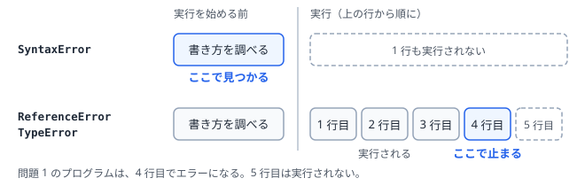
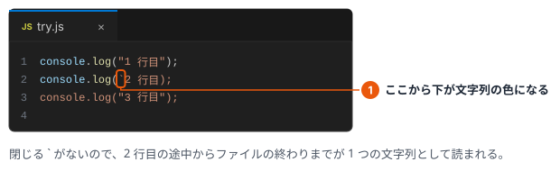

# 基礎編 第3章 エラーを読む

- **この章で学ぶこと**
  - エラーの表示のどこを読むか
  - よく出る 3 種類のエラーの違い
  - エラーが出ないのに結果が違うときの調べ方

この章のコード例は、次のコマンドで実行します（前のコード例は消してから打ちます）。

```sh
node basics/exercises/B03-errors/try.js
```

---

## 3.1 エラーの表示で読む所

エラーの表示は、読む所が決まっています。次の 2 行を実行すると、エラーになります。

```js
const total = 360;
console.log(`合計: ${totl}円`);
```

```
file:///（省略）/basics/exercises/B03-errors/try.js:2
console.log(`合計: ${totl}円`);
                   ^

ReferenceError: totl is not defined
    at file:///（省略）/basics/exercises/B03-errors/try.js:2:20
（この下にも、at で始まる行と、Node.js の版を示す行が続きます）
```

| 順番 | 読む所 | この例 | 分かること |
| --- | --- | --- | --- |
| 1 | 最初の行の末尾 | `try.js:2` | どのファイルの何行目か |
| 2 | 印（`^`） | `totl` の近く | その行のどこか |
| 3 | `at` の行の上 | `ReferenceError: totl is not defined` | エラーの種類と説明 |

この例は、「2 行目の `totl` という名前のものがない」と読めます。1 行目で宣言した名前は `total` なので、つづりの間違いです。

行に日本語があると、印が左にずれて見えることがあります。そのときは、印の近くを見ます。

## 3.2 よく出る 3 種類のエラー

エラーの種類は、説明の前の言葉（`ReferenceError` など）で分かります。よく出るのは次の 3 種類です。

| 種類 | 意味 | よくある原因 |
| --- | --- | --- |
| `SyntaxError` | 書き方の決まりに合わない | `"` や `)` の書き忘れ、全角の記号 |
| `ReferenceError` | その名前を、その行では使えない | つづりの間違い、宣言した行より上で使った |
| `TypeError` | 値の使い方が合わない | `console.lg(...)`、`const` の変数への代入 |

`console.lg is not a function` は `TypeError` です。`console` はありますが、その中に `lg` という命令がありません。`console.log` のつづりを間違えると出ます。

説明ごとの一覧は、章末の「エラーの早見表」にあります。

**種類によって、エラーが見つかる時点が違います。** そのため、エラーより上の行が実行されるかどうかも違います。

| 種類 | 見つかる時点 | エラーより上の行 | エラーより下の行 |
| --- | --- | --- | --- |
| `SyntaxError` | 実行を始める前（ファイルの全体の書き方を調べる所） | 実行されない | 実行されない |
| `ReferenceError`、`TypeError` | その行を実行しようとしたとき | 実行が済んでいる | 実行されない（プログラムがエラーの行で止まる） |

`SyntaxError` は、第0章の 0.5 で見た「1 行も実行されない」エラーです。

## 問題 1：エラーの表示を読む

`basics/exercises/B03-errors/problem-01.js`

```js
const price = 1200;
const count = 3;
console.log(`値段: ${price}円`);
console.log(`個数: ${cont}個`);
console.log(`合計: ${price * count}円`);
```

このファイルを実行すると、次のエラーが表示されます。

```
file:///（省略）/basics/exercises/B03-errors/problem-01.js:4
console.log(`個数: ${cont}個`);
                   ^

ReferenceError: cont is not defined
```

次の ①〜③ に答えてください。③ は、予測してから `node basics/exercises/B03-errors/problem-01.js` を実行します。

- ① エラーが起きたのは、何行目のどの部分か
- ② 原因は何か。どう直せばよいか
- ③ 3 行目の「値段」と、5 行目の「合計」は、それぞれ表示されるか

<details>
<summary>答えと解説</summary>

**① 4 行目の `cont` の部分です。**

最初の行の末尾が `problem-01.js:4` で、印は `cont` の近くにあります。

**② `cont` という名前の変数がありません。`count` に直します。**

`is not defined` は、「その名前のものがない」という意味です。2 行目で宣言した名前は `count` です。

**③ 「値段」は表示され、「合計」は表示されません。**

```
値段: 1200円
file:///（省略）/basics/exercises/B03-errors/problem-01.js:4
（エラーの表示が続きます）
```

エラーは `ReferenceError` なので、4 行目を実行しようとしたときに起きます（3.2）。3 行目までは実行が済んでいて、5 行目は実行されません。



4 行目を直して実行してください。3 行が表示されます。

</details>

## 3.3 エラーが示す行と、原因の行が違うことがある

`` ` `` を閉じ忘れると、エラーが原因の行ではなく、ファイルの終わりを示すことがあります。

```js
console.log("1 行目");
console.log(`2 行目);
console.log("3 行目");
```

```
file:///（省略）/basics/exercises/B03-errors/try.js:4


SyntaxError: Unexpected end of input
```

エラーは、間違いのある 2 行目ではなく、ファイルの終わりの `try.js:4` を示します（最後の行で改行していなければ `:3`）。印（`^`）も出ません。

原因は、2 行目の `` ` `` の閉じ忘れです。閉じる `` ` `` がないので、2 行目の途中からファイルの終わりまでが 1 つの文字列として読まれます。`Unexpected end of input` は、「閉じる記号がないまま、ファイルが終わった」という意味です。

**エラーが示す行に間違いが見つからないときは、その行より上で閉じ忘れを探します。** VS Code では、閉じ忘れた所から下の色が変わります。色が変わり始める行が手がかりです。



`"` と `(` の閉じ忘れは、多くの場合その行自身がエラーになります（第0章の問題 1、第1章の演習 1）。

### 試す

上の 3 行を実行して、エラーを見てください。その後、2 行目を `` console.log(`2 行目`); `` に直して実行します。3 行が表示されます。

## 3.4 エラーが出ないのに、結果が違うとき

書き方が正しくても、計算の内容が間違っていれば違う結果が表示されます。この場合、エラーは出ません。

次のプログラムは、300 円の品物を 4 個買い、送料の 500 円を足した合計を表示します。正しい合計は 1700 円です。

```js
const price = 300;
const count = 4;
let total = price * count;
total = total + 500;
console.log(`合計: ${total}円`); // → 合計: 1700円
```

3 行目を `let total = price + count;` と書き間違えると、表示は `合計: 804円` になります。原因の行は、次の手順で探します。

1. 正しい結果を自分で計算しておく（3 行目の後は `1200`、4 行目の後は `1700`）。
2. 途中の行の下に `console.log(total);` を足して、実際の値を表示する。
3. 自分の計算と違う値が最初に出た行を見直す。

3 行目の下に `console.log(total);` を足すと、`304` が表示されます。`1200` のはずなので、3 行目が原因だと分かります。

第2章の問題 2 で行った「値を追う」と同じ作業です。調べ終わったら、足した `console.log` は消します。

## 問題 2：結果が違う原因を探す

`basics/exercises/B03-errors/problem-02.js`

```js
const price = 800;
const count = 3;
const coupon = 500;

let total = price * count;
total = price - coupon;
console.log(`合計: ${total}円`);
```

800 円の品物を 3 個買い、500 円引きのクーポンを使ったときの合計を表示するプログラムです。正しい合計は 1900 円ですが、`合計: 300円` と表示されます。

5 行目と 6 行目について、「正しく動いた場合の `total`」と「実際の `total`」を表に書き、原因の行を答えてください。実際の値は、`console.log(total);` を足して調べます。

| 行 | コード | 正しく動いた場合の `total` | 実際の `total` |
| --- | --- | --- | --- |
| 5 | `let total = price * count;` | ？ | ？ |
| 6 | `total = price - coupon;` | ？ | ？ |

<details>
<summary>答えと解説</summary>

| 行 | コード | 正しく動いた場合の `total` | 実際の `total` |
| --- | --- | --- | --- |
| 5 | `let total = price * count;` | `2400` | `2400` |
| 6 | `total = price - coupon;` | `1900` | `300` |

**原因は 6 行目です。**

5 行目の後は、どちらも `2400` です。値が違うのは 6 行目の後なので、6 行目を見直します。

6 行目は `price` から `coupon` を引いています。引く相手は、5 行目で計算した小計の `total` です。`total = total - coupon;` に直すと、`合計: 1900円` と表示されます。

</details>

## 3.5 エラーの調べ方

英語の意味が分からないときは、エラーの説明をそのまま検索します。`is not defined` や `Unexpected end of input` のように、決まった言い方の部分を使います。自分で付けた変数の名前は、検索の言葉に入れません。

---

## 演習 1：`SyntaxError` を直す

`basics/exercises/B03-errors/practice-01.js` には、間違いが 2 つあります。直して、次の 3 行を表示するプログラムにします。

```
品物: ノート
値段: 120円
小計: 360円
```

**進め方**

1. 実行して、エラーを読む
   ```sh
   node basics/exercises/B03-errors/practice-01.js
   ```
   - **こうなれば OK**：何行目か（`practice-01.js:` の後ろの数）と、エラーの説明が分かる
2. エラーが示す行を見て直し、保存する
   - 説明の意味は、章末の「エラーの早見表」で探します
   - **こうなれば OK**：画面の上のファイル名の横の ● が消える
3. もう一度実行する
   - 別のエラーが出たら、同じように直します
   ```sh
   node basics/exercises/B03-errors/practice-01.js
   ```
   - **こうなれば OK**：エラーが出なくなる
4. 答え合わせをする
   ```sh
   npm test B03 practice-01
   ```
   - **こうなれば OK**：`演習 1  合格` と表示される

<details>
<summary>ヒント 1：1 つ目のエラー</summary>

`missing )` は、「`)` が足りない」という意味です。エラーが示す行で、`(` と `)` の数を数えます。

</details>

<details>
<summary>ヒント 2：2 つ目のエラー</summary>

エラーは、ファイルの終わりを示します。3.3 と同じエラーです。上の行に戻り、文字列の始まりと終わりの記号が同じかを見比べます。

</details>

<details>
<summary>うまくいかないとき</summary>

| 表示 | よくある原因 |
| --- | --- |
| 直したのに、`missing ) after argument list` が出る | ファイルを保存していないか、`)` を全角の `）` で打っています |
| `小計: ${price * count}円` と、そのまま表示される | 文字列の始まりの `` ` `` を `"` に変えています。変えるのは終わりの記号です |

</details>

解答例：[basics/solutions/B03-errors/practice-01.js](../solutions/B03-errors/practice-01.js)

## 演習 2：`ReferenceError` と `TypeError` を直す

`basics/exercises/B03-errors/practice-02.js` には、間違いが 3 つあります。直して、次の 2 行を表示するプログラムにします。

```
小計: 1800円
送料込み: 2300円
```

**進め方**

1. 実行して、エラーを読む
   ```sh
   node basics/exercises/B03-errors/practice-02.js
   ```
   - **こうなれば OK**：何行目か（`practice-02.js:` の後ろの数）と、エラーの種類が分かる
2. エラーの種類と説明から原因を考えて直し、保存する
   - **こうなれば OK**：画面の上のファイル名の横の ● が消える
3. もう一度実行する
   - 別のエラーが出たら、同じように直します
   ```sh
   node basics/exercises/B03-errors/practice-02.js
   ```
   - **こうなれば OK**：エラーが出なくなる
4. 答え合わせをする
   ```sh
   npm test B03 practice-02
   ```
   - **こうなれば OK**：`演習 2  合格` と表示される

<details>
<summary>ヒント 1：1 つ目のエラー</summary>

`Cannot access 'subtotal' before initialization` は、「宣言した行より上で、`subtotal` を使った」という意味です（第2章の 2.5 の表）。`subtotal` を宣言する行と、表示する行の順番を見ます。

</details>

<details>
<summary>ヒント 2：2 つ目と 3 つ目のエラー</summary>

- `Price is not defined`：その名前の変数がありません。大文字と小文字は区別されます。
- `console.lg is not a function`：3.2 の表の下に、同じエラーの説明があります。

</details>

<details>
<summary>うまくいかないとき</summary>

| 表示 | よくある原因 |
| --- | --- |
| 「実際の表示」に `小計` の行がない | 表示する行を消して、1 つ目のエラーを直しています。消さずに、宣言の行の下へ移します |
| `Identifier 'subtotal' has already been declared` | 行を移すときに、宣言の行が 2 つになっています |
| 「答え合わせが price を 300、count を 2 に変えた場合」が不合格 | `Price` を `450` に書き換えたか、`const Price = 450;` を足しています。`price` に直します |

</details>

解答例：[basics/solutions/B03-errors/practice-02.js](../solutions/B03-errors/practice-02.js)

## 演習 3：結果が違うプログラムを直す

`basics/exercises/B03-errors/practice-03.js` は、1 個 1500 円の品物を 2 個買うときの合計を表示するプログラムです。1 個あたり 200 円の値引きがあり、送料が 500 円かかります。

正しい合計は、(1500 − 200) × 2 + 500 で 3100 円です。エラーは出ませんが、違う合計が表示されます。間違いは 2 つあります。

```
合計: 3100円
```

**進め方**

1. 実行して、表示を見る
   ```sh
   node basics/exercises/B03-errors/practice-03.js
   ```
   - **こうなれば OK**：`合計: 3000500円` と表示される
2. `unit` の行、`total` を宣言した行、送料を足す行の 3 つについて、正しく動いた場合の値を紙に書く
   - **こうなれば OK**：最後の値が `3100` になる
3. 3 つの行の下に `console.log` を足して、保存する
   - かっこの中には、その行で決まる変数を書きます（`unit` の行の下は `console.log(unit);`、ほかの 2 行の下は `console.log(total);`）
   - **こうなれば OK**：画面の上のファイル名の横の ● が消える
4. 実行して、紙の値と比べる
   ```sh
   node basics/exercises/B03-errors/practice-03.js
   ```
   - 違う値が最初に出た行が、直す行です
   - **こうなれば OK**：紙の値と違う値が最初に出た行が分かる
5. その行を直して、保存する
   - 直すのは 1 か所ずつです。直したら手順 4 に戻り、値がすべて紙の値と合うまで繰り返します
   - **こうなれば OK**：足した `console.log` の値が、すべて紙の値と合う
6. 足した `console.log` を消して、保存する
   - **こうなれば OK**：ファイルの `console.log` が、最後の合計の行だけになる
7. 答え合わせをする
   ```sh
   npm test B03
   ```
   - **こうなれば OK**：`結果: この章の演習は、すべて合格です。` と表示される

<details>
<summary>ヒント 1：`total` を宣言した行</summary>

`total` を宣言した行の後に、`console.log(total);` を足します。正しく動いた場合の値は、値引きした後の値段 × 個数で `2600` です。その行のコメントと、式を見比べます。

</details>

<details>
<summary>ヒント 2：送料を足す行</summary>

最初の表示は、合計の後ろに `500` が並んでいます。数が足されずに並ぶときは、どちらかの値が文字列です（第1章の 1.4）。

</details>

<details>
<summary>うまくいかないとき</summary>

| 表示 | よくある原因 |
| --- | --- |
| `合計: 3000500円` | 最初の状態です。送料が文字列としてつながっています |
| `合計: 3500円` | 送料を足す行だけを直した状態です。小計が値引きの前の値段で計算されています |
| `合計: 2600500円` | `total` を宣言した行だけを直した状態です。送料が文字列としてつながっています |
| 表示が 2 行以上ある | 調べるために足した `console.log` が残っています |

</details>

解答例：[basics/solutions/B03-errors/practice-03.js](../solutions/B03-errors/practice-03.js)

---

## エラーの早見表

`price` や `____` の所には、実際の名前が入ります。

| 種類 | 説明 | 意味 | 見直す所 |
| --- | --- | --- | --- |
| `SyntaxError` | `Invalid or unexpected token` | 使えない文字がある | 全角の記号、`"` の閉じ忘れ |
| `SyntaxError` | `missing ) after argument list` | `)` が足りない | `(` と `)` の数、全角の `）`、`+` の書き忘れ |
| `SyntaxError` | `Unexpected end of input` | 閉じる記号がないまま、ファイルが終わった | 上の行の `` ` `` の閉じ忘れ。第4章からは `{` の閉じ忘れも |
| `SyntaxError` | `Identifier 'price' has already been declared` | 同じ名前を 2 回宣言した | `const` や `let` を付けた行 |
| `ReferenceError` | `price is not defined` | その名前のものがない | つづり、大文字と小文字、`"` の書き忘れ |
| `ReferenceError` | `Cannot access 'price' before initialization` | 宣言より上で使った | 行の順番 |
| `TypeError` | `Assignment to constant variable.` | `const` の変数に代入した | 宣言を `let` にするか、代入をやめる |
| `TypeError` | `console.lg is not a function` | 命令として使えない | `console.log` のつづり |

## チェックリスト

- [ ] `SyntaxError` と `ReferenceError`・`TypeError` で、エラーより上の行の扱いが違うことを説明できる
- [ ] エラーが示す行に間違いがないとき、どこを探すかを説明できる
- [ ] 結果が違うときに `console.log` を足して、原因の行を探せる

## 詳しく学ぶ

- MDN：[JavaScript エラーリファレンス](https://developer.mozilla.org/ja/docs/Web/JavaScript/Reference/Errors)（エラーの説明ごとの解説）
