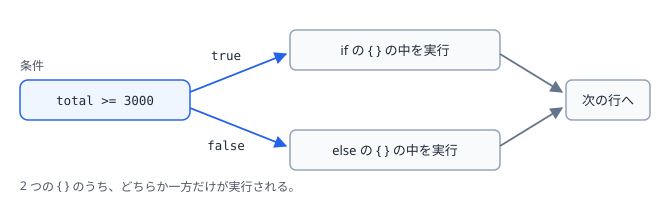
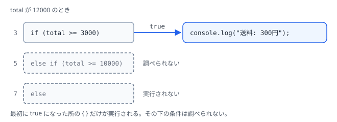

# 基礎編 第4章 条件分岐

- **この章で学ぶこと**
  - 値を比べた結果を表す値（真偽値）
  - 条件に合うときだけ実行する書き方と、合わないときの書き方
  - 複数の条件を組み合わせる書き方

この章のコード例は、次のコマンドで実行します（前のコード例は消してから打ちます）。

```sh
node basics/exercises/B04-conditions/try.js
```

---

## 4.1 真偽値と比較

2 つの値を比べると、結果は `true`（正しい）か `false`（正しくない）のどちらかです。この 2 つの値を**真偽値**と呼びます。

```js
console.log(5 > 3);  // → true
console.log(5 < 3);  // → false
console.log(5 >= 5); // → true
console.log(5 === 5); // → true
console.log(5 !== 5); // → false
```

| 記号 | 意味 |
| --- | --- |
| `>` | 左が右より大きい |
| `<` | 左が右より小さい |
| `>=` | 左が右以上 |
| `<=` | 左が右以下 |
| `===` | 左と右が同じ |
| `!==` | 左と右が違う |

- `>=` と `<=` は、`=` を後ろに書きます。
- 「同じ」は、`=` を 3 つ並べて書きます。`=` が 1 つだと代入です（第2章の 2.3）。
- 文字列も `===` と `!==` で比べられます。
- 数値と文字列は、見た目が同じでも違う値です。`5 === "5"` は `false` です。

```js
const category = "食費";
console.log(category === "食費");   // → true
console.log(category === "交通費"); // → false
```

真偽値も、数値や文字列と同じように変数に入れられます。

```js
const price = 120;
const isCheap = price < 500;
console.log(isCheap); // → true
```

## 4.2 `if`：条件に合うときだけ実行する

`if (条件) { ... }` と書くと、条件が `true` のときだけ、`{ }` の中が実行されます。

```js
const total = 3500;

if (total >= 3000) {
  console.log("送料は無料です");
}
console.log("ご利用ありがとうございます");
// → 送料は無料です
// → ご利用ありがとうございます
```

- 条件は `( )` で囲みます。
- `{ }` の中の行は、空白 2 つ分右にずらします（**字下げ**）。動きは変わりませんが、どこまでが `if` の中かが見やすくなります。
- `if` の `}` の後ろには、`;` を書きません。

### 試す

1 行目を `const total = 2000;` に変えて実行してください。

```
ご利用ありがとうございます
```

### `if` の中で、変数を入れ直す

`if` の中では、外で宣言した変数を使えます。条件に合うときだけ値を変えるには、先に `let` で宣言しておき、`if` の中で入れ直します。

```js
const total = 3500;

let shipping = 500;
if (total >= 3000) {
  shipping = 0;
}
console.log(`送料: ${shipping}円`); // → 送料: 0円
```

## 問題 1：境界の値

`basics/exercises/B04-conditions/problem-01.js`

```js
const total = 3000;

if (total > 3000) {
  console.log("A");
}
if (total >= 3000) {
  console.log("B");
}
if (total === 3000) {
  console.log("C");
}
console.log("D");
```

`node basics/exercises/B04-conditions/problem-01.js` を実行すると、A〜D のうち、どれが表示されるか予測してください。

<details>
<summary>答えと解説</summary>

```
B
C
D
```

**`>` は同じ値を含まず、`>=` は同じ値を含みます。**

| 条件 | `total` が `3000` のとき | 表示 |
| --- | --- | --- |
| `total > 3000` | `false`（3000 は、3000 より大きくない） | されない |
| `total >= 3000` | `true` | B |
| `total === 3000` | `true` | C |

「3000 円以上」は `>=`、「3000 円より大きい」は `>` です。条件を書いたら、ちょうど境界の値（ここでは `3000`）でどうなるかを考えます。

`if` を 3 つ並べると、3 つの条件がそれぞれ別に調べられます。D はどの `{ }` の中でもないので、いつも表示されます。

</details>

## 4.3 `else` と `else if`

`if` の `}` の後ろに `else { ... }` を続けると、条件が `false` のときに実行する内容を書けます。

```js
const total = 2000;

if (total >= 3000) {
  console.log("送料は無料です");
} else {
  console.log("送料は 500 円です");
}
// → 送料は 500 円です
```

2 つの `{ }` のうち、どちらか一方だけが実行されます。



3 つ以上に分けるときは、間に `else if (条件) { ... }` を入れます。

```js
const hour = 15;

if (hour < 12) {
  console.log("午前です");
} else if (hour < 18) {
  console.log("午後です");
} else {
  console.log("夜です");
}
// → 午後です
```

**条件は上から順に調べられ、最初に `true` になった所の `{ }` だけが実行されます。** その後の条件は調べられません。`hour` が `15` のときは、`hour < 12` が `false`、`hour < 18` が `true` なので、`午後です` だけが表示されます。

`else if` は、いくつでも続けられます。最後の `else` は、どの条件にも合わなかったときに実行されます。要らなければ書きません。

範囲が重なる条件は、範囲の狭いほうを先に書きます。`hour < 12` は、`hour < 18` の範囲に含まれる狭い条件です。2 つ目の `hour < 18` が調べられるのは、1 つ目が `false`（12 以上）のときだけです。そのため、「12 以上 18 未満」の意味になります。

### 試す

1 行目の `15` を、`9` と `20` に変えて、それぞれ実行してください。`午前です`、`夜です` と表示されます。`9` は `hour < 18` にも合いますが、表示は `午前です` の 1 行だけです。

## 問題 2：`else if` の順番

`basics/exercises/B04-conditions/problem-02.js`

```js
const total = 12000;

if (total >= 3000) {
  console.log("送料: 300円");
} else if (total >= 10000) {
  console.log("送料: 無料");
} else {
  console.log("送料: 600円");
}
```

このプログラムは、次の決まりで送料を表示するつもりで書かれています。

- 合計が 10000 円以上なら、無料
- 合計が 3000 円以上なら、300 円
- それ以外は、600 円

`total` が `12000` のとき、何が表示されるか予測してください。決まりのとおりに動かす直し方も考えてください。

<details>
<summary>答えと解説</summary>

```
送料: 300円
```

**先に書いた `total >= 3000` が `true` になるので、そこの `{ }` だけが実行されます。**

`12000` は 10000 以上ですが、3000 以上でもあります。条件は上から順に調べられるので（4.3）、2 つ目の条件は調べられません。このままでは、「送料: 無料」は表示されません。



直すには、2 つの条件の順番を、`{ }` の中身ごと入れ替えます。範囲の狭い `total >= 10000` を先に書きます（4.3）。

```js
const total = 12000;

if (total >= 10000) {
  console.log("送料: 無料");
} else if (total >= 3000) {
  console.log("送料: 300円");
} else {
  console.log("送料: 600円");
}
// → 送料: 無料
```

</details>

## 4.4 条件を組み合わせる

2 つの条件は、`&&`（かつ）と `||`（または）で組み合わせられます。`!` は、`true` と `false` を逆にします。

`|` は、日本語のキーボードでは `Shift` を押しながら `¥`、英語のキーボードでは `Shift` を押しながら `\` で打てます。

```js
const total = 4000;
const isMember = true;

if (total >= 3000 && isMember) {
  console.log("会員の送料無料です");
}
// → 会員の送料無料です
```

| 書き方 | 読み方 | `true` になるとき |
| --- | --- | --- |
| `A && B` | A かつ B | A と B が両方とも `true` |
| `A \|\| B` | A または B | A と B のどちらかが `true`（両方でもよい） |
| `!A` | A ではない | A が `false` |

`isMember` のように真偽値が入った変数は、そのまま条件に書けます。`isMember === true` と書く必要はありません。

## 問題 3：条件の組み合わせ

`basics/exercises/B04-conditions/problem-03.js`

```js
const total = 2500;
const isMember = true;

console.log(total >= 3000 && isMember); // ①
console.log(total >= 3000 || isMember); // ②
console.log(!isMember);                 // ③

if (total >= 1000 && total < 3000) {
  console.log("1000 円以上、3000 円未満です"); // ④
}
```

①〜③ でそれぞれ何が表示されるか、④ の行が表示されるかを予測してください。

<details>
<summary>答えと解説</summary>

```
false
true
false
1000 円以上、3000 円未満です
```

先に、それぞれの条件を `true` か `false` に置き換えます。`total >= 3000` は `false`、`isMember` は `true` です。

**① `&&` は、両方が `true` のときだけ `true` です。**

`false && true` なので、`false` です。

**② `||` は、どちらかが `true` なら `true` です。**

`false || true` なので、`true` です。

**③ `!` は、`true` と `false` を逆にします。**

`!true` なので、`false` です。

**④ 範囲は、2 つの比較を `&&` でつないで書きます。**

`total >= 1000` も `total < 3000` も `true` です。`true && true` なので、表示されます。

`1000 <= total < 3000` と続けて書いても、エラーにはなりませんが、正しく比べられません（`total` が `5000` でも `true` になります）。比べるのは左から 1 つずつなので、先に `1000 <= total` が `true` か `false` になり、次にその真偽値と `3000` を比べます。`3000` と比べるとき、`true` は `1`、`false` は `0` として扱われます。どちらも `3000` より小さいので、結果はいつも `true` です。

</details>

## 4.5 `=` と `===` の取り違え

条件の中で、`===` のつもりで `=` と書く間違いはよく起きます。

```js
let count = 0;

if (count = 5) {
  console.log("5 個です");
}
console.log(count);
// → 5 個です
// → 5
```

`count` は `0` なのに、「5 個です」と表示されました。`count = 5` は比較ではなく代入なので、`count` に `5` が入ります。条件には、入れた値の `5` が使われます。

条件の中では、代入した `5` は `true` として扱われます（真偽値でない値が条件でどう扱われるかは、第9章のコラムにあります）。

`if` の行に `TypeError: Assignment to constant variable.` が出たら、条件の `=` を `===` に直します。`const` の変数に条件の中で代入すると、このエラーが出ます。`let` の変数ではエラーが出ないので、気づきにくい間違いです。

---

## 演習 1：間違いを直す

`basics/exercises/B04-conditions/practice-01.js` は、家計簿の記録が交通費かどうかを表示するプログラムです。間違いが 2 つあります。直して、次のように表示させます。

```
交通費以外の記録です
食費: 1200円
```

**進め方**

1. 実行して、エラーを読む
   ```sh
   node basics/exercises/B04-conditions/practice-01.js
   ```
   - **こうなれば OK**：何行目か（`practice-01.js:` の後ろの数）と、エラーの説明が分かる
2. 原因を見つけて直し、保存する
   - 足りない記号は、ファイルの最後ではなく、その `{ }` の中に入れたい最後の行のすぐ下に足します
   - **こうなれば OK**：画面の上のファイル名の横の ● が消える
3. もう一度実行する
   - 別のエラーが出たら、同じように直します
   ```sh
   node basics/exercises/B04-conditions/practice-01.js
   ```
   - **こうなれば OK**：エラーが出なくなる
4. 答え合わせをする
   ```sh
   npm test B04 practice-01
   ```
   - **こうなれば OK**：`演習 1  合格` と表示される

<details>
<summary>ヒント 1：1 つ目のエラー</summary>

`Unexpected end of input` は、「閉じる記号がないまま、ファイルが終わった」という意味です（第3章の 3.3）。`{` と `}` の数を数えます。2 つ目の `if` の `{ }` が、どこで終わるはずかを考えます。

</details>

<details>
<summary>ヒント 2：2 つ目のエラー</summary>

エラーが示す行の条件を見ます。4.5 と同じ間違いです。

</details>

<details>
<summary>うまくいかないとき</summary>

| 表示 | よくある原因 |
| --- | --- |
| 「答え合わせが category を "交通費"、amount を 480 に変えた場合」で、`交通費: 480円` が表示されない | `}` をファイルの最後に足しています。最後の行が、2 つ目の `if` の `{ }` の中に入っています |
| `交通費の記録です` と `交通費: 1200円` が表示される | `category` の行の `const` を `let` に変えて、エラーを消しています。直すのは条件の `=` です |
| `SyntaxError: Unexpected token '='` | `= = =` のように、`=` の間に空白が入っています |
| 「=== で比べる」が不合格 | `==` と書いています。`=` は 3 つです |

</details>

解答例：[basics/solutions/B04-conditions/practice-01.js](../solutions/B04-conditions/practice-01.js)

## 演習 2：送料を決める

送料は 500 円です。合計が 3000 円以上か会員なら 0 円です。`basics/exercises/B04-conditions/practice-02.js` の `____` を書き換えて、送料と支払いの金額を表示するプログラムにします。

```
送料: 500円
支払い: 3300円
```

**進め方**

1. `basics/exercises/B04-conditions/practice-02.js` を開き、4 か所の `____` を書き換える
   - **こうなれば OK**：コメント以外の行に `____` が残っていない
2. 実行する
   ```sh
   node basics/exercises/B04-conditions/practice-02.js
   ```
   - **こうなれば OK**：上の表示と同じになる
3. `total` の値を `3000` に変えて、実行する
   ```sh
   node basics/exercises/B04-conditions/practice-02.js
   ```
   - **こうなれば OK**：`送料: 0円` と表示される
4. `total` の値を `2800` に戻して、保存する
   - **こうなれば OK**：`const total = 2800;` の行に戻り、ファイル名の横の ● が消える
5. 答え合わせをする
   ```sh
   npm test B04 practice-02
   ```
   - **こうなれば OK**：`演習 2  合格` と表示される

<details>
<summary>ヒント</summary>

- `if` の行の 1 つ目：「3000 円以上」を表す記号です（4.1 の表）。
- `if` の行の 2 つ目：「〜か、〜なら」を表す記号です（4.4 の表）。
- `shipping` の行：条件に合うときの送料です。
- 最後の行：支払いは、合計に送料を足したものです。

</details>

<details>
<summary>うまくいかないとき</summary>

| 表示 | よくある原因 |
| --- | --- |
| 「そのまま実行する」で `支払い: 3000円` | 試すために変えた `total` の値を、`2800` に戻していません |
| 「答え合わせが total を 3000 に変えた場合」が不合格 | 1 つ目が `>` か、2 つ目が `&&` です。`3000` ちょうどを含むのは `>=`、「〜か〜なら」は `\|\|` です |
| 「答え合わせが total を 3001 に変えた場合」が不合格 | 1 つ目が `===` です。3000 円より多いときも無料にするには、`>=` を使います |
| 「そのまま実行する」で `送料: 0円` | `>=` を `=>` と書いています。`=` は後ろです。この間違いはエラーになりません |

</details>

解答例：[basics/solutions/B04-conditions/practice-02.js](../solutions/B04-conditions/practice-02.js)

## 演習 3：残高の状態を表示する

残高に合わせて、次の 4 つの言葉のどれか 1 つを表示します。

| 残高 | 表示 |
| --- | --- |
| 10000 円以上 | `余裕があります` |
| 3000 円以上、10000 円未満 | `普通です` |
| 0 円以上、3000 円未満 | `残りわずかです` |
| 0 円未満 | `赤字です` |

**進め方**

1. `basics/exercises/B04-conditions/practice-03.js` を開き、書いてある 1 つ目の条件の `}` の後ろに、`else if` と `else`（4.3）を続ける
   - **こうなれば OK**：`console.log` の行が 4 つになる
2. 実行する
   ```sh
   node basics/exercises/B04-conditions/practice-03.js
   ```
   - **こうなれば OK**：`残りわずかです` と表示される
3. 答え合わせをする
   - 答え合わせは、元の値のほかに、`balance` を 5 通りの値に変えても検査します
   ```sh
   npm test B04 practice-03
   ```
   - **こうなれば OK**：`演習 3  合格` と表示される

<details>
<summary>ヒント</summary>

もとからある `}` の後ろに `else if (条件) {` を続けて、`} else if (条件) {` の形にします。条件は上から順に調べられるので、2 つ目の条件に「10000 円未満」を書く必要はありません（4.3）。最後の「0 円未満」は、どの条件にも合わなかった場合なので、`else` で書けます。

</details>

<details>
<summary>うまくいかないとき</summary>

| 表示 | よくある原因 |
| --- | --- |
| 「答え合わせが balance を 10000 に変えた場合」で、2 行以上が表示される | `else if` ではなく `if` を並べています。`if` を並べると、条件がそれぞれ別に調べられます（問題 1） |
| 「答え合わせが balance を 3000 に変えた場合」や「0 に変えた場合」が不合格 | `>=` ではなく `>` で比べています |
| `SyntaxError: Unexpected token '{'` | `else` の後ろに条件を書いているか、`elseif` と続けて書いています。条件を書くのは `else if` で、間に空白が要ります |
| `SyntaxError: Unexpected token '}'` | `}` を 2 つ書いています。`else if` は、もとからある `}` の後ろに続けます |
| `SyntaxError: Unexpected identifier 'balance'` | 条件を `( )` で囲んでいません |

</details>

解答例：[basics/solutions/B04-conditions/practice-03.js](../solutions/B04-conditions/practice-03.js)

## 演習 4：予算内かどうかを表示する

予算と使った金額が、変数に入っています。使った金額が予算以下なら、「予算内です」と残りの金額を表示します。予算を超えていたら、「予算オーバーです」と超えた金額を表示します。

| `budget` | `spent` | 表示 |
| --- | --- | --- |
| `30000` | `32500` | `予算オーバーです`<br>`超えた金額: 2500円` |
| `30000` | `28000` | `予算内です`<br>`残り: 2000円` |
| `20000` | `20000` | `予算内です`<br>`残り: 0円` |

**進め方**

1. `basics/exercises/B04-conditions/practice-04.js` の 2 つの変数の宣言の下に、予算内の場合と予算オーバーの場合に分けて、それぞれ 2 行を表示する処理を書く
   - 金額は `30000` と書かず、`budget` と `spent` を使います
   - **こうなれば OK**：`console.log` の行が 4 つになる
2. 実行する
   ```sh
   node basics/exercises/B04-conditions/practice-04.js
   ```
   - **こうなれば OK**：上の表の 1 行目と同じ表示になる
3. `spent` の値を `28000` に変えて、実行する
   ```sh
   node basics/exercises/B04-conditions/practice-04.js
   ```
   - **こうなれば OK**：上の表の 2 行目と同じ表示になる
4. `spent` の値を `32500` に戻して、保存する
   - **こうなれば OK**：`const spent = 32500;` の行に戻り、ファイル名の横の ● が消える
5. 答え合わせをする
   ```sh
   npm test B04
   ```
   - **こうなれば OK**：`結果: この章の演習は、すべて合格です。` と表示される

<details>
<summary>ヒント 1：全体の形</summary>

2 つに分かれるので、`if` と `else` を使います。`{ }` の中には、行をいくつでも書けます。

</details>

<details>
<summary>ヒント 2：書き出し</summary>

```js
if (spent <= budget) {
  console.log("予算内です");
  ...
} else {
  ...
}
```

</details>

<details>
<summary>うまくいかないとき</summary>

| 表示 | よくある原因 |
| --- | --- |
| `超えた金額: -2500円` | 引く順番が逆です。超えた金額は、使った金額から予算を引きます |
| 「答え合わせが budget を 20000、spent を 20000 に変えた場合」が不合格 | `<=` ではなく `<` で比べています。同じ金額は予算内です |
| 「そのまま実行する」で `予算内です` | 試すために変えた `spent` の値を、`32500` に戻していません |
| 「答え合わせが budget を 20000、spent を 21000 に変えた場合」が不合格 | 条件か計算に `30000` を直接書いています。`budget` を使います |

</details>

解答例：[basics/solutions/B04-conditions/practice-04.js](../solutions/B04-conditions/practice-04.js)

---

## チェックリスト

- [ ] `>` と `>=` の違いを説明できる
- [ ] `=` と `===` の違いを説明できる
- [ ] `else if` を並べたときに、条件が調べられる順番を説明できる

## 詳しく学ぶ

- JavaScript Primer：[条件分岐](https://jsprimer.net/basic/condition/)
