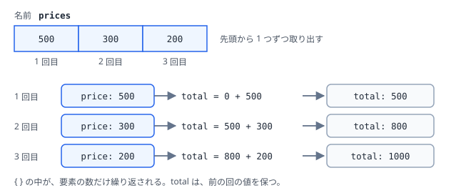

# 基礎編 第5章 配列と繰り返し

- **この章で学ぶこと**
  - 複数の値を 1 つの変数にまとめて持つ
  - 同じ処理を値の数だけ繰り返す
  - 繰り返しの中で、変数の値がどう変わるか

この章のコード例は、次のコマンドで実行します（前のコード例は消してから打ちます）。

```sh
node basics/exercises/B05-arrays-loops/try.js
```

---

## 5.1 配列：値を並べて持つ

`[ ]` の中に値を `,` で区切って並べると、複数の値を 1 つにまとめられます。これを**配列**と呼びます。配列の中の 1 つ 1 つの値を**要素**と呼びます。

```js
const prices = [120, 80, 300];
console.log(prices);        // → [ 120, 80, 300 ]
console.log(prices[0]);     // → 120
console.log(prices.length); // → 3
```

- 要素は `配列[番号]` で取り出します。**番号は 0 から始まります。** 最初の要素は `prices[0]`、2 つ目は `prices[1]` です。
- `配列.length` は要素の数です。`prices.length` は、「`prices` の `length`」と読みます。
- `[ ]` の中には、`prices[3 - 1]` のように式も書けます。式を計算し、その番号の要素を取り出します。

![変数 prices に入った配列に、120、80、300 の 3 つの要素が並んでいる。番号は左から 0、1、2 で、prices[0] が 120、prices[1] が 80、prices[2] が 300。prices.length は 3。](images/B05-array.svg "図5-1 配列は、番号の付いた要素の並び")

### 試す

2 行目の下に `console.log(prices[2]);` を足して実行してください。

`300` が表示されます。3 つ目の要素の番号は、`3` ではなく `2` です。

### 要素がない番号

要素がない番号で取り出すと、エラーにはならず、`undefined` になります。`undefined` は、「値がない」ことを表す値です。

```js
const prices = [120, 80, 300];
console.log(prices[10]); // → undefined
```

表示や計算の結果に `undefined` が出てきたら、番号がずれていないかを見直します。

### 文字列の配列

配列には文字列も入れられます。

```js
const names = ["りんご", "みかん"];
console.log(names); // → [ 'りんご', 'みかん' ]
```

配列を表示すると、文字列が `'` で囲まれます。`"` と同じ意味です。

## 問題 1：番号で取り出す

`basics/exercises/B05-arrays-loops/problem-01.js`

```js
const names = ["りんご", "みかん", "ぶどう"];

console.log(names[1]);                // ①
console.log(names.length);            // ②
console.log(names[names.length]);     // ③
console.log(names[names.length - 1]); // ④
```

`node basics/exercises/B05-arrays-loops/problem-01.js` を実行すると、①〜④ でそれぞれ何が表示されるか予測してください。

<details>
<summary>答えと解説</summary>

```
みかん
3
undefined
ぶどう
```

**① 番号は 0 から数えるので、`names[1]` は 2 つ目の要素の `"みかん"` です。**

**② `length` は要素の数なので、`3` です。**

**③ `names[names.length]` は `names[3]` なので、`undefined` です。**

要素は 3 つなので、番号は `0` から `2` までです。要素の数と同じ番号には、要素がありません。

**④ 最後の要素の番号は、`length - 1` です。**

`names[names.length - 1]` は `names[2]` として計算されるので、`"ぶどう"` です。

</details>

## 5.2 要素を足す、入れ直す

`配列.push(値)` で、配列の最後に要素を足せます。`配列[番号] = 値` で、その番号の要素を入れ直せます。`.push(...)` は、「この配列に対して、`push` を行う」という書き方です。

```js
const prices = [120, 80];
prices.push(300);
console.log(prices); // → [ 120, 80, 300 ]
prices[0] = 150;
console.log(prices); // → [ 150, 80, 300 ]
```

`prices` は `const` で宣言していますが、中の要素は変えられます。`const` でできないのは、`prices = [1, 2];` のように、変数に別の配列を入れ直すことです。

### 試す

最後の行の下に、次の 2 行を足して実行してください。

```js
prices.push(500);
console.log(prices.length);
```

`4` が表示されます。`push` のたびに、要素の数が 1 つ増えます。

## 5.3 `for...of`：要素の数だけ繰り返す

`for (const 名前 of 配列) { ... }` と書くと、配列の要素を先頭から 1 つずつ取り出して、`{ }` の中を繰り返し実行します。`{ }` と字下げの書き方は、`if` と同じです。

```js
const prices = [120, 80, 300];
for (const price of prices) {
  console.log(`${price}円`);
}
console.log("終わり");
// → 120円
// → 80円
// → 300円
// → 終わり
```

`{ }` の中は、要素の数と同じ 3 回実行されます。最後の要素まで終わると、`}` の次の行に進みます。

| 回 | `price` |
| --- | --- |
| 1 回目 | `120` |
| 2 回目 | `80` |
| 3 回目 | `300` |

`price` は回ごとに新しく作られます。`{ }` の中で入れ直さないので、`const` で書けます。

### 試す

1 行目の配列に、要素を 1 つ足して実行してください（例：`[120, 80, 300, 500]`）。

表示は 5 行に増えます。繰り返しの回数は、配列の要素の数で決まります。`for` の行と `{ }` の中は、書き換えていません。

## 問題 2：値を追う

`basics/exercises/B05-arrays-loops/problem-02.js`

```js
const prices = [500, 300, 200];
let total = 0;
for (const price of prices) {
  total = total + price;
}
console.log(total);
```

繰り返しの回ごとに、`price` の値と、4 行目を実行した後の `total` の値を表に書いてください。最後に、6 行目で何が表示されるかを答えてください。

| 回 | その回の `price` | 4 行目を実行した後の `total` |
| --- | --- | --- |
| （繰り返しの前） | － | `0` |
| 1 回目 | ？ | ？ |
| 2 回目 | ？ | ？ |
| 3 回目 | ？ | ？ |

<details>
<summary>答えと解説</summary>

| 回 | その回の `price` | 4 行目を実行した後の `total` |
| --- | --- | --- |
| （繰り返しの前） | － | `0` |
| 1 回目 | `500` | `500` |
| 2 回目 | `300` | `800` |
| 3 回目 | `200` | `1000` |

6 行目では、`1000` が表示されます。

**繰り返しの外で宣言した変数は、回が変わっても値を保ちます。**

`total` は、繰り返しの前の 2 行目で 1 回だけ宣言されています。4 行目は 3 回実行されます。そのたびに、前の回までの `total` に、その回の `price` が足されます。



途中の値は、`console.log` を足せば見られます。4 行目の下に `console.log(total);` を足して実行してください。繰り返しの中で `500`、`800`、`1000` が 1 行ずつ表示され、最後の `console.log(total);` で `1000` が表示されます。

</details>

## 5.4 よく使う形

繰り返しの使い方には、決まった形があります。繰り返しの前に変数を用意し、繰り返しの中でその変数の値を変えていきます。

### 合計する

問題 2 の形です。`0` から始めて、要素を足していきます。

### 数える

`0` から始めて、条件に合うときだけ `1` を足します。繰り返しの中に `if` を書きます。

```js
const prices = [500, 1200, 300, 2000];
let count = 0;
for (const price of prices) {
  if (price >= 1000) {
    count = count + 1;
  }
}
console.log(count); // → 2
```

### いちばん大きい値を探す

最初の要素を `max` に入れ、今の `max` より大きい要素が出てきたら入れ直します。

```js
const prices = [500, 1200, 300, 2000];
let max = prices[0];
for (const price of prices) {
  if (price > max) {
    max = price;
  }
}
console.log(max); // → 2000
```

### あるかどうかを調べる

`false` から始めて、探している値が出てきたら `true` に入れ直します。

```js
const names = ["りんご", "みかん", "ぶどう"];
let found = false;
for (const name of names) {
  if (name === "みかん") {
    found = true;
  }
}
console.log(found); // → true
```

### 集める

**空の配列**（要素が 1 つもない配列。`[]` と書く）から始めて、条件に合う要素を `push` で足します。

```js
const prices = [500, 1200, 300, 2000];
const expensive = [];
for (const price of prices) {
  if (price >= 1000) {
    expensive.push(price);
  }
}
console.log(expensive); // → [ 1200, 2000 ]
```

| 形 | 繰り返しの前 | 繰り返しの中 |
| --- | --- | --- |
| 合計する | `let total = 0;` | `total = total + price;` |
| 数える | `let count = 0;` | 条件に合うとき `count = count + 1;` |
| いちばん大きい値 | `let max = prices[0];` | `price > max` のとき `max = price;` |
| あるかどうか | `let found = false;` | 見つけたとき `found = true;` |
| 集める | `const expensive = [];` | 条件に合うとき `expensive.push(price);` |

### 試す

「いちばん大きい値を探す」の例を実行した後、6 行目（`if` を閉じる `}`）の下に `console.log(max);` を足して実行してください。

`500`、`1200`、`1200`、`2000` と表示され、最後にもう一度 `2000` が表示されます。3 回目は `300` が `1200` より小さいので、`max` は入れ直されません。

## 5.5 `{ }` の中で宣言した変数

**`{ }` の中で宣言した変数は、その `{ }` の中だけで使えます。** 繰り返しの `{ }` の中で宣言した変数は、回ごとに新しく作られます。

```js
const names = ["りんご", "みかん"];
for (const name of names) {
  const label = `${name}を買う`;
  console.log(label);
}
// → りんごを買う
// → みかんを買う
```

`}` の下に `console.log(label);` と書くと、`ReferenceError: label is not defined` になります。`if` の `{ }` でも同じです。

## 問題 3：変数を宣言する場所

`basics/exercises/B05-arrays-loops/problem-03.js`

```js
const prices = [500, 300, 200];
for (const price of prices) {
  let total = 0;
  total = total + price;
  console.log(total);
}
```

問題 2 との違いは、`total` の宣言と表示が `{ }` の中にあることです。

`node basics/exercises/B05-arrays-loops/problem-03.js` を実行すると、何が表示されるか予測してください。問題 2 のように、回ごとの値を表に書くと考えやすくなります。

<details>
<summary>答えと解説</summary>

```
500
300
200
```

**`total` は回ごとに新しく作られ、`0` から始まります。**

3 行目の `let total = 0;` が、毎回実行されます。前の回の値は残らないので、合計になりません。

| 回 | その回の `price` | 3 行目を実行した後の `total` | 4 行目を実行した後の `total` |
| --- | --- | --- | --- |
| 1 回目 | `500` | `0` | `500` |
| 2 回目 | `300` | `0` | `300` |
| 3 回目 | `200` | `0` | `200` |

回をまたいで値を持ち続ける変数は、問題 2 のように、繰り返しの前で宣言します。

</details>

## 5.6 番号で繰り返す `for`

番号を `0` から 1 ずつ増やしながら繰り返す書き方もあります。すでにあるコードによく出るので、読めるようにします。

```js
const prices = [120, 80, 300];
for (let i = 0; i < prices.length; i++) {
  console.log(prices[i]);
}
// → 120
// → 80
// → 300
```

`for` の `( )` の中は、`;` で 3 つに分かれます。

| 部分 | 実行されるとき | 意味 |
| --- | --- | --- |
| `let i = 0` | 最初に 1 回 | 番号の変数 `i` を `0` から始める |
| `i < prices.length` | 毎回、`{ }` の中の前 | `true` の間、繰り返す |
| `i++` | 毎回、`{ }` の中の後 | `i` を 1 増やす（`i = i + 1` と同じ） |

`i` は `0`、`1`、`2` と変わり、`3` になると `i < prices.length` が `false` になって終わります。`i` は入れ直すので、`let` で宣言します。

要素だけが要るときは、番号を使わない `for...of`（5.3）で書きます。

### 試す

2 行目の `i < prices.length` を `i <= prices.length` に変えて実行してください。

```
120
80
300
undefined
```

最後の回は `i` が `3` なので、要素がない `prices[3]` を取り出しています（5.1）。

---

## 演習 1：間違いを直す

`basics/exercises/B05-arrays-loops/practice-01.js` は、値段の合計と、最後の要素を表示するプログラムです。間違いが 2 つあります。直して、次のように表示させます。

```
合計: 5000円
最後: 3000円
```

**進め方**

1. 実行して、エラーを読む
   ```sh
   node basics/exercises/B05-arrays-loops/practice-01.js
   ```
   - **こうなれば OK**：何行目か（`practice-01.js:` の後ろの数）と、エラーの説明が分かる
2. 原因を見つけて直し、保存する
   - **こうなれば OK**：画面の上のファイル名の横の ● が消える
3. もう一度実行して、表示を上の 2 行と見比べる
   - 2 つ目の間違いはエラーになりません。表示の違いから探して直します
   ```sh
   node basics/exercises/B05-arrays-loops/practice-01.js
   ```
   - **こうなれば OK**：上の 2 行と同じ表示になる
4. 答え合わせをする
   ```sh
   npm test B05 practice-01
   ```
   - **こうなれば OK**：`演習 1  合格` と表示される

<details>
<summary>ヒント 1：1 つ目の間違い</summary>

```
ReferenceError: total is not defined
```

エラーが示すのは表示の行です。直す所は、`total` を宣言している行です。`{ }` の中で宣言した変数は、`}` より下では使えません（5.5）。

</details>

<details>
<summary>ヒント 2：2 つ目の間違い</summary>

`最後: undefined円` と表示されます。`undefined` は、要素がない番号で取り出したときの値です。最後の要素の番号は、問題 1 の ④ にあります。

</details>

<details>
<summary>うまくいかないとき</summary>

| 表示 | よくある原因 |
| --- | --- |
| `合計: 1200円`、`合計: 800円`、`合計: 3000円` と 3 行出る | 表示の行を `{ }` の中に移しています。移すのは、`total` を宣言している行です |
| `合計: 0円` | `let total = 0;` が、繰り返しの前と `{ }` の中の両方にあります。`{ }` の中のほうを消します |
| 「答え合わせが prices を [500, 200] に変えた場合」で `最後: undefined円` | `prices[2]` と番号を直接書いています。要素の数が変わっても動くように、`length` を使います |
| `最後: NaN円` | `- 1` を `[ ]` の外に書いています。`prices[prices.length - 1]` と、`[ ]` の中に書きます（`NaN` は、計算できなかったときに出る値です。第6章で説明します） |

</details>

解答例：[basics/solutions/B05-arrays-loops/practice-01.js](../solutions/B05-arrays-loops/practice-01.js)

## 演習 2：合計を計算する

`basics/exercises/B05-arrays-loops/practice-02.js` の `____` を書き換えて、金額の合計を表示するプログラムにします。

```
合計: 5450円
```

**進め方**

1. `basics/exercises/B05-arrays-loops/practice-02.js` を開き、4 か所の `____` を書き換える
   - **こうなれば OK**：コメント以外の行に `____` が残っていない
2. 実行する
   ```sh
   node basics/exercises/B05-arrays-loops/practice-02.js
   ```
   - **こうなれば OK**：上の表示と同じになる
3. 答え合わせをする
   ```sh
   npm test B05 practice-02
   ```
   - **こうなれば OK**：`演習 2  合格` と表示される

<details>
<summary>ヒント</summary>

問題 2 のコードと同じ形です。変数の名前が違います。

- 繰り返す配列は `amounts`、1 回ごとの要素は `amount` です。
- 合計は `0` から始めます。

</details>

<details>
<summary>うまくいかないとき</summary>

| 表示 | よくある原因 |
| --- | --- |
| `ReferenceError: Cannot access 'amount' before initialization` | `for` の行で、`of` の後ろに `amount` と書いています。繰り返す配列は `amounts` です |
| `合計: 900円` | `total = amount + amount;` と書いています。前の回までの `total` に足します |
| `合計: 01200,800,…` と、長い表示になる | `total + amounts` と配列を足しています。足すのは、1 回ごとの要素の `amount` です |

</details>

解答例：[basics/solutions/B05-arrays-loops/practice-02.js](../solutions/B05-arrays-loops/practice-02.js)

## 演習 3：条件に合う要素を数える

1000 円以上（ちょうど 1000 円も含む）の金額が何件あるかを数えて表示します。

```
1000円以上: 3件
```

**進め方**

1. `basics/exercises/B05-arrays-loops/practice-03.js` を開き、`for` の `{ }` の中を書く（繰り返しの外側は書いてあります）
   - 使う書き方は、数える形（5.4）：条件に合うときだけ、`count = count + 1;`
   - **こうなれば OK**：`for` の `{ }` の中に、`if` とその `{ }` がある
2. 実行する
   ```sh
   node basics/exercises/B05-arrays-loops/practice-03.js
   ```
   - **こうなれば OK**：上の表示と同じになる
3. 答え合わせをする
   ```sh
   npm test B05 practice-03
   ```
   - **こうなれば OK**：`演習 3  合格` と表示される

<details>
<summary>ヒント</summary>

`{ }` の中に書くのは、`if` です。条件は「`amount` が 1000 以上」、条件に合うときにすることは「`count` を 1 増やす」です。

</details>

<details>
<summary>うまくいかないとき</summary>

| 表示 | よくある原因 |
| --- | --- |
| `1000円以上: 2件` | 条件を `amount > 1000` と書いています。ちょうど 1000 円を入れるには、`>=` を使います |
| `1000円以上: 5件` | `if` を書かずに、毎回 `count` を増やしています |
| `1000円以上: 5200件` | `count + amount` と金額を足しています。数えるときに足すのは `1` です |
| `1000円以上: 0件` | `count + 1;` と書いて、`count` に入れ直していません。`count = count + 1;` と書きます |
| `SyntaxError: Unexpected end of input` | `}` が足りません。`if` の `}` と、`for` の `}` の 2 つが要ります |

</details>

解答例：[basics/solutions/B05-arrays-loops/practice-03.js](../solutions/B05-arrays-loops/practice-03.js)

## 演習 4：いちばん安い値段を探す

値段の配列から、いちばん安い値段を探して表示します。

```
いちばん安い: 450円
```

**進め方**

1. `basics/exercises/B05-arrays-loops/practice-04.js` の、配列の宣言の下に、いちばん安い値段を探して表示する処理を書く
   - 配列には、要素が 1 つ以上あるものとします
   - 5.4 の「いちばん大きい値」の形で書けます。小さいほうを探すので、比べる記号は `>` ではなく `<` にします
   - **こうなれば OK**：`for` の `}` の下に、表示する行がある
2. 実行する
   ```sh
   node basics/exercises/B05-arrays-loops/practice-04.js
   ```
   - **こうなれば OK**：上の表示と同じになる
3. 答え合わせをする
   ```sh
   npm test B05
   ```
   - **こうなれば OK**：`結果: この章の演習は、すべて合格です。` と表示される

<details>
<summary>ヒント 1：何から始めるか</summary>

5.4 の `max` と同じく、配列の最初の要素から始めます。`0` のような決めた数から始めると、正しく探せません。

</details>

<details>
<summary>ヒント 2：書き出し</summary>

```js
let min = prices[0];
for (const price of prices) {
```

`min` は、「いちばん小さい」という意味の名前です。

</details>

<details>
<summary>うまくいかないとき</summary>

| 表示 | よくある原因 |
| --- | --- |
| `いちばん安い: 0円`、または「答え合わせが prices を [200000, 150000] に変えた場合」が不合格 | `let min = 0;` や `let min = 99999;` のように、決めた数から始めています。最初の要素から始めます |
| `いちばん安い: 3000円` | 比べる向きが逆です。「`price` が `min` より小さいとき」に入れ直します |
| `いちばん安い: …` が 4 行出る | 表示の行が `for` の `{ }` の中にあります。`}` の下に書きます |
| `TypeError: Assignment to constant variable.` | `min` を `const` で宣言しています。入れ直す変数は、`let` で宣言します |

</details>

解答例：[basics/solutions/B05-arrays-loops/practice-04.js](../solutions/B05-arrays-loops/practice-04.js)

---

## チェックリスト

- [ ] 最後の要素の番号が `length - 1` になる理由を説明できる
- [ ] 繰り返しの回ごとの変数の値を、表に書いて追える
- [ ] 問題 2 と問題 3 で表示が違う理由を説明できる

## 詳しく学ぶ

- JavaScript Primer：[配列](https://jsprimer.net/basic/array/)、[ループと反復処理](https://jsprimer.net/basic/loop/)
