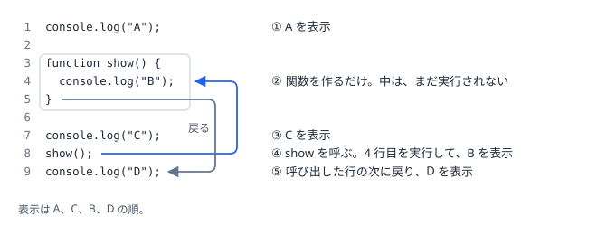
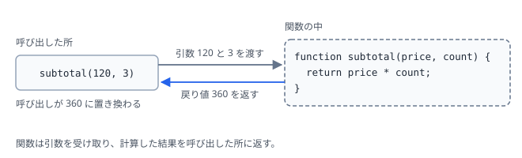
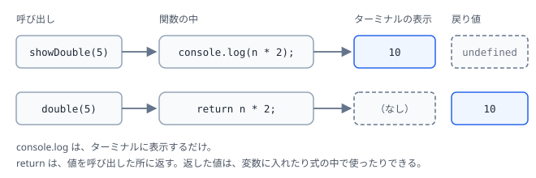
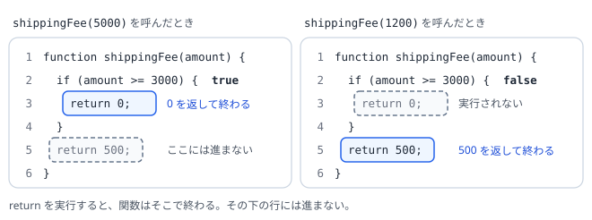

# 基礎編 第6章 関数

- **この章で学ぶこと**
  - 処理に名前を付けて、何度も使う
  - 関数に値を渡し、結果を受け取る
  - `return` と `console.log` の違い

この章のコード例は、次のコマンドで実行します（前のコード例は消してから打ちます）。

```sh
node basics/exercises/B06-functions/try.js
```

---

## 6.1 関数を作って呼ぶ

**関数**は、ひとまとまりの処理に名前を付けたものです。`function 名前() { 処理 }` の形で作ります。これを、関数を**宣言する**と言います。

```js
function greet() {
  console.log("こんにちは");
}

greet();
greet();
// → こんにちは
// → こんにちは
```

`greet();` のように、名前の後ろに `( )` を付けて書くと、その関数の処理が実行されます。これを、関数を**呼ぶ**（呼び出す）と言います。関数は何度でも呼べます。

関数の中の処理は、宣言した所では実行されず、呼んだときに実行されます。処理が終わると、呼んだ所に戻って、続きを実行します。

`console.log(...)` も、関数の呼び出しです。`console.log` は、JavaScript に最初から用意されている関数です。

## 問題 1：実行される順番

`basics/exercises/B06-functions/problem-01.js`

```js
console.log("A");

function show() {
  console.log("B");
}

console.log("C");
show();
console.log("D");
```

`node basics/exercises/B06-functions/problem-01.js` を実行すると、A〜D がどの順で表示されるか予測してください。

<details>
<summary>答えと解説</summary>

```
A
C
B
D
```

**3〜5 行目は関数を作るだけで、`B` が表示されるのは 8 行目で呼んだときです。**

8 行目の `show();` で関数の中に移り、`B` が表示されます。関数の処理が終わると、呼び出した行の次に戻ります。そのため、`B` の後に `D` が表示されます。



8 行目の `show();` を消して実行してください。`B` は表示されません。

</details>

## 6.2 引数

関数には、呼ぶときに値を渡せます。渡す値を**引数**（ひきすう）と呼びます。

```js
function greet(name) {
  console.log(`${name}さん、こんにちは`);
}

greet("佐藤"); // → 佐藤さん、こんにちは
greet("鈴木"); // → 鈴木さん、こんにちは
```

宣言の `( )` の中の `name` は、渡された値が入る変数です。これも引数と呼びます。`greet("佐藤")` と呼ぶと、`name` に `"佐藤"` が入り、関数の中の処理が実行されます。

引数が 2 つ以上あるときは、`,` で区切ります。値は書いた順に入ります。

```js
function showSubtotal(price, count) {
  console.log(`小計: ${price * count}円`);
}

showSubtotal(120, 3); // → 小計: 360円
```

### 試す

上の例の最後の行を `showSubtotal(120);` に変えて実行してください。

```
小計: NaN円
```

値を渡さなかった引数には、`undefined`（値がないことを表す値。第5章の 5.1）が入ります。`120 * undefined` は計算できないので、結果は `NaN` です。`NaN` は、数値として計算できなかったことを表す値です。

## 6.3 戻り値

関数は、計算した結果を呼び出した所に返せます。返す値を**戻り値**（もどりち）と呼びます。返すには、`return 値;` と書きます。

```js
function subtotal(price, count) {
  return price * count;
}

const amount = subtotal(120, 3);
console.log(amount);                      // → 360
console.log(subtotal(80, 2) + 100);       // → 260
console.log(subtotal(subtotal(2, 5), 3)); // → 30
```

関数の呼び出しは、実行するときに戻り値に置き換わります。`subtotal(80, 2) + 100` は、`160 + 100` として計算されます。

呼び出しの `( )` の中に別の呼び出しがあるときは、内側から置き換えます。`subtotal(subtotal(2, 5), 3)` は、内側が `10` に置き換わって、`subtotal(10, 3)` として計算されます。



戻り値は、変数に入れたり、式の中で使ったり、別の関数に渡したりできます。

`return` を書かずに関数が終わると、戻り値は `undefined` です。その呼び出しは、`undefined` に置き換わります。

## 問題 2：`return` と `console.log` の違い

`basics/exercises/B06-functions/problem-02.js`

```js
function showDouble(n) {
  console.log(n * 2);
}

function double(n) {
  return n * 2;
}

const a = showDouble(5);
const b = double(5);
console.log(a); // ①
console.log(b); // ②
```

`node basics/exercises/B06-functions/problem-02.js` を実行すると、3 行が表示されます。何がどの順で表示されるか予測してください。

<details>
<summary>答えと解説</summary>

```
10
undefined
10
```

**① `showDouble` は表示するだけで、戻り値は `undefined` です。**

表示の 1 行目の `10` は、`showDouble(5)` を呼んだときに、中の `console.log` が表示したものです。`return` がないので、`a` には `undefined` が入ります。

**② `return` は、呼び出した所に値を返します。**

`double` は何も表示せずに `10` を返し、`b` に `10` が入ります。



計算をする関数は、`return` で結果を返します。表示は、呼び出した側で行います。

</details>

## 6.4 `return` で関数は終わる

`return` を実行すると、関数の処理はそこで終わります。その下の行は、実行されません。

```js
function shippingFee(amount) {
  if (amount >= 3000) {
    return 0;
  }
  return 500;
}

console.log(shippingFee(5000)); // → 0
console.log(shippingFee(1200)); // → 500
```

`if` の中で `return` すれば下の行へ進まないので、`else` を書かなくても 2 つに分かれます。



### 試す

`return 0;` の下の行に `console.log("ここは実行されません");` を足して実行してください。

表示は `0` と `500` のままです。足した行は、実行されません。

## 問題 3：値を追う

`basics/exercises/B06-functions/problem-03.js`

```js
function subtotal(price, count) {
  return price * count;
}

function discount(amount) {
  if (amount >= 1000) {
    return amount - 100;
  }
  return amount;
}

const a = subtotal(300, 2);
const b = discount(a);
const c = discount(subtotal(400, 3)) + discount(500);
console.log(a); // ①
console.log(b); // ②
console.log(c); // ③
```

①〜③ で、それぞれ何が表示されるか予測してください。関数の呼び出しを、戻り値に書き換えながら考えます。

<details>
<summary>答えと解説</summary>

```
600
600
1600
```

**① `subtotal(300, 2)` は `300 * 2` を返すので、`a` は `600` です。**

**② `discount(600)` は、`600` をそのまま返します。**

`600` は 1000 以上ではないので、`if` の中に入らず、最後の `return amount;` が実行されます。

**③ `( )` の内側の呼び出しから、1 つずつ戻り値に置き換えます。**

| 順 | 式 | 置き換えたもの |
| --- | --- | --- |
| 1 | `discount(subtotal(400, 3)) + discount(500)` | `subtotal(400, 3)` は `1200` |
| 2 | `discount(1200) + discount(500)` | `discount(1200)` は `1100` |
| 3 | `1100 + discount(500)` | `discount(500)` は `500` |
| 4 | `1100 + 500` | `1600` |

</details>

## 6.5 関数にする理由

関数にする良い点は、次の 3 つです。

- 同じ処理を何度も書かずに済みます。計算の方法を変えるときも、直すのは 1 か所です。
- 名前から、何をする処理かが分かります。
- 関数ごとに値を渡して結果を見れば、間違っている所を絞り込めます。

---

この章からは、演習の答え合わせの方法が変わります。コマンドは、これまでと同じ `npm test` です。演習では関数を書きます。答え合わせは、その関数をいろいろな値で呼んで、戻り値を検査します。

- 結果は、`console.log` で表示せず、`return` で返します。
- 関数の前の `export` は、答え合わせが関数を使うための印です。`export` と、関数の名前、引数は書き換えません。
- 自分で試すときは、ファイルのいちばん下に `console.log(subtotal(120, 3));` のような行を足して、`node` で実行します。
- 試す行は残して構いません。答え合わせの間は、ファイルの中の `console.log` の表示は出ません。ただし、試す行がエラーで止まると、答え合わせも止まります。
- 不合格のときは、`✖` の行に、最初に通らなかった検査が出ます。この章では、`subtotal(120, 3) は 360` のように、呼んだ関数と期待した戻り値が出ます。その下の「期待した値」と「実際の値」を見比べます。関数がエラーで止まったときは、その下にエラーの文と場所が出ます。「実際の値」が `undefined` のときは、下に括弧の行が足され、直し方の手がかりが出ます。

  ```
  演習 1  不合格
    ✖ subtotal(120, 3) は 360
        期待した値: 360
        実際の値  : undefined
        （undefined は「値がない」ことを表します。return で値を返しているか、返している値の名前やつづりが合っているかを見直してください）
  ```

## 演習 1：間違いを直す

`basics/exercises/B06-functions/practice-01.js` の 2 つの関数に、間違いが 1 つずつあります。次の値を返すように直します。

| 呼び出し | 返す値 |
| --- | --- |
| `subtotal(120, 3)` | `360` |
| `subtotal(80, 0)` | `0` |
| `shippingFee(3000)` | `0` |
| `shippingFee(2999)` | `500` |

**進め方**

1. 答え合わせを実行して、表示を読む
   - 「期待した値」と「実際の値」を見比べます
   ```sh
   npm test B06 practice-01
   ```
   - **こうなれば OK**：`✖` で始まる行と、「期待した値」「実際の値」が表示される
2. 表示された関数を見て直し、保存する
   - **こうなれば OK**：画面の上のファイル名の横の ● が消える
3. もう一度答え合わせをする
   - 別の不合格が出たら、同じように直します
   ```sh
   npm test B06 practice-01
   ```
   - **こうなれば OK**：`演習 1  合格` と表示される

<details>
<summary>ヒント</summary>

どちらの関数にも、値を返していない所があります。問題 2 の図6-3 を見直します。

</details>

<details>
<summary>うまくいかないとき</summary>

| 表示 | よくある原因 |
| --- | --- |
| `subtotal(120, 3)` の「実際の値」が `undefined` | `subtotal` に `return` がありません。`console.log(price * count);` に変えても、値は返りません |
| `shippingFee(2999)` の「実際の値」が `undefined` | `shippingFee` の最後の行が `console.log(500);` のままです |
| `shippingFee(2999)` の「実際の値」が `"500"` | `500` を `"` で囲んで、文字列を返しています。答え合わせは、文字列を `"` で囲んで表示します |
| `関数 subtotal が見つかりません` | 関数の前の `export` を消しています |

</details>

解答例：[basics/solutions/B06-functions/practice-01.js](../solutions/B06-functions/practice-01.js)

## 演習 2：税込の金額を返す

`basics/exercises/B06-functions/practice-02.js` の `____` を書き換えて、税込の金額を返す関数にします。`price` は税抜きの金額、`taxPercent` は税率（%）です。

| 呼び出し | 返す値 |
| --- | --- |
| `withTax(800, 10)` | `880` |
| `withTax(1500, 8)` | `1620` |
| `withTax(0, 10)` | `0` |

**進め方**

1. `basics/exercises/B06-functions/practice-02.js` を開き、3 か所の `____` を書き換えて保存する
   - 税は、「税抜きの金額 × 税率（%） ÷ 100」で計算します（第2章の演習 2 と同じ計算です）
   - **こうなれば OK**：コメント以外の行に `____` が残っていない
2. 答え合わせをする
   ```sh
   npm test B06 practice-02
   ```
   - **こうなれば OK**：`演習 2  合格` と表示される

<details>
<summary>ヒント</summary>

- `tax` の行：計算に使う値は、引数として渡されます。引数の名前を書きます。
- `return` の行：返すのは、税抜きの金額に税を足したものです。

</details>

<details>
<summary>うまくいかないとき</summary>

| 表示 | よくある原因 |
| --- | --- |
| `withTax(800, 10)` の「実際の値」が `80` | 税だけを返しています。税抜きの金額に足します |
| `✖ withTax(1500, 8) は 1620` と表示される | `800` や `10`、`880` を直接書いています。引数の名前を使います |
| 「実際の値」が `880.0000000000001` | `price * (1 + taxPercent / 100)` のように、小数を掛けています。小数の計算には、わずかな誤差が出ます。税を計算してから足す形にします |

</details>

解答例：[basics/solutions/B06-functions/practice-02.js](../solutions/B06-functions/practice-02.js)

## 演習 3：配列の合計を返す

金額の配列を受け取って、合計を返す関数を書きます。

| 呼び出し | 返す値 |
| --- | --- |
| `total([100, 200, 300])` | `600` |
| `total([500])` | `500` |
| `total([])` | `0` |

**進め方**

1. `basics/exercises/B06-functions/practice-03.js` を開き、`let sum = 0;` の続きを書く
   - 配列の要素を順に取り出す（第5章の 5.3）：`for (const price of prices) { ... }`
   - **こうなれば OK**：`for` の `}` の下に、`return sum;` の行がある
2. ファイルのいちばん下に `console.log(total([100, 200, 300]));` を足して実行する
   ```sh
   node basics/exercises/B06-functions/practice-03.js
   ```
   - **こうなれば OK**：`600` と表示される
3. 答え合わせをする
   ```sh
   npm test B06 practice-03
   ```
   - **こうなれば OK**：`演習 3  合格` と表示される

<details>
<summary>ヒント</summary>

書くことは 2 つです。

- `for...of` で、`prices` の要素を 1 つずつ `sum` に足す。
- 繰り返しが終わった後で、`sum` を返す。

</details>

<details>
<summary>うまくいかないとき</summary>

| 表示 | よくある原因 |
| --- | --- |
| 「実際の値」が `undefined` | `return sum;` を書いていないか、`console.log(sum);` で表示しています |
| 「実際の値」が `100` | `return sum;` を繰り返しの `{ }` の中に書いています。1 つ目の要素を足した所で、関数が終わります（6.4） |
| 「実際の値」が `0` | `sum + price;` と書いています。計算しただけで、`sum` に入れ直していません |
| 「実際の値」に、関数のコードと `100200300` が出る | `sum` ではなく、関数の名前の `total` に足しています |
| `TypeError: prices is not iterable` | 試す行で、`total(100, 200, 300)` と `[ ]` なしで呼んでいます。渡すのは配列です。エラーは関数の中の `for` の行を指しますが、直すのは試す行です |

</details>

解答例：[basics/solutions/B06-functions/practice-03.js](../solutions/B06-functions/practice-03.js)

## 演習 4：予算の状態を文字列で返す

予算 `budget` と、使った金額 `spent` を受け取って、状態を表す文字列を返す関数を書きます。

| 呼び出し | 返す値 |
| --- | --- |
| `budgetMessage(30000, 20500)` | `"予算内（残り 9500円）"` |
| `budgetMessage(30000, 30000)` | `"予算内（残り 0円）"` |
| `budgetMessage(30000, 31500)` | `"予算オーバー（1500円）"` |
| `budgetMessage(10000, 10500)` | `"予算オーバー（500円）"` |

使った金額が予算以下なら「予算内」、予算を超えたら「予算オーバー」です。

**進め方**

1. `basics/exercises/B06-functions/practice-04.js` の関数の中を書く
   - `（ ）` は全角、「残り」の後ろの空白は半角です
   - **こうなれば OK**：関数の中に、`予算内` で始まる文字列と `予算オーバー` で始まる文字列の両方がある
2. 答え合わせをする
   ```sh
   npm test B06
   ```
   - **こうなれば OK**：`結果: この章の演習は、すべて合格です。` と表示される

<details>
<summary>ヒント 1：どこを見ればよいか</summary>

- 場合を分けて、別の値を返す形：6.4 の `shippingFee`
- 文字列の中に計算の結果を入れる：テンプレート文字列（第1章の 1.5）

</details>

<details>
<summary>ヒント 2：書き出し</summary>

```js
if (spent <= budget) {
  return `予算内（残り ...円）`;
}
```

</details>

<details>
<summary>うまくいかないとき</summary>

| 表示 | よくある原因 |
| --- | --- |
| `budgetMessage(30000, 30000)` の「実際の値」が `"予算オーバー（0円）"` | 条件が `<` です。予算とちょうど同じ金額は、「予算内」です |
| 「実際の値」が `"予算オーバー（-1500円）"` | 引く順番が逆です。超えた金額は `spent - budget` です |
| 「実際の値」が `"予算内（残り9500円）"` | 「残り」の後ろの空白が抜けています |
| 「実際の値」に `${budget - spent}` がそのまま出る | `` ` `` ではなく、`"` で囲んでいます |
| 「実際の値」が `undefined` | 文字列を `console.log` で表示しています。`return` で返します |

</details>

解答例：[basics/solutions/B06-functions/practice-04.js](../solutions/B06-functions/practice-04.js)

---

## チェックリスト

- [ ] 関数を宣言した所では、中の処理が実行されないことを説明できる
- [ ] 問題 2 で、`10` を表示する `showDouble(5)` を入れた `a` が `undefined` になる理由を説明できる
- [ ] 関数の呼び出しを戻り値に置き換えて、値を追える

## 詳しく学ぶ

- JavaScript Primer：[関数と宣言](https://jsprimer.net/basic/function-declaration/)
