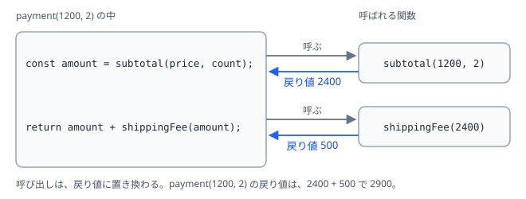
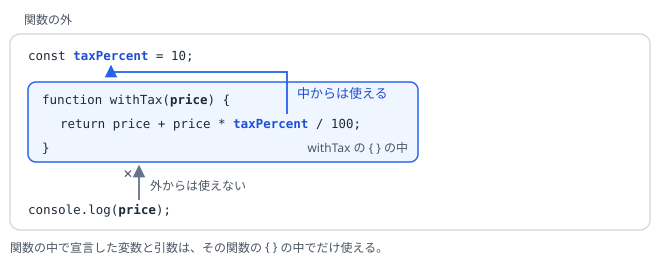
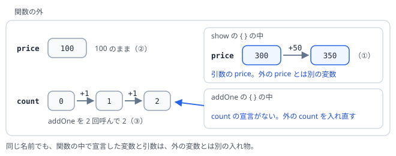

# 基礎編 第7章 関数を組み合わせる

- **この章で学ぶこと**
  - 関数の中から、別の関数を呼ぶ
  - 変数が使える範囲
  - 関数の短い書き方（アロー関数）

この章のコード例は、次のコマンドで実行します（前のコード例は消してから打ちます）。

```sh
node basics/exercises/B07-combining/try.js
```

---

## 7.1 関数から関数を呼ぶ

関数の中から、別の関数を呼べます。小さな関数を部品にして、大きな処理を組み立てます。

```js
function subtotal(price, count) {
  return price * count;
}

function receiptLine(name, price, count) {
  return `${name}: ${subtotal(price, count)}円`;
}

console.log(receiptLine("ノート", 120, 3)); // → ノート: 360円
```

`receiptLine` は、小計の計算を `subtotal` に任せています。

## 問題 1：値を追う

`basics/exercises/B07-combining/problem-01.js`

```js
function subtotal(price, count) {
  return price * count;
}

function shippingFee(amount) {
  if (amount >= 3000) {
    return 0;
  }
  return 500;
}

function payment(price, count) {
  const amount = subtotal(price, count);
  return amount + shippingFee(amount);
}

console.log(payment(1200, 2)); // ①
console.log(payment(1000, 3)); // ②
```

① と ② で、それぞれ何が表示されるか予測してください。次の表を埋めながら考えます。

| 呼び出し | `amount`（`subtotal` の戻り値） | `shippingFee(amount)` の戻り値 | `payment` の戻り値 |
| --- | --- | --- | --- |
| `payment(1200, 2)` ① | ？ | ？ | ？ |
| `payment(1000, 3)` ② | ？ | ？ | ？ |

<details>
<summary>答えと解説</summary>

```
2900
3000
```

**① 小計の `2400` は 3000 以上ではないので、送料の `500` が足されます。**

**② `>=` は「以上」なので、小計がちょうど `3000` のときの送料は `0` です。**

関数の中で呼ばれた関数も、戻り値に置き換えて追います。

| 呼び出し | `amount`（`subtotal` の戻り値） | `shippingFee(amount)` の戻り値 | `payment` の戻り値 |
| --- | --- | --- | --- |
| `payment(1200, 2)` ① | `2400` | `500` | `2900` |
| `payment(1000, 3)` ② | `3000` | `0` | `3000` |



</details>

## 7.2 変数が使える範囲

**関数の中で宣言した変数は、その関数の中でだけ使えます。** 変数が使える範囲を、**スコープ**と呼びます。

```js
function subtotal(price, count) {
  const result = price * count;
  return result;
}

console.log(subtotal(120, 3));
console.log(result);
```

`360` が表示された後、7 行目でエラーになります。

```
ReferenceError: result is not defined
```

`result` は、`subtotal` の中の変数です。関数の外からは使えません。`if` や `for` の `{ }` も同じです（第5章の 5.5）。

関数の中の値を外で使いたいときは、`return` で返します。

### 試す

上の例の最後の行を `console.log(price);` に変えて実行してください。

```
ReferenceError: price is not defined
```

引数の `price` と `count` も、関数の中だけの変数です。

### 関数の外の変数を、中で使う

反対に、関数の外で宣言した変数は、関数の中から使えます。

```js
const taxPercent = 10;

function withTax(price) {
  return price + price * taxPercent / 100;
}

console.log(withTax(800)); // → 880
```

外の変数が `let` なら、関数の中から入れ直せます。

```js
let spent = 0;

function spend(amount) {
  spent = spent + amount;
}

spend(700);
console.log(spent); // → 700
```



### 中と外に同じ名前の変数があるとき

関数の中と外に同じ名前の変数があるときは、関数の中では中の変数が使われます。2 つは別の変数です。

```js
const name = "外";

function showName(name) {
  console.log(name);
}

showName("中");    // → 中
console.log(name); // → 外
```

`showName` の引数の `name` は、1 行目の `name` とは別の変数です。引数も `let` の変数と同じく、関数の中で入れ直せます。

## 問題 2：同じ名前の変数

`basics/exercises/B07-combining/problem-02.js`

```js
const price = 100;
let count = 0;

function show(price) {
  price = price + 50;
  console.log(price); // ①
}

function addOne() {
  count = count + 1;
}

show(300);
console.log(price); // ②
addOne();
addOne();
console.log(count); // ③
```

①〜③ で、それぞれ何が表示されるか予測してください。

<details>
<summary>答えと解説</summary>

```
350
100
2
```

**① ② `show` の引数の `price` は、1 行目の `price` とは別の変数です。**

入れ直したのは、引数の `price` です。1 行目の `price` は `const` ですが、エラーにならず、`100` のままです。

**③ `addOne` の中の `count` は、外の `count` です。**

`addOne` の中には、`count` の宣言がないので、2 行目の `count` を入れ直します。2 回呼んだので、`2` です。



</details>

## 7.3 アロー関数

**アロー関数**は、`(引数) => 式` の形で短く書ける関数です。`=>` の右の式の値が、戻り値になります。第9章で、関数を渡すときによく使います。

```js
function double(n) {
  return n * 2;
}

const triple = (n) => n * 3;

console.log(double(5)); // → 10
console.log(triple(5)); // → 15
```

- `=>` は、`=` と `>` を続けて打ちます。第4章の `>=`（以上）とは別の記号です。
- アロー関数は、`const` の変数に入れて、その変数の名前で呼びます。呼び方は、`function` で宣言した関数と同じです。

処理が 2 行以上になるときは、`=>` の右を `{ }` で囲みます。

```js
const receiptLine = (name, price) => {
  const label = `${name}: `;
  return `${label}${price}円`;
};

console.log(receiptLine("ノート", 120)); // → ノート: 120円
```

3 つの書き方は、戻り値の決まり方と、最後の `;` が違います。

| 書き方 | 戻り値 | `return` | 最後の `;` |
| --- | --- | --- | --- |
| `function 名前(引数) { ... }` | `return` で返した値 | 書く。なければ、戻り値は `undefined`（第6章の 6.3） | 付けない |
| `(引数) => 式` | `=>` の右の式の値 | 書かない | 付ける |
| `(引数) => { ... }` | `return` で返した値 | 書く。なければ、戻り値は `undefined` | `}` の後ろに付ける |

アロー関数は、全体が `const 名前 = ...;` という 1 つの宣言です。そのため、最後に `;` が付きます。

### 試す

最初の例の `triple` の行を `const triple = (n) => return n * 3;` に変えて実行してください。

```
SyntaxError: Unexpected token 'return'
```

`{ }` で囲まない形では、`return` を書けません。

## 問題 3：アロー関数の戻り値

`basics/exercises/B07-combining/problem-03.js`

```js
const withTax = (price) => price + price / 10;
const label = (name, price) => {
  `${name}: ${price}円`;
};
const line = (name, price) => {
  const total = withTax(price);
  return `${name}: ${total}円`;
};

console.log(withTax(200));         // ①
console.log(label("ノート", 200)); // ②
console.log(line("ノート", 200));  // ③
```

①〜③ で、それぞれ何が表示されるか予測してください。

<details>
<summary>答えと解説</summary>

```
220
undefined
ノート: 220円
```

**① `{ }` を書かない形なので、`=>` の右の式の値 `220` が戻り値です。**

**② `label` は `{ }` で囲んだ形で、`return` がありません。戻り値は `undefined` です。**

テンプレート文字列で文字列を作っていますが、返していません（7.3）。

**③ `line` は `{ }` の中で `withTax(200)` を呼び、`return` で文字列を返します。`ノート: 220円` です。**

</details>

## 7.4 関数は値

関数は、数値や文字列と同じ値です。変数に入れられます。

```js
const double = (n) => n * 2;
const calc = double;

console.log(calc(5)); // → 10
```

2 行目の `double` には、`( )` が付いていません。`( )` を付けるかどうかで、意味が変わります。

| 書き方 | 意味 |
| --- | --- |
| `double` | 関数そのもの |
| `double(5)` | 関数を呼んだ結果（戻り値の `10`） |

関数は値なので、別の関数に渡せます。渡す使い方は、第9章で扱います。

### 試す

上の例の最後の行を `console.log(double);` に変えて実行してください。

```
[Function: double]
```

関数そのものが表示されます。`double` は、関数を入れた変数の名前です。

表示に `[Function: ...]` や関数のコードが出たら、`( )` を付け忘れていないかを見直します。

---

## 演習 1：間違いを直す

`basics/exercises/B07-combining/practice-01.js` の 2 つの関数に、間違いが 1 つずつあります。次の値を返すように直します。`payment` は、`subtotal` を呼んで、小計に送料の 500 円を足した金額を返す関数です。

| 呼び出し | 返す値 |
| --- | --- |
| `subtotal(120, 3)` | `360` |
| `payment(120, 3)` | `860` |
| `payment(1000, 2)` | `2500` |

**進め方**

1. 答え合わせを実行して、表示を読む
   ```sh
   npm test B07 practice-01
   ```
   - **こうなれば OK**：`✖` で始まる行と、「期待した値」「実際の値」が表示される
2. 表示された関数を見て直し、保存する
   - **こうなれば OK**：画面の上のファイル名の横の ● が消える
3. もう一度答え合わせをする
   - 別の不合格が出たら、同じように直します
   ```sh
   npm test B07 practice-01
   ```
   - **こうなれば OK**：`演習 1  合格` と表示される

<details>
<summary>ヒント 1：1 つ目の間違い</summary>

`subtotal` は、計算した値を変数に入れた後、何もしていません。

</details>

<details>
<summary>ヒント 2：2 つ目の間違い</summary>

`amount` は、どの関数の中の変数かを見ます（7.2）。問題 1 の `payment` と見比べます。

</details>

<details>
<summary>うまくいかないとき</summary>

| 表示 | よくある原因 |
| --- | --- |
| `subtotal(120, 3)` の「実際の値」が `undefined` | `subtotal` に `return` がありません |
| `ReferenceError: amount is not defined` | `payment` の中で、`subtotal` の中の変数 `amount` を使っています。`subtotal` の戻り値を、`payment` の中の変数に入れます（7.2） |
| `payment(120, 3)` の「実際の値」に、関数のコードが出る | `subtotal` に `( )` と引数を付けていません（7.4） |
| `payment(120, 3)` の「実際の値」が `NaN` | `subtotal()` と、引数を渡さずに呼んでいます |
| 「payment の中で subtotal を呼ぶ」か「小計をもう一度計算しない」が不合格 | `payment` の中で、`price * count` をもう一度計算しています。`subtotal` の戻り値を使います |

</details>

解答例：[basics/solutions/B07-combining/practice-01.js](../solutions/B07-combining/practice-01.js)

## 演習 2：アロー関数を書く

`basics/exercises/B07-combining/practice-02.js` の 4 つの関数を完成させます。1〜3 は `____` を書き換えます。4 は、`function` で宣言した関数を、アロー関数に書き換えます。

| 呼び出し | 返す値 |
| --- | --- |
| `double(5)` | `10` |
| `withTax(800, 10)` | `880` |
| `larger(3, 7)` | `7` |
| `larger(7, 3)` | `7` |
| `half(10)` | `5` |

**進め方**

1. `basics/exercises/B07-combining/practice-02.js` を開き、1〜3 の `____` を書き換えて保存する
   - **こうなれば OK**：コメント以外の行に `____` が残っていない
2. 答え合わせをする
   ```sh
   npm test B07 practice-02
   ```
   - **こうなれば OK**：`✖` の行が `✖ half をアロー関数で書く` になる
3. 4 の `half` を、`export const half = ...` の形のアロー関数に書き換えて保存する
   - **こうなれば OK**：`half` の行が `export const half =` で始まる
4. 答え合わせをする
   ```sh
   npm test B07 practice-02
   ```
   - **こうなれば OK**：`演習 2  合格` と表示される

<details>
<summary>ヒント</summary>

- 1：`=>` の右に、返したい値の式を書きます。
- 2：`=>` の右の式で使っている名前を見ます。
- 3：`a` が `b` 以上のときに返すのは、どちらかを考えます。
- 4：7.3 の最初の例の `double` と `triple` を見比べます。`function` と名前の代わりに、`const 名前 =` で始めます。

</details>

<details>
<summary>うまくいかないとき</summary>

| 表示 | よくある原因 |
| --- | --- |
| `price is not defined` | 2 の `____` が残っています |
| `double(5)` の「実際の値」が `undefined` | `=>` の右を `{ }` で囲んで、`return` を書いていません（問題 3） |
| `half を、export const half = (n) => ... の形のアロー関数に書き換えてください。` | `half` が `function` の宣言のままです |
| `関数 half が見つかりません` | 書き換えるときに、`export` を消しています |
| `ReferenceError: n is not defined` | `=>` を `>=` と打っています |
| `SyntaxError: Unexpected token 'return'` | `{ }` で囲まない形の `=>` の右に、`return` を書いています。`return` を消します（7.3 の表） |

</details>

解答例：[basics/solutions/B07-combining/practice-02.js](../solutions/B07-combining/practice-02.js)

## 演習 3：関数を組み合わせる

品物の名前、値段、個数を受け取って、レシートの 1 行を返す関数 `receiptLine` を書きます。金額は、小計を税込（税率 10%）にしたものです。

| 呼び出し | 返す値 |
| --- | --- |
| `receiptLine("ノート", 120, 3)` | `"ノート: 396円"` |
| `receiptLine("ペン", 80, 2)` | `"ペン: 176円"` |
| `receiptLine("消しゴム", 100, 0)` | `"消しゴム: 0円"` |

**進め方**

1. `basics/exercises/B07-combining/practice-03.js` の `receiptLine` の書き出しの続きに、`sub` を `withTax` に渡す行と、文字列を返す行を書く
   - 上の `subtotal` は小計を、`withTax` は税込の金額を返します。どちらも何を受け取るかを読んでから書きます
   - 書き出しの行は、`subtotal` を呼んで、小計を `sub` に入れています
   - 戻り値は、変数に入れたり、別の関数に渡したりできます（第6章の 6.3）
   - `withTax` を呼ばずに、税込の計算をもう一度書くと、不合格です
   - **こうなれば OK**：`receiptLine` の中に、`withTax(sub)` を呼ぶ行と、`return` の行がある
2. 答え合わせをする
   ```sh
   npm test B07 practice-03
   ```
   - **こうなれば OK**：`演習 3  合格` と表示される

<details>
<summary>ヒント</summary>

```js
const amount = withTax(...);
return ...;
```

`withTax` に渡すのは、小計の `sub` です。返すのは、名前と `amount` をテンプレート文字列で 1 つにした文字列です。

</details>

<details>
<summary>うまくいかないとき</summary>

| 表示 | よくある原因 |
| --- | --- |
| 「実際の値」が `"ノート: 360円"` | 小計を `withTax` に渡していないか、文字列に `withTax` の戻り値ではなく `sub` を入れています |
| 「実際の値」が `"ノート: 396.00000000000006円"` | `price * count * 1.1` と自分で計算しています。小数の計算には、わずかな誤差が出ます。`withTax` を呼びます |
| 「実際の値」に、関数のコードや `NaN` が出る | `withTax(subtotal)` のように、関数の名前を渡しています。小計の `sub` を渡します |
| 「実際の値」が `undefined` | 文字列を `return` で返していません |

</details>

解答例：[basics/solutions/B07-combining/practice-03.js](../solutions/B07-combining/practice-03.js)

## 演習 4：合計と支払う金額を返す

金額の配列を受け取る関数を、2 つ書きます。`total` は合計を返します。`payment` は、合計に送料を足した金額を返します。

| 呼び出し | 返す値 |
| --- | --- |
| `total([1200, 800])` | `2000` |
| `total([])` | `0` |
| `payment([1200, 800])` | `2500`（送料 500 円） |
| `payment([2000, 1500])` | `3500`（送料 0 円） |
| `payment([3000])` | `3000`（送料 0 円） |

**進め方**

1. `basics/exercises/B07-combining/practice-04.js` を開き、`total` の中を書く
   - **こうなれば OK**：`total` の中に、`return` の行がある
2. 答え合わせをする
   ```sh
   npm test B07 practice-04
   ```
   - **こうなれば OK**：`✖` の行が `payment` で始まる（`total` の検査は合格した）
3. `payment` の中を、`total` と `shippingFee` を呼んで書く
   - `shippingFee` は、ファイルに書いてあります。合計が 3000 円以上なら 0 円、それ以外は 500 円を返します
   - 合計を入れる変数には、関数の `total` と違う名前（`amount` など）を付けます
   - **こうなれば OK**：`payment` の中に、`total(` と `shippingFee(` の両方がある
4. 答え合わせをする
   ```sh
   npm test B07
   ```
   - **こうなれば OK**：`結果: この章の演習は、すべて合格です。` と表示される

<details>
<summary>ヒント 1：どこを見ればよいか</summary>

- `total`：第6章の演習 3 と同じ関数です。
- `payment`：問題 1 の `payment` と同じ形です。小計の代わりに、合計を使います。

</details>

<details>
<summary>ヒント 2：<code>payment</code> の書き出し</summary>

```js
const amount = total(prices);
```

</details>

<details>
<summary>うまくいかないとき</summary>

| 表示 | よくある原因 |
| --- | --- |
| `payment([2000, 1500])` の「実際の値」が `4000` | 送料をいつも `500` にしているか、`shippingFee(prices)` と配列を渡しています。`shippingFee` に渡すのは合計です |
| `payment([1200, 800])` の「実際の値」が `2000` | `shippingFee` を呼んだだけで、戻り値を足していません |
| `Cannot access 'total' before initialization` | `payment` の中で、`const total = total(prices);` と、関数と同じ名前の変数を宣言しています。`amount` など、別の名前にします |
| `total([1200, 800])` の「実際の値」が `undefined` | `total` に `return` がありません |
| 「payment の中で total を呼ぶ」が不合格 | `payment` の中で、合計をもう一度計算しています。`total(prices)` を呼びます |

</details>

解答例：[basics/solutions/B07-combining/practice-04.js](../solutions/B07-combining/practice-04.js)

---

## チェックリスト

- [ ] 関数の中で呼ばれた関数を、戻り値に置き換えて追える
- [ ] 問題 2 の ② が `100` のままである理由を説明できる
- [ ] `(n) => n * 3` と `(n) => { n * 3; }` の戻り値の違いを説明できる

## 詳しく学ぶ

- JavaScript Primer：[関数と宣言](https://jsprimer.net/basic/function-declaration/)、[関数とスコープ](https://jsprimer.net/basic/function-scope/)
