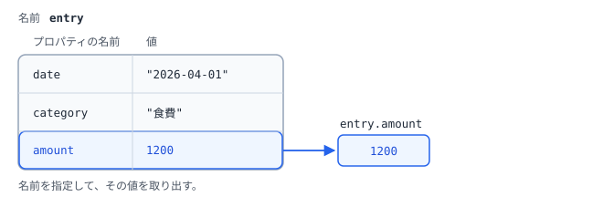
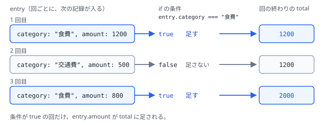

# 基礎編 第8章 オブジェクト

- **この章で学ぶこと**
  - 関係のある値を、名前を付けて 1 つにまとめる
  - まとめた値を、配列に入れて繰り返す
  - まとめた値の中に、さらに配列やまとまりが入っているデータを読む

この章のコード例は、次のコマンドで実行します（前のコード例は消してから打ちます）。

```sh
node basics/exercises/B08-objects/try.js
```

---

## 8.1 オブジェクトを作る・取り出す

家計簿の 1 件の記録には、日付・カテゴリ・金額があります。関係のある値は、**オブジェクト**として 1 つにまとめられます。

```js
const entry = { date: "2026-04-01", category: "食費", amount: 1200 };

console.log(entry.category); // → 食費
console.log(entry.amount);   // → 1200
```

- `{ }` の中に、`名前: 値` を `,` で区切って並べます。この名前と値の組を、**プロパティ**と呼びます。
- 値を取り出すときは、`変数.プロパティの名前` と書きます。



配列は値を番号で取り出し、オブジェクトは名前で取り出します。

| | 書き方 | 取り出し方 | 向いているデータ |
| --- | --- | --- | --- |
| 配列 | `[1200, 500, 800]` | 番号（`prices[0]`） | 同じ種類の値の並び |
| オブジェクト | `{ category: "食費", amount: 1200 }` | 名前（`entry.amount`） | 1 つのものについての、種類の違う値 |

プロパティが多いときは、1 行に 1 つずつ書きます。意味は同じです。最後の `,` は、付けても付けなくても構いません。この教材では付けます。

```js
const entry = {
  date: "2026-04-01",
  category: "食費",
  amount: 1200,
};

console.log(`${entry.category}: ${entry.amount}円`); // → 食費: 1200円
```

### 試す

上のコードの最後に `console.log(entry);` を足して、実行してください。

```
{ date: '2026-04-01', category: '食費', amount: 1200 }
```

オブジェクトをそのまま表示すると、中身の全体が見られます。値を調べるときに使えます。文字列は、配列のときと同じく `'` で囲んで表示されます（第5章の 5.1）。

## 8.2 プロパティを入れ直す・足す

プロパティの値は、変数と同じように `=` で入れ直せます。まだない名前に代入すると、プロパティが足されます。

```js
const entry = { date: "2026-04-01", category: "食費", amount: 1200 };
console.log(entry.memo);   // → undefined

entry.amount = 1500;
entry.memo = "昼食";

console.log(entry.amount); // → 1500
console.log(entry.memo);   // → 昼食
```

足す前の `entry.memo` は、`undefined` です。**オブジェクトにない名前のプロパティを取り出しても、エラーにはならず、値は `undefined` です。** 配列にない番号を取り出したとき（第5章の 5.1）と同じです。

`entry` は `const` で宣言していますが、エラーになりません。配列と同じです（第5章の 5.2）。変えられる理由は、基礎編に続く本編（TypeScript を学ぶ編）の第4章で扱います。

## 問題 1：プロパティの名前

`basics/exercises/B08-objects/problem-01.js`

```js
const entry = { date: "2026-04-01", category: "食費", amount: 1200 };

console.log(entry.category);     // ①
console.log(entry.amout);        // ②
console.log(entry.amount + 300); // ③
console.log(entry.amout + 300);  // ④
```

② と ④ は、`amount` のつづりを `amout` と間違えています。

`node basics/exercises/B08-objects/problem-01.js` を実行すると、①〜④ でそれぞれ何が表示されるか予測してください。

<details>
<summary>答えと解説</summary>

```
食費
undefined
1500
NaN
```

**② つづりを間違えた `amout` は、オブジェクトにない名前なので、値は `undefined` です（8.2）。**

変数の名前を間違えると、`is not defined` のエラーで止まります（第2章の 2.5）。プロパティの名前を間違えても、プログラムは止まりません。

**④ `undefined` に数を足すと、結果は `NaN` です。**

`NaN`（第6章の 6.2）はエラーではないので、プログラムはそのまま先へ進みます。

| 表示 | 見直す所 |
| --- | --- |
| `undefined` | プロパティの名前のつづり |
| `NaN` | 計算に使った値のどれかが、`undefined` や、数ではない値（オブジェクトなど）になっていないか |

</details>

## 8.3 オブジェクトの配列

同じ形のオブジェクトがいくつもあるときは、配列に入れます。家計簿の記録は、「記録のオブジェクトの配列」です。

```js
const entries = [
  { date: "2026-04-01", category: "食費", amount: 1200 },
  { date: "2026-04-02", category: "交通費", amount: 500 },
];

console.log(entries.length);      // → 2
console.log(entries[0].category); // → 食費
```

上の `entries` はそのまま残して、`console.log` の 2 行だけを次の繰り返しに書き換えます。`for...of` で繰り返すと、変数にオブジェクトが 1 件ずつ入ります。

```js
for (const entry of entries) {
  console.log(`${entry.category}: ${entry.amount}円`);
}
```

```
食費: 1200円
交通費: 500円
```

### 試す

配列に、3 件目の記録として `{ date: "2026-04-03", category: "食費", amount: 800 },` の行を足して、実行してください。

表示は 3 行に増えます。`for` の中は書き換えていません。

## 問題 2：値を追う

`basics/exercises/B08-objects/problem-02.js`

```js
const entries = [
  { date: "2026-04-01", category: "食費", amount: 1200 },
  { date: "2026-04-02", category: "交通費", amount: 500 },
  { date: "2026-04-03", category: "食費", amount: 800 },
];

let total = 0;
for (const entry of entries) {
  if (entry.category === "食費") {
    total = total + entry.amount;
  }
}
console.log(total);
```

繰り返しの回ごとに、次の表を埋めてください。最後に、何が表示されるかを答えてください。

| 回 | `entry.category` | `entry.amount` | `if` の条件 | 回の終わりの `total` |
| --- | --- | --- | --- | --- |
| 1 | ？ | ？ | ？ | ？ |
| 2 | ？ | ？ | ？ | ？ |
| 3 | ？ | ？ | ？ | ？ |

<details>
<summary>答えと解説</summary>

| 回 | `entry.category` | `entry.amount` | `if` の条件 | 回の終わりの `total` |
| --- | --- | --- | --- | --- |
| 1 | `"食費"` | `1200` | `true` | `1200` |
| 2 | `"交通費"` | `500` | `false` | `1200` |
| 3 | `"食費"` | `800` | `true` | `2000` |

`2000` が表示されます。

**`entry` には、回ごとに別のオブジェクトが入ります。条件が `true` の回だけ、金額が `total` に足されます。**



第5章の「合計する形」に、`if` を足したものです。条件と金額は、プロパティから取り出しています。

</details>

## 8.4 入れ子のデータ

プロパティの値には、配列やオブジェクトも入れられます。データの中に別のデータが入っている形を、**入れ子**と呼びます。

次の `month` は、1 か月分の家計簿です。月の名前、予算、記録の配列を、1 つのオブジェクトにまとめています。

```js
const month = {
  name: "4月",
  budget: 30000,
  entries: [
    { date: "2026-04-01", category: "食費", amount: 1200 },
    { date: "2026-04-02", category: "交通費", amount: 500 },
  ],
};

console.log(month.name);              // → 4月
console.log(month.entries[0].amount); // → 1200
```

入れ子のデータは、左から 1 つずつ読みます。`month.entries[0].amount` は、`month` の `entries`（記録の配列）の、0 番の記録の、`amount` です。

![month は、name が "4月"、budget が 30000、entries が配列のオブジェクト。entries の配列には、記録のオブジェクトが 2 件入っている。0 番は食費の 1200、1 番は交通費の 500。month.entries[0].amount は、month の ① entries、その ② 0 番、その ③ amount と、左から順にたどって 1200 を取り出す。図の中の同じ場所にも ①②③ の番号がある。](images/B08-nested.svg "図8-3 入れ子のデータ")

上の `month` はそのまま残して、`console.log` の 2 行だけを次の繰り返しに書き換えます。`month.entries` は配列なので、`for...of` で繰り返せます。

```js
for (const entry of month.entries) {
  console.log(entry.amount);
}
```

```
1200
500
```

### `undefined` の先は読めない

**`undefined` からプロパティを取り出そうとすると、`TypeError` のエラーになります。** 入れ子のデータで、途中の名前を間違えたときに出ます。

上の `month` はそのまま残して、繰り返しを次の 1 行に書き換えます。`entries` を `entry` と間違えています。

```js
console.log(month.entry[0]);
```

```
TypeError: Cannot read properties of undefined (reading '0')
```

`month.entry` は、ない名前のプロパティなので `undefined` です（8.2）。`undefined` はオブジェクトでも配列でもないので、その先の `[0]` を取り出せません。エラーの文は、「`undefined` のプロパティは読めない（`0` を読もうとした）」という意味です。

このエラーが出たら、その行の `.` や `[ ]` の左側が `undefined` になっています。多くの場合、原因は番号か名前の間違いです。

## 問題 3：入れ子を読む

`basics/exercises/B08-objects/problem-03.js`

```js
const month = {
  name: "4月",
  budget: 30000,
  entries: [
    { date: "2026-04-01", category: "食費", amount: 1200 },
    { date: "2026-04-02", category: "交通費", amount: 500 },
  ],
};

console.log(month.entries.length);      // ①
console.log(month.entries[1].category); // ②
console.log(month.entries[2]);          // ③
console.log(month.entries[2].category); // ④
```

`node basics/exercises/B08-objects/problem-03.js` を実行すると、①〜④ でそれぞれ何が表示されるか予測してください。エラーになる行があれば、その行も答えてください。

<details>
<summary>答えと解説</summary>

```
2
交通費
undefined
file:///（省略）/basics/exercises/B08-objects/problem-03.js:13
console.log(month.entries[2].category); // ④
                             ^

TypeError: Cannot read properties of undefined (reading 'category')
```

**① ② `month.entries` は、2 件の記録の配列です。**

番号は 0 から始まるので、`month.entries[1]` は 2 件目です。

**③ 配列にない番号を取り出すと、`undefined` です。**

記録は 2 件なので、番号は `0` と `1` だけです。`month.entries[2]` には、何もありません。

**④ `undefined` から `.category` を取り出そうとするので、`TypeError` のエラーで止まります（8.4）。**

③ のとおり、`month.entries[2]` は `undefined` です。こちらは名前ではなく、番号の間違いで `undefined` になっています。

</details>

---

演習の表では、次の `entries` を使います。

```js
const entries = [
  { date: "2026-04-01", category: "食費", amount: 1200 },
  { date: "2026-04-02", category: "交通費", amount: 500 },
  { date: "2026-04-03", category: "食費", amount: 800 },
];
```

## 演習 1：間違いを直す

`basics/exercises/B08-objects/practice-01.js` の `lastEntryText` は、配列の最後の記録を文字列にして返す関数です。間違いが 2 つあります。表のとおりに返すように直します。

| 呼び出し | 返す値 |
| --- | --- |
| `lastEntryText(entries)` | `"食費: 800円"` |
| `lastEntryText([{ date: "2026-04-01", category: "食費", amount: 1200 }])` | `"食費: 1200円"` |

**進め方**

1. 実行して、エラーを読む
   - ファイルの下に、2 件の配列で関数を試しに呼ぶ行があります
   ```sh
   node basics/exercises/B08-objects/practice-01.js
   ```
   - **こうなれば OK**：`TypeError: Cannot read properties of undefined (reading 'category')` と表示される
2. エラーが示す行で `undefined` になっている値を、どの行で作っているかを探して直す
   ```sh
   node basics/exercises/B08-objects/practice-01.js
   ```
   - **こうなれば OK**：エラーが出なくなり、`交通費: undefined円` と表示される
3. 表示から 2 つ目の間違いを探して直す
   ```sh
   node basics/exercises/B08-objects/practice-01.js
   ```
   - **こうなれば OK**：`交通費: 500円` と表示される
4. 答え合わせをする
   ```sh
   npm test B08 practice-01
   ```
   - **こうなれば OK**：`演習 1  合格` と表示される

<details>
<summary>ヒント 1：1 つ目の間違い</summary>

エラーは、「`.` の左側の `last` が `undefined` だ」と知らせています（8.4）。原因は、`last` を作っている上の行です。配列が 2 件のとき、`entries.length` は `2` です。最後の記録の番号はいくつかを考えます。

</details>

<details>
<summary>ヒント 2：2 つ目の間違い</summary>

`undefined` が出たら、プロパティの名前のつづりを見直します（問題 1 の ②）。

</details>

<details>
<summary>うまくいかないとき</summary>

| 表示 | よくある原因 |
| --- | --- |
| `practice-01.js が、エラーで止まりました` | ファイルの下の試しの呼び出しが、エラーで止まっています。1 つ目の間違いが、まだ直っていません |
| 「実際の値」が `"食費: undefined円"` | プロパティの名前のつづりが、まだ直っていません |
| 「実際の値」が `"交通費: 500円"` | `entries[1]` のように、番号を直接書いています。最後の番号は、`entries.length` から計算します |

</details>

解答例：[basics/solutions/B08-objects/practice-01.js](../solutions/B08-objects/practice-01.js)

## 演習 2：1 件の記録を文字列にする

`basics/exercises/B08-objects/practice-02.js` の `____` を書き換えて、1 件の記録を文字列にする関数 `entryText` を完成させます。

| 呼び出し | 返す値 |
| --- | --- |
| `entryText({ date: "2026-04-01", category: "食費", amount: 1200 })` | `"2026-04-01 食費: 1200円"` |
| `entryText({ date: "2026-04-02", category: "交通費", amount: 500 })` | `"2026-04-02 交通費: 500円"` |

**進め方**

1. `basics/exercises/B08-objects/practice-02.js` を開き、3 か所の `____` を書き換えて保存する
   - **こうなれば OK**：コメント以外の行に `____` が残っていない
2. 答え合わせをする
   ```sh
   npm test B08 practice-02
   ```
   - **こうなれば OK**：`演習 2  合格` と表示される

<details>
<summary>ヒント</summary>

- 1 つ目：日付のプロパティの名前を書きます。
- 2 つ目：プロパティを取り出す元の、変数の名前を書きます。
- 3 つ目：金額を取り出す式を、`変数.プロパティの名前` の形で書きます。

</details>

<details>
<summary>うまくいかないとき</summary>

| 表示 | よくある原因 |
| --- | --- |
| `ReferenceError: amount is not defined` | `entry.amount` ではなく、`amount` とだけ書いています |
| 「実際の値」が `"2026-04-01 食費: [object Object]円"` | 3 つ目に `entry` とだけ書いています。オブジェクトをそのまま文字列に入れると、`[object Object]` になります |
| 「実際の値」が `"undefined 食費: 1200円"` | 日付のプロパティの名前が違います。大文字と小文字も区別されます |

</details>

解答例：[basics/solutions/B08-objects/practice-02.js](../solutions/B08-objects/practice-02.js)

## 演習 3：記録を作る・書き換える

`basics/exercises/B08-objects/practice-03.js` に、関数を 2 つ書きます。`makeEntry` は、記録のオブジェクトを作って返します。`changeAmount` は、受け取った記録の金額を入れ直して、その記録を返します。新しい記録は作りません。

| 呼び出し | 返す値 |
| --- | --- |
| `makeEntry("2026-04-01", "食費", 1200)` | `{ date: "2026-04-01", category: "食費", amount: 1200 }` |
| `makeEntry("2026-04-02", "交通費", 500)` | `{ date: "2026-04-02", category: "交通費", amount: 500 }` |
| `changeAmount({ date: "2026-04-01", category: "食費", amount: 1200 }, 1500)` | `{ date: "2026-04-01", category: "食費", amount: 1500 }` |
| `changeAmount({ date: "2026-04-02", category: "交通費", amount: 500 }, 0)` | `{ date: "2026-04-02", category: "交通費", amount: 0 }` |

**進め方**

1. `basics/exercises/B08-objects/practice-03.js` の `makeEntry` の `date: date,` の下に、`category` と `amount` のプロパティを書き足す
   - 書き出しの `return { ... };` は、`{ }` で作ったオブジェクトをそのまま返します。中は、8.1 の 1 行に 1 つずつ書く形です
   - プロパティの値の所には、引数の名前を書きます
   - **こうなれば OK**：`date: date,` の下に、`category:` と `amount:` で始まる行がある
2. 答え合わせをする
   ```sh
   npm test B08 practice-03
   ```
   - **こうなれば OK**：`✖` の行が `changeAmount` で始まる（`makeEntry` の検査は合格した）
3. `changeAmount` の `return entry;` の上に、金額を入れ直す行を書く
   - プロパティを入れ直す（8.2）：`entry.amount = 新しい金額;`。新しい金額は、引数の `amount` に入っています
   - **こうなれば OK**：`return entry;` の上に、`entry.amount =` で始まる行がある
4. 答え合わせをする
   ```sh
   npm test B08 practice-03
   ```
   - **こうなれば OK**：`演習 3  合格` と表示される

<details>
<summary>ヒント</summary>

- `makeEntry`：`date: date,` と同じ形で、2 行を書き足します。`"` で囲むと、引数ではなく文字列になります。

</details>

<details>
<summary>うまくいかないとき</summary>

| 表示 | よくある原因 |
| --- | --- |
| `SyntaxError: Invalid shorthand property initializer` | `category = category` のように、`:` の所に `=` を書いています |
| `SyntaxError: Unexpected identifier 'amount'` | `category: category` の後ろの `,` を書き忘れています |
| 「実際の値」が `{ date: "2026-04-01", category: "category", amount: "amount" }` | 値を `"` で囲んでいます |
| `changeAmount(500 円の交通費の記録, 0)` の「実際の値」の金額が `1500` | `entry.amount = 1500;` と、数を直接書いています。右辺は引数の `amount` です |
| `changeAmount` の「実際の値」の金額が、`1200` のまま | `entry.amount === amount` と書いているか、代入の左右が逆です |

</details>

解答例：[basics/solutions/B08-objects/practice-03.js](../solutions/B08-objects/practice-03.js)

## 演習 4：予算の残りを計算する

`basics/exercises/B08-objects/practice-04.js` に、1 か月分のデータ（8.4 の `month` と同じ形）を受け取り、予算の残りを返す関数 `remaining` を書きます。残りは、予算から記録の金額の合計を引いたものです。

| 呼び出し | 返す値 |
| --- | --- |
| `remaining({ name: "4月", budget: 30000, entries: [1200 円の記録, 500 円の記録] })` | `28300` |
| `remaining({ name: "5月", budget: 20000, entries: [] })` | `20000` |
| `remaining({ name: "6月", budget: 1000, entries: [1500 円の記録] })` | `-500` |

表の「1200 円の記録」は、`{ date: "2026-04-01", category: "食費", amount: 1200 }` のようなオブジェクトです。

**進め方**

1. `basics/exercises/B08-objects/practice-04.js` の関数の中に、予算の残りを計算して返す処理を書く
   - 金額の合計は、`month.entries` を `for...of` で繰り返して求めます（8.4）
   - **こうなれば OK**：`for` の `}` の下に、`return` の行がある
2. 答え合わせをする
   ```sh
   npm test B08
   ```
   - **こうなれば OK**：`結果: この章の演習は、すべて合格です。` と表示される

<details>
<summary>ヒント 1：何を計算するか</summary>

計算は 2 段階です。

1. `month.entries` を繰り返して、金額の合計を求める（8.4 の `for...of` のコード例）
2. `month.budget` から、その合計を引く

</details>

<details>
<summary>ヒント 2：書き出し</summary>

```js
let total = 0;
for (const entry of month.entries) {
```

</details>

<details>
<summary>うまくいかないとき</summary>

| 表示 | よくある原因 |
| --- | --- |
| `TypeError: month is not iterable` | `for (const entry of month)` と書いています。繰り返せるのは、配列の `month.entries` です |
| `ReferenceError: entries is not defined` | `entries` とだけ書いています。`month.entries` と書きます |
| 「実際の値」が `NaN` | `month.budget - month.entries` と配列を引いているか、`total + entry` と記録をそのまま足しています。足すのは `entry.amount` です |
| 「実際の値」が `1700` | 合計を返しています。返すのは、予算から合計を引いた値です |

</details>

解答例：[basics/solutions/B08-objects/practice-04.js](../solutions/B08-objects/practice-04.js)

---

## チェックリスト

- [ ] `undefined` や `NaN` が表示されたときに、どこを見直すかを説明できる
- [ ] `month.entries[0].amount` を、左から順に読んで説明できる
- [ ] `Cannot read properties of undefined` のエラーが、何を知らせているかを説明できる

## 詳しく学ぶ

- JavaScript Primer：[オブジェクト](https://jsprimer.net/basic/object/)
