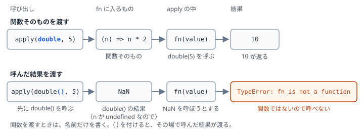
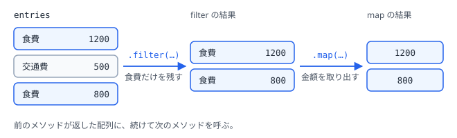

# 基礎編 第9章 配列のメソッド

- **この章で学ぶこと**
  - 関数を、別の関数に引数として渡す
  - 配列から新しい配列を作る処理と、要素を探す処理を `for...of` を使わずに書く
  - メソッドをつなげて書く

この章のコード例は、次のコマンドで実行します（前のコード例は消してから打ちます）。

```sh
node basics/exercises/B09-array-methods/try.js
```

---

## 9.1 関数を引数で渡す

関数は値なので、数値や文字列と同じように、引数として別の関数に渡せます。

```js
function apply(fn, value) {
  return fn(value);
}

const double = (n) => n * 2;

console.log(apply(double, 5));       // → 10
console.log(apply((n) => n + 1, 5)); // → 6
```

- `apply` は、受け取った関数 `fn` を呼びます。`double` を渡すと、`double(5)` が計算されます。
- 2 つ目の呼び出しのように、アロー関数をその場に書いて渡せます。

ほかの関数に渡す関数を、**コールバック**と呼びます。呼ぶのは、渡した側ではなく受け取った側です。

### 試す

1 つ目の呼び出しを `apply(double(), 5)` に変えて、実行してください。

```
TypeError: fn is not a function
```

`double()` と `( )` を付けると、その場で `double` を呼び、戻り値を渡します。`fn` に入るのは関数ではないので、`fn(value)` で呼べません。エラーは、受け取った側の 2 行目（`fn(value)`）に出ますが、原因は呼び出しの 7 行目の `( )` です。名前の付いた関数を渡すときは、`( )` を付けずに名前だけを書きます。



## 9.2 `map`：1 つずつ変換する

`map` は、配列の要素を 1 つずつコールバックに渡し、**返ってきた値を並べた新しい配列**を作ります。

```js
const prices = [100, 200, 300];
const doubled = prices.map((price) => price * 2);

console.log(doubled); // → [ 200, 400, 600 ]
console.log(prices);  // → [ 100, 200, 300 ]
```

`prices.map(...)` のように、値の後ろに `.` を付けて呼ぶ関数を、**メソッド**と呼びます。配列には、最初からメソッドが用意されています。第5章の `push` もメソッドです。この章では、`map`・`filter`・`find` を扱います。

コールバックは、要素の数だけ呼ばれます。上の例では、`price` に `100`、`200`、`300` が順に入って、3 回呼ばれます。

同じ処理を `for...of` で書くと、次のとおりです。

```js
const prices = [100, 200, 300];
const doubled = [];
for (const price of prices) {
  doubled.push(price * 2);
}

console.log(doubled); // → [ 200, 400, 600 ]
```

`map` を使うと、空の配列を用意する行と `push` の行を書かずに済みます。

### 試す

1 つ目のコード例の `price * 2` を、`` `${price}円` `` に変えて実行してください。

`doubled` の表示は `[ '100円', '200円', '300円' ]` に変わります。数値の配列から、文字列の配列も作れます。

## 問題 1：`map` の結果

`basics/exercises/B09-array-methods/problem-01.js`

```js
const entries = [
  { date: "2026-04-01", category: "食費", amount: 1200 },
  { date: "2026-04-02", category: "交通費", amount: 500 },
];

const amounts = entries.map((entry) => entry.amount);
const labels = entries.map((entry) => `${entry.category}: ${entry.amount}円`);
const checks = amounts.map((amount) => amount >= 1000);

console.log(amounts);        // ①
console.log(labels);         // ②
console.log(checks);         // ③
console.log(amounts.length); // ④
```

`node basics/exercises/B09-array-methods/problem-01.js` を実行すると、①〜④ でそれぞれ何が表示されるか予測してください。

<details>
<summary>答えと解説</summary>

```
[ 1200, 500 ]
[ '食費: 1200円', '交通費: 500円' ]
[ true, false ]
2
```

**① ② `map` の結果は、コールバックが返した値の配列です。**

① のコールバックは、記録から金額を取り出して返します。オブジェクトの配列から、金額だけの配列ができます。② は、記録ごとに文字列を作って返しています。

**③ コールバックが条件の式を返すと、`true` と `false` の配列になります。**

`amount >= 1000` の結果は、真偽値です。`map` は、返ってきた値をそのまま並べます。条件に合う要素だけを残す動きはしません。残したいときは、次の節の `filter` を使います。

**④ `map` の結果の配列は、元の配列と同じ長さです。**

要素を 1 つずつ変換するので、数は変わりません。`entries` が 2 件なので、`amounts` も 2 件です。

</details>

## 9.3 `filter`：条件に合うものだけを残す

`filter` は、コールバックが `true` を返した要素だけを集めた、新しい配列を作ります。

```js
const prices = [100, 200, 300];
const big = prices.filter((price) => price >= 200);

console.log(big);    // → [ 200, 300 ]
console.log(prices); // → [ 100, 200, 300 ]
```

`filter` に渡すコールバックは、「残すかどうか」を真偽値で返します。要素そのものは変換されません。真偽値でない値を返したときは、その値が `true` と `false` のどちらとして扱われるかで決まります（章末のコラム）。

### 試す

上の例の `>=` を `>` に変えて実行してください。

`big` の表示は `[ 300 ]` に変わります。`200` は「`200` より大きい」に当てはまらないので、残りません。

## 9.4 `find`：条件に合う最初の 1 つを探す

`find` は、コールバックが `true` を返した最初の要素を返します。配列ではなく、要素そのものが返ります。

```js
const prices = [100, 200, 300];
const found = prices.find((price) => price >= 200);

console.log(found); // → 200
```

**条件に合う要素が 1 つもないとき、`find` は `undefined` を返します。** エラーにはなりません。

```js
const prices = [100, 200, 300];
const found = prices.find((price) => price >= 500);

console.log(found); // → undefined
```

見つからなかった `found` から `found.amount` のようにプロパティを取り出すと、`TypeError` のエラーで止まります（第8章の 8.4）。`find` の結果は、使う前に `undefined` でないかを調べます。

```js
const prices = [100, 200, 300];
const found = prices.find((price) => price >= 500);

if (found === undefined) {
  console.log("見つかりません");
}
// → 見つかりません
```

## 問題 2：`filter` と `find`

`basics/exercises/B09-array-methods/problem-02.js`

```js
const entries = [
  { date: "2026-04-01", category: "食費", amount: 1200 },
  { date: "2026-04-02", category: "交通費", amount: 500 },
  { date: "2026-04-03", category: "食費", amount: 800 },
];

const foodList = entries.filter((entry) => entry.category === "食費");
const food = entries.find((entry) => entry.category === "食費");
const hobbyList = entries.filter((entry) => entry.category === "趣味");
const hobby = entries.find((entry) => entry.category === "趣味");

console.log(foodList.length); // ①
console.log(food.amount);     // ②
console.log(hobbyList);       // ③
console.log(hobby);           // ④
```

`node basics/exercises/B09-array-methods/problem-02.js` を実行すると、①〜④ でそれぞれ何が表示されるか予測してください。

<details>
<summary>答えと解説</summary>

```
2
1200
[]
undefined
```

**① ② `filter` は配列を返し、`find` は要素を 1 つ返します。**

`foodList` は、食費の記録 2 件の配列です。`food` は、最初に見つかった 4 月 1 日の記録です。オブジェクトそのものなので、`food.amount` で金額を取り出せます。

**③ ④ 趣味の記録はないので、`filter` は空の配列を、`find` は `undefined` を返します。**

空の配列は、そのまま `for...of` で繰り返しても、`length` を調べても、エラーになりません。`undefined` の `hobby` は、`hobby.amount` と書くとエラーになります。

</details>

## 9.5 つなげて書く

`map` と `filter` は配列を返すので、その結果に続けて次のメソッドを呼べます。

```js
const entries = [
  { date: "2026-04-01", category: "食費", amount: 1200 },
  { date: "2026-04-02", category: "交通費", amount: 500 },
  { date: "2026-04-03", category: "食費", amount: 800 },
];

const foodAmounts = entries
  .filter((entry) => entry.category === "食費")
  .map((entry) => entry.amount);

console.log(foodAmounts); // → [ 1200, 800 ]
```

左から順に読みます。まず `filter` で食費の記録だけの配列を作り、次に `map` でその金額を取り出しています。



長くなるときは、上のコードのように `.` の前で改行します。`;` は、最後の行の末尾に 1 つ付けます。

関数の中で使うときは、最後の結果を `return` します。途中の結果は、次のように変数に入れても同じです。

```js
function foodAmountsOf(entries) {
  const foodEntries = entries.filter((entry) => entry.category === "食費");
  return foodEntries.map((entry) => entry.amount);
}
```

`return` を書き忘れると、`foodAmountsOf` は `undefined` を返します。`=>` の右の値はコールバックの戻り値で、`foodAmountsOf` の戻り値ではありません。

### 試す

1 つ目のコード例で、`filter` と `map` の順番を入れ替えて実行してください。`const foodAmounts = entries` の下の 2 行を、次のように書き換えます。

```js
  .map((entry) => entry.amount)
  .filter((entry) => entry.category === "食費");
```

表示は `[]` です。先に `map` で金額の配列にすると、次の `filter` の `entry` には数値が入ります。数値の `category` は `undefined` なので、条件はすべて `false` です。数値から、ない名前のプロパティを取り出しても、オブジェクトと同じくエラーにはなりません。エラーで止まるのは、`.` の左が `undefined` のように値がないときです（第8章の 8.4）。

## 9.6 3 つのメソッドのまとめ

| やりたいこと | メソッド | 結果 | コールバックが返すもの |
| --- | --- | --- | --- |
| 1 つずつ変換する | `map` | 同じ長さの新しい配列 | 変換した値 |
| 条件に合うものだけを残す | `filter` | 新しい配列（空の配列のこともある） | 残すなら `true` |
| 条件に合う最初の 1 つを探す | `find` | 要素 1 つ（なければ `undefined`） | 探している要素なら `true` |

合計のように、配列を 1 つの値にまとめる処理には、第5章の `for...of` を使います。

---

演習の表では、次の `entries` を使います。

```js
const entries = [
  { date: "2026-04-01", category: "食費", amount: 1200 },
  { date: "2026-04-02", category: "交通費", amount: 500 },
  { date: "2026-04-03", category: "食費", amount: 800 },
  { date: "2026-04-04", category: "趣味", amount: 1000 },
];
```

表の「4 月 1 日の記録」は、`entries` の中のその日付のオブジェクトを指します。

## 演習 1：間違いを直す

`basics/exercises/B09-array-methods/practice-01.js` の 2 つの関数に、間違いが 1 つずつあります。表のとおりに返すように直します。

| 呼び出し | 返す値 |
| --- | --- |
| `amountsOf(entries)` | `[1200, 500, 800, 1000]` |
| `amountsOf([])` | `[]` |
| `expensive(entries)` | `[4 月 1 日の記録, 4 月 4 日の記録]`（金額が 1000 円以上の記録） |

**進め方**

1. 実行して、表示を見る
   - ファイルの下に、2 件の配列で関数を試しに呼ぶ行があります。エラーは出ません
   ```sh
   node basics/exercises/B09-array-methods/practice-01.js
   ```
   - **こうなれば OK**：`[ undefined, undefined ]` と `[]` の 2 行が表示される
2. 表示から、コールバックが何を返しているかを考えて、直す
   - コールバックの書き方を、第7章の 7.3 のアロー関数と見比べます
   - **こうなれば OK**：もう一度実行すると、`[ 1200, 500 ]` と、1 件の記録だけの配列が表示される
3. 答え合わせをする
   ```sh
   npm test B09 practice-01
   ```
   - **こうなれば OK**：`演習 1  合格` と表示される

<details>
<summary>ヒント 1：<code>amountsOf</code></summary>

`[ undefined, undefined ]` と表示されます。`map` は、コールバックが返した値を並べます。`undefined` は、関数が値を返していないときの値です。アロー関数で `{ }` を書いたときに、値を返すには何が必要かを思い出します（第7章の 7.3）。

</details>

<details>
<summary>ヒント 2：<code>expensive</code></summary>

`[]` と表示されます。`filter` は、コールバックが `true` を返した要素を残します。原因は、`amountsOf` と同じです。

</details>

<details>
<summary>うまくいかないとき</summary>

| 表示 | よくある原因 |
| --- | --- |
| 「実際の値」が `[ undefined, undefined, undefined, undefined ]` | `amountsOf` のコールバックが、値を返していません |
| 「実際の値」が `[]` | `expensive` のコールバックが、値を返していません。`undefined` は `false` として扱われるので、1 件も残りません（詳しくは章末のコラム） |
| `expensive` の「実際の値」が、4 件全部 | `return entry;` と記録を返しています。オブジェクトは `true` として扱われるので、全部が残ります。返すのは条件の式です |
| `expensive` の「実際の値」が、4 月 1 日の記録だけ | 条件が `>` です。「1000 円以上」は `>=` です |

</details>

解答例：[basics/solutions/B09-array-methods/practice-01.js](../solutions/B09-array-methods/practice-01.js)

## 演習 2：メソッドを選ぶ

`basics/exercises/B09-array-methods/practice-02.js` の `____` を書き換えて、2 つの関数を完成させます。

| 呼び出し | 返す値 |
| --- | --- |
| `labels(entries)` | `["食費: 1200円", "交通費: 500円", "食費: 800円", "趣味: 1000円"]` |
| `over(entries, 1000)` | `[4 月 1 日の記録, 4 月 4 日の記録]` |
| `over(entries, 5000)` | `[]` |

**進め方**

1. `basics/exercises/B09-array-methods/practice-02.js` を開き、3 か所の `____` を書き換えて保存する
   - **こうなれば OK**：コメント以外の行に `____` が残っていない
2. 答え合わせをする
   ```sh
   npm test B09 practice-02
   ```
   - **こうなれば OK**：`演習 2  合格` と表示される

<details>
<summary>ヒント</summary>

- `labels`：記録を 1 件ずつ文字列に変換しています。結果は、元と同じ長さの配列です。
- `over`：条件に合う記録だけを残しています。もう 1 つの `____` は、比べる値を持つプロパティの名前です。

メソッドの選び方は、9.6 の表にあります。

</details>

<details>
<summary>うまくいかないとき</summary>

| 表示 | よくある原因 |
| --- | --- |
| `labels` の「実際の値」が、記録のオブジェクトの配列 | `filter` を使っています。空でない文字列は `true` として扱われるので、全部の記録がそのまま残ります（章末のコラム） |
| `over` の「実際の値」が `[ true, false, false, true ]` | `map` を使っています（問題 1 の ③） |
| `over` の「実際の値」が、記録 1 件だけ | `find` を使っています。`find` は、最初の 1 つを返します |
| `over` の「実際の値」が `[]` | プロパティの名前が違います。金額は `amount` です |

</details>

解答例：[basics/solutions/B09-array-methods/practice-02.js](../solutions/B09-array-methods/practice-02.js)

## 演習 3：カテゴリの金額を並べる

`basics/exercises/B09-array-methods/practice-03.js` に、カテゴリが `category` と同じ記録の、金額だけの配列を返す関数 `amountsOfCategory` を書きます。

| 呼び出し | 返す値 |
| --- | --- |
| `amountsOfCategory(entries, "食費")` | `[1200, 800]` |
| `amountsOfCategory(entries, "趣味")` | `[1000]` |
| `amountsOfCategory(entries, "日用品")` | `[]` |

**進め方**

1. `basics/exercises/B09-array-methods/practice-03.js` の `filter()` と `map()` の `( )` の中に、コールバックを書く
   - 書き出しは、9.5 の 1 つ目のコード例と同じ形です
   - `filter` には、カテゴリが `category` と同じかを調べるコールバックを書きます。9.5 の例の `"食費"` の所に、引数の `category` を書きます
   - `map` には、金額を取り出すコールバックを書きます
   - 片方の `( )` が空のうちは、答え合わせが `TypeError: undefined is not a function` で止まります。2 つとも書いてから答え合わせをします
   - **こうなれば OK**：`filter` と `map` の `( )` の中に、どちらも `=>` がある
2. 答え合わせをする
   ```sh
   npm test B09 practice-03
   ```
   - **こうなれば OK**：`演習 3  合格` と表示される

<details>
<summary>ヒント</summary>

コールバックの引数には、記録が 1 件ずつ入ります。`filter` のコールバックは `===` で比べた式を、`map` のコールバックは記録の `amount` を返します。

</details>

<details>
<summary>うまくいかないとき</summary>

| 表示 | よくある原因 |
| --- | --- |
| 「実際の値」が `[]` | `"category"` のように、引数の名前を `"` で囲んでいます |
| 「実際の値」が、記録のオブジェクトの配列 | `map` のコールバックが、記録をそのまま返しています。返すのは `entry.amount` です |
| `SyntaxError: Unexpected token '.'` | `.filter(...)` の行の末尾に `;` を付けています。`;` は、最後の行に 1 つです |

</details>

解答例：[basics/solutions/B09-array-methods/practice-03.js](../solutions/B09-array-methods/practice-03.js)

## 演習 4：日付で探す

`basics/exercises/B09-array-methods/practice-04.js` に、日付が `date` と同じ記録を探して、その金額を返す関数 `amountOn` を書きます。見つからないときは、`0` を返します。

| 呼び出し | 返す値 |
| --- | --- |
| `amountOn(entries, "2026-04-02")` | `500` |
| `amountOn(entries, "2026-04-04")` | `1000` |
| `amountOn(entries, "2026-04-09")` | `0` |

**進め方**

1. `basics/exercises/B09-array-methods/practice-04.js` を開き、関数の中を書く
   - 記録は `find` で探します（9.4）。答え合わせは `find` を使っているかも調べるので、`for...of` で探すと、値が合っていても不合格です
   - 見つからなかったかは、`found === undefined` で調べます（9.4）
   - **こうなれば OK**：`find` を呼ぶ行と、`0` を返す行がある
2. 答え合わせをする
   ```sh
   npm test B09
   ```
   - **こうなれば OK**：`結果: この章の演習は、すべて合格です。` と表示される

<details>
<summary>ヒント 1：何をするか</summary>

1. `find` で、日付が `date` と同じ記録を探して、変数に入れる
2. 見つからなかったら、`0` を返す
3. 見つかったら、その記録の金額を返す

</details>

<details>
<summary>ヒント 2：書き出し</summary>

```js
const found = entries.find((entry) => ...);
if (found === undefined) {
```

`found` は、見つかったときは記録のオブジェクト、見つからないときは `undefined` です。

</details>

<details>
<summary>うまくいかないとき</summary>

| 表示 | よくある原因 |
| --- | --- |
| 「記録のない日付」で `Cannot read properties of undefined (reading 'amount')` | `undefined` かを調べずに、`found.amount` を取り出しています。`if` の中で `return 0;` をしていないときも、同じ表示です |
| 「記録のない日付」で、「実際の値」が `undefined` | 見つからないときに、`0` を返していません |
| 「実際の値」が、記録のオブジェクト | `found` をそのまま返しています。返すのは `found.amount` です |
| 記録のある日付で、「実際の値」が `0` | コールバックが `true` を返していません。`{ }` を書いたなら、`return` が必要です（演習 1） |
| 「実際の値」が `1200` | コールバックで `entry.date = date` と書いています。比べるときは `===` です |

</details>

解答例：[basics/solutions/B09-array-methods/practice-04.js](../solutions/B09-array-methods/practice-04.js)

---

> **コラム: `&&` と `||` の結果**
> `&&` と `||` の左右には、真偽値でない値も書けます。`0`、`""`（空の文字列）、`undefined`、`null`（第10章で出てくる、「ない」を表す値）、`NaN` は、`false` として扱われます。ほかの数値や文字列、配列（空の配列も）、オブジェクトは、`true` として扱われます。`if` の条件に書いたときも同じです。
>
> `&&` と `||` の結果は、`true` か `false` とは限りません。左右のどちらかの値が、そのまま結果になります。
>
> | 式 | 結果 | 決まり |
> | --- | --- | --- |
> | `"" \|\| "なし"` | `"なし"` | `\|\|` は、左が `false` として扱われる値なら、右の値 |
> | `"りんご" \|\| "なし"` | `"りんご"` | `\|\|` は、左が `true` として扱われる値なら、左の値 |
> | `0 && "あり"` | `0` | `&&` は、左が `false` として扱われる値なら、左の値 |
> | `5 && "あり"` | `"あり"` | `&&` は、左が `true` として扱われる値なら、右の値 |
>
> `&&` の左が `false` として扱われる値のとき、右側は実行されません。`found` が `undefined` なら、`found && found.amount` は `undefined` です。`found.amount` を取り出さないので、エラーになりません。

## チェックリスト

- [ ] 関数を引数で渡すときに、`( )` を付けない理由を説明できる
- [ ] `map`・`filter`・`find` が、それぞれ何を返すかを説明できる
- [ ] 条件に合う要素がないときの、`filter` と `find` の結果の違いを説明できる

## 詳しく学ぶ

- JavaScript Primer：[配列](https://jsprimer.net/basic/array/)、[関数と宣言](https://jsprimer.net/basic/function-declaration/)（コールバック関数について）、[暗黙的な型変換](https://jsprimer.net/basic/implicit-coercion/)（`false` として扱われる値について）
