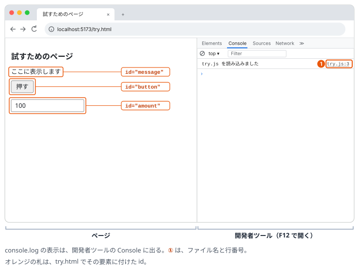
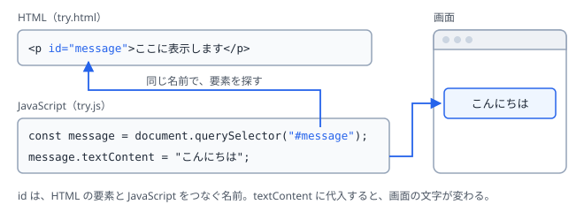
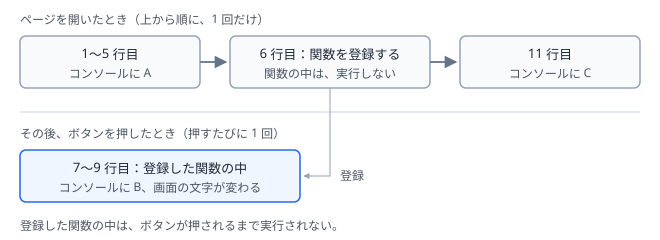

# 基礎編 第10章 画面を動かす

- **この章で学ぶこと**
  - ブラウザの画面の文字を JavaScript で書き換える
  - ボタンが押されたときに処理を実行する
  - 入力欄に打たれた値を使うときに、何が起きるか

---

## 10.1 HTML と JavaScript

ブラウザの画面は、**HTML** というファイルで作られています。JavaScript は HTML から読み込まれて、その画面を動かします。

この章のフォルダの `basics/exercises/B10-dom/try.html` には、次の行があります。

```html
<p id="message">ここに表示します</p>
<button id="button">押す</button>
<p><input id="amount" value="100" /></p>
<script type="module" src="./try.js"></script>
```

HTML では、`<p>` のような**タグ**で画面の部品を書きます。タグで作られた部品を**要素**と呼びます。配列の要素とは別のものです。

| 書き方 | 意味 |
| --- | --- |
| `<p>...</p>` | 文章の要素。間に書いた文字が表示される |
| `<button>...</button>` | ボタンの要素 |
| `<input />` | 入力欄の要素。`value="100"` は、最初に入っている文字 |
| `id="message"` | 要素に付けた名前。JavaScript から要素を探すときに使う |
| `<script ... src="./try.js">` | `try.js` を読み込んで実行する |

この章では HTML は書き換えず、JavaScript だけを書きます。

### 画面を開く

ターミナルで、次のコマンドを実行します。

```sh
npm run dev B10
```

ブラウザが開き、この章のページの一覧が表示されます。「試すためのページ」を押すと、`try.html` の画面が開きます。

- ブラウザは Chrome か Edge を使います。ほかのブラウザで開いたときは、表示されたアドレスを Chrome か Edge に貼り付けます。
- JavaScript のファイルを書き換えて保存すると、画面は自動で読み込み直されます。
- 終わるときは、ターミナルで `Ctrl`+`C` を押します。動かしている間は、そのターミナルにほかのコマンドを打てません。
- 動かしたまま別のコマンドを打つときは、VS Code の「ターミナル」→「新しいターミナル」で、2 つ目のターミナルを開きます（第0章の 0.2）。

### コンソールを開く

ブラウザで実行した `console.log` の表示は、ターミナルではなく、ブラウザの**コンソール**に出ます。

コンソールは、ブラウザで `F12` キー（macOS は `Cmd`+`Option`+`I`）を押し、開いた画面の「Console」（コンソール）を選ぶと表示されます。`try.js を読み込みました` と表示されていれば、`try.js` が実行されています。



この章のコード例は、`basics/exercises/B10-dom/try.js` に打ち、「試すためのページ」で動きを見ます（前のコード例は消してから打ちます）。

- 最初から書いてある 3 行（コメントの 2 行と `console.log` の行）も、消してから打ちます。

## 10.2 要素を取る

`document.querySelector("#名前")` は、その `id` の要素を探して返します。`#` は、「`id` で探す」という印です。

```js
const message = document.querySelector("#message");
console.log(message);
```

コンソールに、`<p id="message">` の要素が表示されます。`document` は、開いているページの全体を表すオブジェクトです。ブラウザが最初から用意しています。

## 10.3 文字を変える

要素もオブジェクトです。`textContent` というプロパティに文字列を代入すると、画面の文字が変わります。

```js
const message = document.querySelector("#message");
message.textContent = "こんにちは";
```

画面の「ここに表示します」が、「こんにちは」に変わります。



### 試す

2 行目の右側を、`` `合計: ${120 + 80}円` `` に変えて保存してください。

画面の表示は `合計: 200円` です。計算の結果を画面に出すときも、`console.log` のときと同じ書き方が使えます。

## 10.4 クリックに反応する

`要素.addEventListener("click", 関数)` と書くと、その要素がクリックされたときに、渡した関数が実行されます。

```js
const message = document.querySelector("#message");
const button = document.querySelector("#button");

button.addEventListener("click", () => {
  message.textContent = "押されました";
});
```

- `addEventListener` は、関数を登録するだけです。渡した関数の中は、その場では実行されません。登録が済むと、次の行に進みます。
- 渡した関数は、クリックされるたびに 1 回ずつ実行されます。呼ぶのはブラウザです。関数を引数で渡す形は、第9章の `map` や `filter` と同じです。
- 引数のないアロー関数は、`=>` の左に `( )` だけを書きます。
- 関数を先に `const show = () => { ... };` と変数に入れたときは、`addEventListener("click", show)` と名前だけを渡します。`show()` と書くと、その場で呼んだ結果を渡します（第9章の 9.1）。

## 問題 1：いつ実行されるか

`basics/exercises/B10-dom/problem-01.js`

```js
const message = document.querySelector("#message");
const button = document.querySelector("#button");
let count = 0;

console.log("A");
button.addEventListener("click", () => {
  count = count + 1;
  console.log("B");
  message.textContent = `${count} 回押されました`;
});
console.log("C");
```

ページを開く前に、上のコードを見て、次の 2 つを予測してください。

- ① ページを開いた直後に、コンソールに表示されるもの
- ② ボタンを 2 回押した後の、コンソールの表示と画面の文字

予測したら、ページの一覧から「問題 1」を開いて ① を見ます。次に、ボタンを 2 回押して ② を見ます。

<details>
<summary>答えと解説</summary>

**① ページを開いた直後は、`A` と `C` が表示されます。**

```
A
C
```

`B` は表示されません。`addEventListener` は関数を登録するだけで、関数の中は、その場では実行されません（10.4）。

**② 押すたびに、関数の中が 1 回実行されます。**

```
A
C
B
B
```

コンソールに `B` が 1 行だけ出て、横に `2` と出ることもあります。同じ表示が続くと、コンソールは 1 行にまとめて回数を出します。

画面の文字は、`2 回押されました` です。

`count` は、関数の外で宣言した変数です。関数が終わっても値が残るので、押すたびに 1 ずつ増えます。



</details>

## 10.5 入力欄の値を取り出す

入力欄の要素の `value` プロパティで、今打たれている内容を取り出せます。

```js
const amount = document.querySelector("#amount");
console.log(amount.value);
```

「試すためのページ」の入力欄には、最初から `100` が入っています。コンソールには `100` と表示されます。

**入力欄の `value` は、数字を打っても文字列です。** 表示は `100` でも、中身は数値の `100` ではなく、文字列の `"100"` です。`===` で比べると分かります。

```js
const amount = document.querySelector("#amount");
console.log(amount.value === "100");
console.log(amount.value === 100);
```

コンソールには、`true` と `false` が表示されます。文字列の `"100"` とは同じで、数値の `100` とは違います。

## 問題 2：入力欄の値を足す

`basics/exercises/B10-dom/problem-02.js`

```js
const amount = document.querySelector("#amount");
const button = document.querySelector("#add");
const result = document.querySelector("#result");

button.addEventListener("click", () => {
  result.textContent = amount.value + 20;
});
```

ページの一覧から「問題 2」を開きます。入力欄には `100` が入っています。「20 を足す」を押すと、画面に何が表示されるか予測してください。

<details>
<summary>答えと解説</summary>

```
10020
```

**`amount.value` は文字列の `"100"` なので、`+ 20` は足し算ではなく、つなぐ動きをします。**

入力欄の値は、数字を打っても文字列です（10.5）。文字列と数値の `+` は、数値を文字列に変えてからつなぎます（第1章の問題 1 の ⑤）。

計算に使うときは、`Number(...)` で数値に変えます（次の 10.6）。`problem-02.js` の 6 行目を `result.textContent = Number(amount.value) + 20;` に直して保存し、もう一度ボタンを押してください。`120` と表示されます。

</details>

## 10.6 文字列を数値に変える

**`Number(文字列)` で、文字列を数値に変えられます。** 入力欄の値を計算に使うときは、先に数値に変えます。

```js
console.log(Number("100") + 20); // → 120
console.log(Number("abc"));      // → NaN
console.log(Number(""));         // → 0
```

- 数値に変えられない文字列は、`NaN` になります（第6章の 6.2）。
- 何も打たれていない入力欄の値は、空の文字列 `""` です。`Number("")` は `0` です。空かどうかは、数値に変える前に `値 === ""` で調べます。

`NaN` かどうかは、`Number.isNaN(値)` で調べます。`値 === NaN` では調べられません。`NaN` は、`NaN` 自身と比べても `false` になる決まりです。

```js
const value = Number("abc");
console.log(Number.isNaN(value)); // → true
console.log(value === NaN);       // → false

if (Number.isNaN(value)) {
  console.log("数値ではありません");
}
// → 数値ではありません
```

## 10.7 要素が見つからないとき

`querySelector` は、その `id` の要素がないと `null` を返します。`null` は、`undefined` と似た、「ない」ことを表す値です。

```js
const message = document.querySelector("#mesage");
console.log(message);
message.textContent = "こんにちは";
```

1 行目は、`id` のつづりが違います。コンソールには `null` と表示され、3 行目は次のエラーになります。

```
Uncaught TypeError: Cannot set properties of null (setting 'textContent')
```

`message.addEventListener(...)` のように取り出す行では、`Cannot read properties of null (reading 'addEventListener')` と出ます。どちらも、`.` の左が `null` だという意味です。

`of null` と書かれたエラーが出たら、その要素を `querySelector` で取っている行の `"` の中と、HTML の `id` を見比べます。`#` を書き忘れると、タグの名前で探します。その名前のタグがなければ、同じエラーになります。

ブラウザのエラーもコンソールに出ます。ファイル名と行番号は、図10-1 の `try.js:3` と同じく、その行の右端に出ます。

- 先頭の `Uncaught` は、読み飛ばして構いません。
- 保存して読み込み直した後は、`try.js?t=1794757813954:3` のように、間に `?t=数字` が入ります。

---

演習 1 と演習 2 には、`npm test` での答え合わせがありません。画面を操作して、それぞれの「画面で確かめること」がすべて当てはまれば完了です。

解答例の画面は、`npm run dev B10 answer` で開けます。自分の画面と見比べるときに使います。

## 演習 1：間違いを直す

`basics/exercises/B10-dom/practice-01.js` は、ボタンを押すと「こんにちは」と表示するプログラムです。間違いが 2 つあります。直して、下の「画面で確かめること」のとおりに動かします。

**画面で確かめること**

- [ ] ページを開いたときに、コンソールにエラーが出ない
- [ ] 「あいさつする」を押すと、「ボタンを押してください」が「こんにちは」に変わる

**進め方**

1. ページの一覧から「演習 1」を開き、コンソールを見る
   - 画面を止めていたときは、次のコマンドで起動し直します
   ```sh
   npm run dev B10
   ```
   - **こうなれば OK**：コンソールに、`Uncaught TypeError` で始まるエラーが出ている
2. 1 つ目の間違いを直して、保存する
   - エラーが示す行は、`button` を使っている行です。その `button` を取っている `querySelector` の行を直します
   - **こうなれば OK**：画面が読み込み直され、コンソールにエラーが出なくなる
3. 「あいさつする」を押して、画面を見る
   - 2 つ目の間違いは、エラーが出ません
   - **こうなれば OK**：エラーは出ず、「ボタンを押してください」のまま変わらない
4. 2 つ目の間違いを探して直し、保存する
   - **こうなれば OK**：上の「画面で確かめること」がすべて当てはまる

<details>
<summary>ヒント 1：1 つ目の間違い</summary>

```
Uncaught TypeError: Cannot read properties of null (reading 'addEventListener')
```

`of null` のエラーです（10.7）。`button` を取っている行の `"` の中を、`practice-01.html` の `id` と見比べます。

</details>

<details>
<summary>ヒント 2：2 つ目の間違い</summary>

2 つ目は、エラーが出ません。ボタンを押しても、画面が変わりません。

プロパティの名前は、大文字と小文字が区別されます。ない名前のプロパティに代入すると、エラーにならず、その名前のプロパティが新しく足されます（第8章の 8.2）。関数の中の行を、10.3 のコード例と 1 文字ずつ見比べます。

</details>

<details>
<summary>うまくいかないとき</summary>

| 画面やコンソールの様子 | よくある原因 |
| --- | --- |
| 直したのに、同じエラーが出る | ファイルを保存していません |
| エラーは出ないが、押しても変わらない | 2 つ目の間違いが残っています（ヒント 2） |
| ページが開かない | `npm run dev B10` を止めています。もう一度実行します |

</details>

解答例：[basics/solutions/B10-dom/practice-01.js](../solutions/B10-dom/practice-01.js)

## 演習 2：カウンターを作る

ボタンで数を増やしたり、0 に戻したりする画面を作ります。`basics/exercises/B10-dom/practice-02.js` には、要素を取る行と、数を入れる変数 `count` の宣言が書いてあります。その下を書きます。

**画面で確かめること**

- [ ] 「1 増やす」を押すたびに、数が `1`、`2`、`3` と増える
- [ ] 「0 に戻す」を押すと、数が `0` になる
- [ ] 「0 に戻す」の後に「1 増やす」を押すと、`1` になる

**進め方**

1. `basics/exercises/B10-dom/practice-02.js` に、「1 増やす」が押されたときの処理を書く
   - ファイルの上の、3 つの要素と `count` の宣言を読んでから書きます
   - **こうなれば OK**：「演習 2」のページで「1 増やす」を押すたびに、数が 1 ずつ増える
2. 「0 に戻す」が押されたときの処理を書く
   - **こうなれば OK**：上の「画面で確かめること」がすべて当てはまる

<details>
<summary>ヒント 1：どこを見ればよいか</summary>

問題 1 のコードが、ほぼ同じ形です。押されたときにすることは、「`count` を入れ直す」と「`count` を画面に表示する」の 2 つです。

</details>

<details>
<summary>ヒント 2：書き出し</summary>

```js
plusButton.addEventListener("click", () => {
  // count を 1 増やす
  // countText の文字を、count にする
});
```

「0 に戻す」のボタンにも、同じ形でもう 1 つ書きます。

</details>

<details>
<summary>うまくいかないとき</summary>

| 画面やコンソールの様子 | よくある原因 |
| --- | --- |
| 何回押しても `1` のまま | `count` を入れ直していません。`countText.textContent = count + 1;` では、`count` の値は変わりません |
| ページを開いた時点で `1` になり、押しても変わらない | `addEventListener("click", plus())` のように、関数に `( )` を付けて渡しています（10.4） |
| 押すたびに `01`、`011` と伸びる | `countText.textContent + 1` と書いています。画面の文字は文字列なので、つながります。足す相手は `count` です |
| 押しても何も変わらない | `count` は入れ直していますが、画面に表示する行がありません |
| 「0 に戻す」の後に押すと、`4` などの続きの数になる | 「0 に戻す」で、画面の文字だけを `0` にしています。`count` も `0` に入れ直します |

</details>

解答例：[basics/solutions/B10-dom/practice-02.js](../solutions/B10-dom/practice-02.js)

## 演習 3：金額を足していく

入力欄に金額を打って「足す」を押すと、合計が増えていく画面を作ります。

ファイルは 2 つに分かれています。

| ファイル | 書くもの | 確かめ方 |
| --- | --- | --- |
| `basics/exercises/B10-dom/practice-03.js` | 計算をする関数 `addAmount` | `npm test B10` |
| `basics/exercises/B10-dom/practice-03-page.js` | 画面のコード | 画面で確かめること |

`addAmount(total, text)` は、今の合計 `total` に、入力欄の文字列 `text` を足した結果を返します。

| 呼び出し | 返す値 |
| --- | --- |
| `addAmount(1000, "500")` | `1500` |
| `addAmount(0, "1200")` | `1200` |
| `addAmount(1000, "abc")` | `1000`（数値に変えられないときは、足さない） |
| `addAmount(1000, "")` | `1000` |

**画面で確かめること**

- [ ] `1200` と打って「足す」を押すと、`合計: 1200円` と表示される
- [ ] 続けて入力欄を `500` に打ち直して「足す」を押すと、`合計: 1700円` と表示される
- [ ] 入力欄を `abc` に打ち直して「足す」を押しても、合計は変わらない

**進め方**

1. `basics/exercises/B10-dom/practice-03.js` の `addAmount` を書く
   - 文字列を数値に変える `Number(text)` と、`NaN` かどうかを調べる `Number.isNaN(値)` を使います（10.6）
   - **こうなれば OK**：`addAmount` の中に、`Number(text)` と `Number.isNaN(` がある
2. 答え合わせをする
   - 画面を動かしたまま、2 つ目のターミナルで打ちます（10.1）
   ```sh
   npm test B10
   ```
   - **こうなれば OK**：`演習 3  合格` と表示される
3. `basics/exercises/B10-dom/practice-03-page.js` に、「足す」が押されたときの処理を書く
   - `addAmount` を呼んで `total` を入れ直し、画面に表示します
   - 先頭の `import` で始まる行は、別のファイルに書いた関数を使うための行です。この行があるので、`addAmount` を呼べます
   - 入力欄の値（`value`）は、押されたときに関数の中で取り出します
   - **こうなれば OK**：「演習 3」のページで、上の「画面で確かめること」がすべて当てはまる

<details>
<summary>ヒント 1：<code>addAmount</code></summary>

先に `Number(text)` の結果を変数に入れます。その変数が `NaN` なら `total` を返し、そうでなければ足した結果を返します。`return` で関数が終わること（第6章の 6.4）を使います。

</details>

<details>
<summary>ヒント 2：画面のコード</summary>

押されたときにすることは 2 つです。

- `total` を、`addAmount(total, 入力欄の値)` の結果で入れ直す。
- `totalText` の文字を、テンプレート文字列で `合計: ○○円` の形にする。

入力欄の値は、押されたときに取り出します。`amount.value` は、関数の中に書きます。

</details>

<details>
<summary>うまくいかないとき</summary>

| 画面やコンソールの様子 | よくある原因 |
| --- | --- |
| `npm test` の「実際の値」が `"1000500"` | `text` を数値に変えずに足しています（問題 2、10.6） |
| `npm test` の「実際の値」が `NaN` | `NaN` かどうかを調べていないか、`=== NaN` で比べています。`Number.isNaN` に渡すのは、数値に変えた後の値です |
| 画面が `合計: 01200円`、次に `合計: 01200500円` | 画面のコードで `addAmount` を呼ばずに、`total + amount.value` と書いています |
| 押しても画面が `合計: 0円` のまま | 表示する行がないか、`addAmount` に `amount.value` ではなく `amount` を渡しています。`amount.value` を関数の外で取り出している場合も、同じ表示です |
| 全角の数字を打つと、合計が変わらない | 正しい動きです。`Number("１２００")` は `NaN` です |

</details>

解答例：[basics/solutions/B10-dom/practice-03.js](../solutions/B10-dom/practice-03.js)、[basics/solutions/B10-dom/practice-03-page.js](../solutions/B10-dom/practice-03-page.js)

---

## チェックリスト

- [ ] 問題 1 で、ページを開いた直後に `B` が表示されない理由を説明できる
- [ ] 入力欄の値を計算に使うときに、`Number(...)` が要る理由を説明できる
- [ ] `of null` のエラーが出たときに、どの行を見るかを説明できる
- [ ] 画面で、演習 1〜3 の「画面で確かめること」が、すべて当てはまった

## 詳しく学ぶ

- MDN：[Document: querySelector()](https://developer.mozilla.org/ja/docs/Web/API/Document/querySelector)、[Node: textContent](https://developer.mozilla.org/ja/docs/Web/API/Node/textContent)、[EventTarget: addEventListener()](https://developer.mozilla.org/ja/docs/Web/API/EventTarget/addEventListener)
