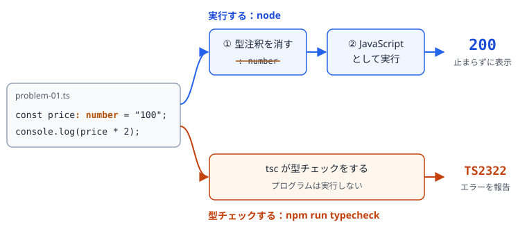
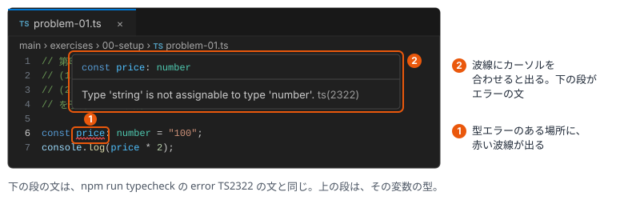

# 第0章 環境構築

- **この章で学ぶこと**
  - TypeScript のファイルを `node ファイル名.ts` で実行する
  - 型が間違っているファイルを実行したとき、何が起きるか
  - 答え合わせの 3 つのコマンド（`npm test`・`npm run typecheck`・`npm run check`）と、Git での進み具合の残し方

---

基礎編を終えた人は、道具と教材の準備（0.1・0.2）が済んでいます。同じ `TSLecture` フォルダのまま、0.3 から始めます。

## 0.1 必要なもの

| ツール | 用途 |
| --- | --- |
| Node.js 26（24 以降なら動きます） | TypeScript を実行する |
| npm（Node.js に付属） | パッケージ（他の人が作ったプログラム）を入れる |
| Visual Studio Code | コードを書く・型エラーを見る |
| Git | 教材をダウンロードする・演習の進み具合を残す |

> **PHPでは**
> Node.js は `php` コマンドにあたります。

VS Code は [公式サイト](https://code.visualstudio.com/) から入手できます。

Node.js は [公式サイト](https://nodejs.org/ja) から LTS 版（長期サポート版）をインストールしてください。インストールできたら、ターミナルで次のコマンドを実行します。

```sh
node --version
```

`v26.` のように、24 以上の数字が表示されれば準備完了です。古いバージョンが表示された場合は、[つまずき集](../../troubleshooting.md) を見てください。

> **コラム: この教材が前提としているバージョン**
> 動作は Node.js 26 と TypeScript 7 で確認しています。Node.js は、型の情報を消すだけで JavaScript になる書き方なら、`.ts` ファイルをそのまま実行できます。そのため、この教材では `enum` など一部の構文を扱いません。

## 0.2 教材の準備

**この教材のコマンドは、すべて `TSLecture` フォルダで実行します。**

1. ターミナルで教材をダウンロードする（`TSLecture` フォルダができます）

   ```sh
   git clone <このリポジトリのURL>
   ```

   `<このリポジトリのURL>` には、研修で案内された URL を入れます。

2. VS Code のメニュー「ファイル」→「フォルダーを開く」で `TSLecture` フォルダを開く。「このフォルダー内のファイルの作成者を信頼しますか?」と聞かれたら、「はい、作成者を信頼します」を選ぶ
3. メニュー「ターミナル」→「新しいターミナル」を開き、パッケージを入れる（このターミナルは、最初から `TSLecture` フォルダにいます）

   ```sh
   npm install
   ```

`npm install` は、`package.json` に書かれたパッケージを `node_modules/` フォルダに入れるコマンドです。`npm install` がエラーなく終わり、画面の左の一覧に `node_modules` が増えれば、準備は完了です。`npm warn` で始まる警告（`fsevents` など）は気にしなくて構いません。

> **PHPでは**
> `npm install` は `composer install` にあたります。`package.json` は `composer.json`、`node_modules/` は `vendor/` にあたります。

> **コラム: 設定ファイルについて**
> フォルダには `package.json` や `tsconfig.json` などの設定ファイルがあります。中身は理解しなくて構いません。触らずに使います。

## 0.3 最初の実行

`main/exercises/M00-setup/hello.ts` を開きます。

```ts
console.log("Hello, TypeScript!");
```

`console.log` は、値をターミナルに表示する関数です。ターミナルで次のように実行します。

```sh
node main/exercises/M00-setup/hello.ts
```

```
Hello, TypeScript!
```

`node ファイル名.ts` と打てば、TypeScript のファイルを実行できます。

> **PHPでは**
> `console.log` は `echo` や `var_dump` に、`node hello.ts` は `php hello.php` にあたります。

## 0.4 この教材の進め方

各章は、下の「1 章の流れ」の順に進めます。詰まったときの対処と、教材全体の決まりも、この節にまとめます。

### 1 章の流れ

1. 節の説明とコード例を読む
2. 「問題」の結果を予測して書き留めてから、実行して答えの折りたたみを開く
   - 型エラーの問題では、コードも直します
3. 演習を解く（途中は `npm test`、最後に `npm run check`。コマンドは 0.6）
   - 関数が何を返すかは、演習の「テストで確かめるもの」の表と、ファイルの関数の上のコメントにあります
   - 最後の `npm run check` で `problem-` のファイルの型エラーが出たら、その問題に戻って直します
4. チェックリストを見て、コミットする（0.7）

### 詰まったとき

上の行から順に試します。

| 症状 | 対処 |
| --- | --- |
| 演習の書き方が分からない | 演習の「ヒント 1」「ヒント 2」を順に開く |
| 演習のテストや型チェックが通らない | 演習の「テストが失敗したら」の表で、表示に合う行を探す |
| 問題を 15 分ほど考えても分からない | 答えを開いて読む。答えも教材の一部です |
| ここまでで解決しない表示やエラーが出る | [つまずき集](../../troubleshooting.md) を見る |
| 基礎がぐらついた | 次の表の基礎編の章に戻る |

基礎編は、必要な章だけを読んで構いません。

| 本編で詰まった所 | 戻る基礎編の章 |
| --- | --- |
| エラーの表示が読めない（どの章でも） | [第3章 エラーを読む](../../basics/chapters/B03-errors.md) |
| 第1章の対応表の基本の文法、第2章の値と変数 | [第1章 値と計算](../../basics/chapters/B01-values.md)〜[第5章 配列と繰り返し](../../basics/chapters/B05-arrays-loops.md) |
| 第3章の関数とコールバック | [第6章 関数](../../basics/chapters/B06-functions.md)、[第7章 関数を組み合わせる](../../basics/chapters/B07-combining.md) |
| 第4章・第5章のオブジェクト | [第8章 オブジェクト](../../basics/chapters/B08-objects.md) |
| 第7章の配列のメソッド | [第9章 配列のメソッド](../../basics/chapters/B09-array-methods.md) |
| 第10章の画面とイベント | [第10章 画面を動かす](../../basics/chapters/B10-dom.md) |

### 決まり

- 書き換えてよいのは、演習のファイル（`problem-*.ts`・`practice-*.ts`）、`main/exercises/try.ts`、自分で作ったファイルだけです。ほかを書き換えると、`git pull` で競合することがあります。
- 本文のコード例（第10・11章の画面の例を除く）は、`main/exercises/try.ts` に貼って `node main/exercises/try.ts` で試せます。この 1 つのファイルを全章で使い回します（基礎編の `try.js` は章ごとでした）。前のコード例は消してから貼ります（同じ名前の変数を 2 回宣言すると、エラーになります）。
- 解答例は `main/solutions/` にあります。
- 問題の番号は章ごとに 1 からです。ほかの章の問題は「第3章の問題 1」と呼びます。
- 技術どうしの関係は [学ぶ技術の関係](../../overview.md)、講座で説明しないツールは [ツール一覧](../../tools.md) にあります。

> **PHPでは**
> 問題の答えには、PHP との違いを書いた「PHPでは」のコラムがあります。予測を外したら、PHP との違いが原因でないかをここで調べます。

## 問題 1：型が違う値を入れて実行する

`main/exercises/M00-setup/problem-01.ts` には、次のコードが書かれています。

```ts
const price: number = "100";
console.log(price * 2);
```

`const price: number` は、再代入しない変数 `price` を作り、型を `number`（数値）にするという意味です（第2章）。右側の `"100"` は文字列です。

`npm run typecheck` は、型が合っているかを調べるコマンドです。`npm run 名前` は、`package.json` の `scripts` に書いたコマンドを動かします。`npm run typecheck M00 problem-01` の `M00` は第0章を表す章ID、`problem-01` は「このファイルだけを調べる」という指定です（詳しくは 0.6）。

次の 2 つを予測してください。まだ説明していないので、PHP の感覚で予想して構いません。

1. `node main/exercises/M00-setup/problem-01.ts` を実行すると、何が表示されるか
2. `npm run typecheck M00 problem-01` を実行すると、型エラーは出るか

<details>
<summary>答えと解説</summary>

**1. node で実行した結果**

```
200
```

エラーにならず、そのまま実行されます。

**2. npm run typecheck M00 problem-01 の結果**

```
main/exercises/M00-setup/problem-01.ts(6,7): error TS2322: Type 'string' is not assignable to type 'number'.
```

型エラーが出ます。`(6,7)` はエラーの場所です（読み方は 0.5）。ファイルの先頭に、本文で省いたコメントなどが 5 行あるので、`price` の行は 6 行目です。

**解説**

**実行と型チェックは、別々の作業です。** `node` は型チェックをせずに実行し、型の間違いは `npm run typecheck` が見つけます。

`node` で `.ts` ファイルを実行すると、Node.js は**型注釈（`: number` の部分）を消してから**、残った JavaScript を実行します。実際に動いたのは次のコードです。

```js
const price = "100";
console.log(price * 2);
```

文字列に `*` を使うと、自動的に数値に変換されます。そのため `"100" * 2` は `200` になりました。



この性質は第2章の 2.5 でもう一度扱います。

> **PHPでは**
> PHP では、種類を書いた引数に合わない値を渡すと、エラーで止まることがあります。TypeScript の型は、実行時には何もしません。

</details>

## 0.5 型エラーを読む

型エラーは、エディタでも見られます。VS Code で `problem-01.ts` を開くと、型エラーのある箇所に赤い波線が出ます。波線にマウスカーソルを合わせると、`npm run typecheck` と同じエラーメッセージが表示されます。



エラーの表示は、次のように読みます。

| 部分 | 意味 |
| --- | --- |
| `main/exercises/M00-setup/problem-01.ts` | エラーのあるファイル |
| `(6,7)` | 6 行目の 7 文字目 |
| `TS2322` | エラーの番号。検索すると解説が見つかりやすい |
| `Type 'string' is not ...` | エラーの内容 |

エディタのエラーは、英語で表示する設定にしてあります。日本語で表示されても意味は同じで、末尾の `ts(2322)` で対応を取れます。

波線を見たら、次の手順で直します。

1. `problem-01.ts` の `"100"` を `100` に書き換えて保存する
2. 赤い波線が消えたことを見る

## 0.6 答え合わせの方法

各章の演習は `main/exercises/章ID-名前/` フォルダにあります（第2章なら `main/exercises/M02-types/`）。章ID は、本編の記号 `M` と 2 けたの章番号です。

| したいこと | 使うもの |
| --- | --- |
| 書きながら型エラーを見る | エディタの赤い波線 |
| プログラムの動きを見る | `node ファイル名.ts` |
| 演習の途中で、関数の値を調べる（テスト） | `npm test 章ID` |
| 型だけを調べる（型チェック） | `npm run typecheck 章ID` |
| 演習の最後とコミットの前に、両方を調べる | `npm run check 章ID` |

`npm test` と `npm run typecheck` は、章ID の後ろに拡張子を除いたファイル名を足すと、`npm test` はそのファイルのテストだけを実行し、`npm run typecheck` はそのファイルの型エラーだけを表示します（`npm test M02 practice-01`）。`npm run check` は、いつも章全体を調べます。

0.5 で `problem-01.ts` を直した後に `npm run check M00` を実行すると、次のように表示されます。見出しの `tsc` は型チェックをするプログラム、`node --test` はテストを動かす仕組みです。

```
=== 型チェック（tsc --noEmit -p main/exercises/M00-setup） ===

型エラーはありません。

=== テスト（node --test main/exercises/M00-setup/**/*.test.ts） ===

✖ double(3) は 6 を返す（まだ実装していません）
✖ double(0) は 0 を返す（まだ実装していません）
✖ double(-2.5) は -5 を返す（まだ実装していません）

=== 結果 ===
型チェック: OK
テスト: 不合格あり
```

**完了の目安は、「型チェック: OK」と「テスト: OK」の両方がそろうことです。** テストだけが OK でも、型が間違っていることがあります（第2章 2.5）。

> **コラム: テストの結果の読み方**
> テストのファイル（`practice-01.test.ts`）には、`test("double(3) は 6 を返す", ...)` のように、関数が満たすべきことが書かれています。失敗すると、`✖` の行にテストの名前が出ます。その下の `--- 失敗の内容 ---` の `5 !== 6` は、「実際は 5 だったが、6 を期待していた」という意味です。まだ書いていない関数には「（まだ実装していません）」と出ます。ほかの読み方は [つまずき集](../../troubleshooting.md) にあります。

## 演習：受け取った数を 2 倍にする

`main/exercises/M00-setup/practice-01.ts` を開いてください。

```ts
export function double(n: number): number {
  throw new Error("TODO: ここを実装してください");
}
```

受け取った数を 2 倍にして返す関数です。読み方は次のとおりです。

- `export`：この関数を、他のファイルから使えるようにする印です。答え合わせのテストが、この関数を呼び出すために付けています（第8章で詳しく扱います）。
- `n: number`：引数 `n` の型は `number`（数値）です。型は、名前の後ろに `:` を付けて書きます。
- `): number`：戻り値の型も `number` です。
- `throw new Error(...)`：エラー（例外）を投げます。まだ実装していないことを示すために置いています。

> **PHPでは**
> PHP の `function double($n) { return $n * 2; }` にあたります。`throw new Error(...)` は、PHP の `throw new Exception(...)` にあたります。

**進め方**（関数の書き方は第3章）

1. 書き換える前に、テストを実行する。`✖` の行が 3 つ出ます

   ```sh
   npm test M00
   ```

2. `throw` の行を次のように書き換えて、保存する

   ```ts
     return n * 2;
   ```

3. 型チェックとテストを実行する。最後が次の表示になれば完了です

   ```sh
   npm run check M00
   ```

   ```
   === 結果 ===
   型チェック: OK
   テスト: OK
   ```

## 0.7 演習の進み具合を Git で残す

演習のファイルは、直接書き換えて進めます（書き換えてよいファイルは 0.4 の「決まり」）。章を終えたら（チェックリストを見た後に）、変更をコミットします。

```sh
git add .
git commit -m "第0章の演習"
```

この教材では、次の場面で Git を使います。

| 場面 | コマンド |
| --- | --- |
| 自分が変えた箇所を確かめる | `git status`、`git diff` |
| まだ `git add` していない変更を取り消す | `git restore ファイル名` |
| 配布時の状態に戻す | `git restore --source=origin/main ファイル名` |
| 教材の更新を受け取る | `git pull` の後に `npm install` |

---

## チェックリスト

- [ ] `node --version` で 24 以上の数字が表示された
- [ ] `node main/exercises/M00-setup/hello.ts` を実行できた
- [ ] 型エラーがあっても `node` では実行できる理由を説明できる

## 詳しく学ぶ

- JavaScript Primer：[JavaScriptとは](https://jsprimer.net/basic/introduction/)、[値の評価と表示](https://jsprimer.net/basic/read-eval-print/)（`console.log` について）
- サバイバルTypeScript：[JavaScriptはTypeScriptの一部](https://typescriptbook.jp/overview/javascript-is-typescript)
