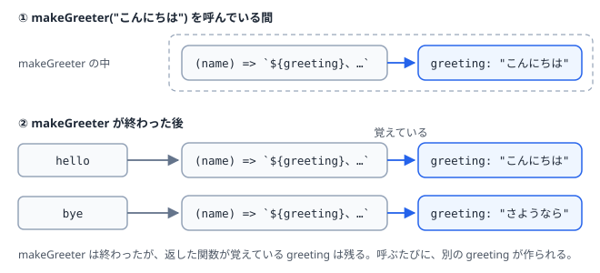
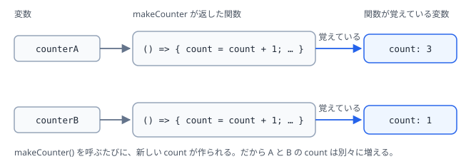

# 第3章 関数とコールバック

- **この章で学ぶこと**
  - アロー関数の書き方と、`{}` を書くかどうかの違い
  - 関数を値として渡す書き方（コールバック）と、その型の書き方
  - 関数を返す関数が、外の変数をどう扱うか（クロージャ）

---

## 3.1 アロー関数

`(引数) => 式` の形で書く関数を、**アロー関数**と呼びます。名前がないので、`const` の変数に入れるか、別の関数にそのまま渡して使います。

```ts
// 通常の関数
function add(a: number, b: number): number {
  return a + b;
}

// アロー関数
const subtract = (a: number, b: number): number => a - b;

console.log(add(5, 3));      // → 8
console.log(subtract(5, 3)); // → 2
```

`=>` の右に式を 1 つだけ書くと、関数はその式の値を返します。処理が複数行になるときは `{}` で囲み、**戻り値は `return` で返します。** `{}` の中に `return` がない関数は、`undefined` を返します。

```ts
const describe = (price: number) => {
  const tax = price * 0.1;
  return `${price}円（税 ${tax}円）`;
};

console.log(describe(1000)); // → 1000円（税 100円）
```

`(price: number)` の後ろに戻り値の型を書かなくても、`return` している値から推論されます。

## 問題 1：`{}` と `return`

`main/exercises/M03-functions/problem-01.ts`

```ts
const half = (n: number) => n / 2;
const quarter = (n: number) => {
  const result = n / 4;
};
const label = (n: number) => {
  half(n);
  return `${n}円`;
};

console.log(half(8) + 1); // ①
console.log(quarter(8));  // ②
console.log(label(50));   // ③
```

`node main/exercises/M03-functions/problem-01.ts` を実行すると、①〜③ でそれぞれ何が表示されるか予測してください。

<details>
<summary>答えと解説</summary>

```
5
undefined
50円
```

- ①：`{}` がないので、`8 / 2` の `4` が戻り値です。そこに `1` を足します。
- ②：`{}` の中に `return` がないので、戻り値は `undefined` です。
- ③：`half(n)` の戻り値はどこにも使っていません。`n` は `50` のままです。

</details>

## 3.2 戻り値の型を書くと、`return` 忘れに気づける

この例のように戻り値の型を `number` と書くと、`return` を忘れたときに型エラーになります。

```ts
const triple = (n: number): number => {
  n * 3;
};
// エラー: A function whose declared type is neither 'undefined', 'void', nor 'any' must return a value.
```

エラーの番号は TS2355 です。エラー文の `void` は、「何も返さない」ことを表す型です。`any` は、第2章 2.5 で出た、型チェックをしない型です。

## 3.3 関数を値として渡す（コールバック）

関数は、数値や文字列と同じように値として扱えます。別の関数に渡す関数を、**コールバック**と呼びます。

```ts
function applyToAll(
  values: number[],
  convert: (n: number) => number,
): number[] {
  const result: number[] = [];
  for (const value of values) {
    result.push(convert(value));
  }
  return result;
}

console.log(applyToAll([1, 2, 3], (n) => n * 10)); // → [ 10, 20, 30 ]
```

`convert(value)` が、渡された関数を呼ぶ箇所です。最初の要素 `1` では `convert(1)` が `(n) => n * 10` を呼び、返った `10` を `result` に足します。

- `number[]` は「数値の配列」の型です。空の配列 `[]` は見ただけでは何の配列か分からないので、`result` には型を書きます。
- `(n: number) => number` は「数値を 1 つ受け取り、数値を返す関数」の型です。引数の名前（`n`）は、型としては意味を持ちません。
- `=>` の右は、関数の型では戻り値の型、アロー関数（3.1 の `(a: number, b: number): number => a - b`）では処理です。この例では、引数 `convert` の `:` の後ろが関数の型です。
- 渡す側のアロー関数 `(n) => n * 10` には、型を書いていません。`convert` の型から、`n` は `number` だと推論されます。

配列のメソッド `forEach` も、コールバックを受け取ります。

```ts
const prices = [120, 80];
prices.forEach((price) => {
  console.log(`${price}円`);
});
// → 120円
// → 80円
```

> **PHPでは**
> PHP の `array_map` に関数を渡すのと同じ考え方です。TypeScript では、受け取る関数の形を `(n: number) => number` のように書きます。

## 3.4 関数を返す関数とクロージャ

関数は、戻り値にもできます。**内側の関数は、作られた場所の外側の変数を覚えていて、外側の関数が終わった後も使えます。** この仕組みを**クロージャ**と呼びます。

```ts
function makeGreeter(greeting: string) {
  return (name: string) => `${greeting}、${name}`;
}

const hello = makeGreeter("こんにちは");
const bye = makeGreeter("さようなら");

console.log(hello("Alice")); // → こんにちは、Alice
console.log(bye("Alice"));   // → さようなら、Alice
```



- `makeGreeter` を呼ぶたびに、新しい `greeting` が用意されます。`hello` と `bye` は、それぞれ別の `greeting` を覚えています。
- 内側の関数は、覚えている変数を読み書きできます。書き換えた値は、次に呼んだときも残っています。

> **PHPでは**
> PHP の `function 名前()` で宣言した関数の中からは、外の変数をそのままは使えません。TypeScript の関数は、外の変数をそのまま使え、関数を返した後もその変数を覚えています。

## 問題 2：2 つのカウンター

`main/exercises/M03-functions/problem-02.ts`

```ts
function makeCounter() {
  let count = 0;
  return () => {
    count = count + 1;
    return count;
  };
}

const counterA = makeCounter();
const counterB = makeCounter();
counterA();
counterA();

console.log(counterA()); // ①
console.log(counterB()); // ②
```

`node main/exercises/M03-functions/problem-02.ts` を実行すると、① と ② でそれぞれ何が表示されるか予測してください。

<details>
<summary>答えと解説</summary>

```
3
1
```

- ①：`counterA` は、覚えている `count` を 2 回増やした後なので、3 回目の呼び出しで `3` です。
- ②：`counterB` は `makeCounter()` をもう一度呼んで作った関数です。別の `count` を覚えているので、`1` です。



</details>

---

## 演習：関数を受け取る関数、関数を返す関数

関数を受け取る関数と、関数を返す関数を 1 つずつ書きます。

**進め方**

#### 関数を受け取る関数を書く

1. `main/exercises/M03-functions/practice-01.ts` の、`countIf` の `throw` の行を書き換える
   - `let count = 0;` で数える変数を作ります
   - 3.3 の `applyToAll` と同じように、`for...of` で要素を順に見ます
   - `condition(value)` が `true` のときだけ、`count` を 1 増やします
   - 最後に `return count;` で返します
   ```sh
   npm test M03
   ```
   - **こうなれば OK**：テストの表示で、テスト名が `countIf` で始まる行がすべて `✔` になる

#### 関数を返す関数を書く

2. `makeMultiplier` の `throw` の行を書き換える
   - 3.4 の `makeGreeter` と同じ形で、アロー関数を `return` します
   - 戻り値の型 `(n: number) => number` は、「数値を受け取って数値を返す関数」を返すという意味です。`return (n) => ...` の `n` の型は、ここから決まります
   ```sh
   npm test M03
   ```
   - **こうなれば OK**：テストの表示で、テスト名が `makeMultiplier` で始まる行がすべて `✔` になる

#### 仕上げる

3. 章全体の型チェックとテストを実行する
   ```sh
   npm run check M03
   ```
   - **こうなれば OK**：「型チェック: OK」「テスト: OK」

**テストで確かめるもの**

| 呼び出し | 返す値 |
| --- | --- |
| `countIf([1, 5, 10], (n) => n >= 5)` | `2` |
| `countIf([], (n) => n > 0)` | `0` |
| `makeMultiplier(3)` | 「受け取った数に 3 を掛ける関数」 |
| `makeMultiplier(3)(4)`（返ってきた関数に 4 を渡す） | `12` |

<details>
<summary>ヒント 1：どこを見ればよいか</summary>

- `countIf`：`applyToAll` の `result.push(convert(value));` の行が、条件に合うときに数える処理に変わります。
- `makeMultiplier`：`makeGreeter` の `greeting` にあたるものが `factor` です。

</details>

<details>
<summary>ヒント 2：書き出し</summary>

- `countIf`：`for...of` の中に `if (condition(value)) { ... }` と書きます。
- `makeMultiplier`：`return (n) => ...;` と書き、アロー関数の中で `factor` を使います。

</details>

<details>
<summary>テストが失敗したら</summary>

| 表示 | よくある原因 |
| --- | --- |
| `3 !== 2` | `countIf` が、条件を確かめずに全部数えています |
| `undefined !== 2` と `undefined !== 0`（型チェックで `A function whose declared type is neither 'undefined', 'void', nor 'any' must return a value.`） | `countIf` の最後に `return count;` を書いていません |
| `undefined !== 12` と `undefined !== 10`（同時に「makeMultiplier が返した関数を、countIf の条件の中で使える」も `0 !== 2` で失敗する） | 返したアロー関数が、何も返していません。`{}` を書いたなら、中に `return` が必要です（3.1） |
| 型チェックで `Type '(n: number) => void' is not assignable to type '(n: number) => number'.` | 上と同じ原因です |
| 「`makeMultiplier` は呼ぶたびに別の関数を返す」だけが失敗する（`15 !== 10`） | 返す関数の中で、`factor` ではなく `3` を直接書いています。受け取った `factor` を使います |
| 型チェックで `Cannot find name 'n'.`（同時に `Type 'number' is not assignable to type '(n: number) => number'.`、テストで `n is not defined`） | `makeMultiplier` が、関数ではなく計算の結果を返そうとしています。`return (n) => ...;` の形で、関数を返します |

</details>

解答例：[main/solutions/M03-functions/practice-01.ts](../solutions/M03-functions/practice-01.ts)

---

## チェックリスト

- [ ] `(n) => n * 3` と `(n) => { n * 3; }` の戻り値の違いを説明できる
- [ ] 問題 2 の ① と ② が違う値になる理由を、「クロージャ」という言葉を使って説明できる

## 詳しく学ぶ

- JavaScript Primer：[関数と宣言](https://jsprimer.net/basic/function-declaration/)、[関数とスコープ](https://jsprimer.net/basic/function-scope/)（クロージャについて）
- サバイバルTypeScript：[アロー関数](https://typescriptbook.jp/reference/functions/arrow-functions)、[関数の型の宣言](https://typescriptbook.jp/reference/functions/function-type-declaration)、[コールバック関数](https://typescriptbook.jp/reference/functions/callback-functions)
