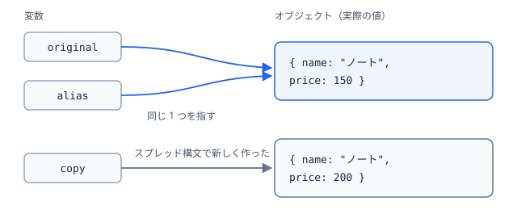
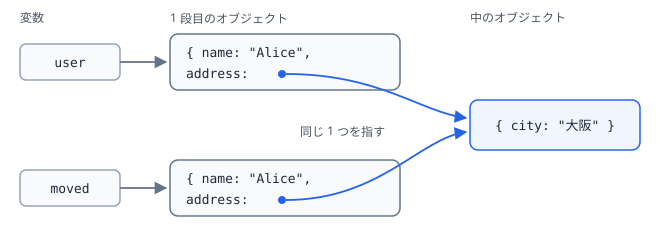

# 第4章 オブジェクトと配列

- **この章で学ぶこと**
  - 分割代入とスプレッド構文の書き方
  - オブジェクトや配列を代入したり、関数に渡したりしたときに何が起きるか
  - 元を変えずに新しいものを作る書き方と、コピーされる範囲

---

## 4.1 オブジェクトと配列の型

オブジェクトの型は `{ 名前: 型; ... }` と書きます（配列の型 `型[]` は第3章 3.3）。変数の型は、値から推論されます。名前の付いた値（`name` や `price`）はプロパティと呼びます（第1章 1.7）。

```ts
const item = { name: "ノート", price: 120 }; // { name: string; price: number } と推論される
const tags = ["文具", "セール"];              // string[] と推論される

console.log(item.price); // → 120
console.log(tags[0]);    // → 文具
```

下の `priceLabel` のように関数を宣言するときは、引数に型を書きます。プロパティは、値では `,` で区切り、型ではふつう `;` で区切ります。

```ts
function priceLabel(item: { name: string; price: number }): string {
  return `${item.name}: ${item.price}円`;
}

console.log(priceLabel({ name: "ペン", price: 80 })); // → ペン: 80円
```

## 4.2 分割代入

**分割代入**は、オブジェクトや配列から値を取り出して、まとめて変数にする書き方です。オブジェクトはプロパティ名で、配列は先頭からの順番で取り出します。

```ts
const item = { name: "ノート", price: 120 };
const { name, price } = item; // item.name と item.price を取り出す

const sizes = ["S", "M", "L"];
const [first, second] = sizes; // 先頭から順に取り出す

console.log(name, price);   // → ノート 120
console.log(first, second); // → S M
```

関数の引数でも使えます。画面を作るコード（React など）で、よく見かける書き方です。下の例では、`{ name, price }` が取り出す名前、`:` の後ろの `{ name: string; price: number }` が引数の型です。

```ts
function label({ name, price }: { name: string; price: number }): string {
  return `${name}（${price}円）`;
}

console.log(label({ name: "ペン", price: 80 })); // → ペン（80円）
```

反対に、変数からオブジェクトを作るときは、プロパティ名と変数名が同じなら省略できます。

```ts
const name = "ペン";
const price = 80;
const pen = { name, price }; // { name: name, price: price } の省略形

console.log(pen); // → { name: 'ペン', price: 80 }
```

## 4.3 スプレッド構文

**スプレッド構文** `...` は、オブジェクトや配列の中身を、新しいオブジェクトや配列の中に広げます。

```ts
const base = { name: "ノート", price: 120 };
const sale = { ...base, price: 100 }; // base の中身を広げ、price だけ上書き

const list = [1, 2];
const longer = [...list, 3]; // list の中身を広げ、3 を足す

console.log(sale);   // → { name: 'ノート', price: 100 }
console.log(longer); // → [ 1, 2, 3 ]
```

同じプロパティ名は、後ろに書いたほうが残ります。スプレッド構文は、複数並べることもできます。

```ts
const base = { name: "ノート", price: 120 };
const extra = { price: 90, stock: 5 };
const merged = { ...base, ...extra }; // price は後ろの extra のほうが残る

console.log(merged); // → { name: 'ノート', price: 90, stock: 5 }
```

## 問題 1：順番を入れ替える

`main/exercises/M04-objects/problem-01.ts`

```ts
const defaults = { size: "M", color: "黒" };
const custom = { color: "赤" };

const first = { ...defaults, ...custom };
const second = { ...custom, ...defaults, size: "L" };
const { size, color } = second;

console.log(first.color); // ①
console.log(color);       // ②
console.log(size);        // ③
```

`node main/exercises/M04-objects/problem-01.ts` を実行すると、①〜③ でそれぞれ何が表示されるか予測してください。

<details>
<summary>答えと解説</summary>

```
赤
黒
L
```

- ①：`first` では `custom` が後ろなので、`color` は `"赤"` が残ります。
- ②：`second` では `defaults` が後ろなので、`color` は `"黒"` が残ります。分割代入の `color` は `second.color` です。
- ③：`defaults` の `"M"` の後ろに `size: "L"` を書いているので、`"L"` が残ります。

> **PHPでは**
> `{ ...defaults, ...custom }` は、`array_merge($defaults, $custom)` に近い動きです。同じ文字列のキーは後ろの値が残ります。

</details>

## 問題 2：代入した先を変える

まだ説明していない動きです。ここまでの知識で予想してください。外れて構いません（説明は 4.4）。

`main/exercises/M04-objects/problem-02.ts`

```ts
const original = { name: "ノート", price: 120 };
const alias = original;
alias.price = 150;

const copy = { ...original };
copy.price = 200;

console.log(original.price); // ①
console.log(copy.price);     // ②
```

`node main/exercises/M04-objects/problem-02.ts` を実行すると、① と ② でそれぞれ何が表示されるか予測してください。

<details>
<summary>答えと解説</summary>

```
150
200
```

- ①：`alias` と `original` は同じ 1 つのオブジェクトを指しています。`alias` から変えると、`original` から見ても変わっています。
- ②：`copy` は、スプレッド構文で作った別のオブジェクトです。`copy` を変えても `original` は変わりません。



> **PHPでは**
> PHP の配列は、代入するとコピーされます。`$alias` を変えても、`$original` は変わりません。
> TypeScript では、オブジェクトも配列も共有されます。
>
> ```php
> <?php
> $original = ["name" => "ノート", "price" => 120];
> $alias = $original;
> $alias["price"] = 150;
>
> echo $original["price"]; // 120
> ```

</details>

## 4.4 代入や引数では、コピーされない

**オブジェクトや配列を代入しても、コピーは作られません。** 2 つの変数が同じものを指します。問題 2 の ① は、この動きです。この状態を**共有**と呼びます。一般には「同じものを参照している」と言います。

同じものを指しているかは、`===` で調べられます。オブジェクトや配列の `===` は、中身ではなく、同じものかどうかを比べます。

```ts
const colors = ["赤"];
const sameColors = colors;     // 同じ配列を指す
const newColors = [...colors]; // 新しい配列を作る

sameColors.push("青");

console.log(colors);                // → [ '赤', '青' ]
console.log(newColors);             // → [ '赤' ]
console.log(colors === sameColors); // → true
console.log(colors === newColors);  // → false
```

> **PHPでは**
> PHP の配列の `===` は中身を比べるので、`[1] === [1]` は `true` です。

関数の引数も同じです。関数の中で引数の中身を変えると、呼び出し元の値も変わります。下の例の `{ name: string; price: number }[]` は、オブジェクトの配列の型です。

```ts
function addFee(items: { name: string; price: number }[]) {
  items.push({ name: "送料", price: 500 });
}

const cart = [{ name: "ノート", price: 120 }];
addFee(cart);

console.log(cart.length); // → 2
```

**`const` が禁止するのは、変数への再代入です。** 指している配列やオブジェクトの中身は変えられます。

```ts
const scores = [70];
scores.push(80);

console.log(scores); // → [ 70, 80 ]
```

`=` で別の値を入れると、型エラーになります。`node` で実行しても、エラーで止まります。

```ts
const scores = [70];
scores = [80];
// エラー: Cannot assign to 'scores' because it is a constant.
```

## 問題 3：関数の中で作る、変える

`main/exercises/M04-objects/problem-03.ts`

```ts
function applySale(item: { name: string; price: number }) {
  const sale = { ...item, price: 100 };
  item.name = "セール品";
  return sale;
}

const pen = { name: "ペン", price: 150 };
const result = applySale(pen);

console.log(pen);    // ①
console.log(result); // ②
```

`node main/exercises/M04-objects/problem-03.ts` を実行すると、① と ② でそれぞれ何が表示されるか予測してください。

<details>
<summary>答えと解説</summary>

```
{ name: 'セール品', price: 150 }
{ name: 'ペン', price: 100 }
```

- ①：`item` と `pen` は同じオブジェクトを指すので、`name` の変更が `pen` に届きます。`price` を変えたのは `sale` なので、`pen` の `price` は `150` のままです。
- ②：`sale` は、`name` を変える前に作った別のオブジェクトです。後から `item.name` を変えても、`sale` の `name` は `"ペン"` のままです。

</details>

## 4.5 元を変えずに、新しく作る

4.4 の `addFee` のように元を書き換えると、呼び出し元の値が知らないうちに変わります。そこで値を変えたいときは、スプレッド構文で新しいものを作って返します。画面を作るコード（実践編・React 編）は、この書き方が前提です。

```ts
function withFee(items: { name: string; price: number }[]) {
  return [...items, { name: "送料", price: 500 }];
}

const cart = [{ name: "ノート", price: 120 }];
const cartWithFee = withFee(cart);

console.log(cart.length);        // → 1
console.log(cartWithFee.length); // → 2
```

オブジェクトも同じです。次の `soldOut` は、在庫を 0 にした新しいオブジェクトを返します。

```ts
function soldOut(item: { name: string; stock: number }) {
  return { ...item, stock: 0 };
}

const pen = { name: "ペン", stock: 5 };
const result = soldOut(pen);

console.log(pen.stock);    // → 5
console.log(result.stock); // → 0
```

| したいこと | 元を書き換える | 新しく作る |
| --- | --- | --- |
| 配列に足す | `items.push(x)` | `[...items, x]` |
| プロパティを変える | `item.price = 100` | `{ ...item, price: 100 }` |

## 4.6 コピーされるのは 1 段目だけ

**スプレッド構文がコピーするのは 1 段目だけです。** これを**浅いコピー**（シャローコピー）と呼びます。オブジェクトの中のオブジェクトは、共有されたままです。

```ts
const user = { name: "Alice", address: { city: "東京" } };
const moved = { ...user };
moved.address.city = "大阪";

console.log(user.address.city);              // → 大阪
console.log(user === moved);                 // → false
console.log(user.address === moved.address); // → true
```

`moved` と `user` は別のオブジェクトですが、`address` には同じ 1 つのオブジェクトが入っています。



中のオブジェクトも変えたいときは、その段も新しく作ります。

```ts
const user = { name: "Alice", address: { city: "東京" } };
const moved = {
  ...user,
  address: { ...user.address, city: "大阪" },
};

console.log(user.address.city);  // → 東京
console.log(moved.address.city); // → 大阪
```

## 問題 4：中の配列

`main/exercises/M04-objects/problem-04.ts`

```ts
const order = { id: 1, items: ["ペン"] };
const next = { ...order, id: 2 };
const added = { ...order, items: [...order.items, "ノート"] };

next.items.push("消しゴム");

console.log(order.items); // ①
console.log(added.items); // ②
```

`node main/exercises/M04-objects/problem-04.ts` を実行すると、① と ② でそれぞれ何が表示されるか予測してください。

<details>
<summary>答えと解説</summary>

```
[ 'ペン', '消しゴム' ]
[ 'ペン', 'ノート' ]
```

- ①：`next` の `items` は `order` と同じ配列なので、`push` が `order.items` に届きます。
- ②：`added` の `items` は、`push` の前に新しく作った配列なので、`"消しゴム"` は入りません。

`next` の `items` も新しく作ると、`order.items` は変わらなくなります。次の順に試してください。

1. `next` を作る行を、下のコードのように直す
2. もう一度実行する
   - **こうなれば OK**：1 行目に `[ 'ペン' ]` と表示される

```ts
const order = { id: 1, items: ["ペン"] };
const next = { ...order, id: 2, items: [...order.items] };
const added = { ...order, items: [...order.items, "ノート"] };

next.items.push("消しゴム");

console.log(order.items); // → [ 'ペン' ]
console.log(added.items); // → [ 'ペン', 'ノート' ]
```

</details>

---

## 演習：元を変えずに新しく作る

受け取ったオブジェクトや配列を書き換えずに、新しいものを作って返す関数を書きます。

**進め方**

#### 配列とオブジェクトを新しく作る

1. `main/exercises/M04-objects/practice-01.ts` の、`addTag` の `throw` の行を書き換える
   - 4.5 の `withFee` と同じ形で、`tags` の中身の後ろに `tag` を足した配列を返します
   ```sh
   npm test M04
   ```
   - **こうなれば OK**：テストの表示で、テスト名が `addTag` で始まる行がすべて `✔` になる
2. `withPrice` の `throw` の行を書き換える
   - 4.5 の `soldOut` と同じ形で、`price` を受け取った値に変えます
   - `{ ...item, price }` と書くと、`price: price` の省略形です（4.2）
   ```sh
   npm test M04
   ```
   - **こうなれば OK**：テストの表示で、テスト名が `withPrice` で始まる行がすべて `✔` になる

#### 中のオブジェクトも新しく作る

3. `withCity` の `throw` の行を書き換える
   - 4.6 の最後の例と同じ形で、`address` も新しく作ります
   - `address` の `zip` は、そのまま残します
   ```sh
   npm test M04
   ```
   - **こうなれば OK**：テストの表示で、テスト名が `withCity` で始まる行がすべて `✔` になる

#### 仕上げる

4. 章全体の型チェックとテストを実行する
   ```sh
   npm run check M04
   ```
   - **こうなれば OK**：「型チェック: OK」「テスト: OK」

**テストで確かめるもの**

| 呼び出し | 返す値 |
| --- | --- |
| `addTag(["文具"], "セール")` | `["文具", "セール"]`（新しい配列） |
| `withPrice({ name: "ノート", price: 120 }, 150)` | `{ name: "ノート", price: 150 }`（新しいオブジェクト） |
| `withCity({ name: "Alice", address: { city: "東京", zip: "100-0001" } }, "大阪")` | `{ name: "Alice", address: { city: "大阪", zip: "100-0001" } }`（`address` も新しいオブジェクト） |

<details>
<summary>ヒント 1：どこを見ればよいか</summary>

- `addTag`・`withPrice`：4.5「元を変えずに、新しく作る」の例と表
- `withCity`：4.6「コピーされるのは 1 段目だけ」の最後の例

</details>

<details>
<summary>ヒント 2：書き出し</summary>

- `addTag`：`return [...tags, ` と書き始めます。
- `withPrice`：`return { ...item, ` と書き始めます。
- `withCity`：`return { ...user, address: { ...user.address, ` と書き始めます。

</details>

<details>
<summary>テストが失敗したら</summary>

| 表示 | よくある原因 |
| --- | --- |
| 「`addTag` は元の配列を変えない」 | `tags.push(tag)` を使っています。`push` は元の配列を書き換えます |
| 「`withPrice` は元のオブジェクトを変えない」 | `item.price = price` と書いています。スプレッド構文で新しいオブジェクトを作ります |
| 「`withPrice` は価格を変えた新しいオブジェクトを返す」（型チェックで `'price' is specified more than once`） | `{ price, ...item }` の順に書いています。後ろに書いたほうが残るので、`price` を後ろに書きます |
| 「`withCity` は元の address を変えない」 | `{ ...user }` の `address` を書き換えています。`address` は共有されているので、`address` も新しく作ります |
| 「`withCity` は city だけを変えた新しいオブジェクトを返す」（型チェックで `Property 'zip' is missing in type`） | `address: { city }` と書いて、`zip` が消えています。`...user.address` を先に広げます |

</details>

解答例：[main/solutions/M04-objects/practice-01.ts](../solutions/M04-objects/practice-01.ts)

---

## チェックリスト

- [ ] 問題 2 の ① が `150` になる理由を、「共有」という言葉を使って説明できる
- [ ] `const` の配列に `push` できる理由を説明できる
- [ ] 問題 4 の ① で `order.items` が変わる理由を、「1 段目」という言葉を使って説明できる

## 詳しく学ぶ

- JavaScript Primer：[オブジェクト](https://jsprimer.net/basic/object/)、[配列](https://jsprimer.net/basic/array/)
- サバイバルTypeScript：[オブジェクトの分割代入](https://typescriptbook.jp/reference/values-types-variables/object/destructuring-assignment-from-objects)、[オブジェクトのスプレッド構文](https://typescriptbook.jp/reference/values-types-variables/object/spread-syntax-for-object)、[配列のスプレッド構文](https://typescriptbook.jp/reference/values-types-variables/array/spread-syntax-for-array)、[readonlyとconstの違い](https://typescriptbook.jp/reference/values-types-variables/object/readonly-vs-const)
