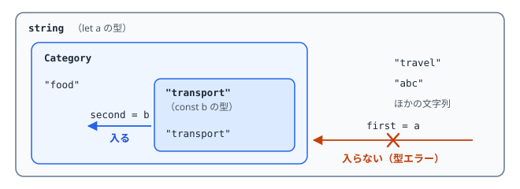

# 第5章 データの型を書く

- **この章で学ぶこと**
  - `type` でデータの形に名前を付ける。`?` と `readonly` の書き方
  - ユニオン型で取りうる値を限定する。`let` と `const` で推論される型の違い
  - `Record` の使い方と、`type` と `interface` の違い

---

## 5.1 `type` でデータの形に名前を付ける

`type 名前 = 型;` と書くと、型に名前を付けられます（**型エイリアス**）。同じ形のデータを何度も使うときに、毎回書かずに済みます。型の名前は、大文字で始めるのが習慣です。

プロパティ名の後ろに `?` を付けると、省略できます。省略したプロパティを読むと `undefined` です。

```ts
type Item = {
  name: string;
  price: number;
  memo?: string; // ? を付けると、省略できる
};

const note: Item = { name: "ノート", price: 120 };
const pen: Item = { name: "ペン", price: 80, memo: "黒" };

console.log(note.name, pen.memo); // → ノート 黒
console.log(note.memo);           // → undefined
```

型を書いた変数に `{ ... }` を直接書くとき、型に書いていないプロパティがあると型エラーになります。打ち間違いを見つけるのに役立ちます。

```ts
type Item = { name: string; price: number };

const eraser: Item = { name: "消しゴム", price: 50, color: "白" };
// エラー: Object literal may only specify known properties, and 'color' does not exist in type 'Item'.
```

> **PHPでは**
> `type` で書く型は、PHP の連想配列に「このキーには、この型の値が入る」というルールを付けたものにあたります。

## 5.2 文字列のユニオン型で、取りうる値を限定する

`"food"` のように、特定の値だけが入る型を**リテラル型**と呼びます。`|` は「または」の意味で、型をつなぐと「この中のどれか」という型になります（**ユニオン型**）。

```ts
type Category = "food" | "transport";

function label(category: Category): string {
  if (category === "food") {
    return "食費";
  }
  return "交通費";
}

console.log(label("food"));      // → 食費
console.log(label("transport")); // → 交通費
```

書いた値以外を入れると、型エラーになります。打ち間違いや想定していない値を、実行前に見つけられます。

```ts
type Category = "food" | "transport";

const category: Category = "travel";
// エラー: Type '"travel"' is not assignable to type 'Category'.
```

5.1 の `memo?: string` の型も、ユニオン型の `string | undefined`（文字列か `undefined`）として扱われます。`undefined` かどうかを調べてから使う書き方は、第6章で扱います。

## 5.3 `let` と `const` で、推論される型が違う

**文字列を直接書くと、`let` の変数は `string`、`const` の変数はリテラル型と推論されます。** `let` の変数は、後で別の文字列を入れられるので `string` です。`const` の変数は、再代入できないので書いた文字列の型です。

そのため、型注釈のない `let` の変数の値は、`Category` 型の変数に入れられません。

```ts
type Category = "food" | "transport";

let a = "transport";   // a の型は string
const b = "transport"; // b の型は "transport"

const first: Category = a;
// エラー: Type 'string' is not assignable to type 'Category'.
const second: Category = b;
```

型チェックが見るのは、今の値ではなく型です。`a` の今の値は `"transport"` でも、型の `string` にはほかの文字列も入るので、エラーになります。

次の図は、各型に入る値の範囲を示します。内側の型の値は、外側の型にも入ります。



`let` のまま使いたいときは、`let a: Category = "transport";` のように型注釈を書きます。

`const` の変数に別の変数を入れると、入れた変数の型をそのまま受け継ぎます。

```ts
const word = "Osaka";
const place = word; // place の型は "Osaka"（word の型）
console.log(place); // → Osaka
```

## 問題 1：変数に入れたサイズを渡す

`main/exercises/M05-data-types/problem-01.ts`

```ts
type Size = "S" | "M" | "L";

function printSize(size: Size): void {
  console.log(`サイズ ${size}`);
}

function printText(text: string): void {
  console.log(`文字 ${text}`);
}

let input = "S";
const copy = input;
const large: Size = "L";

printSize(copy);  // ①
printText(large); // ②
```

次の 2 つを予測してから、エディタの赤い波線と実行結果を見てください。

1. ① と ② のそれぞれに、型エラーが出るか
2. `node main/exercises/M05-data-types/problem-01.ts` を実行すると、何が表示されるか

答えを読んだ後、型エラーがあれば、答えの最後の手順で直します。

<details>
<summary>答えと解説</summary>

型エラーが出るのは ① だけです。

- ①：`input` の型は `string` です。`copy` は `const` ですが、`string` 型の変数を入れたので、型は `string` です（5.3）。`Argument of type 'string' is not assignable to parameter of type 'Size'.` と表示されます。
- ②：`Size` は `string` の内側の型です（図5-1）。内側の型の値は、外側の型に入ります。

実行結果です。

```
サイズ S
文字 L
```

① に型エラーがあっても、`node` は型を消して実行するので、結果が表示されます。

次の順に、型エラーを直します。

1. `let input = "S";` を `const input = "S";` に変える
2. 次のコマンドを実行する

   ```sh
   npm run typecheck M05 problem-01
   ```

   - **こうなれば OK**：「型チェック: OK」と表示される

</details>

## 5.4 `readonly` は実行時には効かない

プロパティの前に `readonly` を付けると、書き換えが型エラーになります。**止めるのは型チェックだけで、実行時には何もしません。** 型は実行時に消えるからです（第2章 2.5）。

```ts
type Ticket = {
  readonly id: number;
  title: string;
};

const ticket: Ticket = { id: 1, title: "受付" };
ticket.title = "会計"; // title は書き換えられる
ticket.id = 2;
// エラー: Cannot assign to 'id' because it is a read-only property.
console.log(ticket.id);
```

このコードを `node` で実行すると、`id` は書き換わり、次のように表示されます。

```
2
```

## 問題 2：座席の予約

`main/exercises/M05-data-types/problem-02.ts`

```ts
type Seat = {
  readonly code: string;
  guest?: string;
};

function reserve(seat: Seat, guest: string): void {
  seat.guest = guest;
}

const seat: Seat = { code: "A1" };
const moved: Seat = { ...seat, code: "B2" };
reserve(seat, "田中");

console.log(seat.code);   // ①
console.log(seat.guest);  // ②
console.log(moved.guest); // ③
```

`{ ...seat, code: "B2" }` は、第4章 4.3 のスプレッド構文です。次の 2 つを予測してから、エディタの赤い波線と実行結果を見てください。

1. 型エラーが出る行はあるか
2. `node main/exercises/M05-data-types/problem-02.ts` を実行すると、①〜③ で何が表示されるか

<details>
<summary>答えと解説</summary>

型エラーは出ません。

`readonly` が止めるのは、`code` への代入です。`{ ...seat, code: "B2" }` は新しいオブジェクトを作るので、`seat.code` を書き換えていません。`guest` は `readonly` ではないので、後から入れられます。

実行結果です。

```
A1
田中
undefined
```

- ①：`moved` は別のオブジェクトなので、`seat.code` は `A1` のままです。
- ②：関数に渡したオブジェクトは、呼び出し元と同じものです（第4章 4.4）。`reserve` の中で入れた値が見えます。
- ③：`moved` を作った時点の `seat` には `guest` がありません。後から `seat` に入れても、`moved` には入らないので、`undefined` です。

</details>

## 5.5 キーと値の型を決めるときは `Record`

キーを自由に足していく辞書のようなオブジェクトには、`Record<キーの型, 値の型>` を使います。`[]` の中に変数を書くと、その値をキーにして読み書きできます。

```ts
const stock: Record<string, number> = {};
stock["ノート"] = 10;
stock["ペン"] = 25;

const key = "ペン";
console.log(stock[key]);        // → 25
console.log(stock);             // → { 'ノート': 10, 'ペン': 25 }
console.log(stock["消しゴム"]); // → undefined
```

まだ入れていないキーを読むと `undefined` が返りますが、型は `number` のままです。調べ方は第6章 6.1 で扱います。

キーの型にユニオン型を書くと、「このキーが全部そろったオブジェクト」という型になります。キーが 1 つでも足りないと、型エラーになります。ユニオン型にないキーを書いたときも、5.1 の余分なプロパティと同じく型エラーになります。

次の関数は、分類ごとの件数を数えます。最初に全部のキーを `0` で用意し、1 件ずつ足していきます。

```ts
type Category = "food" | "transport";
type Purchase = { category: Category; name: string };

function countByCategory(purchases: Purchase[]): Record<Category, number> {
  const counts: Record<Category, number> = { food: 0, transport: 0 };
  for (const purchase of purchases) {
    counts[purchase.category] = counts[purchase.category] + 1;
  }
  return counts;
}

const purchases: Purchase[] = [
  { category: "food", name: "パン" },
  { category: "transport", name: "バス" },
  { category: "food", name: "牛乳" },
];
console.log(countByCategory(purchases)); // → { food: 2, transport: 1 }
```

`<>` の書き方は、第8章で詳しく扱います。

> **PHPでは**
> `Record<string, number>` は、キーが文字列、値が数値の連想配列にあたります。

## 5.6 ほかの型を広げる書き方を読む

既存の型にプロパティを足して、新しい型を作れます。`interface` では `extends`、`type` では `&` を使います。`interface` は、`type` と同じようにオブジェクトの形を表す書き方です。

```ts
interface Item {
  name: string;
  price: number;
}

interface Book extends Item {
  author: string;
}

type Food = Item & { expires: string };

const book: Book = { name: "入門書", price: 2000, author: "山田" };
const milk: Food = { name: "牛乳", price: 200, expires: "2026-11-20" };

console.log(book.name, book.author);  // → 入門書 山田
console.log(milk.name, milk.expires); // → 牛乳 2026-11-20
```

| 書き方 | 読み方 |
| --- | --- |
| `interface Book extends Item { author: string; }` | `Item` のプロパティすべてに、`author` を足した型 |
| `type Food = Item & { expires: string };` | `Item` のプロパティと、`{ expires: string }` のプロパティの、両方を持つ型 |

`Book` の値には、`Item` のプロパティも含めて、`?` のないプロパティをすべて書きます。

```ts
interface Item {
  name: string;
  price: number;
}

interface Book extends Item {
  author: string;
}

const broken: Book = { name: "入門書", price: 2000 };
// エラー: Property 'author' is missing in type '{ name: string; price: number; }' but required in type 'Book'.
```

`&` は、ユニオン型の `|` と記号が似ています。`A | B` は「`A` か `B` のどちらか」、`A & B` は「`A` と `B` の両方」です。

## 5.7 `type` と `interface` の違い

**この教材では `type` を使います。** `interface` はライブラリや標準の型によく出るので、読めるようにしておきます。

| 違い | `type` | `interface` |
| --- | --- | --- |
| 同じ名前を 2 回宣言する | 型エラー | 1 つに統合される |
| ユニオン型 | 書ける | 書けない |

どちらを使うかは、プロジェクトごとに決めます（サバイバルTypeScript も、そう勧めています）。

---

## 問題 3：型エラーを読む

`main/exercises/M05-data-types/problem-03.ts` には、次のコードが書かれています。

```ts
type Size = "S" | "M" | "L";
type Product = { name: string; price: number; memo?: string };
type Book = Product & { author: string };

const stock: Record<Size, number> = { S: 3, M: 5, L: 2, XL: 1 };

const pen: Product = { name: "ペン", price: 80 };
const memo: string = pen.memo;

const books: Book[] = [
  { name: "小説", price: 900, author: "山田" },
  { name: "辞書", author: "佐藤" },
];

console.log(stock, memo, books);
```

どの行でどんな型エラーが出るか予測してから、次の順に進めます。

1. 型エラーを表示する

   ```sh
   npm run typecheck M05 problem-03
   ```

2. それぞれのエラーが何を言っているかを、自分の言葉でファイル内のコメント欄に書く
3. エラーが消えるようにコードを直す
   - 直し方に迷ったら、下の「言い換えの例と修正例」を開きます
4. もう一度同じコマンドを実行する
   - **こうなれば OK**：「型チェック: OK」と表示される

<details>
<summary>表示されるエラー</summary>

```
main/exercises/M05-data-types/problem-03.ts(14,57): error TS2353: Object literal may only specify known properties, and 'XL' does not exist in type 'Record<Size, number>'.
main/exercises/M05-data-types/problem-03.ts(17,7): error TS2322: Type 'string | undefined' is not assignable to type 'string'.
  Type 'undefined' is not assignable to type 'string'.
main/exercises/M05-data-types/problem-03.ts(21,3): error TS2322: Type '{ name: string; author: string; }' is not assignable to type 'Book'.
  Property 'price' is missing in type '{ name: string; author: string; }' but required in type 'Product'.
```

</details>

<details>
<summary>言い換えの例と修正例</summary>

- **エラー 1（TS2353）**：「`Record<Size, number>` のキーは `S`・`M`・`L` だけなのに、`XL` を書いている」
- **エラー 2（TS2322）**：「`pen.memo` は `undefined` かもしれないので、`string` 型の変数に入れられない」。`pen` に `memo` を足しても、`Product` の `memo` は省略できる型のままなので、エラーは消えません。
- **エラー 3（TS2322）**：「`Book` には `Product` の `price` も必要なのに、辞書のデータに書かれていない」。字下げされた 2 行目に理由が出ています。

```ts
const stock: Record<Size, number> = { S: 3, M: 5, L: 2 };

const pen: Product = { name: "ペン", price: 80 };
const memo: string | undefined = pen.memo;

const books: Book[] = [
  { name: "小説", price: 900, author: "山田" },
  { name: "辞書", price: 2500, author: "佐藤" },
];
```

`XL` が必要なら、消すのではなく `Size` に `"XL"` を足します。

</details>

## 演習：家計簿のデータの型

支出データの型を書き、分類ごとの合計を出す関数を書きます。

**進め方**

#### 型を書く

1. `main/exercises/M05-data-types/practice-01.ts` の、`Category` と `Expense` の型を書き直す
   - `Category`：`"food"`、`"transport"`、`"other"` のどれかが入る型にします（5.2）
   - `Expense`：`category`（分類。`Category` 型）と `memo`（メモ。文字列。省略できる）を足します（5.1）
   - 2 つとも書くまでは、`practice-01.test.ts` に型エラーが残ります。テストのファイルも調べるので、コマンドにファイル名は付けません
   - `Unused '@ts-expect-error' directive.` は、「`Category` に `"travel"` も入ってしまう」という意味です。`Category` を書けば消えます
   - `problem-01.ts` の型エラーが出たら問題 1 に、`problem-03.ts` の型エラーが出たら問題 3 に戻って直します
   ```sh
   npm run typecheck M05
   ```
   - **こうなれば OK**：「型チェック: OK」と表示される

#### 関数を書く

2. `emptyTotals` の `throw` の行を書き換える
   - 3 つの分類を `0` にしたオブジェクトを `return` します
   ```sh
   npm test M05
   ```
   - **こうなれば OK**：テストの表示で、`emptyTotals` で始まる行が `✔` になる
3. `totalByCategory` の `throw` の行を書き換える
   - 5.5 の `countByCategory` と同じ形です。`+ 1` の代わりに、`expense.amount` を足します
   - 合計の入れ物は `const totals = emptyTotals();` で作ります
   ```sh
   npm test M05
   ```
   - **こうなれば OK**：テストの表示で、`totalByCategory` で始まる行がすべて `✔` になる

#### 仕上げる

4. 章全体の型チェックとテストを実行する
   ```sh
   npm run check M05
   ```
   - **こうなれば OK**：「型チェック: OK」「テスト: OK」

**テストで確かめるもの**

| 呼び出し | 返す値 |
| --- | --- |
| `emptyTotals()` | `{ food: 0, transport: 0, other: 0 }` |
| `totalByCategory(expenses)`（食費 800 円と 500 円、交通費 200 円の 3 件） | `{ food: 1300, transport: 200, other: 0 }` |
| `totalByCategory([])` | `{ food: 0, transport: 0, other: 0 }` |

<details>
<summary>ヒント 1：どこを見ればよいか</summary>

- `Category`：5.2 の `Category`
- `Expense`：5.1 の `Item`（`?` の付け方）
- `emptyTotals`・`totalByCategory`：5.5 の `countByCategory`

</details>

<details>
<summary>ヒント 2：書き出し</summary>

- `emptyTotals`：`return { food: 0, ... };` と書き、3 つのキーを並べます。
- `totalByCategory`：`for (const expense of expenses) { ... }` の中で、`totals[expense.category]` に `expense.amount` を足します。最後に `return totals;` と書きます。

</details>

<details>
<summary>テストが失敗したら</summary>

| 表示 | よくある原因 |
| --- | --- |
| `Unused '@ts-expect-error' directive.`（TS2578） | テストの最後で「`Category` に `"travel"` は入らない」ことを調べています。`Category` が `string` のままだと出ます |
| テストのファイルで `Property 'memo' is missing ...` | `memo` に `?` を付け忘れています |
| テストのファイルで `'category' does not exist in type 'Expense'` | `Expense` に `category` を足していません |
| `Type '{}' is missing the following properties ...: food, other, transport` | `emptyTotals` が空の `{}` を返しています。3 つのキーを `0` で用意します |
| 型チェックで `Type '"other"' is not assignable to type 'Category'.` | `Category` に `"other"` を書き忘れています。3 つの分類を、全部 `\|` でつなぎます |
| `+ food: 500` | 足さずに代入しているので、最後の金額だけが残っています。`totals[expense.category] + expense.amount` を入れます |

表示の読み方は、[つまずき集](../../troubleshooting.md) の「テスト」と「型チェック」にあります。

</details>

解答例：[main/solutions/M05-data-types/practice-01.ts](../solutions/M05-data-types/practice-01.ts)

---

## チェックリスト

- [ ] `const` で宣言した `copy` の型が `string` になる理由を説明できる
- [ ] `readonly` のプロパティがあっても、スプレッド構文なら違う値のオブジェクトを作れる理由を説明できる
- [ ] `Record<Category, number>` の値に、すべての分類のキーが必要な理由を説明できる

## 詳しく学ぶ

- JavaScript Primer：[オブジェクト](https://jsprimer.net/basic/object/)
- サバイバルTypeScript：[型エイリアス](https://typescriptbook.jp/reference/values-types-variables/type-alias)、[オプションプロパティ](https://typescriptbook.jp/reference/values-types-variables/object/optional-property)、[readonlyプロパティ](https://typescriptbook.jp/reference/values-types-variables/object/readonly-property)、[リテラル型](https://typescriptbook.jp/reference/values-types-variables/literal-types)、[ユニオン型](https://typescriptbook.jp/reference/values-types-variables/union)、[Record](https://typescriptbook.jp/reference/type-reuse/utility-types/record)、[インターフェース](https://typescriptbook.jp/reference/object-oriented/interface)、[インターフェースの継承](https://typescriptbook.jp/reference/object-oriented/interface/interface-inheritance)、[interfaceとtypeの違い](https://typescriptbook.jp/reference/object-oriented/interface/interface-vs-type-alias)、[インターセクション型](https://typescriptbook.jp/reference/values-types-variables/intersection)
