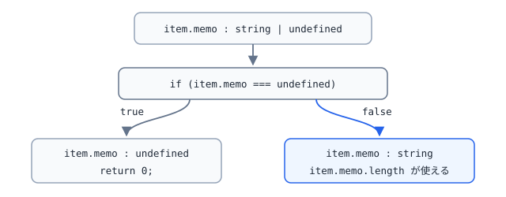

# 第6章 null と型の絞り込み

- **この章で学ぶこと**
  - `undefined` や `null` かもしれない値を、調べてから使う（型の絞り込み）
  - 「なければ既定値」を書く `||` と `??` の違い
  - 型を言い切る `as` と `!` が、実行時に何をするか

---

## 6.1 確かめると、型が絞り込まれる

`if` で `undefined` の場合を除くと、その先では型から `undefined` が消えます（**型の絞り込み**）。たとえば、省略できるプロパティ `memo?: string` の型は `string | undefined` で、そのままでは文字列として使えません。

```ts
type Item = { name: string; memo?: string };

function memoLength(item: Item): number {
  if (item.memo === undefined) {
    return 0;
  }
  return item.memo.length; // ここでは item.memo は string
}

console.log(memoLength({ name: "ノート" }));              // → 0
console.log(memoLength({ name: "ペン", memo: "黒" }));    // → 1
```

エディタで `item.memo` にカーソルを合わせると、場所によって型の表示が変わります。



`undefined` と `null` は、どちらも「値がない」ことを表します。次のように使い分けます。

| 値 | 出てくる場面 |
| --- | --- |
| `undefined` | 指定されていない。省略したプロパティや引数、配列の範囲外（第2章の `process.argv[2]`） |
| `null` | 「ない」ことを明示する。関数が「ない」を表す値として返すとき（演習の `parseAmount`） |

どちらが来るかは、多くの場合、型に書いてあります（`string | undefined` など）。エディタでカーソルを合わせて調べます。

配列の範囲外と、`Record<string, number>` のまだないキー（第5章 5.5）は、型に `undefined` が出ません。そのときも `=== undefined` で調べてから使います。

> **`null` と `undefined` のどちらを使うか**
> 言語やライブラリが返す値は、そのまま扱います。自分の関数が「無効」を返すとき、この教材は実践編のアプリに合わせて `null` を使います。サバイバルTypeScript は、こだわりがなければ `undefined` を使うことを勧めています。どちらにそろえるかは、プロジェクトで決めます。

## 6.2 `??` と `||` で既定値を決める

`a ?? b` と `a || b` は、どちらも「`a` がなければ `b` を使う」書き方です。違いは、何を「ない」と扱うかです。

- `??` は、左が `null` か `undefined` のときだけ右を使います
- `||` は、左が `false` として扱われる値のとき右を使います

```ts
function showStock(stock: number | null): void {
  console.log(`??: ${stock ?? 10}`);
  console.log(`||: ${stock || 10}`);
}

showStock(null);
// → ??: 10
// → ||: 10
showStock(0);
// → ??: 0
// → ||: 10
showStock(3);
// → ??: 3
// → ||: 3
```

`false` として扱われる値は、主に次の 6 つです。`if (値)` と書いたときも、同じ表で判定されます。

| 値 | 判定 |
| --- | --- |
| `false` `0` `""` `null` `undefined` `NaN` | `false` として扱われる |
| それ以外（`"0"`、`[]`、`{}` も含む） | `true` として扱われる |

`0` や `""` も正しい値として使うなら、既定値は `??` で決めます。

## 問題 1：設定の既定値

`main/exercises/M06-narrowing/problem-01.ts`

```ts
type Settings = {
  volume?: number;
  nickname?: string;
};

function summarize(settings: Settings): string {
  const volume = settings.volume ?? 50;
  const nickname = settings.nickname || "ゲスト";
  return `${nickname}: 音量 ${volume}`;
}

console.log(summarize({}));                          // ①
console.log(summarize({ volume: 0, nickname: "" })); // ②
console.log(summarize({ nickname: "0" }));           // ③
```

`node main/exercises/M06-narrowing/problem-01.ts` を実行すると、①〜③ でそれぞれ何が表示されるか予測してください。

<details>
<summary>答えと解説</summary>

```
ゲスト: 音量 50
ゲスト: 音量 0
0: 音量 50
```

- ①：どちらも省略したので `undefined` です。`??` も `||` も右の値を使います。
- ②：`0` は `null` でも `undefined` でもないので、`??` は `0` をそのまま使います。`""` は `false` として扱われるので、`||` は `"ゲスト"` を使います。
- ③：`"0"` は空でない文字列なので `true` として扱われ、`||` は `"0"` をそのまま使います。音量は省略したので `50` です。

> **PHPでは**
> PHP では `"0"` と空の配列 `[]` も `false` ですが、TypeScript では `true` です。PHP の `$a || $b` は `true` か `false` を返しますが、TypeScript の `||` は左右どちらかの値そのものを返します。`??` の働きは PHP と同じです。

</details>

## 6.3 `?.` で、ないときは `undefined` にする

`a?.b` は、`a` が `null` か `undefined` なら、エラーにせず `undefined` になります（**オプショナルチェーン**）。`??` と組み合わせると、「なければ既定値」を短く書けます。

```ts
type User = { name: string; address?: { city: string } };

const alice: User = { name: "Alice", address: { city: "東京" } };
const bob: User = { name: "Bob" };

console.log(alice.address?.city);           // → 東京
console.log(bob.address?.city);             // → undefined
console.log(bob.address?.city ?? "未登録"); // → 未登録
```

`item.memo?.toUpperCase()` のように、メソッドの呼び出しにも使えます。`memo` がなければ、呼び出さずに `undefined` になります。

`?.` を付けずに `bob.address.city` と書くと、`'bob.address' is possibly 'undefined'.` という型エラーになります。型チェックを無視して実行すると、`Cannot read properties of undefined` という実行時エラーで止まります。

## 6.4 `unknown` は、確かめるまで使えない

`unknown` は、中身が分からない値の型です。`any`（型チェックをしない型。第2章）と違って、型を調べるまでは、数値として計算したり `.length` を読んだりできません。

```ts
function double(value: unknown): number {
  return value * 2;
  // エラー: 'value' is of type 'unknown'.
}
```

`typeof` や `Array.isArray`（配列なら `true` を返す）で調べると、その中では調べた型として使えます。外から来た値は、`unknown` として受け取ってから調べると安全です。

```ts
function toNumber(value: unknown): number {
  if (typeof value === "number") {
    return value;
  }
  if (typeof value === "string") {
    return Number(value);
  }
  if (Array.isArray(value)) {
    return value.length;
  }
  return 0;
}

console.log(toNumber(42));     // → 42
console.log(toNumber("8"));    // → 8
console.log(toNumber([1, 2])); // → 2
console.log(toNumber(null));   // → 0
```

`typeof` は、オブジェクトにも配列にも `null` にも `"object"` を返します。そこでオブジェクトかどうかは、`typeof value === "object" && value !== null` で調べます。この式は配列でも `true` になるので、配列を分けるときは先に `Array.isArray` で調べます。プロパティがあるかは `"名前" in value` で調べます。下の例の `JSON.parse` は、第2章の JSON を読み込む関数です。

```ts
const data: unknown = JSON.parse('{"name": "Alice"}');

if (typeof data === "object" && data !== null && "name" in data) {
  console.log(data.name); // → Alice
}
```

## 6.5 判別可能なユニオン型

**判別可能なユニオン型**は、共通のプロパティ（下の例では `kind`）の値で種類を見分けるユニオン型です。`kind` を調べると、その種類だけが持つプロパティを使えます。

```ts
type Entry =
  | { kind: "income"; amount: number; source: string }
  | { kind: "expense"; amount: number; category: string };

function describe(entry: Entry): string {
  if (entry.kind === "income") {
    return `収入 ${entry.amount}円: ${entry.source}`;
  }
  return `支出 ${entry.amount}円: ${entry.category}`;
}

console.log(describe({ kind: "income", amount: 1000, source: "給料" }));  // → 収入 1000円: 給料
console.log(describe({ kind: "expense", amount: 800, category: "食費" })); // → 支出 800円: 食費
```

`type Entry =` の次の行の先頭にある `|` は、行をそろえるための書き方で、意味は変わりません。

`if` の外で `entry.source` を使うと型エラーになります。支出には `source` がないからです。画面の状態（読み込み中・成功・失敗）を表すときにも、この形がよく使われます。

確かめ方の一覧です。

| 確かめ方 | 条件が `true` の側で絞り込まれる型の例 |
| --- | --- |
| `x !== undefined` / `x !== null` | `undefined` や `null` を除いた型 |
| `typeof x === "string"` | `string` |
| `Array.isArray(x)` | 配列 |
| `"name" in x` | `name` プロパティを持つ型 |
| `x.kind === "income"` | `kind` が `"income"` の型 |
| `x instanceof Error` | `Error` のオブジェクト（第9章で使う） |

## 6.6 `as` と `!` は、実行時に何もしない

`as` と `!` は、値を調べる代わりに、型チェックへ「こういう型だ」と言い切る書き方です。**どちらも実行時には何もしません。** 値を変換せず、中身も調べません。

- `値 as 型`：この値を、この型として扱います（**型アサーション**）。`unknown` の値は、どの型にも言い切れます
- `値!`：この値は `null` でも `undefined` でもないものとして扱います（**非 null アサーション**）

```ts
type Item = { name: string; memo?: string };

const input: unknown = "100";
const price = input as number;
console.log(typeof price); // → string
console.log(price + 1);    // → 1001

const item: Item = { name: "ノート" };
const memo = item.memo!;
console.log(memo);         // → undefined
```

`price` は `number` 型として扱われますが、中身は文字列のままです。`memo` は `string` 型として扱われますが、中身は `undefined` です。

言い切ると、型チェックは間違いを指摘できなくなります。値を調べられる場面では、`as` と `!` ではなく `if` で検査します。

## 問題 2：型を言い切る書き方

`main/exercises/M06-narrowing/problem-02.ts`

```ts
type Product = {
  name: string;
  price: number;
  tags?: string[];
};

const data: unknown = JSON.parse('{"name": "ペン", "price": "80"}');
const product = data as Product;

console.log(product.name);         // ①
console.log(product.price === 80); // ②
console.log(product.tags!.length); // ③
console.log("終わり");             // ④
```

次の 2 つを予測してください。

1. エディタでこのファイルを開いたとき、型エラー（赤い波線）は出るか
2. `node main/exercises/M06-narrowing/problem-02.ts` を実行すると、①〜④ でそれぞれ何が起きるか

<details>
<summary>答えと解説</summary>

型エラーは出ません。`as` と `!` で言い切ったので、型チェックは間違いを指摘できません。

実行すると、次の行が表示されて止まります（エラーの前後に、場所を示す行も出ます）。

```
ペン
false
TypeError: Cannot read properties of undefined (reading 'length')
```

場所を示す行のコードでは、`!` が空白になっています。`node` が型の書き方を消してから実行したためです（第2章 2.5）。

- ①：JSON に `name` があるので、そのまま表示されます。
- ②：`price` の中身は文字列の `"80"` のままです。`as` は値を変換しないので、数値の `80` とは等しくありません。
- ③：`tags` は実際には `undefined` です。`!` は値を調べないので、`.length` を読もうとして実行時エラーになります。
- ④：③ で止まるので、実行されません。

</details>

---

## 問題 3：型エラーを読む

`main/exercises/M06-narrowing/problem-03.ts` には、次のコードが書かれています。

```ts
type Member = {
  name: string;
  nickname?: string;
};

const member: Member = { name: "Alice" };
console.log(member.nickname.toUpperCase());

function shout(text: string | null): string {
  return text.toUpperCase();
}
console.log(shout("hello"));

const input: unknown = JSON.parse('"42"');
console.log(input.length);
```

どの行でどんな型エラーが出るか予測してから、次の順に進めます。

1. 型エラーを表示する

   ```sh
   npm run typecheck M06 problem-03
   ```

2. それぞれのエラーが何を言っているかを、自分の言葉でファイル内のコメント欄に書く
3. `as` と `!` を使わずにコードを直す
   - `shout` は、`text` が `null` のとき `""` を返すようにします
4. もう一度同じコマンドを実行する
   - **こうなれば OK**：「型チェック: OK」と表示される

<details>
<summary>表示されるエラー</summary>

```
main/exercises/M06-narrowing/problem-03.ts(16,13): error TS18048: 'member.nickname' is possibly 'undefined'.
main/exercises/M06-narrowing/problem-03.ts(19,10): error TS18047: 'text' is possibly 'null'.
main/exercises/M06-narrowing/problem-03.ts(24,13): error TS18046: 'input' is of type 'unknown'.
```

</details>

<details>
<summary>言い換えの例と修正例</summary>

- **エラー 1（TS18048）**：「`nickname` は省略できるので `undefined` かもしれない。そのままでは `toUpperCase()` を呼べない」
- **エラー 2（TS18047）**：「`text` は `null` かもしれない。そのままでは `toUpperCase()` を呼べない」
- **エラー 3（TS18046）**：「`input` は `unknown` なので、型を調べるまで `.length` は使えない」

```ts
console.log(member.nickname?.toUpperCase());

function shout(text: string | null): string {
  if (text === null) {
    return "";
  }
  return text.toUpperCase();
}

if (typeof input === "string") {
  console.log(input.length);
}
```

</details>

## 演習：値を調べてから使う

値の種類を調べてから使う関数を、`as` と `!` を使わずに 2 つ書きます。

**進め方**

#### 種類で分ける関数を書く

1. `main/exercises/M06-narrowing/practice-01.ts` の、`formatEntry` の `throw` の行を書き換える
   - 6.5 の `describe` と同じ形で、`entry.kind` を調べて分けます
   - 収入なら `"+1000 給料"`、支出なら `"-800 食費"` の形の文字列を返します
   ```sh
   npm test M06
   ```
   - **こうなれば OK**：テストの表示で、`formatEntry` で始まる行がすべて `✔` になる

#### 外から来た値を調べる関数を書く

2. `parseAmount` の `throw` の行を書き換える
   - `typeof value !== "string"` なら `null` を返します。この後の `value` は `string` に絞り込まれます
   - `Number(value)` の結果を変数に入れます
   - `Number.isNaN(結果)` が `true` なら `null`、そうでなければ結果を返します（`NaN` は自分自身とも等しくないので、`=== NaN` では調べられません）
   ```sh
   npm test M06
   ```
   - **こうなれば OK**：テストの表示で、`parseAmount` で始まる行がすべて `✔` になる

#### 仕上げる

3. 章全体の型チェックとテストを実行する
   ```sh
   npm run check M06
   ```
   - `problem-03.ts` の型エラーが出たら、問題 3 に戻って直します
   - **こうなれば OK**：「型チェック: OK」「テスト: OK」

**テストで確かめるもの**

| 呼び出し | 返す値 |
| --- | --- |
| `formatEntry({ kind: "income", amount: 1000, source: "給料" })` | `"+1000 給料"` |
| `formatEntry({ kind: "expense", amount: 800, category: "食費" })` | `"-800 食費"` |
| `parseAmount("800")` | `800` |
| `parseAmount("abc")` | `null` |
| `parseAmount(null)`、`parseAmount([800])` | `null` |

<details>
<summary>ヒント 1：どこを見ればよいか</summary>

- `formatEntry`：6.5 の `describe`
- `parseAmount`：6.4 の `toNumber` と、6.1 の `memoLength`（先に `return` で除く形）

</details>

<details>
<summary>ヒント 2：書き出し</summary>

- `formatEntry`：`+` と `-` は、テンプレートリテラルの `${}` の外にそのまま書きます。
- `parseAmount`：最後の `return` は、第1章の三項演算子（`条件 ? A : B`）を使うと 1 行で書けます。`if` で分けても構いません。

</details>

<details>
<summary>テストが失敗したら</summary>

| 表示 | よくある原因 |
| --- | --- |
| `NaN !== null` | `parseAmount` で、`Number()` の結果が `NaN` かどうかを調べていません |
| 型チェックで `This condition will always return 'false'.` | `値 === NaN` と書いています。`Number.isNaN(値)` で調べます |
| `0 !== null` | `typeof` で調べずに `Number()` に渡しています。`Number(null)` は `0` です |
| 型チェックで `Property 'source' does not exist on type 'Entry'.` | `kind` を調べる前に `entry.source` を使っています。支出には `source` がありません |
| 型チェックで `Property 'source' does not exist on type '{ kind: "expense"; ... }'.` | 支出の側で `entry.source` を使っています。収入の行をコピーしたときに起きやすい間違いです |

</details>

解答例：[main/solutions/M06-narrowing/practice-01.ts](../solutions/M06-narrowing/practice-01.ts)

---

## チェックリスト

- [ ] `||` と `??` で、`0` や `""` の扱いがどう違うかを説明できる
- [ ] `as` と `!` が実行時に何もしないことを、問題 2 の結果を使って説明できる

## 詳しく学ぶ

- JavaScript Primer：[演算子](https://jsprimer.net/basic/operator/)（`??` と `?.`）、[暗黙的な型変換](https://jsprimer.net/basic/implicit-coercion/)
- サバイバルTypeScript：[undefinedとnullの違い](https://typescriptbook.jp/reference/values-types-variables/undefined-vs-null)、[オプショナルチェーン](https://typescriptbook.jp/reference/values-types-variables/object/optional-chaining)、[truthyな値、falsyな値](https://typescriptbook.jp/reference/values-types-variables/truthy-falsy-values)、[制御フロー分析と型ガードによる型の絞り込み](https://typescriptbook.jp/reference/statements/control-flow-analysis-and-type-guard)、[判別可能なユニオン型](https://typescriptbook.jp/reference/values-types-variables/discriminated-union)、[unknown型](https://typescriptbook.jp/reference/statements/unknown)、[型アサーション「as」](https://typescriptbook.jp/reference/values-types-variables/type-assertion-as)
