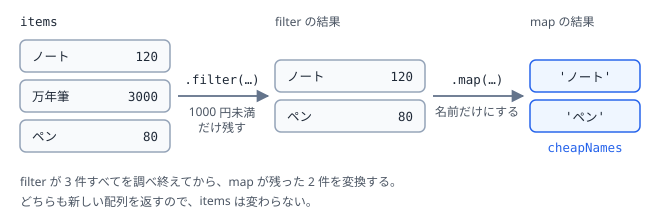

# 第7章 配列メソッド

- **この章で学ぶこと**
  - `map`・`filter`・`find`・`some` の使い分けと、`find` の結果の扱い方
  - `sort` で並べ替えるときの書き方と、元の配列との関係
  - メソッドをつなげる書き方、`reduce` で合計を出す書き方、配列の 1 件を消す・変える書き方

---

## 7.1 よく使う配列のメソッド

配列のメソッドの多くは、コールバック（第3章）を受け取ります。コールバックは要素ごとに呼ばれます。`find` と `some` は、条件に合う要素が見つかった所で止まります。

| メソッド | すること | 戻り値 |
| --- | --- | --- |
| `map(変換)` | 各要素を変換する | 変換した値の新しい配列 |
| `filter(条件)` | 条件が `true` の要素をすべて残す | 残った要素の新しい配列 |
| `find(条件)` | 条件が `true` の最初の要素を探す | 見つかった要素 1 つ（なければ `undefined`） |
| `some(条件)` | 条件が `true` の要素が 1 つでもあるか調べる | `true` / `false` |

この 4 つは、元の配列を変えません。

```ts
const prices = [300, 1200, 80];

console.log(prices.map((p) => p + 100));    // → [ 400, 1300, 180 ]
console.log(prices.filter((p) => p < 500)); // → [ 300, 80 ]
console.log(prices.find((p) => p < 500));   // → 300
console.log(prices.some((p) => p > 1000));  // → true
console.log(prices);                        // → [ 300, 1200, 80 ]
```

> **PHPでは**
> `map` は `array_map`、`filter` は `array_filter` にあたります。PHP の `array_map(関数, 配列)` と違い、TypeScript は `配列.map(関数)` の順に書きます。

## 7.2 `find` の結果は、確かめてから使う

**`find` は、見つからないと `undefined` を返します。** そのため戻り値の型は `要素の型 | undefined` です。

```ts
const prices = [300, 1200, 80];

console.log(prices.find((p) => p > 1000)); // → 1200
console.log(prices.find((p) => p > 5000)); // → undefined
```

見つかった要素のプロパティを読むときは、第6章の `?.` と `??` を使います。見つからなければ、`?.` の結果は `undefined` で、`??` の右の値が使われます。

```ts
const items = [
  { name: "ノート", price: 120 },
  { name: "ペン", price: 80 },
];

const pen = items.find((item) => item.name === "ペン");
console.log(pen?.price ?? 0); // → 80

const eraser = items.find((item) => item.name === "消しゴム");
console.log(eraser?.price ?? 0); // → 0
```

## 問題 1：在庫を探す

`main/exercises/M07-array-methods/problem-01.ts`

```ts
const stocks = [
  { name: "りんご", count: 3 },
  { name: "みかん", count: 0 },
  { name: "りんご", count: 8 },
];

const apple = stocks.find((s) => s.name === "りんご");
const orange = stocks.find((s) => s.name === "みかん");
const grape = stocks.find((s) => s.name === "ぶどう");

console.log(apple?.count);           // ①
console.log(orange?.count || "なし"); // ②
console.log(orange?.count ?? "なし"); // ③
console.log(grape?.count ?? "なし");  // ④
```

`node main/exercises/M07-array-methods/problem-01.ts` を実行すると、①〜④ でそれぞれ何が表示されるか予測してください。

<details>
<summary>答えと解説</summary>

```
3
なし
0
なし
```

- ①：`find` は、条件に合う最初の要素を返します。「りんご」は 2 つありますが、返るのは先にある `count: 3` の方です。
- ②：「みかん」は見つかり、`count` は `0` です。`||` は `0` も `false` として扱うので、右の `"なし"` が使われます（第6章 6.2）。
- ③：`??` が右の値を使うのは、左が `null` か `undefined` のときだけです。`0` はそのまま表示されます。
- ④：「ぶどう」はないので、`grape` は `undefined` です。`?.` の結果も `undefined` になり、`??` の右の `"なし"` が使われます。

</details>

## 7.3 並べ替えは、コピーしてから比べ方を渡す

`sort` には、気をつける動きが 2 つあります。

- **比べ方を渡さない `sort()` は、要素を文字列として並べます。** 文字列は先頭の文字から比べるので、`"1200"` は `"300"` より前です。
- **`sort` は、元の配列そのものを並べ替えます。** 下の例の `sorted` と `prices` は同じ配列です（第4章の「共有」）。

```ts
const prices = [300, 1200, 80, 500];

const sorted = prices.sort();

console.log(sorted); // → [ 1200, 300, 500, 80 ]
console.log(prices); // → [ 1200, 300, 500, 80 ]
```

数値を小さい順に並べるには、`[...prices].sort((a, b) => a - b)` と書きます。`[...prices]` でコピーしてから並べ替えるので、元の配列は変わりません。

```ts
const prices = [300, 1200, 80, 500];

const ascending = [...prices].sort((a, b) => a - b);

console.log(ascending); // → [ 80, 300, 500, 1200 ]
console.log(prices);    // → [ 300, 1200, 80, 500 ]
```

`(a, b) => a - b` は「2 つの要素の比べ方」です。負の数を返すと `a` が前、正の数を返すと `b` が前になります。

| 比べ方 | 並ぶ順 |
| --- | --- |
| `(a, b) => a - b` | 小さい順 |
| `(a, b) => b - a` | 大きい順 |
| `(a, b) => a.price - b.price` | `price` の小さい順 |

表の 3 行目の例です。

```ts
const items = [
  { name: "ノート", price: 120 },
  { name: "ペン", price: 80 },
];

const byPrice = [...items].sort((a, b) => a.price - b.price);

console.log(byPrice.map((item) => item.name)); // → [ 'ペン', 'ノート' ]
```

## 問題 2：関数の中で並べ替える

`main/exercises/M07-array-methods/problem-02.ts`

```ts
function highest(values: number[]): number {
  const sorted = values.sort((a, b) => b - a);
  return sorted[0];
}

const scores = [40, 100, 70];

console.log(highest(scores));    // ①
console.log(scores);             // ②
console.log([...scores].sort()); // ③
```

`node main/exercises/M07-array-methods/problem-02.ts` を実行すると、①〜③ でそれぞれ何が表示されるか予測してください。

<details>
<summary>答えと解説</summary>

```
100
[ 100, 70, 40 ]
[ 100, 40, 70 ]
```

- ①：`b - a` は大きい順なので、先頭は `100` です。
- ②：`values` と `scores` は同じ配列です。関数の中の `sort` で、`scores` も大きい順に変わります。
- ③：比べ方がないので、文字列として比べます。先頭の文字は `"1"`、`"4"`、`"7"` の順です。

> **PHPでは**
> PHP の配列は、関数に渡すとコピーになるので、関数の中で並べ替えても元の配列は変わりません。また、PHP の `sort` は数を数として並べます。

</details>

## 7.4 メソッドをつなげる、合計を出す

`map` や `filter` は新しい配列を返すので、続けて別のメソッドを呼べます。上から順に読むと、データの変わり方を追えます。

```ts
const items = [
  { name: "ノート", price: 120 },
  { name: "万年筆", price: 3000 },
  { name: "ペン", price: 80 },
];

const cheapNames = items
  .filter((item) => item.price < 1000) // 1000 円未満だけ残す
  .map((item) => item.name);           // 名前だけにする

console.log(cheapNames); // → [ 'ノート', 'ペン' ]
```



合計を出すときは `reduce` を使います。2 つ目の引数が、`sum` の最初の値です。この教材で使う `reduce` は、この形だけです。

```ts
const prices = [120, 3000, 80];
const total = prices.reduce((sum, price) => sum + price, 0); // sum はそれまでの合計。最初は 0

console.log(total); // → 3200
```

`reduce` は、要素ごとにコールバックを呼びます。コールバックが返した値が、次の回の `sum` になります。

| 回 | `sum` | `price` | 返す値（次の `sum`） |
| --- | --- | --- | --- |
| 1 | `0` | `120` | `120` |
| 2 | `120` | `3000` | `3120` |
| 3 | `3120` | `80` | `3200` |

最後の回に返した値が、`reduce` の結果です。

## 問題 3：支払い済みの個数

`main/exercises/M07-array-methods/problem-03.ts`

```ts
const orders = [
  { item: "ノート", count: 2, paid: true },
  { item: "ペン", count: 5, paid: false },
  { item: "定規", count: 1, paid: true },
];

const paidCounts = orders.filter((o) => o.paid).map((o) => o.count);
const total = paidCounts.reduce((sum, count) => sum + count, 10);

console.log(paidCounts); // ①
console.log(total);      // ②
```

`node main/exercises/M07-array-methods/problem-03.ts` を実行すると、① と ② でそれぞれ何が表示されるか予測してください。

<details>
<summary>答えと解説</summary>

```
[ 2, 1 ]
13
```

- ①：`filter` で `paid` が `true` の 2 件が残り、`map` で `count` だけの配列になります。
- ②：`sum` は `10` から始まります。`10 + 2` が `12`、`12 + 1` が `13` です。

</details>

## 7.5 配列の中の 1 件を消す・変える

画面に表示するデータは、元の配列を変えずに、新しい配列を作って更新します（第4章）。1 件を消すときは `filter`、1 件だけ変えるときは `map` を使います。

```ts
const items = [
  { id: 1, name: "ノート", price: 120 },
  { id: 2, name: "ペン", price: 80 },
];

// id が 2 のものを消す（id が 2 でないものだけ残す）
const removed = items.filter((item) => item.id !== 2);

// id が 1 のものだけ、価格を変える（ほかはそのまま返す）
const updated = items.map((item) => (item.id === 1 ? { ...item, price: 100 } : item));

console.log(removed.map((item) => item.name));  // → [ 'ノート' ]
console.log(updated.map((item) => item.price)); // → [ 100, 80 ]
console.log(items.length);                      // → 2
```

`map` の中の `条件 ? A : B` は、第1章の三項演算子です。外側の `( )` は読みやすくするためのもので、なくても動きます。条件に合う要素は `{ ...item, 変更 }` で作った新しいオブジェクトに置き換わり、ほかの要素はそのまま入ります。

| したいこと | 書き方 |
| --- | --- |
| 追加する | `[...items, x]`（第4章） |
| 1 件を消す | `items.filter((item) => item.id !== 消す id)` |
| 1 件だけ変える | `items.map((item) => (item.id === 変える id ? { ...item, 変更 } : item))` |

実践編と React 編では、画面のデータをこの 3 つの形で更新します。

## 問題 4：更新した配列を使う

`main/exercises/M07-array-methods/problem-04.ts`

```ts
const tasks = [
  { id: 1, title: "買い物", done: false },
  { id: 2, title: "掃除", done: false },
  { id: 3, title: "洗濯", done: true },
];

const updated = tasks.map((t) => (t.id === 2 ? { ...t, done: true } : t));
const remaining = updated.filter((t) => !t.done);

console.log(remaining.map((t) => t.title));       // ①
console.log(tasks.filter((t) => !t.done).length); // ②
console.log(updated[0] === tasks[0]);             // ③
```

オブジェクトの `===` は、同じものかどうかを比べます（第4章）。`!t.done` の `!` は否定（第1章 1.3）です。第6章の `値!` とは別のものです。`node main/exercises/M07-array-methods/problem-04.ts` を実行すると、①〜③ でそれぞれ何が表示されるか予測してください。

<details>
<summary>答えと解説</summary>

```
[ '買い物' ]
2
true
```

- ①：`updated` では「掃除」も `done` が `true` です。未完了で残るのは「買い物」です。
- ②：`tasks` は変わっていないので、未完了は「買い物」と「掃除」の 2 件です。
- ③：`id` が 1 の要素は、`map` の中でそのまま返しています。コピーではなく、`tasks[0]` と同じオブジェクトです。

</details>

---

## 演習：配列のメソッドで商品を扱う

商品の配列を扱う 3 つの関数を、配列のメソッドで書きます。

**進め方**

#### 関数を書く

1. `main/exercises/M07-array-methods/practice-01.ts` の、`namesUnder` の `throw` の行を書き換える
   - 3 つの関数とも、`for` 文は使わず、配列のメソッドで書きます。手本の `=` の右側の式を、`return` で返します
   - 7.4 の `cheapNames` の `items` を `products` に、`1000` を `limit` に変えた形です
   ```sh
   npm test M07
   ```
   - **こうなれば OK**：テストの表示で、テスト名が `namesUnder` で始まる行がすべて `✔` になる
2. `sortByPrice` の `throw` の行を書き換える
   - 7.3 の `byPrice` と同じ形で、コピーしてから並べ替えます
   ```sh
   npm test M07
   ```
   - **こうなれば OK**：テストの表示で、テスト名が `sortByPrice` で始まる行がすべて `✔` になる
3. `changePrice` の `throw` の行を書き換える
   - 7.5 の `updated` と同じ形で、`id` の代わりに `name` で比べます。名前が `name` と同じ商品の価格を変えます
   - `{ ...p, price }` は `{ ...p, price: price }` の省略形です（第4章）
   ```sh
   npm test M07
   ```
   - **こうなれば OK**：テストの表示で、テスト名が `changePrice` で始まる行がすべて `✔` になる

#### 仕上げる

4. 章全体の型チェックとテストを実行する
   ```sh
   npm run check M07
   ```
   - **こうなれば OK**：「型チェック: OK」「テスト: OK」

**テストで確かめるもの**

`products` が次の配列のとき、それぞれの関数は表の値を返します。

```ts
const products = [
  { name: "ノート", price: 120 },
  { name: "万年筆", price: 3000 },
  { name: "ペン", price: 80 },
  { name: "ファイル", price: 200 },
];
```

| 呼び出し | 返す値 |
| --- | --- |
| `namesUnder(products, 150)` | `["ノート", "ペン"]`（150 円未満の商品の名前。元の順のまま） |
| `namesUnder(products, 120)` | `["ペン"]`（120 円ちょうどの「ノート」は含めない） |
| `sortByPrice(products)` | 価格が `80`、`120`、`200`、`3000` の順に並んだ、新しい配列 |
| `changePrice(products, "ペン", 100)` | 「ペン」の価格だけを `100` にした、新しい配列（ほかの商品はそのまま） |

<details>
<summary>ヒント 1：どこを見ればよいか</summary>

- `namesUnder`：7.4「メソッドをつなげる、合計を出す」
- `sortByPrice`：7.3「並べ替えは、コピーしてから比べ方を渡す」
- `changePrice`：7.5「配列の中の 1 件を消す・変える」

</details>

<details>
<summary>ヒント 2：書き出し</summary>

- `namesUnder`：`return products.filter(...).map(...);` の形です。
- `sortByPrice`：`return [...products].sort(...);` の形です。比べ方は `(a, b) => a.price - b.price` です。
- `changePrice`：`return products.map((p) => (p.name === name ? ... : p));` の形です。

</details>

<details>
<summary>テストが失敗したら</summary>

| 表示 | よくある原因 |
| --- | --- |
| 「`namesUnder(products, 150)` は 150 円未満の商品の名前を返す」で、オブジェクトの配列が表示される | `filter` だけで終わっています。`map` で名前だけにします |
| 「`namesUnder` は limit ちょうどの商品を含めない」で `+   'ノート',` | `<=` で比べています。「未満」は `<` です |
| 「`sortByPrice` は価格の安い順に並べる」で、並びが変わっていない | 比べ方を渡していません。`(a, b) => a.price - b.price` を渡します |
| 型チェックで `The left-hand side of an arithmetic operation must be of type 'any', 'number', 'bigint' or an enum type.`（right-hand side の同じエラーも出る） | `a - b` と、オブジェクト同士を引いています。`a.price - b.price` にします |
| 「`sortByPrice` は元の配列を変えない」 | `products.sort(...)` を直接呼んでいます。`[...products]` でコピーしてから並べ替えます |
| 「`changePrice` は元の配列を変えない」 | 見つけた商品の `price` を直接書き換えています。`{ ...p, price }` で新しいオブジェクトを作ります |

</details>

解答例：[main/solutions/M07-array-methods/practice-01.ts](../solutions/M07-array-methods/practice-01.ts)

---

## チェックリスト

- [ ] `find` の結果に `?.` を使う理由を説明できる
- [ ] 問題 2 の ② で、関数の外の `scores` の並びが変わる理由を説明できる
- [ ] `[...prices].sort((a, b) => a - b)` の `[...prices]` と `a - b` の役割を説明できる

## 詳しく学ぶ

- JavaScript Primer：[配列](https://jsprimer.net/basic/array/)
- サバイバルTypeScript：[配列の操作](https://typescriptbook.jp/reference/values-types-variables/array/array-operations)、[配列のループ](https://typescriptbook.jp/reference/values-types-variables/array/how-to-loop-an-array)
