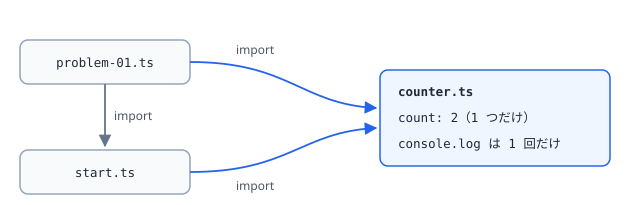

# 第8章 モジュールと型を読む

- **この章で学ぶこと**
  - `export` と `import`、型だけを読み込む `import type`
  - 複数のファイルから `import` されたファイルが、どう実行されるか
  - `Map` の使い方と、`Array<T>` や `Partial<T>` のような `<>` の付いた型の読み方

---

## 8.1 `export` と `import`

ファイルを分けるときは、外から使わせたいものに `export` を付け、使う側で `import` します。`import` や `export` のある `.ts` ファイルを、**モジュール**と呼びます。

`shop.ts`

```ts
export type Item = {
  name: string;
  price: number;
};

const taxRate = 0.1; // export していないので、ほかのファイルからは使えない

export function formatPrice(price: number): string {
  return `${Math.round(price * (1 + taxRate))}円`;
}
```

`main.ts`（`shop.ts` と同じ `main/exercises/M08-modules/` にあります。`node main/exercises/M08-modules/main.ts` で実行します）

```ts
import type { Item } from "./shop.ts"; // 型は import type で読み込む
import { formatPrice } from "./shop.ts"; // 関数は import で読み込む

const note: Item = { name: "ノート", price: 120 };
console.log(formatPrice(note.price)); // → 132円
```

- `from` には、読み込むファイルを `./`（同じフォルダ）から書きます。
- `{ }` の中には、使いたい名前を書きます。`import { a, b } from "./x.ts";` のように並べられます。
- `export` を付けていないものを `import` すると、型エラーになります。
- `{ }` を付けない `import 名前 from …` は、そのファイルが代表として 1 つだけ出したもの（`export default`）を読み込みます。テストのファイルの `import assert from "node:assert/strict";` がこの形です。
- `Math.round` は、小数を四捨五入して整数にする関数です。

**型だけを読み込むときは `import type` と書きます。** `import type` の行は、型と同じく実行時に消えます（第2章）。

- この教材の設定では、型を普通の `import` で読み込むと、型エラーになります。`node` で実行しても `does not provide an export named` で止まります。
- 逆に、関数を `import type` で読み込むと、型としてしか使えません。実行時には消えるので、呼び出す行が型エラーになります。

> **コラム: 拡張子を書くかどうか**
> この教材では、Node.js がそのまま実行できるように、`./shop.ts` と拡張子まで書きます。Vite などを使うプロジェクトでは、よく `./shop` のように拡張子を省きます。省くと、型エラーになり、`node` でも動きません。

> **PHPでは**
> PHP の `require` は、ファイルの中身をその場で読み込みます。TypeScript の `import` は、`export` されたものだけを名前を指定して読み込みます。

## 8.2 モジュールは 1 回だけ実行される

`import` されたファイルは、次の決まりで実行されます。

- `import` されたファイルは、`import` した側の本体より先に実行される
- 何か所から `import` されても、実行されるのは最初の 1 回だけ
- そのため、ファイルの中の変数は 1 つだけで、`import` した側のファイルの間で共有される

次の例では、`header.ts` と `app.ts` がどちらも `config.ts` を `import` しています（説明のための例です）。

`config.ts`

```ts
console.log("config.ts を実行しました");

export const config = { theme: "light" };
```

`header.ts`

```ts
import { config } from "./config.ts";

console.log("header.ts を実行しました");

export function switchToDark(): void {
  config.theme = "dark";
}
```

`app.ts`

```ts
import { config } from "./config.ts";
import { switchToDark } from "./header.ts";

console.log("app.ts の本体");
switchToDark();
console.log(config.theme);
```

`app.ts` を実行すると、次のように表示されます。

```
config.ts を実行しました
header.ts を実行しました
app.ts の本体
dark
```

`config.ts` の表示は 1 回だけです。`header.ts` が書き換えた `config` を `app.ts` からも読めるので、最後は `dark` です。

> **PHPでは**
> 1 回だけ実行される点は、`require_once` に似ています。

## 問題 1：2 つのファイルから使われるカウンター

`main/exercises/M08-modules/` の、次の 3 つのファイルを使います。

`counter.ts`

```ts
console.log("counter.ts の本体");

let count = 0;

export function increment(): number {
  count = count + 1;
  return count;
}
```

`start.ts`

```ts
import { increment } from "./counter.ts";

console.log("start.ts の本体");

export const first = increment();
```

`main/exercises/M08-modules/problem-01.ts`

```ts
import { increment } from "./counter.ts";
import { first } from "./start.ts";

console.log("problem-01.ts の本体");
console.log(increment()); // ①
console.log(first);       // ②
```

`node main/exercises/M08-modules/problem-01.ts` を実行すると、何がどの順で表示されるか予測してください。

<details>
<summary>答えと解説</summary>

```
counter.ts の本体
start.ts の本体
problem-01.ts の本体
2
1
```

- 最初の 3 行：`import` された 2 つのファイルは、`problem-01.ts` の本体より先に実行されます。`counter.ts` は最初の `import` で実行され、`start.ts` からの `import` ではもう実行されません。
- ①：本体が動く前に、`start.ts` が `increment()` を 1 回呼んでいます。`count` は 1 つだけなので、`1` の続きで `2` です。
- ②：`first` には、`start.ts` を実行したときの結果の `1` が入っています。



</details>

## 8.3 `<>` に型を渡す（ジェネリクス）

`Array<string>` は「文字列の配列」で、`string[]` と同じ意味です。`<>` の中に型を渡す仕組みを**ジェネリクス**と呼びます。この教材では自分では定義せず、読むだけにします。

```ts
const names: Array<string> = ["ノート", "ペン"]; // string[] と同じ
const scores: Record<string, number> = { math: 80 }; // キーが string、値が number

console.log(names.length); // → 2
console.log(scores.math);  // → 80
```

| 型 | 意味 |
| --- | --- |
| `Array<T>` | T の配列（`T[]` と同じ） |
| `Map<K, V>` | キーが K、値が V の `Map`（8.4） |
| `Promise<T>` | 後で T が届く約束（第9章） |
| `Record<K, V>` | キーが K、値が V のオブジェクト（第5章） |

`T` や `K` や `V` は、「ここに何かの型が入る」ことを表す名前です。

## 8.4 `Map` でキーと値を集める

`Map` は、キーと値の組を集める専用のオブジェクトです。`new Map<string, number>()` で作り、`set` で値を入れ、`get` で値を読みます。`new 名前()` は、第1章のクラスと同じ書き方です。

```ts
const stock = new Map<string, number>(); // キーが string、値が number の Map

stock.set("ノート", 10);
stock.set("ペン", 5);
stock.set("ノート", 8); // 同じキーに入れると、値が置き換わる

console.log(stock.get("ノート"));   // → 8
console.log(stock.get("消しゴム")); // → undefined
console.log(stock.size);            // → 2
```

| 書き方 | 意味 |
| --- | --- |
| `stock.set(キー, 値)` | そのキーに値を入れる。すでにあれば置き換える |
| `stock.get(キー)` | そのキーの値を返す。なければ `undefined` を返す |
| `stock.size` | キーの数 |

- 第5章の `Record` は、ふつうのオブジェクトに付ける型です。`Map` は、それとは別の種類のオブジェクトです。
- 配列の `map` メソッドとも別のものです。

**この `stock` の `get` の戻り値の型は、`number | undefined` です。** 数値として使うときは、`??` で「なければ 0」とします（第6章）。

```ts
const sold = new Map<string, number>();
sold.set("ノート", 3);

const noteCount = sold.get("ノート") ?? 0;
const penCount = sold.get("ペン") ?? 0;
sold.set("ペン", penCount + 1);

console.log(noteCount);        // → 3
console.log(penCount);         // → 0
console.log(sold.get("ペン")); // → 1
```

> **PHPでは**
> `Map` の使い方は、連想配列の `$stock["ノート"] = 10;` や `$stock["ペン"] ?? 0` にあたります。

## 問題 2：`Map` で数える

`main/exercises/M08-modules/problem-02.ts`

```ts
const points = new Map<string, number>();
points.set("赤", 5);

for (const team of ["赤", "青", "赤"]) {
  points.set(team, (points.get(team) ?? 0) + 1);
}
points.set("青", 10);

console.log(points.get("赤")); // ①
console.log(points.get("青")); // ②
console.log(points.size);      // ③
```

`node main/exercises/M08-modules/problem-02.ts` を実行すると、①〜③ でそれぞれ何が表示されるか予測してください。

<details>
<summary>答えと解説</summary>

```
7
10
2
```

- ①：最初の `5` に、`for` の中で 2 回 `1` を足します。
- ②：`for` の中で `1` になった後、`set` で `10` に置き換わります。
- ③：キーは `赤` と `青` の 2 つです。同じキーに何度 `set` しても、キーは増えません。

</details>

## 8.5 知らない型は、定義へ移動して読む

エディタで名前を右クリックし、「定義へ移動」（F12 キー）を選ぶと、その型が書かれた場所が開きます。

試すときは、`main/exercises/try.ts` に `[1, 2].map((n) => n > 1);` と書き、`map` の上で F12 を押します。TypeScript に付属する型定義の、次の行が見つかります。

```ts
map<U>(callbackfn: (value: T, index: number, array: T[]) => U, thisArg?: any): U[];
```

| 部分 | 読み方 |
| --- | --- |
| `T` | `Array<T>` の `T`。この配列の要素の型 |
| `map<U>` | 戻り値の要素の型を `U` と呼ぶ |
| `callbackfn: (value: T, ...) => U` | 要素（`T`）を受け取って `U` を返す関数を渡す |
| `: U[]` | `U` の配列を返す |

`index`、`array`、`thisArg` は、普段は使わないので読み飛ばして構いません。

`[1, 2].map((n) => n > 1)` なら、`T` は `number`、`U` は `boolean` で、`boolean[]` が返ります。

定義へ移動した先の型は、多くが `interface` で書かれています。`interface` と `extends` の読み方は、第5章 5.6 と同じです。定義にはプロパティがたくさん並びます。使いたいプロパティを探して、その型を調べます。

## 8.6 型から型を作る（ユーティリティ型）

`Partial<T>` のように、元の型から別の型を作る型が、TypeScript に用意されています（**ユーティリティ型**）。`Partial<Item>` は、`Item` のプロパティをすべて省略可能にした型です。ほかのユーティリティ型は、「詳しく学ぶ」のページで調べられます。

```ts
type Item = { name: string; price: number };

const draft: Partial<Item> = { name: "ノート" }; // price は省略できる

console.log(draft.name);  // → ノート
console.log(draft.price); // → undefined
```

`Partial<Item>` の `price` は省略できるので、型は `number | undefined` です。

「一部だけを変更する」関数の引数に、`Partial` がよく使われます。スプレッド構文（第4章 4.3）を 2 つ並べると、同じプロパティは後ろに書いたほうが残ります。

```ts
type Profile = { name: string; age: number };

function updateProfile(
  profile: Profile,
  changes: Partial<Profile>,
): Profile {
  return { ...profile, ...changes };
}

const alice: Profile = { name: "Alice", age: 20 };

console.log(updateProfile(alice, { age: 21 })); // → { name: 'Alice', age: 21 }
console.log(alice.age);                         // → 20
```

`Partial<Profile>` の値は、そのままでは `Profile` 型の変数に入れられません（プロパティが足りないかもしれないため）。`updateProfile` では、先に書いた `...profile` ですべてのプロパティがそろうので、戻り値を `Profile` 型にできます。

変えない項目は `changes` に書きません。`{ age: undefined }` のように `undefined` を書くと、`age` は `undefined` で上書きされます。型チェックでは見つかりません。

---

## 問題 3：型エラーを読む

`shop.ts` は 8.1 と同じ内容です。`main/exercises/M08-modules/problem-03.ts` には、次のコードが書かれています。

```ts
import type { Item, formatPrice } from "./shop.ts";

const prices = new Map<string, number>();
prices.set("箱", 300);
console.log(formatPrice(prices.get("箱")));

const draft: Partial<Item> = { name: "箱" };
const item: Item = draft;
console.log(item.name);
```

どの行でどんな型エラーが出るか予測してから、次の順に進めます。

1. 型エラーを表示する

   ```sh
   npm run typecheck M08 problem-03
   ```

2. それぞれのエラーが何を言っているかを、自分の言葉に言い換えて、ファイル内のコメント欄に書く
3. `shop.ts` は変えずに、エラーが消えるようにこのファイルを直す
4. もう一度同じコマンドを実行する
   - **こうなれば OK**：「型チェック: OK」と表示される

<details>
<summary>表示されるエラー</summary>

```
main/exercises/M08-modules/problem-03.ts(14,13): error TS1361: 'formatPrice' cannot be used as a value because it was imported using 'import type'.
main/exercises/M08-modules/problem-03.ts(14,25): error TS2345: Argument of type 'number | undefined' is not assignable to parameter of type 'number'.
  Type 'undefined' is not assignable to type 'number'.
main/exercises/M08-modules/problem-03.ts(17,7): error TS2322: Type 'Partial<Item>' is not assignable to type 'Item'.
  Types of property 'name' are incompatible.
    Type 'string | undefined' is not assignable to type 'string'.
      Type 'undefined' is not assignable to type 'string'.
```

</details>

<details>
<summary>言い換えの例と修正例</summary>

- **エラー 1（TS1361）**：「`formatPrice` を `import type` で読み込んだので、実行時には消える。関数として呼べない」
- **エラー 2（TS2345）**：「`Map` の `get` の戻り値は `number | undefined`。`number` しか受け取らない `formatPrice` には渡せない」
- **エラー 3（TS2322）**：「`Partial<Item>` の `name` は `string | undefined`。`name` が必ず `string` の `Item` には入れられない」

```ts
import type { Item } from "./shop.ts";
import { formatPrice } from "./shop.ts";

const prices = new Map<string, number>();
prices.set("箱", 300);
console.log(formatPrice(prices.get("箱") ?? 0));

const draft: Partial<Item> = { name: "箱" };
const item: Item = { name: "名前なし", price: 0, ...draft };
console.log(item.name);
```

`item` は、足りない項目の値を先に書き、後ろの `...draft` で上書きしています（8.6）。

</details>

## 演習：モジュールを使う

`shop.ts` の型と関数を `import` して、3 つの関数を書きます。

**進め方**

#### import する

1. `main/exercises/M08-modules/practice-01.ts` の先頭で、`shop.ts` から `Item` 型を `import` する
   - 8.1 の `main.ts` の 1 行目と同じです
   - `shop.ts` は書き換えません
   ```sh
   npm run typecheck M08 practice-01
   ```
   - **こうなれば OK**：型エラー `Cannot find name 'Item'.` が消え、「型チェック: OK」と表示される

#### 関数を書く

2. `describeItem` の `throw` の行を書き換える
   - 先に、ファイルの先頭で `formatPrice` 関数を `import` します。8.1 の `main.ts` の 2 行目と同じです
   - 8.1 の `formatPrice(note.price)` と同じように呼び、テンプレートリテラルで商品名とつなげます
   - 返す形は `ノート: 132円` です（`:` は半角で、後ろに半角スペースが 1 つ）
   ```sh
   npm test M08
   ```
   - **こうなれば OK**：テストの表示で、テスト名が `describeItem` で始まる行が `✔` になる
3. `applyChanges` の `throw` の行を書き換える
   - 8.6 の `updateProfile` と同じ形です
   ```sh
   npm test M08
   ```
   - **こうなれば OK**：テストの表示で、テスト名が `applyChanges` で始まる行がすべて `✔` になる
4. `totalByName` の `throw` の行を書き換える
   - 先に `const totals = new Map<string, number>();` で空の `Map` を作ります
   - 問題 2 の形で、`1` を足す代わりに `item.price` を足します
   - キーは `item.name` です
   - 最後に `Map` を `return` します
   ```sh
   npm test M08
   ```
   - **こうなれば OK**：テストの表示で、テスト名が `totalByName` で始まる行がすべて `✔` になる

#### 仕上げる

5. 章全体の型チェックとテストを実行する
   ```sh
   npm run check M08
   ```
   - `problem-03.ts` のエラーが出たら、問題 3 に戻って直します
   - **こうなれば OK**：「型チェック: OK」「テスト: OK」

**テストで確かめるもの**

| 呼び出し | 返す値 |
| --- | --- |
| `describeItem({ name: "ノート", price: 120 })` | `"ノート: 132円"` |
| `applyChanges({ name: "ノート", price: 120 }, { price: 100 })` | `{ name: "ノート", price: 100 }`（新しいオブジェクト） |
| `applyChanges({ name: "ペン", price: 80 }, {})` | `{ name: "ペン", price: 80 }` |
| `totalByName([{ name: "ノート", price: 120 }, { name: "ペン", price: 80 }, { name: "ノート", price: 100 }]).get("ノート")` | `220` |
| `totalByName([{ name: "ノート", price: 120 }]).get("ペン")` | `undefined` |

<details>
<summary>ヒント 1：どこを見ればよいか</summary>

- `describeItem`：`formatPrice` は、税込価格の文字列を返します
- `applyChanges`：8.6 の `updateProfile` の `Profile` を `Item` に、`profile` を `item` に読み替えます
- `totalByName`：問題 2 の `points.set(...)` の行で、`team` にあたるものが `item.name` です

</details>

<details>
<summary>ヒント 2：書き出し</summary>

- `describeItem`：テンプレートリテラルの中で `formatPrice(item.price)` を呼びます。
- `applyChanges`：スプレッド構文を 2 つ並べ、`changes` を後ろに書きます。
- `totalByName`：`const totals = new Map<string, number>();` から始め、`for (const item of items)` の中で `totals.set(item.name, ...)` を呼びます。

</details>

<details>
<summary>テストが失敗したら</summary>

| 表示 | よくある原因 |
| --- | --- |
| テストの名前が出ず、ファイルの名前だけが `✖` で表示される（`npm run typecheck M08 practice-01` で `TS1484`） | 型の `Item` を、普通の `import` で読み込んでいます。`import type` にします |
| `+ 'ノート: 120円'` と `- 'ノート: 132円'` | `formatPrice` を使わず、`item.price` をそのまま表示しています |
| 「`applyChanges` は changes の内容で上書きした…」が失敗する | スプレッド構文の順番が逆です。`changes` を後ろに書きます |
| 「`applyChanges` は元のオブジェクトを変えない」だけが失敗する | `item` のプロパティに書き込んでいます。スプレッド構文で新しいオブジェクトを作ります（第4章） |
| `100 !== 220` | 足さずに `item.price` だけを入れているので、値が置き換わっています |
| `NaN !== 220`（型チェックで `Object is possibly 'undefined'.`） | `get` の結果に `?? 0` を付けていません。最初の 1 件で `undefined` に足しています |

</details>

解答例：[main/solutions/M08-modules/practice-01.ts](../solutions/M08-modules/practice-01.ts)

---

## チェックリスト

- [ ] 問題 1 で、先に書いた ① が `2`、後に書いた ② が `1` になった理由を説明できる
- [ ] `Map` の `get` の戻り値の型に `undefined` が含まれる理由を説明できる
- [ ] 問題 3 で、`Partial<Item>` の値を `Item` 型の変数に入れられなかった理由を説明できる

## 詳しく学ぶ

- JavaScript Primer：[ECMAScriptモジュール](https://jsprimer.net/basic/module/)、[Map/Set](https://jsprimer.net/basic/map-and-set/)
- サバイバルTypeScript：[モジュール](https://typescriptbook.jp/reference/modules)、[ジェネリクス](https://typescriptbook.jp/reference/generics)、[ジェネリクスを使った標準ライブラリ](https://typescriptbook.jp/reference/generics/built-in-libraries-using-generics)、[ユーティリティ型](https://typescriptbook.jp/reference/type-reuse/utility-types)、[Partial](https://typescriptbook.jp/reference/type-reuse/utility-types/partial)
