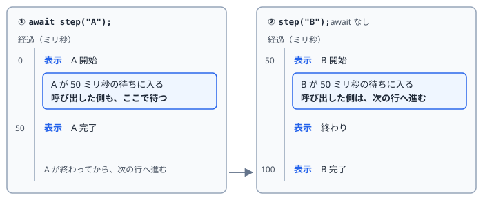

# 第9章 非同期

- **この章で学ぶこと**
  - Promise と `async`/`await` で、時間のかかる処理の結果を受け取る方法
  - 待っている処理や予約した処理が動く順番
  - `try`/`catch` でエラーを受け取る方法

---

## 9.1 Promise と `await`

ファイルの読み込みのように時間がかかる処理は、待つ間にほかの処理を止めないように、結果の代わりに **Promise**（「後で結果を届ける」という約束のオブジェクト）を返します。`await` を付けると、結果を待って中身を取り出せます。

```ts
import { readFile } from "node:fs/promises";

const text = await readFile("main/exercises/M09-async/numbers.txt", "utf8");
console.log(text.split("\n")[0]); // → 100
```

- `node:fs/promises` は Node.js に付属する機能です。`node:` で始まる名前は、`./` で指すファイルではありません。
- `readFile(パス, "utf8")` は、ファイルを文字列として読み込みます。パスは、コマンドを実行した場所（`TSLecture` フォルダ）から数えます。戻り値の型は `Promise<string>`（後で文字列が届く約束）です（第8章の `<>`）。
- `await` を付けると、`Promise<string>` から `string` を取り出せます。
- この例のように、ファイルの一番外側（関数の外）では、`await` をそのまま書けます。関数の中で使うときは、9.2 の `async` が必要です。

`await` を付け忘れると、中身ではなく Promise そのものを受け取ります。

```ts
import { readFile } from "node:fs/promises";

const promise = readFile("main/exercises/M09-async/numbers.txt", "utf8");
console.log(promise);           // → Promise { <pending> }
console.log(`中身: ${promise}`); // → 中身: [object Promise]
```

`<pending>` は「まだ結果が届いていない」という意味です。

結果の値を表示したいのに `[object Promise]` が出たら、`await` の付け忘れです。`${}` の中では型エラーにならないので、表示で気づきます。

## 9.2 `async` 関数

関数の中で `await` を使うときは、関数に `async` を付けます。**`async` 関数の戻り値は、必ず Promise になります。**

```ts
import { readFile } from "node:fs/promises";

async function countLines(path: string): Promise<number> {
  const text = await readFile(path, "utf8");
  return text.trim().split("\n").length;
}

const lines = await countLines("main/exercises/M09-async/numbers.txt");
console.log(lines); // → 3
```

- `return` しているのは `number` ですが、戻り値の型は `Promise<number>` と書きます。呼び出す側も `await` で受け取ります。
- `trim()` は、文字列の前後の空白と改行を除くメソッドです。`numbers.txt` は最後の行も改行で終わるので、`trim()` がないと空の行まで数えて `4` になります。

## 問題 1：`await` を付けるかどうか

`main/exercises/M09-async/problem-01.ts`

```ts
async function getPrice(): Promise<number> {
  return 500;
}

async function getDouble(): Promise<number> {
  const price = await getPrice();
  return price * 2;
}

const a = getDouble();
const b = await getDouble();

console.log(typeof a); // ①
console.log(typeof b); // ②
console.log(b + 1);    // ③
```

`node main/exercises/M09-async/problem-01.ts` を実行すると、①〜③ でそれぞれ何が表示されるか予測してください。

<details>
<summary>答えと解説</summary>

```
object
number
1001
```

- ①：`getDouble` の中では `await` していますが、`async` 関数の戻り値は Promise です。呼び出す側に `await` がないので、`a` は Promise（オブジェクト）のままです。`typeof` はオブジェクトに `"object"` を返します（第6章 6.4）。
- ②：`await` で Promise の中身を取り出したので、`b` は数値です。
- ③：`b` は `500 * 2` の `1000` なので、`1` を足すと `1001` です。

</details>

## 9.3 予約した処理は後で動く

`setTimeout(関数, ミリ秒)` は、指定した時間の後に関数を呼ぶよう予約します。1000 ミリ秒が 1 秒です。予約するだけなので、プログラムは止まらずに次の行へ進みます。

**予約した処理は、上から順の処理が全部終わってから動きます。** 時間が `0` でも同じです。予約が複数あるときは、時間の早いものから動きます。

```ts
console.log("開始");
setTimeout(() => console.log("100 ミリ秒後"), 100);
setTimeout(() => console.log("0 ミリ秒後"), 0);
console.log("終了");
// → 開始
// → 終了
// → 0 ミリ秒後
// → 100 ミリ秒後
```

## 9.4 `await` の後ろは、待った後で続く

ここからは、`ms` ミリ秒待つ関数 `wait(ms)` を使います。`await wait(100)` と書くと、その関数の続きだけが 100 ミリ秒待ちます。中身は読めなくて構いません。戻り値の `Promise<void>` は、届く値がない Promise です。

**`async` 関数は、`await` のところで待ちに入ると、呼び出した側へ戻ります。** 呼び出した側は、待たずに次の行へ進みます。動く順番は次のとおりです。

- `await` より前の行は、関数を呼んだときにすぐ動きます。
- `await` より後ろの行は、待っているものが終わった後に動きます。

```ts
function wait(ms: number): Promise<void> {
  return new Promise((resolve) => setTimeout(resolve, ms));
}

async function load(name: string): Promise<void> {
  console.log(`${name} 開始`);
  await wait(100);
  console.log(`${name} 完了`);
}

console.log("最初の行");
setTimeout(() => console.log("タイマー"), 0);
load("A");
console.log("最後の行");
// → 最初の行
// → A 開始
// → 最後の行
// → タイマー
// → A 完了
```


呼び出す側も `await` を付けると、その関数が最後まで終わってから次の行へ進みます。`await` で待つ間に止まるのは、`await` を書いた関数の続きの行だけです。予約した処理は、その間に動きます。

```ts
function wait(ms: number): Promise<void> {
  return new Promise((resolve) => setTimeout(resolve, ms));
}

async function save(): Promise<void> {
  await wait(50);
  console.log("保存した");
}

await save();
console.log("次の行");
// → 保存した
// → 次の行
```

## 問題 2：表示される順番

`main/exercises/M09-async/problem-02.ts`

```ts
function wait(ms: number): Promise<void> {
  return new Promise((resolve) => setTimeout(resolve, ms));
}

async function cook(name: string, ms: number): Promise<void> {
  await wait(ms);
  console.log(`${name} ができた`);
}

console.log("注文");
cook("カレー", 100);
cook("サラダ", 50);
setTimeout(() => console.log("水が届いた"), 0);
console.log("待つ");
```

`node main/exercises/M09-async/problem-02.ts` を実行すると、どの順番で表示されるか予測してください。

<details>
<summary>答えと解説</summary>

```
注文
待つ
水が届いた
サラダ ができた
カレー ができた
```

1. 上から順の処理で表示されるのは「注文」と「待つ」です。`cook` は `await` で待ちに入り、呼び出した側は次の行へ進みます。
2. その後、タイマーが時間の早い順に終わります。0 ミリ秒の「水が届いた」、50 ミリ秒のサラダ、100 ミリ秒のカレーの順です。先に呼んだカレーのほうが、後に終わります。

> **PHPでは**
> PHP の `file_get_contents()` や `sleep()` は、終わるまで次の行に進みません。TypeScript の `await` で止まるのは、`await` を書いた関数やファイルの続きだけです。`await` を付けずに呼んだ側は、先へ進みます。

</details>

## 問題 3：呼び出す側の `await`

`main/exercises/M09-async/problem-03.ts`

```ts
function wait(ms: number): Promise<void> {
  return new Promise((resolve) => setTimeout(resolve, ms));
}

async function step(name: string): Promise<void> {
  console.log(`${name} 開始`);
  await wait(50);
  console.log(`${name} 完了`);
}

await step("A");
step("B");
console.log("終わり");
```

`node main/exercises/M09-async/problem-03.ts` を実行すると、どの順番で表示されるか予測してください。

<details>
<summary>答えと解説</summary>

```
A 開始
A 完了
B 開始
終わり
B 完了
```

- `await step("A")`：`await` があるので、A が完了するまで次の行へ進みません。
- `step("B")`：`await` より前の「B 開始」はすぐ表示されます。呼び出す側に `await` がないので、次の行の「終わり」が先に表示され、「B 完了」は最後です。



</details>

## 9.5 エラーを受け取る

処理が失敗すると、エラー（例外）が投げられます。`try` の中でエラーが投げられると、残りの行を飛ばして `catch` へ移ります。`catch` が終わると、その次の行へ進みます。

```ts
import { readFile } from "node:fs/promises";

try {
  const text = await readFile("no-such-file.txt", "utf8");
  console.log(text); // ここは実行されない
} catch (e) {
  console.log("読み込めませんでした"); // → 読み込めませんでした
}
console.log("次の処理"); // → 次の処理
```

`catch (e)` の `e` の型は `unknown`（何が入っているか分からない型）です。JavaScript では `Error` 以外の値（文字列など）も `throw` できるので、そのままでは `e.message` を読めません。

```ts
try {
  throw new Error("在庫がありません");
} catch (e) {
  console.log(e.message);
  // エラー: 'e' is of type 'unknown'.
}
```

`e instanceof Error` で絞り込むと、`e.message` を読めます（第6章の絞り込み）。`async` 関数の中で投げられたエラーも、呼び出す側で `await` を付けていれば、同じように `catch` に届きます。`await` を付けないと `catch` には届かず、Node.js では上から順の処理が終わった後にエラーで止まります。

```ts
async function loadStock(count: number): Promise<number> {
  if (count <= 0) {
    throw new Error("在庫がありません");
  }
  return count;
}

try {
  const stock = await loadStock(0);
  console.log(`在庫: ${stock}`);
} catch (e) {
  if (e instanceof Error) {
    console.log(e.message); // → 在庫がありません
  }
}
```

> **PHPでは**
> PHP の `catch (Exception $e)` と違い、TypeScript では `catch (e)` と書き、受け取る値の種類は書きません。

## 問題 4：繰り返しの中のエラー

`main/exercises/M09-async/problem-04.ts`

```ts
async function half(n: number): Promise<number> {
  if (n < 0) {
    throw new Error("負の数です");
  }
  return n / 2;
}

for (const n of [10, -4, 6]) {
  try {
    console.log(await half(n));
  } catch (e) {
    console.log("失敗しました");
  }
  console.log(`${n} は終わり`);
}
```

`node main/exercises/M09-async/problem-04.ts` を実行すると、何が表示されるか予測してください。

<details>
<summary>答えと解説</summary>

```
5
10 は終わり
失敗しました
-4 は終わり
3
6 は終わり
```

- `n` が `10` と `6` の回は成功し、半分の値を表示します。
- `n` が `-4` の回はエラーが投げられ、`catch` へ移ります。
- どの回も `catch` の次の行へ進んで「〜は終わり」を表示するので、繰り返しは止まりません。

</details>

---

## 演習：ファイルの数値を合計して報告する

数値が 1 行に 1 つずつ書かれたファイルを読み、合計を報告する関数を書きます。`main/exercises/M09-async/` の `numbers.txt` と `prices.txt` を使います。

**進め方**

#### ファイルを読む関数を書く

1. `main/exercises/M09-async/practice-01.ts` の、`sumFile` の `throw` の行を書き換える
   - 9.2 の `countLines` と同じように、`await` を付けて `readFile` で読み、`trim()` と `split("\n")` で行の配列にします
   - 合計は `lines.reduce((sum, line) => sum + Number(line), 0)` で求めます（第7章 7.4）
   ```sh
   npm test M09
   ```
   - **こうなれば OK**：テストの表示で、テスト名が `sumFile` で始まる行がすべて `✔` になる

#### エラーを受け取る関数を書く

2. `reportFile` の `throw` の行を書き換える
   - 9.5 の最後の例と同じ形で、`try` の中で `await sumFile(path)` を呼び、`合計: 600` の形の文字列を返します
   - `catch` の中では、`e instanceof Error` なら `読み込めません: ${e.message}` の形の文字列を返します
   - `Error` でなければ、`"不明なエラー"` を返します
   ```sh
   npm test M09
   ```
   - **こうなれば OK**：テストの表示で、テスト名が `reportFile` で始まる行がすべて `✔` になる

#### 仕上げる

3. 章全体の型チェックとテストを実行する
   ```sh
   npm run check M09
   ```
   - **こうなれば OK**：「型チェック: OK」「テスト: OK」

**テストで確かめるもの**

| 呼び出し | 返す値 |
| --- | --- |
| `await sumFile("…/numbers.txt")` | `600` |
| `await sumFile("…/prices.txt")` | `120` |
| `await reportFile("…/numbers.txt")` | `"合計: 600"` |
| `await reportFile("…/missing.txt")`（ないファイル） | `"読み込めません: ENOENT: no such file or directory, open '…'"` |

表の `ENOENT: no such file…` は、エラーの `message` に入っている文です。自分で書く必要はありません（`ENOENT` は「そのファイルはない」という意味のエラーコード）。

<details>
<summary>ヒント 1：どこを見ればよいか</summary>

- `sumFile`：9.2 の `countLines`（ファイルを読む `async` 関数）と、第7章 7.4 の `reduce`
- `reportFile`：9.5 の最後の例（`await` と `try`/`catch`、`instanceof Error`）

</details>

<details>
<summary>ヒント 2：書き出し</summary>

- `sumFile`：`const text = await readFile(path, "utf8");` から始め、次の行で `const lines = text.trim().split("\n");` と書きます。
- `reportFile`：`try` の中は `const total = await sumFile(path);` から始めます。`catch (e)` の中は `if (e instanceof Error) { ... }` の後に、`return "不明なエラー";` を書きます。

</details>

<details>
<summary>テストが失敗したら</summary>

| 表示 | よくある原因 |
| --- | --- |
| `'合計: [object Promise]'` | `sumFile(path)` に `await` を付けていません |
| 型チェックで `Property 'trim' does not exist on type 'Promise<string>'.` と、その下に `Parameter 'sum' implicitly has an 'any' type.` など（テストで `text.trim is not a function`） | `readFile(...)` に `await` を付けていません |
| `'0100200300'`（型チェックで `Type 'string' is not assignable to type 'number'.`） | 行を `Number()` で数値にせず、文字列のまま足しています |
| `AssertionError [ERR_ASSERTION]: 読み込めません` の後ろに続きがない | 返す文字列に `e.message` を入れていません |
| テストは OK なのに、型チェックで `'e' is of type 'unknown'.` | `instanceof Error` で絞り込まずに `e.message` を読んでいます |
| テストは OK なのに、型チェックで `Function lacks ending return statement and return type does not include 'undefined'.` | `Error` でなかったときの `return "不明なエラー";` がありません |

</details>

解答例：[main/solutions/M09-async/practice-01.ts](../solutions/M09-async/practice-01.ts)

---

## チェックリスト

- [ ] `async` 関数を `await` なしで呼ぶと何を受け取るか説明できる
- [ ] 問題 2 で、先に呼んだカレーが後に表示された理由を説明できる
- [ ] 問題 3 で「終わり」が「B 完了」より先に表示された理由を説明できる

## 詳しく学ぶ

- JavaScript Primer：[非同期処理:Promise/Async Function](https://jsprimer.net/basic/async/)、[例外処理](https://jsprimer.net/basic/error-try-catch/)
- サバイバルTypeScript：[Promise](https://typescriptbook.jp/reference/asynchronous/promise)、[async関数](https://typescriptbook.jp/reference/asynchronous/async)、[await](https://typescriptbook.jp/reference/asynchronous/await)、[例外処理](https://typescriptbook.jp/reference/statements/exception)、[unknown型](https://typescriptbook.jp/reference/statements/unknown)
