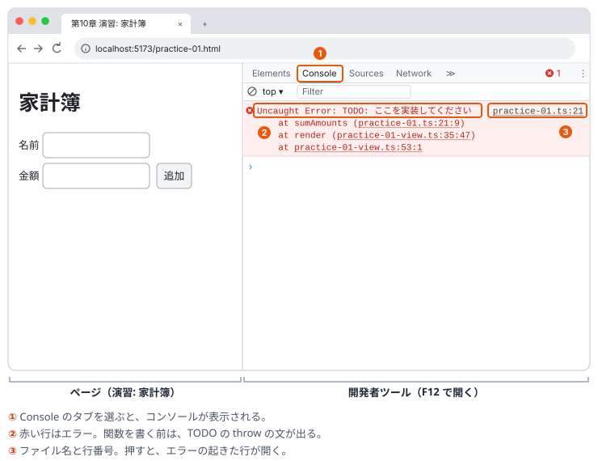
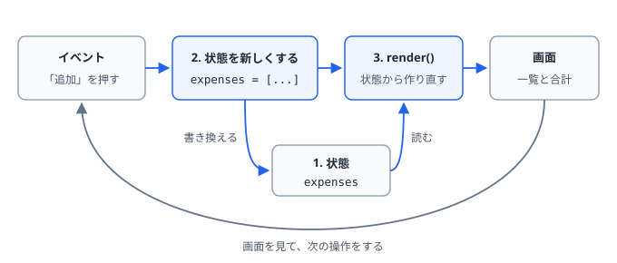

# 第10章 ブラウザとDOM、イベント

- **この章で学ぶこと**
  - 画面の要素の取得と、表示の書き換え
  - イベントの登録と、入力欄の値の扱い
  - 「状態を変える → 状態から画面を作り直す」という画面の作り方

---

## 10.1 コードがどこで動くか

ここまでの章のコードは、`node` コマンドで、自分のパソコンの上で動かしました。この章のコードは、ブラウザの中で動きます。同じ TypeScript でも、動く場所によって使える機能が違います。

| 動く場所 | 使える機能の例 | 使えない機能の例 |
| --- | --- | --- |
| Node.js（第0〜9章） | `process.argv`、`node:fs/promises` | `document`（画面がないため） |
| ブラウザ（第10・11章の画面） | `document`、`addEventListener` | `process.argv`、`node:fs/promises` |

ブラウザは TypeScript をそのままは読めません。この章では、**Vite**（開発用のツール）が型を消して JavaScript にし、ブラウザに渡します。`node` と同じく、型チェックはしません。

画面の要素（見出し、入力欄、ボタンなど）をプログラムから扱うための仕組みを、**DOM** と呼びます。

> **PHPでは**
> PHP はサーバーの上で動き、HTML を作ってブラウザに送ります。この章の TypeScript は、送られた後のブラウザの中で動き、表示されている画面を書き換えます。

## 10.2 画面を起動する

次のコマンドで、この章の画面を起動します。

```sh
npm run dev M10
```

ブラウザが開き、この章のページの一覧が表示されます。ブラウザが開かないときは、ターミナルに表示された `http://localhost:` で始まるアドレスを、ブラウザで開いてください。

- 起動したターミナルは、章の終わりまでそのままにします。ほかのコマンドは、メニュー「ターミナル」→「新しいターミナル」で開いた、もう 1 つのターミナルで打ちます。
- 止めるときは、起動したターミナルで `Ctrl` + `C` を押します。
- `Re-optimizing dependencies` などと表示されることがあります。気にしなくて構いません。
- ファイルを保存すると、画面が自動で読み込み直されます。
- 問題 1・3 で試した変更は元に戻します。問題 2 の修正は残します。
- HTML の `<script type="module" src="./ファイル名.ts">` が `.ts` を読み込み、ページを開くと実行されます。
- `document` を使うコード例は、`try.ts` に貼っても `node` では動きません。`// 画面:` のコメントは、ブラウザで動かしたときの様子です。動きは、問題と演習の画面で見ます。
- `console.log` の表示先は、ターミナルではなく、ブラウザの**開発者ツール**の「コンソール」です。開発者ツールは、Chrome なら `F12`（Mac では `Command` + `Option` + `I`）で開きます。



コンソールの赤い行はエラーです。右端のファイル名を押すと、エラーの起きた行が開きます。図10-1 は、演習の関数を書く前に「第10章 演習: 家計簿」を開いたときの画面です。

## 10.3 要素を取得して書き換える

`document.querySelector("セレクタ")` で、画面の要素を取得します。セレクタは、CSS で要素を指定するときと同じ書き方です。

| セレクタ | 取得するもの | 対応する HTML の例 |
| --- | --- | --- |
| `"#price"` | `id` が `price` の要素 | `<input id="price">` |
| `".error"` | `class` に `error` を含む最初の要素 | `<p class="error">` |
| `"button"` | 最初の `<button>` 要素 | `<button>` |

要素が見つからないとき、`querySelector` は `null` を返します。そのため、戻り値の型には `null` が含まれ、使う前に確かめます。

`textContent` は、要素の中の文字です。読み書きできます。

```ts
const title = document.querySelector("h1");
if (title !== null) {
  title.textContent = "家計簿"; // 画面: 見出しの文字が「家計簿」に変わる
}
```

## 10.4 入力欄の値と `as`

入力欄（`<input>`）に入っている値は、`value` で読みます。**`value` は、数字を入力していても文字列です。**

`querySelector("#age")` の型は、どの要素にも当てはまる `Element | null` で、そのままでは `value` を読めません。`as HTMLInputElement` は、「取得した要素を入力欄として扱う」と言い切る書き方です（第6章の `as`）。`HTMLButtonElement` はボタン、`HTMLParagraphElement` は `<p>` の要素の型です。

```ts
const ageInput = document.querySelector("#age") as HTMLInputElement;
console.log(typeof ageInput.value); // 画面: 20 と入力してあっても、コンソールに string と表示される
```

`as` は型チェックに言い切るだけで、実行時には何も確かめません。要素がなければ、変数には `null` が入ったままです。`null` のプロパティを読むと、その行を実行したときにエラーになります。

## 10.5 イベントを登録する

**イベント**は、クリックや入力など、画面で起きる出来事です。イベントの処理は、コールバック（第3章）として `addEventListener("イベントの種類", コールバック)` で要素に登録します。ボタンを押したときのイベントは `"click"` です。

**`addEventListener` は、処理を登録するだけです。** コールバックは、イベントが起きたときに初めて動きます。ファイル自体は、ページを開いたときに上から 1 回だけ実行されます。

```ts
const button = document.querySelector("button");
button?.addEventListener("click", () => {
  console.log("押されました"); // 画面: ボタンを押すたびに、コンソールに表示される
});
```

## 問題 1：送料を足すボタン

`main/exercises/M10-dom/problem-01.html` には、次の HTML が書かれています。

```html
<input id="price" />
<button id="add">送料を足す</button>
<p id="result"></p>
<script type="module" src="./problem-01.ts"></script>
```

`main/exercises/M10-dom/problem-01.ts`

```ts
const priceInput = document.querySelector("#price") as HTMLInputElement;
const addButton = document.querySelector("#add") as HTMLButtonElement;
const resultText = document.querySelector("#result") as HTMLParagraphElement;

let count = 0;

addButton.addEventListener("click", () => {
  count = count + 1;
  resultText.textContent = `${Number(priceInput.value + 300)}円`;
});

console.log(count);
```

一覧の「第10章 問題 1」を開く前に、次の 3 つを予測してください。

1. 入力欄に `800` と入力してボタンを 2 回押した後、開発者ツールのコンソールに何が何回表示されているか
2. そのとき、結果の欄（`#result`）に何が表示されているか
3. `document.querySelector("#price")` の `"#price"` を `"#amount"` に変えたとします（HTML は変えない）。コンソールに実行時のエラーは出るか。出るなら、ページを開いたときか、ボタンを押したときか

予測したら、起動中の画面で「第10章 問題 1」を開いて試します。問い 3 は `problem-01.ts` を書き換えて保存してから試します。

<details>
<summary>答えと解説</summary>

1. `0` が 1 回だけです。`console.log(count)` はコールバックの外にあるので、ページを開いたときに 1 回実行されて終わりです。押すと `count` は増えますが、表示し直す処理はありません。
2. `800300円` です。`Number()` の括弧の中が先に計算されます。`priceInput.value` は文字列 `"800"` なので、`"800" + 300` は連結で `"800300"` です（第2章）。送料を足すには `Number(priceInput.value) + 300` と書きます。
3. 出ます。ボタンを押したときです。`priceInput` には黙って `null` が入り、コールバックの中で `value` を読んだときに初めてエラーになります。結果の欄は変わりません。

問い 3 のエラーは次の表示です。

```
Uncaught TypeError: Cannot read properties of null (reading 'value')
```

> **PHPでは**
> PHP のプログラムは、リクエストのたびに上から最後まで実行されて終わります。ブラウザの TypeScript は、実行し終えた後も、ページを開いている間はイベントを待ち続けます。

</details>

## 10.6 要素の種類を確かめる

**この教材では、`as` の代わりに `instanceof` で要素の種類を確かめます。** `as` では、要素がないことや種類の違いに気づけません。

```ts
const priceInput = document.querySelector("#price");
if (priceInput instanceof HTMLInputElement) {
  console.log(Number(priceInput.value) + 500); // 画面: 入力欄が 800 なら、コンソールに 1300 と表示される
}
```

`null` を除いただけでは `Element` のままで、`value` を持ちません。`value` を持つのは、`Element` に機能を足した `HTMLInputElement` です。

`instanceof` の注意点は、次の 2 つです。

- `HTMLInputElement` は、ブラウザが用意しているクラスでもあるので、実行時に確かめられます。`type` で書いた型は実行時に消えるので使えません。
- `null` なら `false` になるので、同じ条件で `null` も除けます。

要素の種類ごとの型は次のとおりです。

| 要素 | 型 |
| --- | --- |
| `<input>` | `HTMLInputElement` |
| `<button>` | `HTMLButtonElement` |
| `<form>` | `HTMLFormElement` |
| `<ul>` `<li>` `<p>` など | `HTMLUListElement` `HTMLLIElement` `HTMLParagraphElement` など（`textContent` だけ使うなら `Element` のままでよい） |

`querySelector("input")` のようにタグ名で取得すると、型は最初から `HTMLInputElement | null` です。この場合は `null` を除くだけで `value` を使えます。

## 10.7 イベントが起きた要素を受け取る

イベントのコールバックは、イベントの情報を引数 `event` で受け取れます。`event.target` は、イベントが起きた要素です。

`event.target` の型は `EventTarget | null` です。`EventTarget` は `value` を持たないので、`instanceof` で入力欄かどうかを確かめてから読みます。下の `"input"` は、入力欄の文字が変わるたびに起きるイベントです。

```ts
const input = document.querySelector("#price");
input?.addEventListener("input", (event) => {
  if (event.target instanceof HTMLInputElement) {
    console.log(event.target.value); // 画面: 入力するたびに、今の文字がコンソールに表示される
  }
});
```

## 問題 2：型エラーを読む

`main/exercises/M10-dom/problem-02.ts` には、次のコードが書かれています。

```ts
const tagInput = document.querySelector("input");
if (tagInput !== null) {
  console.log(tagInput.value); // ①
  const total: number = 100 + tagInput.value; // ②
  tagInput.addEventListener("input", (event) => {
    if (event.target !== null) {
      console.log(event.target.value); // ③
    }
  });
}

const message = document.querySelector("#message");
if (message instanceof HTMLParagraphElement) {
  console.log(message.value); // ④
}
```

①〜④ のうち、型エラーになる行はどれか、どんなエラーかを予測してから、次の順に進めます。エラーにならない行もあります。

1. 型エラーを表示する

   ```sh
   npm run typecheck M10 problem-02
   ```

2. それぞれのエラーが何を言っているかを、自分の言葉でファイル内のコメント欄に書く
3. `as` を使わずに、エラーが消えるようにコードを直す
4. もう一度同じコマンドを実行する
   - **こうなれば OK**：「型チェック: OK」と表示される

<details>
<summary>表示されるエラー</summary>

```
main/exercises/M10-dom/problem-02.ts(14,9): error TS2322: Type 'string' is not assignable to type 'number'.
main/exercises/M10-dom/problem-02.ts(17,32): error TS2339: Property 'value' does not exist on type 'EventTarget'.
main/exercises/M10-dom/problem-02.ts(24,23): error TS2339: Property 'value' does not exist on type 'HTMLParagraphElement'.
```

① はエラーになりません。タグ名 `"input"` で取得したので、`null` を除けば `HTMLInputElement` です。

</details>

<details>
<summary>言い換えの例と修正例</summary>

- **エラー 1（②、TS2322）**：「数値と文字列の `+` は連結なので、結果は `string` で、`number` 型の変数には入れられない」
- **エラー 2（③、TS2339）**：「`null` は除いたが、まだ `EventTarget` なので、`value` は使えない」
- **エラー 3（④、TS2339）**：「`<p>` の要素に `value` はない」。入力欄ではないので、`textContent` を読みます

```ts
const tagInput = document.querySelector("input");
if (tagInput !== null) {
  console.log(tagInput.value); // ①
  const total: number = 100 + Number(tagInput.value); // ②
  tagInput.addEventListener("input", (event) => {
    if (event.target instanceof HTMLInputElement) {
      console.log(event.target.value); // ③
    }
  });
}

const message = document.querySelector("#message");
if (message instanceof HTMLParagraphElement) {
  console.log(message.textContent); // ④
}
```

</details>

## 10.8 要素を作って追加する

一覧の行のように数が変わる要素は、プログラムで作って追加します。

- `document.createElement("li")`：`<li>` の要素を作る。作っただけでは画面に出ない
- `親.append(要素)`：今の中身を残したまま、最後に要素を追加する
- `親.replaceChildren()`：中身をすべて消す

```ts
const list = document.querySelector("#list");
if (list !== null) {
  list.replaceChildren();

  for (const name of ["昼食", "電車"]) {
    const item = document.createElement("li");
    item.textContent = name;
    list.append(item);
  }
  // 画面: 一覧に「昼食」「電車」の 2 行が並ぶ
}
```

文字は必ず `textContent` で入れます。`innerHTML` は、文字を HTML として要素の中に入れるプロパティです。入力欄の値を入れると、入力された文字が HTML として解釈され、悪意のあるプログラムを実行されるおそれがあります。

## 10.9 フォームと、状態から作り直す形

入力欄とボタンは `<form>` で囲み、次の道具を使います。

- `"submit"` イベント：フォームの中のボタンや、入力欄で `Enter` キーを押したときに起きる
- `event.preventDefault()`：ページの読み込み直しを止める。`"submit"` の処理の最初に呼ぶ
- `form.reset()`：入力欄を最初の状態に戻す

画面を次の形で作ると、表示とデータがずれません。

1. **状態**（画面に表示するデータ）を 1 か所の変数に持つ
2. イベントが起きたら、状態を新しくする（第4章の「元を変えずに新しく作る」）
3. `render` 関数で、状態から画面を作り直す

演習の `practice-01-view.ts` は、この形で書かれています。次のコードは、その抜き出しです。`parseExpense` は演習で書く関数で、入力が正しければ `Expense`（`name` と `amount` を持つオブジェクト）を、間違っていればメッセージの文字列を返します。

```ts
let expenses: Expense[] = []; // 1. 状態

form.addEventListener("submit", (event) => {
  event.preventDefault();

  const result = parseExpense(nameInput.value, amountInput.value);
  if (typeof result === "string") {
    errorText.textContent = result; // 画面: 入力が正しくなければ、メッセージが表示される
    return;
  }

  errorText.textContent = "";
  expenses = [...expenses, result]; // 2. 状態を新しくする
  form.reset();
  render(); // 3. 画面: 一覧と合計が、新しい状態の内容になる
});
```



`parseExpense` のように入力欄の数を検査するときは、`Number()` で数値にしてから調べます（第2章 2.6）。整数かどうかは `Number.isInteger(値)` で調べ、`NaN` や小数では `false` です。空の入力は `Number("")` で `0` になるので、範囲も合わせて調べます。

```ts
console.log(Number.isInteger(Number("20")));  // → true
console.log(Number.isInteger(Number("2.5"))); // → false
console.log(Number.isInteger(Number("abc"))); // → false
console.log(Number(""));                      // → 0
```

## 問題 3：追加ボタンと一覧

`main/exercises/M10-dom/problem-03.html` には、`<button id="add">追加</button>` と `<ul id="list"></ul>` が書かれています。

`main/exercises/M10-dom/problem-03.ts`

```ts
const addButton = document.querySelector("#add");
const list = document.querySelector("#list");

let names: string[] = [];

const render = () => {
  for (const name of names) {
    const item = document.createElement("li");
    item.textContent = name;
    list?.append(item);
  }
};

addButton?.addEventListener("click", () => {
  names = [...names, `項目${names.length + 1}`];
  render();
});
```

一覧の「第10章 問題 3」を開く前に、次の 3 つを予測してください。

1. 「追加」を 1 回押すと、一覧に何が並ぶか
2. もう 1 回押すと（合計 2 回）、一覧に何が並ぶか。このとき `names` の要素はいくつか
3. コールバックの中の 2 行を入れ替えて、`render();` を先にします。ページを開き直して「追加」を 2 回押すと、一覧に何が並ぶか

予測したら画面で試します。問い 3 は、2 行を入れ替えて保存してから試します。

<details>
<summary>答えと解説</summary>

1. `項目1` の 1 行です。
2. 上から `項目1`、`項目1`、`項目2` の 3 行です。`names` の要素は 2 つです。`append` は今の中身を残すので、2 回目の `render` は 1 回目の行の後ろに全件を足します。重複を防ぐには、10.8 の例のように最初に中身を空にします。
3. `項目1` の 1 行です。1 回目の `render` のとき、`names` はまだ空なので何も足されません。2 回目の `render` のとき、`names` は `項目1` だけです。`render` は、状態を新しくしてから呼びます。

</details>

---

## 演習：家計簿

名前と金額を入力して「追加」を押すと、一覧と合計が表示される画面を完成させます。`practice-01.ts` の `formatYen`（金額を「1,234円」の形にする）と `formatLine`（「昼食: 800円」の形の 1 行を作る）は、用意してあります。

**進め方**

#### 合計の関数を書く

1. `main/exercises/M10-dom/practice-01.ts` の、`sumAmounts` の `throw` の行を書き換える
   - 第7章 7.4 の `reduce` で、`expense.amount` を足していきます
   ```sh
   npm test M10
   ```
   - **こうなれば OK**：テストの表示で、`sumAmounts` で始まる行が `✔` になる

#### 入力を検査する関数を書く

2. `parseExpense` の `throw` の行の上に、名前の検査を書く
   - `文字列.trim()`：前後の空白を除いた文字列を返す（第9章）
   - `name.trim()` の結果を変数に入れ、それが `""` なら `"名前を入力してください"` を返します
   - `throw` の行は、次の手順まで残します
   ```sh
   npm test M10
   ```
   - **こうなれば OK**：テストの表示で、`parseExpense は名前が空ならメッセージを返す` の行が `✔` になる
3. 残した `throw` の行を、金額の検査と戻り値に書き換える
   - 10.9 のとおり、`Number(amountText)` で数値にしてから、`Number.isInteger` で整数かを調べます
   - 整数でないか、`1` より小さいときは、`"金額は 1 以上の整数で入力してください"` を返します
   - 正しいときは、`name` に手順 2 の空白を除いた文字列、`amount` に数値を入れたオブジェクトを返します
   ```sh
   npm test M10
   ```
   - **こうなれば OK**：テストの表示で、`parseExpense` で始まる行がすべて `✔` になる

#### 画面につなぐ

4. `main/exercises/M10-dom/practice-01-view.ts` の、`render` 関数の TODO を書く
   - 10.8「要素を作って追加する」の例と同じ形です。配列は `expenses`、一覧は `list` を使います
   - 1 行の文字は `formatLine(expense)` で作ります
   - ファイルの先頭の `if (...) { throw ... }` は書き換えません。この `if` より後では、`list` などの要素をそのまま使えます
   - 画面を止めていたら、次のコマンドでもう一度起動します
   ```sh
   npm run dev M10
   ```
   - **こうなれば OK**：起動中の画面の一覧から「第10章 演習: 家計簿」を開き、「昼食」と「800」を入力して「追加」を押すと、一覧に「昼食: 800円」が出る
5. 同じ画面で、続けて次を試す
   - [ ] 「電車」と「200」を追加すると、一覧が「昼食」「電車」の 2 行になり、「合計 1,000円」と表示される
   - [ ] 名前を空にしたり、金額に文字を入れたりすると、メッセージが表示される

#### 仕上げる

6. 章全体の型チェックとテストを実行する
   ```sh
   npm run check M10
   ```
   - `problem-02.ts` のエラーが出たら、問題 2 に戻って直します
   - 終わったら、画面を起動したターミナルで `Ctrl` + `C` を押して、画面を止めます
   - **こうなれば OK**：「型チェック: OK」「テスト: OK」

**テストで確かめるもの**

| 呼び出し | 返す値 |
| --- | --- |
| `sumAmounts([{ name: "昼食", amount: 800 }, { name: "電車", amount: 200 }])` | `1000` |
| `parseExpense("  昼食 ", "800")` | `{ name: "昼食", amount: 800 }` |
| `parseExpense("   ", "800")` | `"名前を入力してください"` |
| `parseExpense("昼食", "")`、`"0"`、`"1.5"`、`"-100"` | `"金額は 1 以上の整数で入力してください"` |

<details>
<summary>ヒント 1：どこを見ればよいか</summary>

- `sumAmounts`：第7章 7.4 の `reduce`
- `parseExpense`：10.9 の `Number()` と `Number.isInteger`、第9章の `trim()`
- `render`：10.8「要素を作って追加する」

</details>

<details>
<summary>ヒント 2：書き出し</summary>

- `sumAmounts`：`expenses.reduce((sum, expense) => ..., 0)` の形です。
- `parseExpense`：金額の検査は `if (!Number.isInteger(amount) || amount < 1) { ... }` の形です。
- `render`：最初に `list.replaceChildren()` で一覧を空にし、`for (const expense of expenses) { ... }` の中で `<li>` を作って `list.append` します。

</details>

<details>
<summary>テストが失敗したら</summary>

| 表示 | よくある原因 |
| --- | --- |
| `'[object Object]200'` と `1000` | `reduce` の 2 つ目の引数 `0` を書いていません。`sum` の最初の値が 1 件目の支出（オブジェクト）になり、`+` で連結されます |
| `+ name: '  昼食 '` と `- name: '昼食'` | 空白を除いた名前で検査しただけで、返す値には元の `name` を入れています |
| 「金額が空・0・小数・マイナスなら…」で `金額 ""` | `Number("")` は `NaN` ではなく `0` です。`NaN` かどうかではなく、1 以上の整数かどうかを検査します |
| 画面が動かず、コンソールに `TODO: ここを実装してください` と出る | `practice-01.ts` に `throw` の行が残っています |
| 画面で、追加するたびに一覧の行が重複して増える | `render` の最初で `list.replaceChildren()` を呼んでいません |
| 画面に一覧が出ない | `render` の中で、作った `<li>` を `list.append(...)` で追加していません |

</details>

解答例：[main/solutions/M10-dom/practice-01.ts](../solutions/M10-dom/practice-01.ts)、[main/solutions/M10-dom/practice-01-view.ts](../solutions/M10-dom/practice-01-view.ts)

---

## チェックリスト

- [ ] 問題 1 で、id を変えたときのエラーがボタンを押すまで出ない理由を説明できる
- [ ] 問題 3 で一覧の行が重複した理由を、`append` の動きを使って説明できる

## 詳しく学ぶ

- JavaScript Primer：[Todoアプリ](https://jsprimer.net/use-case/todoapp/)（特に「[イベントとモデル](https://jsprimer.net/use-case/todoapp/event-model/)」）、[データを表示する](https://jsprimer.net/use-case/ajaxapp/display/)
- サバイバルTypeScript：[制御フロー分析と型ガードによる型の絞り込み](https://typescriptbook.jp/reference/statements/control-flow-analysis-and-type-guard)、[型アサーション「as」](https://typescriptbook.jp/reference/values-types-variables/type-assertion-as)
- この講座で説明していないツール（ESLint・Prettier など）：[ツール一覧](../../tools.md)
