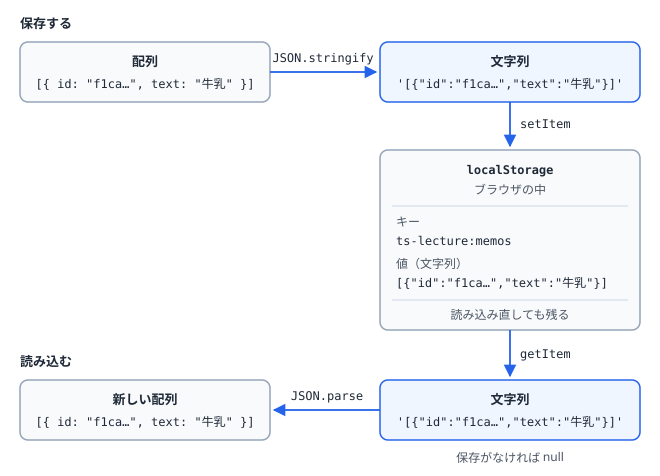
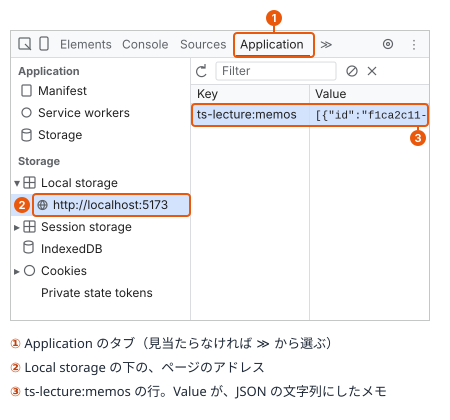

# 第11章 データの保存と通信

- **この章で学ぶこと**
  - データを JSON の文字列にして、ブラウザに保存する
  - 要素にデータを持たせ、親の要素でクリックを受ける
  - 通信でデータを読む書き方と、名前だけ知っておくものの役割

---

画面のあるアプリでは、データを保存し、通信で読みます。この章では、そのための書き方を、小さなメモ一覧で動かします。実践編で読むアプリでも、同じ書き方を使っています。細かい点まで覚える必要はありません。

## 11.1 値を JSON の文字列にする

`JSON.stringify(値)` は、オブジェクトや配列を JSON の文字列にします。第2章の `JSON.parse` は、その反対です。

```ts
const item = { name: "ペン", price: 80 };
const text = JSON.stringify(item);

console.log(text);                  // → {"name":"ペン","price":80}
console.log(JSON.parse(text).name); // → ペン
```

- `JSON.stringify` の結果は、その時点の値を書き出したただの文字列です。元のオブジェクトとのつながりはありません。
- `JSON.parse` は、呼ぶたびに文字列から新しいオブジェクトを作ります。

## 問題 1：JSON の文字列にして、元に戻す

`main/exercises/M11-next-steps/problem-01.ts`

```ts
const memos = [{ text: "牛乳", count: 2 }];

const saved = JSON.stringify(memos);
memos[0].count = 5;
const loaded = JSON.parse(saved);

console.log(typeof saved);          // ①
console.log(loaded[0].count);       // ②
console.log(loaded[0] === memos[0]); // ③
```

`node main/exercises/M11-next-steps/problem-01.ts` を実行すると、①〜③ でそれぞれ何が表示されるか予測してください。

<details>
<summary>答えと解説</summary>

```
string
2
false
```

- ①：`JSON.stringify` の結果は文字列です。
- ②：`saved` は、`count` が `2` の時点で作った文字列です。後から `memos` を変えても、文字列は変わりません。
- ③：`JSON.parse` は新しいオブジェクトを作ります。`===` は同じオブジェクトかを調べるので（第4章）、`false` です。

</details>

## 11.2 ブラウザに保存する

11.2〜11.5 のコードはブラウザ用なので、読むだけで構いません。11.2〜11.4 は演習の画面で、11.5 は実践編で動かします。

`localStorage` は、ブラウザの中に文字列を保存する仕組みです。ページを読み込み直しても残ります。

```ts
localStorage.setItem("memo", "牛乳");

console.log(localStorage.getItem("memo"));  // 画面: コンソールに 牛乳 と表示される
console.log(localStorage.getItem("other")); // 画面: コンソールに null と表示される
```

- `setItem(キー, 文字列)` で保存し、`getItem(キー)` で読みます。
- 保存がないキーを読むと `null` が返ります。
- 保存できるのは文字列だけです。配列やオブジェクトは、図11-1 のように `JSON.stringify` で文字列にして保存します。



## 11.3 要素にデータとクラスを付ける

`要素.dataset.名前` で、要素に小さなデータを持たせられます。`classList.toggle("クラス名", 条件)` は、条件が `true` ならクラスを付け、`false` なら外します。

```ts
const button = document.createElement("button");
button.dataset.id = "abc"; // 画面: まだ何も表示されない（要素は <button data-id="abc"> になる）

const message = document.createElement("p");
message.classList.toggle("hidden", true); // 画面: まだ何も表示されない（要素は <p class="hidden"> になる）
```

`dataset` に付けていない名前を読むと `undefined` です。そのため `dataset.id` の型は `string | undefined` です。

演習の `style.css` では、`hidden` のクラスを付けた要素を表示しません。

## 11.4 親の要素でクリックを受ける

**一覧の中の要素をクリックすると、`click` のイベントは外側の要素にも届きます。** そこで、ボタンごとに登録する代わりに、一覧全体に 1 つだけ登録できます。これを**イベント委譲**と呼びます。

`<ul>` に登録した処理は、ボタン以外（メモの文字など）をクリックしても動きます。そこで、実際にクリックされた要素 `event.target` がボタンかどうかを調べます。

```ts
const list = document.querySelector("ul");

list?.addEventListener("click", (event) => {
  if (event.target instanceof HTMLButtonElement) {
    console.log(event.target.dataset.id); // 画面: コンソールに、押したボタンの data-id の値が表示される
  }
});
```


図11-2 は、演習の画面で「削除」を押したときの様子です。`<ul>` の中の行やボタンを作り直しても、`<ul>` に登録した処理はそのまま使えます。

## 11.5 通信でデータを読む

`fetch(URL)` は、サーバーにデータを取りに行く関数です。時間がかかるので Promise を返します（第9章）。

```ts
const response = await fetch("./categories.json");
const data: unknown = await response.json();

console.log(data); // 画面: コンソールに、読み込んだデータが表示される
```

`response` は、サーバーからの返事です。中身を読む `response.json()` も時間がかかるので、もう一度 `await` します。

`response.json()` の結果は外から来た値なので、`unknown` として受け取り、調べてから使います（第6章）。失敗したときの扱いは、実践編で学びます。

## 11.6 名前だけ知っておくもの

次のものは、ここでは役割だけを紹介します。使い方は、実践編とその詳細版で、使う場面ごとに説明します。

| 名前 | 役割 |
| --- | --- |
| 正規表現 | 文字列の形を調べる書き方。`/^\d{4}$/` は「数字 4 けただけ」 |
| `assert.deepEqual` | テストで、配列やオブジェクトの中身が同じかを調べる |
| 開発者ツールの Network | ページが行った通信を見る |
| 開発者ツールの Application | `localStorage` に保存された中身を見る |

---

## 演習：消せるメモ一覧

メモを追加・削除でき、ページを読み込み直しても残る画面を完成させます。

**進め方**

#### データの関数を書く

1. `main/exercises/M11-next-steps/practice-01.ts` の、`parseMemos` の `throw` の行を書き換える
   - `saved` が `null` なら `[]` を返します（11.2）
   - それ以外は `JSON.parse(saved)` の結果を返します。`JSON.parse` は `any` を返すので、ここでは型エラーになりません
   - 保存された値が壊れていた場合の扱いは、実践編で学びます
   ```sh
   npm test M11
   ```
   - **こうなれば OK**：テストの表示で、テスト名が `parseMemos` で始まる行がすべて `✔` になる
2. `removeMemo` の `throw` の行を書き換える
   - `filter` で、`id` が違うメモだけを残します（第7章）
   ```sh
   npm test M11
   ```
   - **こうなれば OK**：テストの表示で、テスト名が `removeMemo` で始まる行がすべて `✔` になる

#### 画面につなぐ

3. 画面を起動し、「第11章 演習: 消せるメモ一覧」を開く
   ```sh
   npm run dev M11
   ```
   - 「削除」は、押してもまだ動きません（次の手順で書きます）
   - **こうなれば OK**：「牛乳」と「卵」を追加すると、2 つとも一覧に出る（前に試したメモが残っていても構いません）
4. `main/exercises/M11-next-steps/practice-01-view.ts` の、`click` の処理の中の TODO を書いて保存する
   - `removeMemo` の結果を `memos` に入れ直します
   - 同じファイルの `submit` の処理を手本に、メモを保存して一覧を作り直します
   - **こうなれば OK**：「牛乳」の「削除」を押すと、その行だけが消え、ほかの行は残る
5. 同じ画面で、続けて次を試す
   - [ ] ページを読み込み直しても、一覧は削除した後のままで、消した行は戻らない
   - [ ] 開発者ツール（開き方は第10章の 10.2）の Application のタブを図11-3 の順に開くと、`ts-lecture:memos` の値が JSON の文字列になっている



#### 仕上げる

6. 章全体の型チェックとテストを実行する
   - 第10章と同じく、もう 1 つのターミナルで打ちます
   ```sh
   npm run check M11
   ```
   - 終わったら、画面を起動したターミナルで `Ctrl` + `C` を押して、画面を止めます
   - **こうなれば OK**：「型チェック: OK」「テスト: OK」

**テストで確かめるもの**

| 呼び出し | 返す値 |
| --- | --- |
| `parseMemos(null)` | `[]` |
| `parseMemos('[{"id":"1","text":"milk"}]')` | `[{ id: "1", text: "milk" }]` |
| `removeMemo(memos, "1")`（`memos` は `{ id: "1", text: "milk" }` と `{ id: "2", text: "egg" }` の 2 件） | `[{ id: "2", text: "egg" }]` |

<details>
<summary>ヒント 1：どこを見ればよいか</summary>

- `parseMemos`：11.1 の `JSON.parse`、11.2 の `null`
- `removeMemo`：第7章の `filter`
- 画面の TODO：同じファイルの `submit` の処理

</details>

<details>
<summary>ヒント 2：書き出し</summary>

- `parseMemos`：`if (saved === null) { ... }` から始めます。
- `removeMemo`：`return memos.filter((memo) => ...);` の形で書きます。
- 画面の TODO：`memos = removeMemo(memos, id);` の後に、`save();` と `render();` を書きます。

</details>

<details>
<summary>テストが失敗したら</summary>

| 表示 | よくある原因 |
| --- | --- |
| 型チェックで `Argument of type 'string \| null' is not assignable to parameter of type 'string'.` | `null` の場合を先に分けていません |
| 「removeMemo は指定した id のメモを除く」だけが失敗する | `filter` の条件が逆です。`!==` で、違う `id` を残します |
| 「removeMemo は元の配列を変えない」だけが失敗する | `splice` などで元の配列を変えています。`filter` で新しい配列を作ります |
| 画面で、削除しても読み込み直すとメモが戻る | TODO の中で `save()` を呼んでいません |
| 画面で、「削除」を押しても一覧が変わらない | TODO の中で `render()` を呼んでいません |

</details>

解答例：[main/solutions/M11-next-steps/practice-01.ts](../solutions/M11-next-steps/practice-01.ts)、[main/solutions/M11-next-steps/practice-01-view.ts](../solutions/M11-next-steps/practice-01-view.ts)

---

## チェックリスト

- [ ] 配列を `localStorage` に保存するときに `JSON.stringify` が必要な理由を説明できる
- [ ] 親の要素でクリックを受けるときに、`event.target` を調べる理由を説明できる

## 詳しく学ぶ

- JavaScript Primer：[JSON](https://jsprimer.net/basic/json/)、[Todoアプリ](https://jsprimer.net/use-case/todoapp/)、[Ajax通信](https://jsprimer.net/use-case/ajaxapp/)
- 次に進む：本編はここまでです。続ける人は、オプションの [実践編](../../practice/chapters/P00-digest.md) へ進みます
