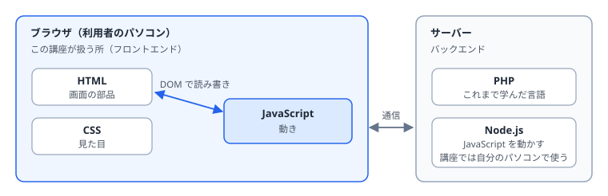
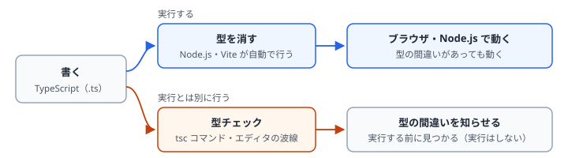

# 学ぶ技術の関係

この講座で学ぶ技術と、その関係を 1 枚にまとめたページです。細かい説明は各章にあります。

## コードはどこで動くか

Web のアプリは、利用者のパソコンの**ブラウザ**と、**サーバー**で動きます。ブラウザ側を**フロントエンド**（画面の見た目と動き）、サーバー側を**バックエンド**と呼びます。この講座が扱うのは、フロントエンドのコードです。ブラウザとサーバーは、通信でページやデータをやり取りします。この通信（`fetch`）と、ブラウザへの保存（`localStorage`）は、本編 第11章で紹介し、実践編 第6章で詳しく扱います。

## これから出会う技術

| 名前 | 一言で言うと | この講座で学ぶ所 |
| --- | --- | --- |
| JavaScript | 主にブラウザで動く言語。画面の動きを作る | 基礎編。本編からは、型を書き足した TypeScript で書く（基礎編の書き方は、そのまま使える） |
| TypeScript | JavaScript に型（値の種類の決まり）を書き足した言語。型の間違いは `tsc` というコマンドで調べる | 本編、実践編 |
| Node.js | ブラウザの外（自分のパソコンやサーバー）で JavaScript を動かす実行環境（プログラムを動かす土台） | 基礎編 第0章、本編 第0章 |
| npm | Node.js と一緒に入る道具。ライブラリやツール（パッケージ）を入れる。`npm test` や `npm run check` のように、名前を付けたコマンドを動かすのにも使う | 基礎編 第0章、本編 第0章 |
| DOM | ブラウザが HTML から作った画面の部品を、コードから読み書きするための仕組み | 基礎編 第10章、本編 第10章、実践編 |
| Vite | TypeScript を JavaScript に変えてブラウザに渡し、保存するたびに画面を更新する道具（型チェックはしない） | 本編 第10章（起動と停止だけ） |
| React | 画面を部品に分けて作るライブラリ（よく使う機能をまとめた部品集） | React 編（準備中） |

> **PHPでは**
> Node.js は `php` コマンド、npm は Composer（PHP のパッケージを入れる道具）にあたります。PHP は主にサーバーで動き、HTML を作ってブラウザに返します。JavaScript は、受け取ったページの中で、ブラウザが動かします。

## TypeScript が動くまで

ブラウザも Node.js も、型を読めません。TypeScript のコードは、Node.js や Vite が自動で型を消し、JavaScript として動かします。型の間違いは、実行とは別の作業の**型チェック**（`tsc` コマンドとエディタの波線）で見つけます。

動くときには、型はもう残っていません。そのため、型の間違いを直さずに動かしたり、外から受け取ったデータ（入力欄の文字やファイルの中身）が書いた型と違ったりしても、実行時に型で止められることはありません。この性質は、本編で何度も扱います。

## よく混同するもの

- **Java と JavaScript** は、名前が似ているだけの別の言語です。
- **TypeScript** は、JavaScript に型を書き足したものです。JavaScript の書き方（構文）は、そのまま使えます。ただし、JavaScript では動くコードが、型エラーになることはあります。
- **Node.js** は言語ではありません。JavaScript を動かす実行環境です。

## 学ぶ順番

| 編 | 章の数 | 終えるとできること |
| --- | --- | --- |
| 基礎編（オプション。PHP の基礎に自信がない人） | 12 章 | 30 行ほどのプログラムを自分で書き、エラーを読んで直せる |
| 本編（メイン） | 12 章 | TypeScript のコードを読んで、型が何を守っているかを説明でき、小さな関数と画面を書ける |
| 実践編（オプション） | 7 章 | 小さな Web アプリのコードを読み解き、簡単な改修ができる |
| React 編（オプション。準備中） | 10 章（予定） | React で書かれた画面を読み解き、見た目と動きに関わる簡単な改修ができる |

章の番号は、編ごとに 0 か 1 から数えます（基礎編 第0章、本編 第0章、実践編 第1章）。

どこから始めるかは、README の「[どこから始めるか](README.md#どこから始めるか)」で決めます。この講座で説明しない周りのツール（ESLint など）は、[ツール一覧](tools.md) にあります。
