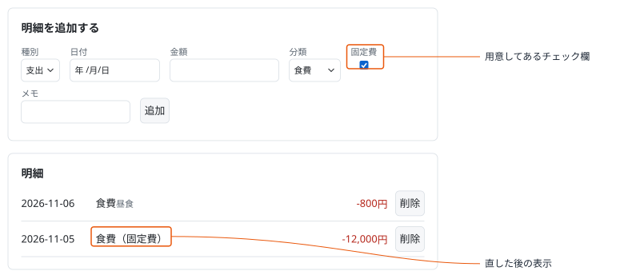
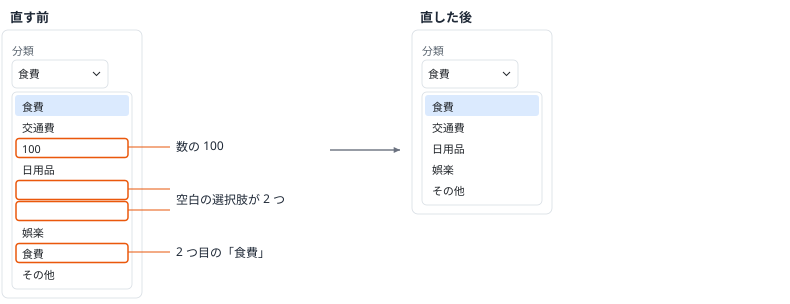
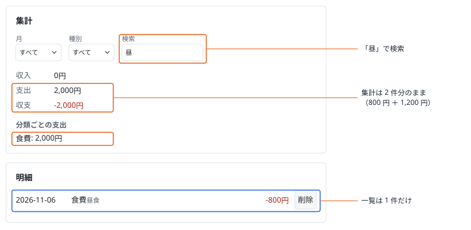

# 実践編

- **このページで学ぶこと**
  - 家計簿のアプリのファイルの役割と、操作から画面が変わるまでの流れ
  - 型・入力の検証・外から来るデータ・差分の読み方の要点
  - 型をたどる・データを検査する・変更を読む、の 3 つの改修

---

## 進め方と決まり

実践編は、この 1 ページです。要点を読み、3 つの改修で手を動かします。読むのは家計簿のアプリのコードで、本文はその案内です。

| フォルダ | 使い方 |
| --- | --- |
| `practice/app/` | 読む用の完成版。書き換えません（本文が行番号で場所を示すため） |
| `practice/exercises/P02-types/` など | 改修用（完成版のコピー）。名前の先頭が、コマンドで使う章ID（`P02` など）です |
| `practice/solutions/P02-types/` など | 改修の解答例 |

- コマンドは、`npm run dev`（画面を起動）・`npm test`（テスト）・`npm run typecheck`（型チェック）・`npm run check`（テストと型チェック）の 4 つです。後ろに、完成版なら `app`、改修用フォルダなら章ID を付けます（`npm run dev app`、`npm test P02`）。
- 画面を起動したターミナルでは、ほかのコマンドを打てません。先に `Ctrl` + `C` で画面を止めます。
- 試しに書き換えた所は、`git restore ファイルのパス` で元に戻します。
- 問題は、15 分ほど考えて分からなければ、答えを開いて読みます。
- 後で詳細版（最後の「詳しく学ぶ」）を読むときは、第2・6・7章の改修を飛ばして構いません（このページの改修と同じものです）。

## 地図：画面・ファイル・操作のたびに繰り返す流れ

最初に完成版を起動し、ブラウザで明細の追加・絞り込み・削除と、ページの読み込み直しを試します。

```sh
npm run dev app
```


**ファイルの名前は、役割を表しています。** 名前から見当を付けてから開くと、読む範囲を絞れます。`practice/app/src/` の主なファイルは次のとおりです（`.test.ts` で終わるファイルはテスト）。

| ファイル | 役割 |
| --- | --- |
| `main.ts` | 入口。状態を持ち、イベントの処理を登録する |
| `state.ts` | 今の状態から、新しい状態を作る関数（`addEntry`・`removeEntry`・`setFilter` など） |
| `render.ts` | 状態から画面を作り直す |
| `types.ts` | 型の定義 |
| `validate.ts` | フォームの入力を検証して、明細を作る |
| `storage.ts` | 明細を localStorage（ブラウザの保存場所）に保存し、読み込む |
| `categories.ts` | 分類の一覧を `public/categories.json` から取ってきて、検査する |
| `summary.ts` | 絞り込み・並べ替え・集計 |
| `format.ts` | 金額や分類を、表示用の文字にする |

<!-- app-map: stage=3 -->

**アプリの状態（画面を作るためにアプリが覚えている値）は、`main.ts` の変数 `state` 1 つにまとめてあります。操作のたびに、新しい状態を作って入れ替え、画面を作り直します。**


## 要点

### 操作から、画面が変わるまで

イベントの処理は、`state.ts` の関数で新しい状態を作り、`update` に渡します。月の選択欄を変えたときの処理は、次の 3 行です。

`practice/app/src/main.ts`（70〜72行目）

```ts
elements.filterMonth.addEventListener("change", () => {
  update(setFilter(state, { month: elements.filterMonth.value }));
});
```

`update` が状態を入れ替え、`render` を呼びます。

`practice/app/src/main.ts`（20〜27行目）

```ts
// 状態を新しくし、明細が変わっていれば保存して、画面を作り直す
function update(next: AppState): void {
  if (next.entries !== state.entries) {
    saveEntries(next.entries);
  }
  state = next;
  render(state, elements);
}
```

`render` は、表示する明細を `filterEntries` で 1 回だけ選び、集計と一覧の両方に渡します。

`practice/app/src/render.ts`（104〜110行目）

```ts
export function render(state: AppState, elements: Elements): void {
  const visibleEntries = filterEntries(state.entries, state.filter);
  renderForm(state, elements);
  renderFilter(state, elements);
  renderSummary(visibleEntries, elements);
  renderList(visibleEntries, elements);
}
```

### 型を地図にする

**明細の型 `Entry` は、収入（`Income`）と支出（`Expense`）のユニオン型で、`kind` で見分けます（判別可能なユニオン型）。** 収入だけが入金元 `source` を、支出だけが分類 `category` を持ちます。

`practice/app/src/types.ts`（1〜19行目）

```ts
export type Income = {
  kind: "income";
  id: string;
  date: string;
  amount: number;
  source: string;
  memo?: string;
};

export type Expense = {
  kind: "expense";
  id: string;
  date: string;
  amount: number;
  category: string;
  memo?: string;
};

export type Entry = Income | Expense;
```

`if` で `kind` を調べると、`entry` の型が絞り込まれます（本編第6章）。下の 14 行目の `entry` は `Income` 型、16 行目では `Expense` 型です。

`practice/app/src/format.ts`（12〜17行目）

```ts
export function entryLabel(entry: Entry): string {
  if (entry.kind === "income") {
    return entry.source;
  }
  return entry.category;
}
```

型の定義から、その型の値を作る場所・使う場所をたどると、直す場所が見つかります（改修 1）。

### 絞り込みと集計は、配列のメソッドをつなぐ

`summary.ts` の関数は、`filter` や `reduce` をつないで書いてあります。下の `filterEntries` は、月の条件と種別の条件を 1 つずつ `filter` にしています。`monthOf` は、日付から `"2026-11"` の形の月を取り出す関数です。

`practice/app/src/summary.ts`（23〜27行目）

```ts
export function filterEntries(entries: Entry[], filter: Filter): Entry[] {
  return entries
    .filter((entry) => filter.month === "all" || monthOf(entry.date) === filter.month)
    .filter((entry) => filter.kind === "all" || entry.kind === filter.kind);
}
```

関数が何を返すべきかは、テストのファイル（`summary.test.ts`）に書いてあります。テストは仕様として読めます（問題 4）。

### 外から来るデータは、検査してから使う

**入力欄の値、保存した明細、通信の結果は、型どおりとは限りません。検査を通ったものだけを使います。** 型は実行時に消えるので、型注釈を書いても、実行時の値は調べられません。

- 入力欄の値は、数字を入力しても文字列です。`validate.ts` が数値に変換して検証し、明細を作ります。
- 保存した明細と通信の結果は、`unknown` 型で受け取り、`typeof` などで検査します。

`practice/app/src/storage.ts`（31〜44行目）

```ts
export function parseStoredEntries(text: string | null): Entry[] {
  if (text === null) {
    return [];
  }
  try {
    const data: unknown = JSON.parse(text);
    if (!Array.isArray(data)) {
      return [];
    }
    return data.map(toEntry).filter((entry) => entry !== null);
  } catch {
    return [];
  }
}
```

`toEntry` は、1 件ずつ項目を調べ、正しい形なら明細を、そうでなければ `null` を返します。

- `JSON.parse` が読めない文字列でエラーを投げると、`catch` へ移って `[]` を返します（本編第9章。中身を使わないので `(e)` を省いています）。最後の `.filter((entry) => entry !== null)` は、`toEntry` が `null` を返した要素を除きます。

### 変更は、必要な変更とついでの変更に分けて読む

ほかの人の変更は、差分で読みます。機能に必要な変更と、ついでに行われた整理を分け、ついでの変更で動きが変わっていないかを調べます。実際の差分は、改修 3 の問題 3 で読みます。

### 使う道具

| したいこと | 道具 |
| --- | --- |
| 名前でファイルや行を探す | VS Code の全文検索 |
| 型や関数の定義・使っている場所を開く | 名前を右クリックして「定義へ移動」「参照へ移動」 |
| 画面の HTML、表示とエラー、通信、保存したデータを見る | 開発者ツール（Chrome では `F12`。Mac では `Command` + `Option` + `I`）の Elements・Console・Network・Application のタブ |
| 2 つのフォルダやファイルの違いを見る | `git diff --no-index 前 後`（表示が長いときは `q` キーで終わる） |

---

## 改修 1：支出に「固定費」の項目を足す

支出の明細に、固定費かどうかを表す項目 `fixed` を足し、一覧で「交通費（固定費）」のように表示します。固定費は、家賃や定期券など、毎月決まって出ていくお金です。改修用フォルダは `practice/exercises/P02-types/`（章ID は `P02`）です。



### 問題 1

型の定義を読んだら、次に「その型の値をどこで作っているか」を探します。

1. `Entry` 型の値を新しく作っている関数は、アプリの中に 2 つあります。1 つは `storage.ts` の `toEntry` で、保存されたデータから明細を作ります。もう 1 つは、どのファイルの、何という関数ですか。
   - 探し方：`types.ts` の `Entry` の上で「参照へ移動」を使います。参照は多く出るので、ファイルの役割の表から見当を付けて開きます。
   - 選ぶのは、明細のオブジェクトを書いて返している関数です。`Entry` を受け取るだけの関数は選びません。テストのファイルと `testdata.ts` は除きます。
2. `toEntry` の次の抜粋を読み、`memo` のある支出のデータを読み込んだとき、26 行目で返す明細が持つプロパティを、すべて挙げてください。

`practice/app/src/storage.ts`（20〜27行目）

```ts
  const common = typeof memo === "string" ? { id, date, amount, memo } : { id, date, amount };

  if (kind === "income" && typeof source === "string") {
    return { kind, ...common, source };
  }
  if (kind === "expense" && typeof category === "string") {
    return { kind, ...common, category };
  }
```

- `kind`・`memo`・`category` などの変数は、12 行目の `const { kind, id, date, amount, source, category, memo } = record;` で、保存されたデータから取り出した値です（分割代入。本編第4章）。型は `unknown` です。
- `...common` は、`common` の中身をコピーするスプレッド構文です（本編第4章）。

<details>
<summary>答えと解説</summary>

1. `validate.ts` の `parseEntryForm` です。フォームの入力から明細を作ります。

`practice/app/src/validate.ts`（56〜61行目）

```ts
  const entry: Entry =
    kind === "income"
      ? { kind: "income", id, date, amount, source }
      : { kind: "expense", id, date, amount, category };

  return { ok: true, entry: memo === "" ? entry : { ...entry, memo } };
```

明細が生まれるのは、アプリの外からデータが入ってくる 2 か所です。ほかの場所は、できあがった `Entry` を受け取って使います。

2. `kind`・`id`・`date`・`amount`・`memo`・`category` の 6 つです。`memo` が文字列なので、20 行目の `common` は `{ id, date, amount, memo }` です。26 行目は、`kind` と `common` の中身と `category` を並べたオブジェクトを返します。

どちらの関数も、収入と支出のオブジェクトを別々に書いています。支出に項目を足すときは、2 つの関数の支出の側を直します。

</details>

フォームの側（チェック欄の HTML、要素の取得、入力の読み取り）は、改修用フォルダに用意してあります。足すのは、型と、その型の値を作る場所・使う場所です。

**進め方**

#### 型に項目を足す

1. 型チェックを実行し、最初から出ている型エラーを読む
   - エラーの出る `testdata.ts` とテストのファイル（`.test.ts`）は、書き換えません
   - `// @ts-expect-error` は「次の行は型エラーになるはず」という印です。次の行に型エラーがないと、`Unused '@ts-expect-error' directive.` が出ます
   ```sh
   npm run typecheck P02
   ```
   - **こうなれば OK**：`'fixed' does not exist in type 'Expense'` が 4 つと、`Unused '@ts-expect-error' directive.` が 1 つ（初期状態）
2. `practice/exercises/P02-types/src/types.ts` の `Expense` に、`fixed: boolean` を足す
   - `?` は付けません（テストが型チェックで調べます）
   - 型エラーは、先頭のファイルの名前と、最後の行（`Property 'fixed' is missing ...`）だけを読みます
   ```sh
   npm run typecheck P02
   ```
   - **こうなれば OK**：`practice/exercises/P02-types/src/` で始まる行が、`storage.ts` と `validate.ts` の 2 行だけになる

#### 型エラーをたどって直す

3. `src/validate.ts` で、支出を作っている行に `fixed` を足す
   - チェック欄の値は `input.fixed`（`boolean` 型）です
   - 型エラーは `const entry: Entry =` のすぐ下の行に出ます。直すのは、その下の支出の行です。収入には足しません
   ```sh
   npm run typecheck P02
   ```
   - **こうなれば OK**：型エラーが `storage.ts` の 1 つだけになる
4. `src/storage.ts` の `toEntry`（問題 1）で、支出を返す行に `fixed` を足す
   - 保存された値は、`const { kind, id, ... } = record;` に `fixed` を足すと取り出せます（型は `unknown`）
   - `値 === true` は、値が `true` のときだけ `true` です。`unknown` 型の値にも使えます
   - `fixed` のない古い支出は、捨てずに、固定費でない支出として読みます
   ```sh
   npm run typecheck P02
   ```
   - **こうなれば OK**：「型チェック: OK」
5. `src/format.ts` の `entryLabel` を直す
   - 最後の行では、`entry` が `Expense` に絞り込まれています（要点の「型を地図にする」）
   - `entry.fixed` が `true` なら `` `${entry.category}（固定費）` `` を返します（括弧は全角）
   ```sh
   npm test P02
   ```
   - **こうなれば OK**：「テスト: OK」

#### 画面で見る

6. 画面を起動し、次を試す
   ```sh
   npm run dev P02
   ```
   - [ ] チェックを入れて追加した支出は、一覧に「分類（固定費）」と表示される
   - [ ] チェックを入れずに追加した支出と、収入は、これまでどおりに表示される
   - [ ] ページを読み込み直しても、「（固定費）」の表示が残る
   - 完成版やほかの改修の画面で明細を追加・削除すると、保存し直されて「（固定費）」が消えます。改修の誤りではありません

#### 仕上げる

7. 画面を `Ctrl` + `C` で止め、型チェックとテストを実行する
   ```sh
   npm run check P02
   ```
   - **こうなれば OK**：「型チェック: OK」「テスト: OK」
8. 自分の変更を差分で読む
   ```sh
   git diff practice/exercises/P02-types
   ```
   - **こうなれば OK**：`types.ts`・`validate.ts`・`storage.ts`・`format.ts` の 4 つのファイルが表示される
9. コミットする
   ```sh
   git add practice/exercises/P02-types
   git commit -m "実践編 改修: 支出に「固定費」の項目を足す"
   ```
   - **こうなれば OK**：表示の 1 行目に、付けたメッセージが出る

**テストで確かめるもの**（主なもの）

| 呼び出し | 返す値 |
| --- | --- |
| `parseEntryForm`（支出。固定費にチェックあり） | `{ ok: true, entry: … }`（`entry` は `fixed: true` を持つ支出） |
| `parseEntryForm`（収入） | `{ ok: true, entry: … }`（`entry` は `fixed` を持たない収入） |
| `parseStoredEntries`（`fixed` のない支出を保存したもの） | `fixed: false` の支出 1 件の配列 |
| `parseStoredEntries`（`fixed` が `"no"` のような、`true` でも `false` でもない値の支出） | `fixed: false` の支出 1 件の配列 |
| `entryLabel`（分類が交通費で、`fixed` が `true` の支出） | `"交通費（固定費）"` |

<details>
<summary>ヒント 1：どこを見ればよいか</summary>

- `validate.ts`：問題 1 の答えの抜粋の、支出を作っている行
- `storage.ts`：問題 1 の 2 の抜粋の、支出の明細を返している行
- `format.ts`：`entryLabel` の最後の行

</details>

<details>
<summary>ヒント 2：書き出し</summary>

- `types.ts`：`Expense` に `fixed: boolean;` を足します。
- `validate.ts`：支出の明細を `{ kind: "expense", id, date, amount, category, fixed: input.fixed }` にします。
- `storage.ts`：`const { kind, id, ... } = record;` の行に `fixed` を足し、支出を返す行を `{ kind, ...common, category, fixed: fixed === true }` にします。
- `format.ts`：最後の行を、`entry.fixed` が `true` なら `` `${entry.category}（固定費）` ``、そうでなければ `entry.category` を返すようにします。

</details>

<details>
<summary>テストや画面がうまくいかないとき</summary>

| 表示 | よくある原因 |
| --- | --- |
| 型チェックで `'fixed' does not exist in type 'Expense'`（`testdata.ts`、`state.test.ts`） | `types.ts` の `Expense` に、まだ `fixed` を足していません |
| 型チェックで `Unused '@ts-expect-error' directive.`（`validate.test.ts`） | `Expense` に `fixed` を足していないか、`fixed?: boolean` と `?` を付けています。`types.ts` を直しても新しい型エラーが出ないときも、`?` を付けていないかを確かめます |
| 型チェックのエラーの最後の行が `Property 'fixed' is missing in type '{ ... }' but required in type 'Expense'.` | そのファイルで作っている支出の明細に `fixed` がありません（`validate.ts` で直す行は、手順 3） |
| 型チェックで `No value exists in scope for the shorthand property 'fixed'.` | `{ ..., fixed }` と短く書いていますが、`fixed` という名前の変数がありません。`validate.ts` では `fixed: input.fixed` と書きます |
| 型チェックで `Type 'unknown' is not assignable to type 'boolean'.`（`storage.ts`） | 保存されたデータの `fixed` を、確かめずにそのまま入れています。`fixed === true` にします |
| 型チェックで `'fixed' does not exist in type 'Income'`（`validate.ts`） | 収入の明細にも `fixed` を入れています |
| 型チェックで `Property 'fixed' does not exist on type 'Entry'.`（`format.ts`） | `kind` を確かめる前に `entry.fixed` を読んでいます。`Expense` に絞り込まれた後で読みます |
| テストで `+ fixed: false` `- fixed: true`、または `+ fixed: true` `- fixed: false`（`parseEntryForm`） | `fixed` に、入力の値ではなく決まった値を入れています |
| テスト「保存した明細をそのまま読み戻す」で、収入の明細に `+ fixed: false` | `storage.ts` で、`fixed` を `common` に入れています。収入にも `fixed` が付いてしまいます（この間違いは、型チェックでは見つかりません） |
| テスト「fixed が true でも false でもない支出…」が失敗する | `Boolean(fixed)` のように、`true` 以外の値も `true` にしています。`fixed === true` にします。差分が `+ []` のときは、支出を捨てています（下の行） |
| テスト「fixed のない支出…を、fixed が false の支出として読む」が失敗し、期待する明細が `-` の行で丸ごと表示される | `fixed` がない支出を捨てています。`typeof fixed === "boolean"` を条件に足すと、こうなります |
| テストで `+ '交通費'` `- '交通費（固定費）'` | `entryLabel` を、まだ直していません |

表示の読み方は、[つまずき集](../../troubleshooting.md) にあります。

</details>

解答例：[practice/solutions/P02-types/src/types.ts](../solutions/P02-types/src/types.ts)、[practice/solutions/P02-types/src/validate.ts](../solutions/P02-types/src/validate.ts)、[practice/solutions/P02-types/src/storage.ts](../solutions/P02-types/src/storage.ts)、[practice/solutions/P02-types/src/format.ts](../solutions/P02-types/src/format.ts)

> **コラム: 型を変えると、直す場所を型チェックが教えてくれる**
> 手順 2 で `types.ts` に 1 行足しただけで、`validate.ts` と `storage.ts` に型エラーが出ました。どちらも、問題 1 で探した「`Entry` の値を作っている場所」です。項目を省略できない形（`fixed: boolean`）で足したので、作る場所の直し忘れを型チェックが見つけてくれます。

---

## 改修 2：分類の選択欄に、おかしな選択肢が出る

次の不具合の報告から始めます。改修用フォルダは `practice/exercises/P06-external/`（章ID は `P06`）です。

> 支出を追加しようとしたら、分類の選択欄に「100」や、空白の選択肢が出ています。「食費」も 2 つあります。



### 問題 2

分類の一覧は、`fetchCategories` が `public/categories.json` から取ってきます。完成版の 2 つの関数を読みます。

`practice/app/src/categories.ts`（1〜11行目）

```ts
export function parseCategories(data: unknown): string[] {
  if (
    typeof data !== "object" ||
    data === null ||
    !("categories" in data) ||
    !Array.isArray(data.categories)
  ) {
    throw new Error("分類のデータの形が正しくありません");
  }
  return data.categories.filter((item) => typeof item === "string");
}
```

`practice/app/src/categories.ts`（13〜20行目）

```ts
export async function fetchCategories(): Promise<string[]> {
  const response = await fetch("./categories.json");
  if (!response.ok) {
    throw new Error(`分類を読み込めませんでした（${response.status}）`);
  }
  const data: unknown = await response.json();
  return parseCategories(data);
}
```

- `fetch(URL)` は、サーバーにデータを取りに行くブラウザの機能で、Promise を返します（本編第9章）。`response.ok` は、返事が「成功」なら `true` です。
- `await response.json()` は、返事の中身を JSON として読みます。取り出した値の型は `any`（型チェックをしない型。本編第2章）です。

1. 18 行目で、`const data: unknown` と型を書いているのは、なぜですか。
2. 返ってきた中身が `{ "categories": ["食費", 100, ""] }` のとき、完成版の `parseCategories` は何を返しますか。

<details>
<summary>答えと解説</summary>

1. **`any` のままだと、検査しなくても型チェックを通ってしまうからです。** `unknown` で受け取ると、使う前に検査しないと型エラーになります。そこで `parseCategories` が、形を検査してから `string[]` として返します。
2. **`["食費", ""]` です。** 10 行目の `filter` は、文字列でないもの（`100`）だけを除きます。空の文字列 `""` も文字列なので残ります。

</details>

**進め方**

#### 原因を探す

1. 画面を起動し、分類の選択欄を開く
   ```sh
   npm run dev P06
   ```
   - **こうなれば OK**：報告のとおり、「100」や空白の選択肢、2 つの「食費」が出ている
2. `practice/exercises/P06-external/public/categories.json` をエディタで開き、中身を見る
   - このファイルはサーバーがそのまま返します。開発者ツールの Network のタブで `categories.json` の行を選び、Response のタブを開いても、同じ中身が見えます（見なくても進めます）
   - **こうなれば OK**：中身に `100`、`null`、`""`、2 つ目の `"食費"` が見える
3. 返ってきたデータが選択欄に入るまでに通る関数を、改修用フォルダの `src/` でたどり、原因の場所を見つける
   - 問題 2 で読んだ関数を、改修用フォルダの同じファイルで開き、完成版と見比べます
   - 15 分ほど探して見つからなければ、解答例のリンクの下の折りたたみ「手順 3 の答え」を開きます
   - **こうなれば OK**：`100` や `""` を取り除く検査が、どの関数にないかを言える

#### 読み込む側を直す

4. 画面を `Ctrl` + `C` で止め、原因の関数を直す
   - `public/categories.json` は書き換えません（データの側は直せないものとします）
   - 残すのは、文字列で、空でなく、まだ残していないものです。順番は元のデータのままにします
   - 空の配列に 1 つずつ足す形で書けます。`配列.includes(値)` は、配列にその値が入っていれば `true` を返します
   ```ts
     const categories: string[] = [];
     for (const item of data.categories) {
       if (/* 残す条件 */) {
         categories.push(item);
       }
     }
     return categories;
   ```
   ```sh
   npm test P06
   ```
   - **こうなれば OK**：「テスト: OK」
5. 画面を起動し直し、分類の選択欄を開く
   ```sh
   npm run dev P06
   ```
   - [ ] 選択肢が、「食費」「交通費」「日用品」「娯楽」「その他」の 5 つになる

#### 仕上げる

6. 画面を `Ctrl` + `C` で止め、型チェックとテストを実行する
   ```sh
   npm run check P06
   ```
   - **こうなれば OK**：「型チェック: OK」「テスト: OK」
7. 自分の変更を差分で読む
   ```sh
   git diff practice/exercises/P06-external
   ```
   - **こうなれば OK**：`categories.ts` だけが表示される
8. コミットする
   ```sh
   git add practice/exercises/P06-external
   git commit -m "実践編 改修: 分類のデータを検査する"
   ```
   - **こうなれば OK**：表示の 1 行目に、付けたメッセージが出る

**テストで確かめるもの**

| 呼び出し | 返す値 |
| --- | --- |
| `parseCategories({ categories: ["食費", "交通費"] })` | `["食費", "交通費"]` |
| `parseCategories({ categories: ["食費", 100, "交通費", null] })` | `["食費", "交通費"]`（文字列でないものを除く） |
| `parseCategories({ categories: [true, "食費", 0, { name: "娯楽" }, ["交通費"]] })` | `["食費"]`（数値や `null` のほかも、文字列でなければ除く） |
| `parseCategories({ categories: ["食費", "", "交通費"] })` | `["食費", "交通費"]`（空の文字列を除く） |
| `parseCategories({ categories: ["食費", "交通費", "食費", "娯楽"] })` | `["食費", "交通費", "娯楽"]`（2 回目の「食費」を除く） |

<details>
<summary>ヒント 1：どこを見ればよいか</summary>

- 選択肢は、`main.ts` の `loadCategories` が `fetchCategories` から受け取った一覧で作ります。`fetchCategories` の中で、返事の中身を検査している関数を読みます
- 見つけた関数は、完成版の同じ関数（問題 2）と見比べます。ただし、完成版が除いているのは、文字列でないものだけです

</details>

<details>
<summary>ヒント 2：書き出し</summary>

手順 4 の形の `/* 残す条件 */` には、`typeof item === "string"`、`item !== ""`、`!categories.includes(item)` の 3 つを `&&` でつないで書きます。

</details>

<details>
<summary>テストや画面がうまくいかないとき</summary>

| 表示 | よくある原因 |
| --- | --- |
| テスト「文字列でないものを除く」で、`+ 100` と `+ null` | 文字列かどうかを検査していません（最初の状態もこれです）。`100` や `null` のように決まった値を除くのではなく、`typeof item === "string"` で調べます |
| テスト「空の文字列を除く」で、`+ ''` | 文字列かどうかだけを検査しています。空の文字列も除きます |
| テスト「同じ分類が 2 回出てきたら…」が失敗する | 重複を除いていません |
| 型チェックで `Variable 'categories' implicitly has type 'any[]' ...` | 空の配列に型を書いていません。`const categories: string[] = [];` にします |
| 型チェックで `'data.categories' is of type 'unknown'.` と表示され、分類が残るはずのテストが `+ []` で失敗する | `filter` の中で、元の配列（`data.categories`）に入っているかを調べています。元の配列には必ず入っているので、全部が除かれます。新しい配列を作り、まだ入っていないものだけを足します（`unknown` の型エラーも、この形にすれば消えます） |
| `(item: string) =>` と型注釈を書いたら、型チェックは通るが、テスト「文字列でないものを除く」が失敗する | 型注釈は、実行時には何もしません。`typeof item === "string"` で、実行時に調べます |
| テストは合格するが、画面の選択肢が変わらない | ページを読み込み直していません |

表示の読み方は、[つまずき集](../../troubleshooting.md) にあります。

</details>

解答例：[practice/solutions/P06-external/src/categories.ts](../solutions/P06-external/src/categories.ts)

<details>
<summary>手順 3 の答え：原因の場所と、型チェックに通った理由</summary>

原因は、改修用フォルダの `src/categories.ts` の `parseCategories` です。最後の行が `return data.categories;` で、配列の中身を検査せずにそのまま返しています。

戻り値の型は `string[]` なのに、型エラーになりません。`Array.isArray` で検査した後の `data.categories` の型は、`any[]`（中身が何でもよい配列）だからです。`any` は型チェックをすり抜けます。配列であることは検査しましたが、中身までは検査していませんでした。

</details>

---

## 改修 3：検索の機能を仕上げる

同僚が、家計簿のアプリに「検索」の機能を足しました。検索の欄に文字を入れると、その文字を含む明細だけが一覧に表示されます。この変更を読んで、仕上げます。

- 変更の前は完成版（`practice/app/`）、変更の後は改修用フォルダ（`practice/exercises/P07-changes/`。章ID は `P07`）です。
- 差分の `-` で始まる行は変更の前、`+` で始まる行は変更の後です。`@@` で始まる行は場所を表す印で、読み飛ばして構いません。

最初に、同僚の版を起動して検索を試します。

```sh
npm run dev P07
```

1. メモが「昼食」の支出と、メモのない支出を 1 件ずつ追加する
2. 検索の欄に「昼」と入れる
   - 一覧は「昼食」の明細だけになりますが、上の集計の金額は変わりません
3. 画面を `Ctrl` + `C` で止める



### 問題 3

`src/state.ts` の差分です。

```diff
@@ -1,10 +1,12 @@
 import { monthOf } from "./summary.ts";
 import type { AppState, CategoriesState, Entry, EntryKind, Filter } from "./types.ts";
 
+const noFilter: Filter = { month: "all", kind: "all", keyword: "" };
+
 export function createInitialState(entries: Entry[]): AppState {
   return {
     entries,
-    filter: { month: "all", kind: "all" },
+    filter: noFilter,
     categories: { status: "loading" },
     formKind: "expense",
     formErrors: [],
@@ -22,7 +24,7 @@ export function removeEntry(state: AppState, id: string): AppState {
   return {
     ...state,
     entries,
-    filter: monthRemains ? state.filter : { ...state.filter, month: "all" },
+    filter: monthRemains ? state.filter : noFilter,
   };
 }
 
```

`removeEntry` は、月の絞り込みを外すことがあります。外すのは、絞り込んでいる月の最後の明細を削除したとき（`monthRemains` が `false` のとき）です。

この差分には、検索語を足すのに必要な変更と、「ついでに」行われたコードの整理が入っています。

1. それぞれ、どの行ですか。`noFilter` に名前を付けたこと自体は、どちらに入れても構いません。
2. 「ついで」の変更で、画面の動きが変わる場面があります。どんな操作をしたときに、何が変わりますか。

<details>
<summary>答えと解説</summary>

1. 必要な変更は、最初の状態の `filter` に `keyword: ""` を足すことです（`noFilter` を作って、`createInitialState` で使っている部分）。「ついで」の変更は `removeEntry` の `filter:` の行です。
2. 月で絞り込んでいて、その月の最後の明細を削除したときです。変更の前は、月の絞り込みだけが外れていました。変更の後は、種別の絞り込みと検索語まで外れます。

| | `month` | `kind` | `keyword` |
| --- | --- | --- | --- |
| 削除の前の `state.filter` | `"2027-01"` | `"expense"` | `"テスト"` |
| 変更の前 `{ ...state.filter, month: "all" }` | `"all"` | `"expense"` | `"テスト"` |
| 変更の後 `noFilter` | `"all"` | `"all"` | `""` |

ついでの変更は、動きが変わらないはずのものです。本当に変わらないかは、変更の前と後の式を比べると分かります。

</details>

### 問題 4

同僚の変更には、テストの追加がありませんでした。そこで、検索の仕様をテストとして書き足し、改修用フォルダの `summary.test.ts` に入れてあります。

`practice/exercises/P07-changes/src/summary.test.ts`（19〜40行目）

```ts
const search = (keyword: string) =>
  filterEntries(sampleEntries, { month: "all", kind: "all", keyword }).map((entry) => entry.id);

test("filterEntries は、検索語がメモに含まれる明細だけを残す", () => {
  assert.deepEqual(search("昼"), ["b"]);
  assert.deepEqual(search("夕食"), []);
});

test("filterEntries は、検索語が分類か入金元に含まれる明細も残す", () => {
  assert.deepEqual(search("食"), ["b", "d"]);
  assert.deepEqual(search("給料"), ["a"]);
});

test("filterEntries は、メモ・分類・入金元のほかの項目（種別や日付など）は調べない", () => {
  assert.deepEqual(search("expense"), []);
  assert.deepEqual(search("2026"), []);
});

test("filterEntries は、月・種別・検索語のすべてに合う明細だけを残す", () => {
  const ids = filterEntries(sampleEntries, { month: "2026-11", kind: "expense", keyword: "食費" }).map((entry) => entry.id);
  assert.deepEqual(ids, ["d"]);
});
```

- `assert.deepEqual(実際の値, 期待する値)` は、2 つの中身が同じかを調べます（本編第11章）。

テストデータ（`src/testdata.ts` の `sampleEntries`）は、次の 4 件です。

| ID | 種別 | 日付 | 入金元（収入） | 分類（支出） | メモ |
| --- | --- | --- | --- | --- | --- |
| a | 収入 | 2026-10-25 | 給料 | — | — |
| b | 支出 | 2026-10-28 | — | 食費 | 昼食 |
| c | 支出 | 2026-11-02 | — | 交通費 | — |
| d | 支出 | 2026-11-05 | — | 食費 | — |

1. 検索の仕様を、言葉で 4 つ挙げてください。
2. `search("食")` で b と d が残るのは、それぞれ、どの項目に「食」が含まれるからですか。
3. 改修用フォルダの `filterEntries` は、要点の「絞り込みと集計は、配列のメソッドをつなぐ」の抜粋から変わっていません。1 つ目のテストの `search("昼")` は、今は何を返しますか。

<details>
<summary>答えと解説</summary>

1. メモに検索語が含まれる明細を残す。分類（支出）や入金元（収入）に検索語が含まれる明細も残す。種別や日付など、ほかの項目は調べない。月・種別の絞り込みと組み合わせて使える。
2. b は、分類の「食費」とメモの「昼食」の両方です。d は、分類の「食費」です。
3. `["a", "b", "c", "d"]`（4 件すべて）です。今の `filterEntries` は検索語を無視しています。改修の手順 1 でテストを実行すると、`+ 'a'` `+ 'c'` `+ 'd'` の差分が見えます。

</details>

### 問題 5

画面では、検索すると一覧が絞り込まれました。ところが、問題 4 の 3 のとおり、`filterEntries` は検索語を使っていません。

検索語で明細を選んでいる行は、どのファイルの、どの関数にありますか。改修用フォルダの `src/` で `keyword` を全文検索して探してください。何行か見つかりますが、明細を選んでいるのは 1 行です。

<details>
<summary>答えと解説</summary>

**`render.ts` の `renderList` です。** 一覧を描く関数の中で、メモに検索語が含まれる明細だけを選んでいます。

`practice/exercises/P07-changes/src/render.ts`（103〜104行目）

```ts
function renderList(entries: Entry[], keyword: string, elements: Elements): void {
  const matched = entries.filter((entry) => (entry.memo ?? "").includes(keyword));
```

</details>

改修では、同僚の変更について、次の 3 つを行います。

**削除の不具合**（差分で入ったもの）：問題 3 で見つけた、`removeEntry` の不具合を直します。

**検索の不具合**（利用者からの報告）：次の報告が届いています。

- メモで検索すると、一覧は絞り込まれるのに、上の集計（収入・支出・収支）の金額が変わりません。月や種別で絞り込んだときは、集計も変わるのに。
- それと、検索して 1 件も見つからなかったとき、一覧が空になるだけで、何も表示されません。

**検索の対象を広げる**（小さな機能）：メモだけでなく、分類（支出）と入金元（収入）も検索します。

**進め方**

#### 準備

1. テストを実行し、失敗しているテストを見る
   - 画面を起動していたら、先に `Ctrl` + `C` で止めます
   ```sh
   npm test P07
   ```
   - **こうなれば OK**：「--- 失敗の内容 ---」より上に、`✖` で始まる行が 5 つある

#### 削除の不具合を直す

2. `src/state.ts` の `removeEntry` の `filter:` の行を、変更の前の式（問題 3 の差分の `-` の行）に戻す
   ```sh
   npm test P07
   ```
   - **こうなれば OK**：テスト「removeEntry は、月の絞り込みを外すとき、種別と検索語の絞り込みは残す」が合格する

#### 検索の不具合を直す

3. 報告の 2 つの症状が起きる理由を考える
   - 問題 5 で見つけた行と、要点の「操作から、画面が変わるまで」の `render` を見比べます
   - 15 分ほど考えて分からなければ、解答例のリンクの下の折りたたみ「手順 3 の答え」を開きます
   - **こうなれば OK**：集計の金額が変わらない理由を説明できる
4. 検索の条件を、集計と一覧の両方に効く場所に書く
   - 書く場所は、手順 3 で考えた理由から決めます
   - `filterEntries` の `.filter(...)` の並びに、3 つ目の `.filter((entry) => 条件)` を足す形で書けます（この手順では、メモだけを調べます）
   - メモは `(entry.memo ?? "").includes(filter.keyword)` で調べます。`includes` は、検索語が含まれていれば `true` を返します（検索語が `""` なら必ず `true`）
   - `entry.memo ?? ""` は、メモがなければ `""` にする式です。かっこで囲んでから `.includes` を付けます
   - 「…分類か入金元に含まれる明細も残す」と「…すべてに合う明細だけを残す」のテストは、手順 6 まで失敗します
   ```sh
   npm test P07
   ```
   - **こうなれば OK**：テスト「filterEntries は、検索語がメモに含まれる明細だけを残す」が合格する
5. `src/render.ts` の `renderList` から検索の処理（問題 5）を消し、変更の前の形に戻す
   - 下の 2 つ目のコマンドは、完成版（`-` の行）と改修用（`+` の行）の `render.ts` を比べます。`renderList` と、`render` の中の呼び出しを、`-` の行の形に戻します
   - `renderFilter` の `+` の行（検索の欄に検索語を入れる部分）は、検索の機能に必要なので残します
   ```sh
   npm run typecheck P07
   git diff --no-index practice/app/src/render.ts practice/exercises/P07-changes/src/render.ts
   ```
   - **こうなれば OK**：「型チェック: OK」のまま、差分が検索の欄に値を入れる部分だけになる

#### 検索の対象を広げる

6. `filterEntries` で、メモに加えて、分類と入金元も調べる
   - 分類と入金元は、`format.ts` の `entryLabel(entry)` で取り出せます（要点の「型を地図にする」）
   - 使うには、`summary.ts` の先頭に `import { entryLabel } from "./format.ts";` を足します
   - 2 つの条件は、`||`（または）でつなぎます
   ```sh
   npm test P07
   ```
   - **こうなれば OK**：「テスト: OK」

#### 仕上げる

7. 画面を起動し、次を試す
   ```sh
   npm run dev P07
   ```
   - [ ] 検索すると、一覧と一緒に、集計の金額と「分類ごとの支出」も、見つかった明細だけのものに変わる
   - [ ] 検索して 1 件も見つからないとき、「明細はまだありません。」が表示される（月や種別で 1 件もないときと同じ文）
   - [ ] 「食費」で検索すると、分類が「食費」の支出が表示される。メモにない言葉で試してください
   - [ ] 月・種別・検索語で絞り込んだまま、その月の最後の明細を削除すると、月だけが「すべて」に戻り、種別と検索の欄は残る
   - [ ] 検索の欄を空にすると、元の表示に戻る
8. 画面を `Ctrl` + `C` で止め、型チェックとテストを実行する
   ```sh
   npm run check P07
   ```
   - **こうなれば OK**：「型チェック: OK」「テスト: OK」
9. 自分の変更を差分で読む
   ```sh
   git diff practice/exercises/P07-changes
   ```
   - **こうなれば OK**：表示されるのが `state.ts`・`summary.ts`・`render.ts` の 3 つのファイルだけで、ついでの変更が混ざっていない
10. コミットする
    ```sh
    git add practice/exercises/P07-changes
    git commit -m "実践編 改修: 検索の機能を仕上げる"
    ```
    - **こうなれば OK**：表示の 1 行目に、付けたメッセージが出る

**テストで確かめるもの**（主なもの）

テストデータは、問題 4 の表の 4 件（a〜d）です。

| 呼び出し | 返す値 |
| --- | --- |
| `filterEntries`（検索語が `"昼"`） | b だけの配列 |
| `filterEntries`（検索語が `"食"`） | b と d の配列 |
| `filterEntries`（検索語が `"expense"` や `"2026"`） | 空の配列（種別や日付は調べない） |
| `filterEntries`（月が 2026-11、種別が支出、検索語が `"食費"`） | d だけの配列 |
| `removeEntry`（月・種別・検索語で絞り込み中に、その月の最後の明細を削除） | 返す状態の `filter` は、月だけが `"all"` になり、種別と検索語は残る |

<details>
<summary>ヒント 1：どこを見ればよいか</summary>

- 報告の 2 つの症状（集計が変わらない、見つからないときに何も表示されない）は、同じ原因です
- 集計が変わらない理由：改修用フォルダの `render.ts` の `render` 関数で、集計（`renderSummary`）と一覧（`renderList`）に、それぞれ何を渡しているかを見ます
- 検索の対象を広げる：`filterEntries` の中で、メモと `entryLabel(entry)` の、どちらかに検索語が含まれていれば残します

</details>

<details>
<summary>ヒント 2：書き出し</summary>

- `render.ts`：`renderList` を、完成版（`practice/app/src/render.ts`）と同じ形に戻します。引数の `keyword` と、`matched` を作っている行を消し、`render` 関数の中の呼び出しも元に戻します。`renderFilter` に足された行（検索の欄に、状態の検索語を入れる部分）は、そのまま残します。
- `summary.ts`：`filterEntries` に、3 つ目の `filter` を足します。

  ```ts
      .filter((entry) => entryLabel(entry).includes(filter.keyword) || (entry.memo ?? "").includes(filter.keyword));
  ```

  26 行目の末尾の `;` は消します（`;` は、足した行の末尾に 1 つだけ付けます）。`entryLabel` を使うには、ファイルの先頭に `import { entryLabel } from "./format.ts";` を足します。

</details>

<details>
<summary>テストや画面がうまくいかないとき</summary>

| 表示 | よくある原因 |
| --- | --- |
| テスト「月の絞り込みを外すとき、種別と検索語の絞り込みは残す」で `+ keyword: ''` `- keyword: '給'` と `+ kind: 'all'` `- kind: 'income'` | 最初の状態です。`removeEntry` が、絞り込みを全部なくしています |
| 同じテストで、`+ keyword: ''` `- keyword: '給'` だけ | 種別は残していますが、検索語を残していません。今の絞り込みをコピーして、月だけを変えます |
| テスト「検索語がメモに含まれる明細だけを残す」で、`+ 'a'` `+ 'c'` `+ 'd'` | 最初の状態です。`filterEntries` が、検索語を使っていません |
| テスト「検索語が分類か入金元に含まれる明細も残す」で `- 'd'` | メモだけを調べています。`entryLabel(entry)` も調べます |
| 型チェックで `Property 'category' does not exist on type 'Entry'.`（`summary.ts`） | `entry` は、収入か支出か分からない `Entry` 型のままです（種別の `filter` は `"all"` も通すので、型は絞り込まれません）。分類と入金元は、`entryLabel(entry)` で取り出します |
| 型チェックで `'entry.memo' is possibly 'undefined'.` | メモのない明細があります。`(entry.memo ?? "")` にします |
| 型チェックで `'\|\|' and '??' operations cannot be mixed without parentheses.`（テストでは、ファイルの名前の行だけが `✖` になる） | `entry.memo ?? ""` を、かっこで囲んでいません |
| テスト「検索語がメモに含まれる明細だけを残す」で `+ 'b'`、または（戻り値に `boolean` と書いた関数に分けたとき）型チェックで `Type 'string \| boolean' is not assignable to type 'boolean'.` | `entry.memo ?? "".includes(...)` と書いています。`(entry.memo ?? "").includes(...)` と、かっこで囲みます |
| テスト「検索語がメモに含まれる明細だけを残す」で `+ []` | 2 つの条件を `&&`（かつ）でつないでいます。メモと `entryLabel(entry)` のどちらかに含まれていれば残すので、`\|\|` でつなぎます |
| 型チェックで `Cannot find name 'entryLabel'.` | `summary.ts` で `entryLabel` を `import` していません |
| 型チェックで `Expected 2 arguments, but got 3.`（`render.ts`） | `renderList` の引数は戻しましたが、`render` 関数の中の呼び出しを戻していません |
| テスト「…ほかの項目（種別や日付など）は調べない」が失敗する | 明細の全部の項目を調べています。調べるのは、メモと `entryLabel(entry)` です |
| テストは合格するが、「食費」で検索すると、集計は変わるのに一覧が空になる | `render.ts` の `renderList` に、メモだけを調べる検索の処理が残っています。`renderList` を元に戻します |
| テストは合格するが、検索しても何も変わらない | 完成版（`npm run dev app`）を起動しています |

表示の読み方は、[つまずき集](../../troubleshooting.md) にあります。

</details>

解答例：[practice/solutions/P07-changes/src/state.ts](../solutions/P07-changes/src/state.ts)、[practice/solutions/P07-changes/src/summary.ts](../solutions/P07-changes/src/summary.ts)、[practice/solutions/P07-changes/src/render.ts](../solutions/P07-changes/src/render.ts)

<details>
<summary>手順 3 の答え：なぜ、集計が変わらなかったのか</summary>

同僚は、検索の処理を、一覧を描く関数（`renderList`）の中に書いていました。一覧は絞り込まれますが、集計を描く関数には、検索する前の明細が渡されたままです。「見つからなかったとき」の表示も、検索する前の件数で決まっていました。

```text
同僚の版  filterEntries（月・種別）         ─┬→ renderSummary（検索する前の明細）
                                             └→ renderList → メモで検索 → 一覧
直した版  filterEntries（月・種別・検索語） ─┬→ renderSummary
                                             └→ renderList
```

このアプリでは、「どの明細を表示するか」を `filterEntries` の 1 か所で決め、その結果を集計と一覧の両方に渡しています。同じ決まりを 2 か所に分けて書くと、片方だけが古いまま残ります。機能を足すときは、新しい場所を作る前に、**同じ種類の処理がすでにどこにあるか**を探します。

</details>

---

## チェックリスト

- [ ] 外から来るデータを `unknown` で受け取る理由と、型注釈だけでは実行時の値を調べられない理由を説明できる
- [ ] 検索の処理を `renderList` に書くと、集計が変わらない理由を説明できる
- [ ] 差分の中の「ついで」の変更で動きが変わっていないかを、どう調べるかを説明できる

## 詳しく学ぶ

実践編はここまでです。続ける人は、オプションの [React 編](../../react/chapters/R00-digest.md) へ進みます。

**実践編 詳細版**（7 章）では、このページの要点を、問題を解きながら詳しく読みます。読むかどうかは任意です。

- [第1章 全体像と、画面が表示されるまで](P01-overview.md)、[第2章 データの型](P02-types.md)、[第3章 フォームの入力と検証](P03-form.md)、[第4章 イベントから再描画まで](P04-events.md)、[第5章 集計とテスト](P05-summary.md)、[第6章 外から来るデータ](P06-external.md)、[第7章 変更を読む・総合](P07-changes.md)
