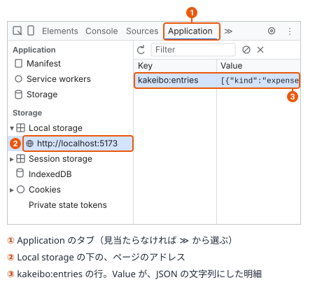

# 実践編 第1章 全体像と、画面が表示されるまで

- **この章で学ぶこと**
  - 初めて見るアプリを動かしてから読み、ファイルの役割の地図を作る
  - ページを開いてから画面が表示されるまでに、どのファイルのどの関数が、どの順で動くか
  - 画面の表示とデータが、どういう形で結び付けられているか

---

## 1.1 実践編の進め方

**この章からは、実践編の詳細版です。** 標準の道は 1 ページの [実践編](P00-digest.md) で、詳細版は、その要点を詳しく読みたい人が読みます。そこで済ませた改修（第2・6・7章）は、飛ばして構いません。実践編では、家計簿のアプリのコードを読みます。本編と違い、**コードが教材の本体**です。本文は、どこをどの順で読み、何を考えるかの案内です。

コマンドでは、実践編の章を `P01`〜`P07` という章ID で表します。第1章のコマンドは `npm run dev P01`・`npm test P01`・`npm run check P01` です。実践編で実行する npm のコマンドは、`npm run dev`・`npm test`・`npm run typecheck`・`npm run check` の 4 つです（役割は 1.3 のコラム）。`package.json` のほかのコマンドは、実践編では実行しません。

### 1 章の流れ

各章は、問題と、章末の改修 1 つでできています。

1. 完成版を起動して（`npm run dev app`）、その章で読む機能を画面で動かす
2. 本文が示す範囲のコードを、エディタで開いて読む
3. 問題の答えを自分の言葉で書き留めてから、「答えと解説」を開き、「確かめ方」の手順を自分でも試す
4. 章末の改修をする（途中は `npm test`、最後に `npm run check`）
5. 自分の変更を `git diff` で読み、コミットする

### 詰まったとき

症状に合う行の対処を試します。

| 症状 | 対処 |
| --- | --- |
| 改修の書き方が分からない | 改修の「ヒント 1」「ヒント 2」を順に開く |
| 改修のテストや画面が思ったとおりにならない | 改修の「テストや画面がうまくいかないとき」の表で、表示に合う行を探す |
| 問題を 15 分ほど考えても分からない | 答えを開いて読む。答えも教材の一部です。読んで分かったら、「確かめ方」を試して先へ進む |
| ここまでで解決しない表示やエラーが出る | [つまずき集](../../troubleshooting.md) を見る |

### 決まり

| フォルダ | 使い方 |
| --- | --- |
| `practice/app/` | 読む用の完成版 |
| `practice/exercises/P01-overview/` | この章の改修用（完成版のコピー）。フォルダの名前は章ID で始まります |
| `practice/solutions/P01-overview/` | 改修の解答例。`npm run dev P01 answer` のように `answer` を付けると、解答例を当てはめた版を起動して見比べられます |

- 完成版（`practice/app/`）は書き換えません。本文が行番号で場所を示すためです。
- 試しに書き換えるときは、改修用フォルダを使います。試した後は `git restore ファイルのパス` で元に戻します。「確かめ方」には、この手順を書いていません。
- 明細のデータは、画面のアドレスごとに保存されます。同じアドレスなら、完成版・改修用フォルダ・解答例のどの版で追加・削除した明細も、ほかの版を開き直すと画面に出ます。2 つの版を同時に起動すると、後の版のアドレスは `5174` などに変わり、データは別になります。
- 問題の番号は章ごとに 1 からです。実践編の本文では、実践編の章を「第3章」、本編の章を「本編第10章」と呼びます。

## 1.2 動かしてから読む

この章で読むのは、`index.html` と `src/main.ts`、それに `src/elements.ts`・`src/state.ts`・`src/render.ts` の一部です。読むときは、次の 2 つを守ります。

- 抜粋に付けた行番号は、エディタに表示されるファイルの行番号です。抜粋だけで答えず、前後のコードもエディタで読みます。
- 本編で扱っていない書き方のうち、問いに必要なものはその場で説明します。それ以外は飛ばして構いません。

知らないコードを読むときは、先に動かして、何をするアプリかをつかみます。次のコマンドで、完成版を起動します。

```sh
npm run dev app
```

ほかのコマンドを打つ前や、もう一度起動する前に、画面を `Ctrl` + `C` で止めます。起動している間は、そのターミナルでほかのコマンドを打てません。この後の章でも同じです。

ブラウザで、次の操作を試してください。

1. 支出を 2 件、収入を 1 件追加する（日付は、違う月のものを混ぜる）
2. 金額を空にしたまま「追加」を押す
3. 「月」と「種別」で絞り込む
4. 明細を 1 件削除する
5. ページを読み込み直す

画面の中で起きていることは、ブラウザの**開発者ツール**で調べます。Chrome なら `F12`（Mac では `Command` + `Option` + `I`）で開きます（本編第10章）。実践編では、主に次の 4 つのタブを使います（第4章で Sources のタブを足します）。

| タブ | 見るもの |
| --- | --- |
| Elements | 今の画面の HTML |
| Console | `console.log` の表示と、エラー |
| Network | ページが行った通信 |
| Application | ページがブラウザに保存したデータ（左の木の「Local storage」など） |

タブが見当たらないときは、タブの並びの右端にある `>>` を押すと出てきます。

画面の各部分の HTML には、id が付いています。この後の章では、場所を id で示すことがあります。


### 問題 1

ページを読み込み直しても、追加した明細は残っています。

1. 明細のデータは、サーバーとブラウザの中のどちらに保存されていると考えられますか。本編第11章を思い出して答えてください。
2. 上の表の開発者ツールのタブを使って、保存されている場所を開いてください。明細は、どういう名前（Key）で保存されていますか。

<details>
<summary>答えと解説</summary>

1. ブラウザの中（localStorage）です。サーバーには送っていません。本編第11章で使った仕組みと同じです。
2. `kakeibo:entries` です。「Application」タブの左の木で「Local storage」の下の `http://localhost:5173` を選ぶと、右の表に出ます。`kakeibo:` は、同じサイトのほかの保存と名前がぶつからないように付けた前置きです。明細は JSON の文字列として保存されています。別のブラウザやシークレットウィンドウで開くと明細が空になることでも、ブラウザの中にあると分かります。



**localStorage** は、ブラウザがサイトごとに持っている保存場所です。名前と文字列の組を保存でき、ページを閉じても残ります。

**確かめ方**：開発者ツールで `kakeibo:entries` の行を選び、`Delete` キーか右クリックのメニューで消します。ページを読み込み直すと、明細が空に戻ります。確かめたら、1.2 の 1 と同じように明細を追加し直します（この後の問題で使います）。

保存と読み込みのコードは第6章で読みます。

</details>

## 1.3 地図を作る

`practice/app/` の中は、次のようになっています（テストのファイルと設定ファイルは省いています）。

```
practice/app/
├── index.html        画面の骨組み
├── style.css         見た目
├── public/
│   └── categories.json
└── src/
    ├── main.ts
    ├── types.ts
    ├── state.ts
    ├── validate.ts
    ├── summary.ts
    ├── format.ts
    ├── storage.ts
    ├── categories.ts
    ├── elements.ts
    └── render.ts
```

<!-- app-map: stage=1 -->

全部を最初から順に読む必要はありません。先に、ファイルの名前から役割の見当を付けます。

コードの場所を探すときは、**全文検索**を使います。この後の章でも、次の形で使います（VS Code の場合）。

- 開き方：左の虫めがねのアイコンを押します（`Ctrl` + `Shift` + `F`。Mac では `Command` + `Shift` + `F`）。
- 探す範囲：検索欄の下の「含めるファイル」に `practice/app` と入れます。改修用フォルダや解答例を除き、完成版だけを探せます。
- 「含めるファイル」の欄が見えないときは、検索欄の右下の `…` を押します。

### 問題 2

次の処理は、`src/` のどのファイルにあると思いますか。ファイルの名前だけを見て予測してください。

1. 金額を `1,234円` の形にする
2. 入力された金額が正しいかを確かめる
3. 収入と支出の合計を計算する
4. 画面の一覧を作る

<details>
<summary>答えと解説</summary>

1. `format.ts`（format は「形を整える」）
2. `validate.ts`（validate は「正しいか確かめる」）
3. `summary.ts`（summary は「集計」）
4. `render.ts`（render は「描く」）

ファイルの名前は、役割を表すように付けられています。名前から見当を付けてから開くと、読む範囲を絞れます。

**確かめ方**：全文検索で `円` を探します（「含めるファイル」は `practice/app`）。`format.ts` の `formatYen` が見つかります。画面に出ている文言で検索するのは、該当するコードを探す一番手早い方法です。

<!-- app-map: stage=2 -->

</details>

### 問題 3

`npm run dev app` は何を実行しますか。リポジトリ直下の `package.json` を開いて、`scripts` の部分を読んで答えてください。

<details>
<summary>答えと解説</summary>

`node scripts/dev.ts app` が実行されます。

`package.json` の `scripts` には、`npm run 名前` で実行できるコマンドが並んでいます。`"dev": "node scripts/dev.ts"` とあるので、`npm run dev app` は `node scripts/dev.ts app` と同じです。`scripts/dev.ts` は、指定されたフォルダを Vite で起動するスクリプトです。

初めて見るプロジェクトでは、`package.json` の `scripts` を読むと、起動・テスト・型チェックのコマンドが分かります。`npm test app` で、完成版のテストを実行できます。

**確かめ方**：`npm run dev app` を打つと、`> dev` の行の次に `> node scripts/dev.ts app` と表示されます。

</details>

> **コラム: `scripts` の名前と、この講座のコマンド**
> この講座では、`package.json` の `scripts` に次の名前を付けています。
>
> | 名前 | 中で動くもの | この講座で使う場面 |
> | --- | --- | --- |
> | `dev` | Vite | 画面を起動して見る |
> | `test` | `node --test` | 改修の途中で、テストを実行する |
> | `typecheck` | `tsc --noEmit` | 型だけを直したときに、型チェックをする |
> | `check` | 型チェックとテストの両方 | 改修の最後と、コミットの前 |
>
> この講座では、どれも `scripts/` の中のスクリプト（問題 3 の `scripts/dev.ts` など）が、表の「中で動くもの」を呼び出します。
>
> ほかのプロジェクトでは、`build`（公開用のファイルを作る）や `lint`（書き方の決まりを検査する）などの名前もあります。`test` と `start` は、`run` を省いて `npm test` のように打てます。

## 1.4 入口から、最初の表示まで

ブラウザが最初に読み込むのは `index.html` です。そこから、コードがどの順で動くかをたどります。

### 問題 4

1. `index.html` の中で、TypeScript のファイルを読み込んでいるのは、どの行ですか。
2. そこから、アプリの入口になるファイルはどれだと分かりますか。

<details>
<summary>答えと解説</summary>

`practice/app/index.html`（59行目）

```html
    <script type="module" src="./src/main.ts"></script>
```

HTML が最初に読み込むのは `src/main.ts` です。プログラムが始まる場所を**入口**（エントリーポイント）と呼びます。

知らないアプリを読むときは、入口から `import` をたどると、全体のつながりが分かります。ほかのファイルは、`main.ts` の `import` から順にたどれます（本編第8章）。

**確かめ方**：`main.ts` の先頭の `import` には、7 つのファイルが並びます。そのうち `types.ts` は `import type` で、型だけを読み込みます。この行は、型と同じく実行時には消えます。残りの `format.ts` は `render.ts` から、`summary.ts` は `render.ts` と `state.ts` から読み込まれます。全文検索で `./format.ts` や `./summary.ts` を探すと分かります（テストのファイルは除きます）。

<!-- app-map: stage=3 -->

</details>

### 問題 5

`main.ts` は、`import` の後、次の 2 行から始まります。

`practice/app/src/main.ts`（17〜18行目）

```ts
const elements = getElements();
let state = createInitialState(loadEntries());
```

18 行目の `state` は、画面を作るためにアプリが覚えている値（**状態**）を入れる変数です。本編第10章の家計簿の `expenses` にあたります。

1. 17 行目の `getElements` は、`elements.ts` にあります。`Elements` の型（1〜21行目）と `getElements`（47〜73行目）を読んで、戻り値の `entryList` が画面のどの要素かを、`index.html` の id で答えてください。また、`index.html` にその id の要素がなかったら、どうなりますか。`findElement`（23〜29行目）を読んで答えてください。
2. `state.ts` の `createInitialState`（4〜12行目）を読み、5 つのプロパティの値を答えてください。保存された明細がまだ 1 件もないとき、この 2 行を実行した直後の `state` の中身です。

`findElement` を読むのに必要な書き方は、`document.querySelector`（本編第10章）と `instanceof`（本編第10章の 10.6）です。

<details>
<summary>答えと解説</summary>

1. `id="entry-list"` の `<ul>`（明細の一覧）です。要素がなければ、`findElement` がエラー（例外）を投げます。

`practice/app/src/elements.ts`（23〜29行目）

```ts
function findElement(selector: string): HTMLElement {
  const element = document.querySelector(selector);
  if (!(element instanceof HTMLElement)) {
    throw new Error(`要素が見つかりません: ${selector}`);
  }
  return element;
}
```

- `getElements` は、画面の要素を 1 つのオブジェクトにまとめて返します。`entryList: findElement("#entry-list")` の行で、`#entry-list` の要素を取得しています。
- 要素が見つからないと、`querySelector` は `null` を返し、`instanceof HTMLElement` が `false` になります。そこでエラーを投げるので、`main.ts` は 17 行目で止まります。画面には `index.html` に書いた部分だけが残り、分類の選択欄も集計の金額も空のままです。コンソールに `要素が見つかりません: #entry-list` と表示されます。
- 画面の要素を使うときは、`elements.entryList` のように、このオブジェクトから取り出します。要素を増やすときは、`Elements` の型と `getElements` の戻り値の 2 か所に足します。

2. 次の表のとおりです。

`practice/app/src/state.ts`（4〜12行目）

```ts
export function createInitialState(entries: Entry[]): AppState {
  return {
    entries,
    filter: { month: "all", kind: "all" },
    categories: { status: "loading" },
    formKind: "expense",
    formErrors: [],
  };
}
```

| プロパティ | 値 | 意味 |
| --- | --- | --- |
| `entries` | `[]` | 明細はまだない |
| `filter` | `{ month: "all", kind: "all" }` | 絞り込んでいない |
| `categories` | `{ status: "loading" }` | 分類の一覧は、まだ読み込み中 |
| `formKind` | `"expense"` | フォームの種別は「支出」 |
| `formErrors` | `[]` | 入力のエラーはない |

保存がないとき、`localStorage.getItem` は `null` を返し、`parseStoredEntries(null)` は `[]` を返します。そのため、`loadEntries`（`storage.ts`）の結果も `[]` です。

型の定義は、`types.ts` の `AppState` にあります。

状態に入るのは、上の表の 5 つです（入力欄に打っている途中の値は入りません）。このアプリでは、絞り込みの条件や読み込みの状況も状態に入っています。

`let` で宣言されているのは、後で別の状態に入れ替えるためです（問題 9）。

**確かめ方**：1 は、改修用フォルダの `index.html`（`practice/exercises/P01-overview/index.html`）で `id="entry-list"` を `id="entry-list2"` に変え、`npm run dev P01` で起動してコンソールを見ます。2 は、改修用フォルダの `src/main.ts` の 18 行目の後に `console.log(state);` を入れます。`npm run dev P01` で起動して、開発者ツールのコンソールを見ます。1.2 で追加した明細が残っていれば、`entries` にその明細が入っています。

</details>

### 問題 6

`main.ts` の最後は次の 2 行です。

`practice/app/src/main.ts`（91〜92行目）

```ts
render(state, elements);
await loadCategories();
```

`render`（`render.ts`）は、フォーム・絞り込み・集計・一覧を、それぞれ別の関数で作ります（1.5 で読みます）。ここでは、フォームを作る `renderForm` を読みます。

`renderForm` を読むのに必要な書き方は次の 2 つです。

- `classList.toggle("hidden", 条件)` は、条件が `true` なら `hidden` というクラスを付け、`false` なら外します。`hidden` の付いた要素は画面に表示されません。
- `categoryStatusText({ categories }: AppState)` の `{ categories }` は、引数の分割代入です（本編第4章）。`AppState` 型の引数から、`categories` だけを取り出しています。

1. 91 行目の `render` が実行された時点で、分類の選択欄の中身と、フォームの下の文言（`id="category-status"`）はどうなっていますか。`render.ts` の `renderForm`（39〜53行目）と、その上の `categoryStatusText` を読んで答えてください。
2. 92 行目の `loadCategories` が終わると、画面はどう変わりますか。`main.ts` の `loadCategories`（29〜38行目）と、その中で呼ぶ `update`（20〜27行目）を読んで答えてください。

<details>
<summary>答えと解説</summary>

1. 選択欄は空で、下に「分類を読み込んでいます…」と表示されます。この時点の `state.categories` は `{ status: "loading" }` だからです（問題 5）。`renderForm` が選択欄に項目を入れるのは、`status` が `"ready"` のときだけです（46〜48行目）。それまでは、`index.html` に書いた空の `<select id="category"></select>` のままです。
2. 読み込みが成功すると、選択欄に分類が入り、文言が消えます。

`practice/app/src/main.ts`（29〜38行目）

```ts
async function loadCategories(): Promise<void> {
  try {
    const items = await fetchCategories();
    update(setCategories(state, { status: "ready", items }));
  } catch (e) {
    console.error(e);
    const message = "分類を読み込めませんでした。ページを読み込み直してください。";
    update(setCategories(state, { status: "error", message }));
  }
}
```

`loadCategories` は、`fetchCategories` で分類の一覧を読み込み、終わったら `update` を呼びます。`update` は、状態を新しくして、もう一度 `render` を呼ぶ関数です（問題 9）。ページを開くと `render` が 2 回動きます。

`async`・`await`・`try`〜`catch` は、本編第9章で扱いました。`console.error` は、値をコンソールにエラーとして（赤く）表示します。

| 順番 | 起きること | 画面 |
| --- | --- | --- |
| 1 | `render(state, elements)` | 分類は「読み込み中」 |
| 2 | `loadCategories()` が分類を読み込む（待つ） | そのまま |
| 3 | `update(...)` が状態を新しくして `render` を呼ぶ | 分類の選択欄に項目が入る |

読み込みは一瞬で終わるので、普段は 1 の画面に気づきません。

**確かめ方**：開発者ツールの「Network」タブで、通信の速さを遅くしてから、ページを読み込み直します。タブの上の段の「No throttling」の選択欄で「3G」を選びます（「Offline」は選びません）。「分類を読み込んでいます…」が表示されるのが見えます。確かめたら、設定を元に戻します。

</details>

## 1.5 状態から画面を作る

画面を作っているのは、`render.ts` の `render` 関数です。

### 問題 7

`practice/app/src/render.ts`（104〜110行目）

```ts
export function render(state: AppState, elements: Elements): void {
  const visibleEntries = filterEntries(state.entries, state.filter);
  renderForm(state, elements);
  renderFilter(state, elements);
  renderSummary(visibleEntries, elements);
  renderList(visibleEntries, elements);
}
```

`renderSummary` と `renderList` には、`state.entries` ではなく `visibleEntries` を渡しています。一方、`renderFilter` には `state` をそのまま渡しています。

1. `visibleEntries` には、何が入っていますか。
2. 集計と一覧に `state.entries` を渡すと、画面で何が困りますか。
3. `renderFilter` は月の選択肢を作っています。こちらに `visibleEntries` を使うと、何が困りますか。

<details>
<summary>答えと解説</summary>

1. 今の絞り込みの条件（`state.filter`）に合う明細だけが入っています。`filterEntries` は `summary.ts` にあります。
2. 絞り込んでも、集計と一覧が変わらなくなります。絞り込みでは、状態の明細を減らしません。表示するときに選び直しています。
3. 月で絞り込んだとたんに、月の選択肢がその月だけになります。ほかの月を選ぶには、いったん「すべて」に戻します。選択肢は、絞り込む前の明細（`state.entries`）から作ります。

`render` は、状態を受け取って画面を作ります。状態は書き換えません。

**確かめ方**：改修用フォルダの `render.ts` で、`renderList(visibleEntries, elements)` を `renderList(state.entries, elements)` に変え、`npm run dev P01` で起動します。月の違う明細が 2 件以上ある状態で、月を 1 つ選びます。集計はその月の分に変わり、一覧は全部の明細のままです。

</details>

### 問題 8

`practice/app/src/render.ts`（99〜102行目）

```ts
function renderList(entries: Entry[], elements: Elements): void {
  elements.entryList.replaceChildren(...sortByDate(entries).map(createEntryItem));
  elements.emptyMessage.classList.toggle("hidden", entries.length > 0);
}
```

100 行目を読むのに必要な書き方は次のとおりです。

- `要素.replaceChildren(a, b)` は、要素の今の中身を全部消してから、`a` と `b` を入れます。`要素.append(a, b)` は、今の中身を残したまま、末尾に `a` と `b` を足します。
- `.map(createEntryItem)` は、関数の名前をそのまま渡しています。`.map((entry) => createEntryItem(entry))` と同じ意味です。
- `...` は、配列の要素を、引数として 1 つずつ渡す書き方です。`replaceChildren(...[a, b])` は `replaceChildren(a, b)` と同じです。

`replaceChildren` を、`append` に書き換えたとします。

明細が 1 件もない状態から、支出を 2 件続けて追加すると、一覧には何行表示されますか。

<details>
<summary>答えと解説</summary>

3 行表示されます（1 件目を追加したときの 1 行と、2 件目を追加したときの 2 行）。ページを開いたときにも `render` は動きますが、明細が 0 件なので行は出ません。

`render` は、状態が変わるたびに一覧を全部作り直します。`append` は今の中身を残すので、`render` が呼ばれるたびに、そのときの明細の数だけ行が増えます。種別や絞り込みを変えたときにも増えます。

その次の行は、明細が 1 件以上あるときに、「明細はまだありません。」の文を隠しています（`classList.toggle` は問題 6）。

**確かめ方**：書き換える前に、今の画面で明細をすべて削除しておきます。それから改修用フォルダの `render.ts` で書き換えて、`npm run dev P01` で起動し、種別を変えずに支出を 2 件続けて追加します。

</details>

### 問題 9

状態を変えるときは、必ず `main.ts` の `update` 関数を通ります。

`practice/app/src/main.ts`（20〜27行目）

```ts
// 状態を新しくし、明細が変わっていれば保存して、画面を作り直す
function update(next: AppState): void {
  if (next.entries !== state.entries) {
    saveEntries(next.entries);
  }
  state = next;
  render(state, elements);
}
```

1. 月の絞り込みを変えたとき、`saveEntries` は呼ばれますか。`state.ts` の `setFilter`（29〜31行目）と `addEntry`（14〜16行目）を読み比べて答えてください。
2. もし `update` の中の `render(state, elements);` の行がなかったら、ページを開いた後の画面はどうなりますか。その画面で支出を追加しようとすると、何が起きますか（分類が空のまま追加すると、入力の検証でエラーになります）。

<details>
<summary>答えと解説</summary>

1. 呼ばれません。

`practice/app/src/state.ts`（14〜16行目）

```ts
export function addEntry(state: AppState, entry: Entry): AppState {
  return { ...state, entries: [...state.entries, entry], formErrors: [] };
}
```

`practice/app/src/state.ts`（29〜31行目）

```ts
export function setFilter(state: AppState, changes: Partial<Filter>): AppState {
  return { ...state, filter: { ...state.filter, ...changes } };
}
```

- `addEntry` は `[...state.entries, entry]` で新しい配列を作るので、`next.entries !== state.entries` は `true` になり、保存されます。
- `setFilter` は `filter` だけを新しくし、`entries` は元と同じ配列のままなので、`next.entries !== state.entries` は `false` になり、保存されません。

状態を、元を変えずに新しく作っているので、この 1 行で明細が変わったかが分かります。

- `===` や `!==` で配列を比べると、中身ではなく、同じ配列かどうかを調べます（本編第4章）。
- `...` は、オブジェクトや配列の中身をコピーするスプレッド構文です（本編第4章）。
- `Partial<Filter>` は、`Filter` の項目の一部だけを持つオブジェクトの型です（本編第8章）。

2. 分類の選択欄が空で、「分類を読み込んでいます…」と表示されたままです。その画面で「追加」を押しても、何も起きないように見えます。

- 最初の画面は、`main.ts` の最後の `render` が作ります。分類の読み込みが終わった後の `render` は、`update` の中で呼んでいるので（問題 6）、動きません。
- 「追加」を押すと、分類が空なので、入力の検証でエラーになります。エラーのメッセージは `update(setFormErrors(...))` で状態に入りますが、画面を作り直さないので、表示されません。

どちらの場合も、**状態は変わっているのに画面が古いまま**です。状態を変えることと、画面を作り直すことは、別の作業です。`update` にまとめておけば、作り直し忘れが起きません。

**確かめ方**：1 は、改修用フォルダの `main.ts` で、`saveEntries(next.entries);` の上に `console.log("保存します");` を入れます。明細を追加したときと、絞り込みを変えたときで、コンソールの表示を比べます。2 は、同じファイルの `update` の中の `render(state, elements);` の行を消して、画面を見ます。`render` の行を消したままだと、章末の改修で画面が更新されません。

</details>

## 1.6 素朴な版と比べる

このアプリでは、状態を変えると `render` が画面を全部作り直します。なぜこの形にするのかを、そうしていない書き方と比べて確かめます。

### 問題 10

次のコードは、明細を配列に残さず、追加のたびに画面の該当する場所だけを書き換える書き方です。このアプリのコードではありません。

```ts
let total = 0;

form.addEventListener("submit", (event) => {
  event.preventDefault();
  const amount = Number(amountInput.value);

  const item = document.createElement("li");
  item.textContent = `${nameInput.value}: ${amount}円`;
  list.append(item);

  total = total + amount;
  totalText.textContent = `合計 ${total}円`;
});
```

このコードに次の機能を足すとします。それぞれ、何をする必要がありますか。

1. 明細を 1 件削除する
2. 月で絞り込む

<details>
<summary>答えと解説</summary>

1. 一覧からその行を消し、`total` から金額を引き、合計の表示を書き換えます。追加のときと同じ 3 か所を、削除のためにもう一度書きます。どれか 1 つを忘れると、一覧と合計がずれます。
2. このコードのままではできません。明細は日付を持たず、画面の `<li>` の文字としてしか残っていません。どの明細が何月のものかを後から調べられません。

機能が増えるたびに、「画面のどこをどう書き換えるか」の組み合わせが増えていきます。

このアプリの形なら、機能を足すときに考えるのは、次の 2 つです。

- 状態をどう変えるか（`state.ts` に関数を 1 つ足す）
- 状態から画面をどう作るか（`render.ts`）

削除は `removeEntry`、絞り込みは `setFilter` で、状態を新しくします。画面は `render` が全部作り直すので、一覧と合計がずれることはありません。

</details>

## まとめ

ページを開いてから最初の画面が表示されるまでの流れを、ファイルと関数の名前を使って説明してください。

<details>
<summary>説明の例</summary>

1. ブラウザが `index.html` を読み込み、その中の `<script>` から `src/main.ts` が実行される。
2. `main.ts` が `getElements` で画面の要素を取得し、`loadEntries` で保存された明細を読み込んで、`createInitialState` で最初の状態を作る。
3. イベントの処理（`submit`・`change`・`click`）を登録する。
4. `render` が、状態から画面を作る。この時点では、分類は読み込み中。
5. `loadCategories` が分類を読み込み、終わったら `update` を呼ぶ。`update` が状態を新しくして、もう一度 `render` を呼ぶ。

その後は、操作のたびに「`update` で状態を新しくする → `render` で画面を作り直す」を繰り返す。


後の章で読むファイルも、この図のどこかに当たります。迷ったら、この図に戻ってください。

</details>

---

## 改修：明細の件数を表示する

明細の一覧の上に、表示している明細の件数を「3 件」の形で表示します。件数の文字を作る関数を書いた後、HTML・要素の取得・描画の 3 か所を順につなげます。

**進め方**

#### 件数の文字を作る

1. `practice/exercises/P01-overview/src/format.ts` の、一番下の `formatCount` の `throw` の行を書き換える
   - `3` なら `"3 件"` を返します（数と「件」の間に半角の空白）
   - 画面はまだ変わりません（テストは画面を見ません）
   ```sh
   npm test P01
   ```
   - **こうなれば OK**：テストの表示で、`formatCount` の行に `✔` が付く

#### 画面につなぐ

2. 画面を起動したままにする
   - 保存すると、画面は自動で読み込み直されます
   - 画面を起動している間は、型エラーをエディタの赤い波線で見ます
   ```sh
   npm run dev P01
   ```
   - **こうなれば OK**：家計簿の画面が表示される
3. `practice/exercises/P01-overview/index.html` の、一覧（`id="entry-list"`）のすぐ上に、件数を表示する要素を足す
   - `id="名前"` を付けると、`elements.ts` の `findElement("#名前")` で取得できます（問題 5）
   - `class="status"` を付けると、「明細はまだありません。」と同じ見た目になります
   - 要素の中はまだ空なので、この時点では画面の見た目は変わりません
   - **こうなれば OK**：開発者ツールの Elements で、一覧のすぐ上に足した要素が見える
4. `src/elements.ts` の 2 か所（`Elements` の型と、`getElements` の戻り値）に、その要素を足す
   - 2 か所に足す理由は問題 5 で読みました。書き方は、`emptyMessage` が出てくる 2 か所と同じです
   - **こうなれば OK**：`elements.ts` に赤い波線がなく、`render.ts` で `elements.` と打つと、足した要素の名前が候補に出る（打った文字は消しておく）
5. `src/render.ts` の `renderList` で、件数を表示する
   - 数えるのは、`renderList` が受け取る明細です
   - 文字を表示するには、`要素.textContent` に文字列を代入します（本編第10章）
   - ほかのファイルの関数は、先頭の `import` に名前を足すと使えます
   - **こうなれば OK**：一覧の上に「3 件」の形で件数が表示される
6. 画面で次を 1 つずつ試す
   - [ ] 「明細」の見出しの下、一覧の上に、件数が表示される
   - [ ] 明細を追加・削除すると、件数が変わる
   - [ ] 月や種別で絞り込むと、件数が、表示されている明細の数に変わる
   - [ ] 明細がないときは「0 件」と表示される

#### 仕上げる

7. 画面を `Ctrl` + `C` で止め、型チェックとテストを実行する
   - 画面につなぐ段階で書いたコードに型エラーがないことを、ここで調べます
   ```sh
   npm run check P01
   ```
   - **こうなれば OK**：「型チェック: OK」「テスト: OK」
8. 自分の変更を差分で読む
   ```sh
   git diff practice/exercises/P01-overview
   ```
   - **こうなれば OK**：`index.html`・`elements.ts`・`format.ts`・`render.ts` の 4 つのファイルが表示される
9. コミットする
   ```sh
   git add practice/exercises/P01-overview
   git commit -m "実践編 第1章 改修: 明細の件数を表示する"
   ```
   - **こうなれば OK**：表示の 1 行目に、付けたメッセージが出る

**テストで確かめるもの**

| 呼び出し | 返す値 |
| --- | --- |
| `formatCount(3)` | `"3 件"` |
| `formatCount(0)` | `"0 件"` |

<details>
<summary>ヒント 1：どこを見ればよいか</summary>

- 表示する場所：`render.ts` の `renderList`（問題 8）

</details>

<details>
<summary>ヒント 2：書き出し</summary>

- `index.html`：`<p id="entry-count" class="status"></p>` を足します。
- `elements.ts`：`Elements` の型に `entryCount: HTMLElement;` を、`getElements` の戻り値に `entryCount: findElement("#entry-count"),` を足します。
- `render.ts`：`renderList` の中で、`elements.entryCount.textContent` に `formatCount(entries.length)` を入れます。`formatCount` の `import` も必要です。

</details>

<details>
<summary>テストや画面がうまくいかないとき</summary>

| 表示 | よくある原因 |
| --- | --- |
| テストで `'3件' !== '3 件'` | 数と「件」の間に、半角の空白が入っていません |
| 型チェックで `'entryCount' does not exist in type 'Elements'` | `getElements` の戻り値には足したが、`Elements` の型に足していません |
| 型チェックで `Property 'entryCount' is missing in type '{ form: HTMLFormElement; ... }' but required in type 'Elements'.` | 上の逆です。`Elements` の型には足したが、`getElements` の戻り値に足していません |
| 型チェックで `Property 'entryCount' does not exist on type 'Elements'.` | `Elements` の型に `entryCount` を足していません |
| 型チェックで `Cannot find name 'formatCount'. Did you mean 'formatMonth'?` | `render.ts` で `formatCount` を `import` していません |
| 型チェックで `Type 'string' is not assignable to type 'HTMLElement'.` | `elements.entryCount` に、文字列をそのまま代入しています。`elements.entryCount.textContent` に代入します |
| 型チェックで `Cannot find name 'state'.` | `renderList` の中で `state.entries` を使っています。`renderList` が受け取った `entries` を使います |
| 件数・分類の選択肢・集計の金額が出ず、コンソールに `要素が見つかりません: #entry-count` | `index.html` に要素を足していないか、`id` のつづりが違います |
| テストは合格するが、絞り込んでも件数が変わらない | `render` 関数の中で、`state.entries.length` を表示しています。`renderList` の中で、受け取った `entries` の数を表示します |

表示の読み方は、[つまずき集](../../troubleshooting.md) にあります。

</details>

解答例：[practice/solutions/P01-overview/src/format.ts](../solutions/P01-overview/src/format.ts)、[practice/solutions/P01-overview/index.html](../solutions/P01-overview/index.html)、[practice/solutions/P01-overview/src/elements.ts](../solutions/P01-overview/src/elements.ts)、[practice/solutions/P01-overview/src/render.ts](../solutions/P01-overview/src/render.ts)

---

## チェックリスト

- [ ] 「状態」が何で、このアプリではどの変数かを説明できる
- [ ] 絞り込みを変えたときに、明細が保存し直されない理由を説明できる
- [ ] 画面の該当箇所だけを書き換える書き方と比べて、状態から全部作り直す形の良い点を説明できる

## 詳しく学ぶ

- JavaScript Primer：[Todoアプリ](https://jsprimer.net/use-case/todoapp/)（特に「[イベントとモデル](https://jsprimer.net/use-case/todoapp/event-model/)」。状態と表示を分ける考え方）、[ECMAScriptモジュール](https://jsprimer.net/basic/module/)
- サバイバルTypeScript：[判別可能なユニオン型](https://typescriptbook.jp/reference/values-types-variables/discriminated-union)（`AppState` の `categories` の型。第2章で読みます）
