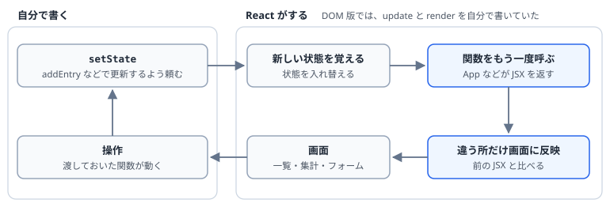
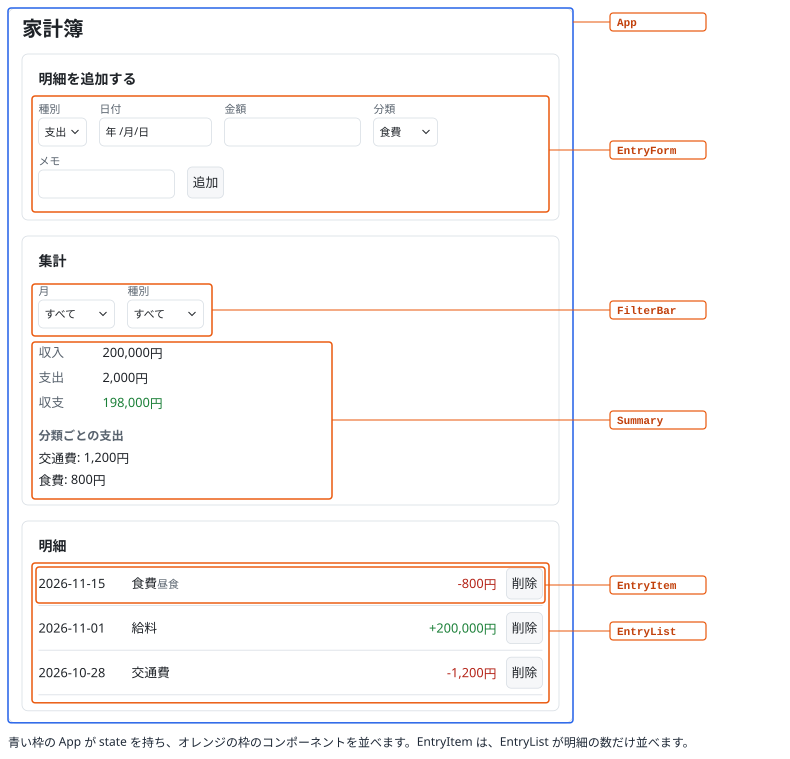
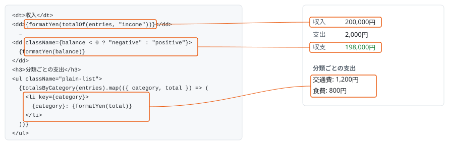
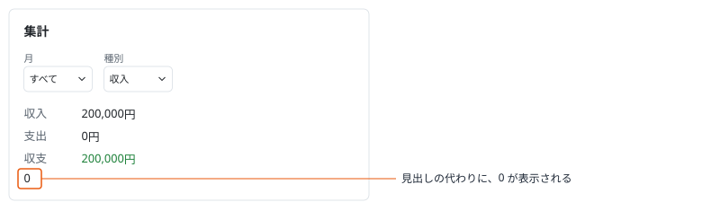
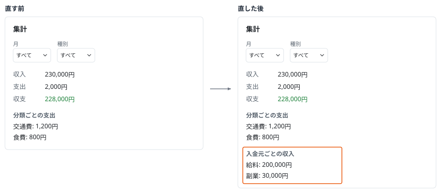
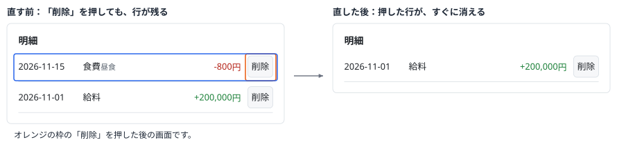
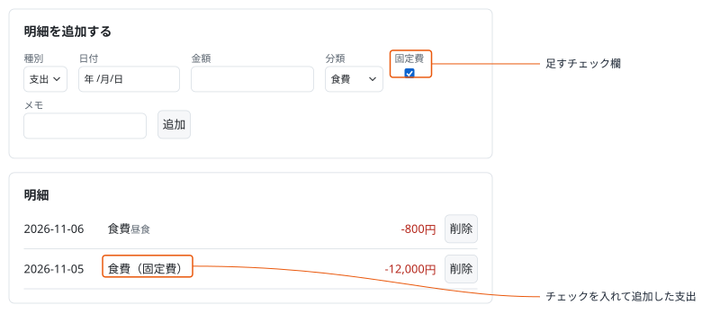
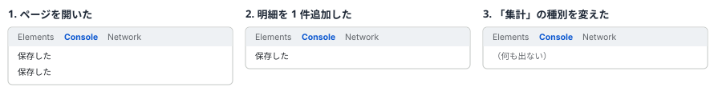
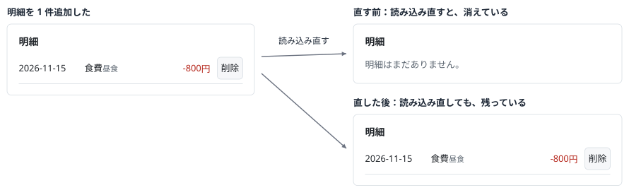

# React 編

- **このページで学ぶこと**
  - DOM 版の家計簿が、React 版ではどういう形になっているか
  - JSX・state・フォーム・データの流れ・エフェクトの要点
  - JSX を書く・state を書き換えない・フォームに欄を足す・依存配列を直す、の 4 つの改修

---

## 進め方と決まり

React 編は、この 1 ページです。要点を 1 つ読むたびに、問題 1 問と改修 1 つで手を動かします。実践編を終えてから読みます。読むのは、実践編の家計簿を React で書き直したアプリです。

| フォルダ | 使い方 |
| --- | --- |
| `react/app/` | 読む用の完成版（React 版）。書き換えません |
| `react/exercises/R05-flow/` など | 改修用（完成版のコピー）。名前の先頭が、コマンドで使う章ID（`R05` など）です |
| `practice/app/` | 実践編で読んだ完成版（DOM 版）。見比べるために開きます |

- コマンドは、実践編の 4 つと `npm run lint` を使います。`npm run lint` は**リンター**（型チェックでは見つからない、間違いになりやすい書き方を知らせる道具）を動かします。このページで使うのは改修 4 だけです。
- 改修の間は、画面を起動したターミナルをそのままにします。ほかのコマンドは、メニュー「ターミナル」→「新しいターミナル」で開いたターミナルで打ちます。改修ごとに起動する画面が違うので、次の改修に進む前に `Ctrl` + `C` で止めます。
- 試しに書き換えた所は、`git restore ファイルのパス` で元に戻します。問題は、15 分ほど考えて分からなければ、答えを開いて読みます。

## React とは、なぜ使うのか

**React は、画面を作るための JavaScript のライブラリ（よく使う機能をまとめた部品集）です。** 「この状態なら、画面はこの形」という関数（**コンポーネント**）を書くと、実際の画面をその形に合わせる仕事を、React が引き受けます。広く使われていて、実務のフロントエンドのコードでよく出会います。

実践編の DOM 版では、画面を変える仕事を、すべて自分で書いていました。画面が大きくなるほど、書く場所と、直し忘れる場所が増えます。React を使うと、次の所が変わります。その代わりに、React の書き方の決まり（state は書き換えない、など）を守って書きます。

| | DOM 版（自分で書く） | React 版 |
| --- | --- | --- |
| 画面の形を書く場所 | `index.html` の骨組みと、`render.ts` の書き換えに分かれる | コンポーネントの中の 1 か所 |
| 画面の直し方 | どの要素をどう書き換えるかを 1 つずつ書き、状態を変えるたびに `render` を自分で呼ぶ | 状態から画面の形を返すだけ。コンポーネントを呼び直すのも、前と違う所を直すのも React |
| 画面の分け方 | 関数に分ける | 部品（コンポーネント）に分け、タグのように組み合わせる |

## 地図：React の動きと、コンポーネント

最初に React 版の完成版を起動し、明細の追加・絞り込み・削除を試します。動きは DOM 版と同じです。見たら、画面を `Ctrl` + `C` で止めます。

```sh
npm run dev rapp
```

React の動きは、次の 3 つです。

1. **コンポーネント**（JSX を返す関数）は、状態から JSX を返します。**JSX** は、HTML のタグに似た書き方です。
2. 状態を更新すると、React がその関数をもう一度呼びます。
3. React が、前の JSX と違う所だけを、画面に反映します。



コンポーネントは、`react/app/src/` に 6 つあります。`state.ts`・`summary.ts`・`validate.ts` など、画面に触らないファイルは、DOM 版と同じ内容のまま使います。**明細と絞り込みの state は `App` が持ち、子には props（タグの属性の形で渡す値）で渡します。**

| コンポーネント | 役割 |
| --- | --- |
| `App.tsx` の `App` | state を持つ。下の 4 つを並べる |
| `components/EntryForm.tsx` | 明細を追加するフォーム |
| `components/FilterBar.tsx` | 月と種別の絞り込み |
| `components/Summary.tsx` | 集計 |
| `components/EntryList.tsx`・`EntryItem.tsx` | 明細の一覧と、その 1 行 |



---

## 要点 1：JSX とコンポーネント

### JSX：タグを値として書く

**JSX は、画面に出したい形を、HTML のタグに似た書き方で書いた値です。** `.tsx` のファイルで書けます。値なので、関数の戻り値にできます。

`react/app/src/components/Summary.tsx`（9〜32行目）

```tsx
export function Summary({ entries }: SummaryProps) {
  const balance = balanceOf(entries);

  return (
    <>
      <dl className="totals">
        <dt>収入</dt>
        <dd>{formatYen(totalOf(entries, "income"))}</dd>
        <dt>支出</dt>
        <dd>{formatYen(totalOf(entries, "expense"))}</dd>
        <dt>収支</dt>
        <dd className={balance < 0 ? "negative" : "positive"}>{formatYen(balance)}</dd>
      </dl>
      <h3>分類ごとの支出</h3>
      <ul className="plain-list">
        {totalsByCategory(entries).map(({ category, total }) => (
          <li key={category}>
            {category}: {formatYen(total)}
          </li>
        ))}
      </ul>
    </>
  );
}
```



| 書き方 | 意味 | 上の例 |
| --- | --- | --- |
| `{式}` | 式の値が、その場所に入る。囲まないと、文字としてそのまま表示される | 16 行目の `{formatYen(…)}` |
| `className="…"`・`className={式}` | 属性。決まった文字列は `" "`、式は `{ }` で書く。`class` は `className` と書く | 14・20 行目 |
| `配列.map((…) => <li key={…}>…</li>)` | 配列を、要素の並びにする。`key` には、要素ごとに違う値を渡す | 24〜28 行目 |
| `<>` と `</>` | 並べたタグを、1 つに囲む。画面に要素は増えない | 13・30 行目 |

条件で表示を変えるには、`{ }` の中に `条件 && A` か `条件 ? A : B` を書きます。`条件 && A` は、条件が `true` のときだけ A を表示します。`条件 ? A : B` は、A と B を出し分けます。

| `{ }` の中の式の値 | 画面 |
| --- | --- |
| タグ（JSX）、文字列、数 | そのまま表示される |
| `true`・`false`・`null`・`undefined` | 何も表示されない |

### コンポーネントと props

**コンポーネントは、JSX を返す関数です。** 名前を大文字で始め、ほかの JSX の中でタグとして使います。タグに書いた属性は、1 つのオブジェクトにまとめて、関数の引数に渡されます。これを **props** と呼びます。

| | コード | 場所 |
| --- | --- | --- |
| 親が使う | `<Summary entries={visibleEntries} />` | `App.tsx` の 100 行目 |
| 子が受け取る | `export function Summary({ entries }: SummaryProps) {` | `Summary.tsx` の 9 行目 |
| props の型 | `type SummaryProps = { entries: Entry[]; };` | `Summary.tsx` の 5〜7 行目 |

- `{ entries }` は、引数の分割代入です（本編第4章）。
- props は、子の中で書き換えません。受け取った値から JSX を作るだけにします。

## 問題 1：支出があるときだけ見出しを出す

集計の「分類ごとの支出」の見出しは、支出が 1 件もないときにも表示されます。そこで、支出があるときだけ見出しを出そうとして、`Summary.tsx` の 22 行目を、次のように書き換えたとします。

```tsx
      {totalsByCategory(entries).length && <h3>分類ごとの支出</h3>}
```

`A && B` の値は、A が `false` として扱われる値（`false`・`0`・`""` など）なら、A そのものです。そうでなければ、B です。

1. 支出が 1 件以上あるとき、この行は何を表示しますか。
2. 支出が 1 件もないとき、この行は何を表示しますか。
3. ねらいどおりに動くようにするには、どう直しますか。

<details>
<summary>答えと解説</summary>

1. **見出し「分類ごとの支出」**。配列の長さは 1 以上なので、式の値は `<h3>` です。
2. **`0`**。配列の長さは `0` で、`false` として扱われるので、式の値は `0` そのものです。React は数の `0` をそのまま表示します。
3. **左側を、`true` か `false` になる式にします**。`{totalsByCategory(entries).length > 0 && <h3>分類ごとの支出</h3>}` と書けば、支出がないときの式の値は `false` で、何も表示されません。



</details>

## 改修 1：集計に「入金元ごとの収入」を足す

集計の「分類ごとの支出」の下に、「入金元ごとの収入」の一覧を足します。改修用フォルダは `react/exercises/R05-flow/`（章ID は `R05`）です。



入金元ごとに合計する関数 `totalsBySource` は、改修用フォルダの `src/summary.ts` に用意してあります。足りないのは、画面に表示する部分です。

**進め方**

#### 一覧を表示する

1. この改修の画面を起動する
   ```sh
   npm run dev R05
   ```
   - 画面が表示されたら、入金元と月が違う収入を 2 件追加します（たとえば、10 月の「給料」と 11 月の「副業」。図0-5 は、支出も入れた画面です）
   - **こうなれば OK**：一覧にその 2 件があり、「集計」の月の欄で、両方の月を選べる
2. `react/exercises/R05-flow/src/components/Summary.tsx` の、「分類ごとの支出」の一覧（`</ul>`）の下に、見出しと一覧を足す
   - 見出しは `<h3>入金元ごとの収入</h3>` です
   - 一覧の形は、すぐ上の「分類ごとの支出」と同じです。`totalsBySource(entries)` は、`{ source, total }` の配列を返します
   - `key` には、`source` を渡します
   - 先頭の `import { balanceOf, totalOf, totalsByCategory } from "../summary.ts";` の `{ }` の中に、`totalsBySource` を足します
   - **こうなれば OK**：集計に「入金元ごとの収入」の見出しと、「給料: 200,000円」の形の行が表示される

#### 収入がないときは、見出しも出さない

3. 収入が 1 件もないときは、見出しと一覧の両方を表示しないようにする
   - `totalsBySource(entries)` の結果は、条件と一覧の両方で使うので、`return` の前で変数に入れます
   - 条件は、`配列.length > 0` のように、`true` か `false` になる式にします。`配列.length &&` と書くと、`0` が表示されます（問題 1）
   - 見出しと一覧の 2 つは、`<>` と `</>` で囲んでから、`条件 && (…)` の `( )` に入れます。`( )` の中に書けるのは、1 つの要素です
   ```sh
   npm test R05
   ```
   - **こうなれば OK**：「テスト: OK」
4. 画面で次を 1 つずつ試す
   - [ ] 収入があるとき、「入金元ごとの収入」に、入金元ごとの合計が、金額の大きい順に表示される
   - [ ] 同じ入金元の収入を 2 件追加すると、1 行にまとまり、金額が合計になる
   - [ ] 「集計」の種別を「支出」に変えると、見出しと一覧が消える。`0` のような余分な文字も出ない
   - [ ] 種別を「すべて」に戻し、手順 1 で使った月の 1 つで絞り込むと、その月の収入だけが入金元ごとに合計される。ほかの月にしかない入金元は消える
   - [ ] Console に、`key` の警告（`Each child in a list should have a unique "key" prop.`）が出ていない

#### 仕上げる

5. 画面を `Ctrl` + `C` で止め、型チェックとテストを実行する
   ```sh
   npm run check R05
   ```
   - **こうなれば OK**：「型チェック: OK」「テスト: OK」
6. 自分の変更を差分で読む
   ```sh
   git diff react/exercises/R05-flow
   ```
   - **こうなれば OK**：`Summary.tsx` の 1 つのファイルだけが表示される

**テストで確かめるもの**

| 表示するもの | 画面の HTML |
| --- | --- |
| 給料 200,000 円の収入がある `Summary` | 「分類ごとの支出」の一覧の後に、`<h3>入金元ごとの収入</h3>`、`<ul class="plain-list">`、`<li>給料: 200,000円</li>`、`</ul>` |
| 副業 30,000 円と給料 180,000 円の `Summary` | `<li>給料: 180,000円</li>`、`<li>副業: 30,000円</li>` の順 |
| 支出だけの `Summary` | 「分類ごとの支出」の一覧の `</ul>` で終わる |

<details>
<summary>ヒント 1：どこを見ればよいか</summary>

- 一覧の形：`Summary.tsx` の 22〜29 行目
- 計算の結果を変数に入れている例：`Summary.tsx` の 10 行目
- `条件 && <タグ>` の例：`EntryList.tsx` の 18 行目

</details>

<details>
<summary>ヒント 2：書き出し</summary>

- `import` に `totalsBySource` を足し、`const balance = …;` の下に `const sourceTotals = totalsBySource(entries);` を足します。
- 「分類ごとの支出」の `</ul>` の下に、次を足します。

  ```tsx
        {sourceTotals.length > 0 && (
          <>
            <h3>入金元ごとの収入</h3>
            <ul className="plain-list">
              {sourceTotals.map(({ source, total }) => (
                <li key={source}>
                  {source}: {formatYen(total)}
                </li>
              ))}
            </ul>
          </>
        )}
  ```

</details>

<details>
<summary>テストや画面がうまくいかないとき</summary>

テストの表示で、`-` で始まる行は「テストが期待しているのに、画面にない行」、`+` で始まる行は「画面にあるのに、テストが期待していない行」です。

| 表示 | よくある原因 |
| --- | --- |
| テスト「収入が 1 件もないとき、入金元ごとの収入の見出しを表示しない」で `+ '</ul>0'` と `- '</ul>'` | `sourceTotals.length && (…)` と書いています。長さが `0` のとき、`0` が表示されます。`sourceTotals.length > 0 &&` にします |
| 同じテストで、`+ '<h3>入金元ごとの収入</h3>'` が出る | 条件を付けずに、見出しと一覧を足しています（手順 3 がまだです） |
| 同じテストで、`+ '<ul class="plain-list">'` と `+ '</ul>'` だけが出る | 見出しにだけ条件を付けています。一覧も、`<>` の中に入れます |
| テストで、ファイルの名前の行（`Summary.test.ts` など）が `✖` になる。型チェックで `JSX expressions must have one parent element.` | `条件 && (…)` の `( )` の中に、`<h3>` と `<ul>` を並べています。`<>` と `</>` で囲みます |
| テストで `ReferenceError [Error]: totalsBySource is not defined` が出て、`App` のテストも `✖` になる。型チェックで `Cannot find name 'totalsBySource'.` | `Summary.tsx` で `totalsBySource` を `import` していません |
| Console に `Each child in a list should have a unique "key" prop.` | `<li>` に `key` を付けていません |

表示の読み方は、[つまずき集](../../troubleshooting.md) にあります。

</details>

解答例：[react/solutions/R05-flow/src/components/Summary.tsx](../solutions/R05-flow/src/components/Summary.tsx)

---

## 要点 2：state

### state：更新すると、関数がもう一度呼ばれる

**state（状態）は、コンポーネントが覚えておく値です。** `useState(最初の値)` が、「今の値」と「更新する関数」の 2 つを返します。

`react/app/src/App.tsx`（24〜25行目）

```tsx
export function App({ initialEntries }: AppProps) {
  const [state, setState] = useState(createInitialState(initialEntries));
```

`react/app/src/App.tsx`（59〜61行目）

```tsx
  function handleAdd(entry: Entry): void {
    setState((prev) => addEntry(prev, entry));
  }
```

明細を追加すると、次の順に進みます。

1. `handleAdd` が `setState` を呼びます。`setState` には、新しい state そのものか、前の state から新しい state を作る関数を渡します。関数の `prev` には、React がいちばん新しい state を入れます。
2. React が、戻り値（新しい state）を覚えます。
3. React が、`App` と、その中に置いたコンポーネントを、もう一度呼びます（**再描画**）。
4. 今度の `useState` は、新しい state を返します。React は、新しい JSX と前の JSX の違いだけを、画面に反映します。

**`setState` のすぐ後で `state` を読んでも、前の値のままです。** `state` は、`App` が呼ばれるたびに作られる別の変数で、新しい値が入るのは、次に呼ばれたときの `state` です。図0-6 は、`setState` のすぐ後で件数を表示した場合です（図の `console.log` は、説明のために足した行です）。


### state は書き換えず、新しく作る

**配列やオブジェクトの state を更新するときは、元を変えずに、新しい配列やオブジェクトを作って渡します。** React は、前の state と新しい state を `===` で比べて、変わったかを判断します。

| | 書き方 | 例 |
| --- | --- | --- |
| 元を書き換える（使わない） | `push`・`splice`、プロパティへの代入 | `state.entries.push(entry)` |
| 新しく作る（使う） | `filter`・`map`・`[...配列, 値]`・`{ ...オブジェクト, 変える項目 }` | 下の `addEntry` |

`react/app/src/state.ts`（14〜16行目）

```ts
export function addEntry(state: AppState, entry: Entry): AppState {
  return { ...state, entries: [...state.entries, entry], formErrors: [] };
}
```

**`{ ...state, 変えるもの }` で作った新しい状態でも、書いていないプロパティは、前と同じ配列やオブジェクトのままです。**`addEntry` が返す状態では、`entries` は新しい配列で、`filter` は前と同じオブジェクトです。

## 問題 2：書き換えた state を渡す

改修用フォルダ `react/exercises/R03-state/` の `src/App.tsx` の `handleAdd` を、次のように書き換えたとします。フォームの種別は「支出」、「集計」の月と種別は「すべて」で始めます。

```tsx
  function handleAdd(entry: Entry): void {
    state.entries.push(entry);
    setState(state);
  }
```

- `EntryForm` は、追加のとき、自分の state（日付・金額・メモなど）を空に戻してから、`onAdd`（`App` の `handleAdd`）を呼びます。
- 明細の保存は、`state.entries` が前と違う配列になったときに動きます（仕組みは、要点 4 のエフェクトで読みます）。

1. 日付と金額を入れて「追加」を押すと、一覧と入力欄は、それぞれどうなりますか。
2. そのまま「集計」の種別を「支出」に変えると、一覧はどうなりますか。
3. 2 の後でページを読み込み直すと、追加した明細は残っていますか。

予測を書いたら、`npm run dev R03` で起動して試せます。試した後は、`App.tsx` を `git restore` で戻します。

<details>
<summary>答えと解説</summary>

1. **一覧は変わらず、日付・金額・メモの欄は空に戻ります。** `setState` に渡した `state` は、前の state と同じオブジェクトです。React は変わっていないと判断し、一覧と集計を変えません。入力欄は、`EntryForm` の state が空の文字列に更新されたので、空に戻ります。
2. **追加したはずの明細が、一覧に現れます。** 種別を変えると、`state.ts` の `setFilter`（絞り込みを変える関数）が新しい state を作るので、`App` がもう一度呼ばれます。`push` で足した明細は配列に入っているので、このときに表示されます。
3. **残っていません。** `push` では同じ配列のままなので、保存が動きません。2 の `setFilter` が作る新しい state でも、`entries` には同じ配列がそのまま入ります。

</details>

## 改修 2：削除しても明細が消えない不具合を直す

改修用フォルダ `react/exercises/R03-state/`（章ID は `R03`）の家計簿は、「削除」を押しても明細が消えません。原因を読み、直します。



**進め方**

#### 症状を見る

1. この改修の画面を起動する
   ```sh
   npm run dev R03
   ```
   - **こうなれば OK**：家計簿の画面が表示される
2. 「集計」の月と種別を「すべて」にして明細を 2 件追加し、1 件の「削除」を押して、次を 1 つずつ見る
   - [ ] 「削除」を押しても、行が消えない
   - [ ] 「集計」の種別を「支出」に変え、「すべて」に戻すと、その行が消えている
   - [ ] ページを読み込み直すと、その行が戻っている

#### 原因を読む

3. `react/exercises/R03-state/src/state.ts` の `removeEntry`（18〜29行目）を読み、要点の決まり（state は書き換えず、新しく作る）に合わない行を探す
   - `配列.findIndex(関数)` は、関数が `true` を返す最初の要素の位置を返します。見つからなければ `-1` です
   - `配列.splice(位置, 1)` は、その位置の要素を 1 つ取り除きます。元の配列を書き換えます
   - `配列.some(関数)` は、関数が `true` を返す要素が 1 つでもあれば `true` を返します（本編第7章）
   - **こうなれば OK**：元の配列やオブジェクトを書き換えている行と、受け取った `state` をそのまま返している行を見つけた
4. テストを実行する
   ```sh
   npm test R03
   ```
   - 2 つのテストは、`removeEntry` に渡した**元の** state を調べています。`actual` は呼んだ後の元の値、`-` は期待した値にだけある行です
   - `A !== B` の表示は、左の `A` が実際の値、右の `B` が期待する値です
   - **こうなれば OK**：`removeEntry` の、名前の違う 2 つのテストが `✖` になり、最後に「テスト: 不合格あり」と出る（「失敗の内容」にも、同じ名前がもう一度出ます）

#### 直す

5. `removeEntry` の、明細を除く所を書き直す
   - 元の配列を変えずに要素を除くには、`filter` を使います（本編第7章）。新しい配列は、別の変数に入れます
   - 月が残っているかを調べる所（`some` の行）は、手順 6 で直します
   - 最後は、`{ ...state, entries: 新しい配列 }` の形で、新しい状態を返します
   ```sh
   npm test R03
   ```
   - **こうなれば OK**：`✖` が、テスト「絞り込み中の月の明細がなくなったら、月の絞り込みを外す」の 1 つだけになる
6. 月の絞り込みを外す所を書き直す
   - 絞り込みの条件 `state.filter` も、`state.filter.month = "all";` と書き換えずに、新しいオブジェクトを作ります。一部だけを変えた新しいオブジェクトは、`{ ...元のオブジェクト, 変える項目 }` で作ります（本編第4章）
   - その月の明細が残っているかは、新しく作った配列で調べます（`state.entries` は、除く前のままです）。月の絞り込みを外す条件そのもの（その月の明細がなくなったとき）は、変えません
   ```sh
   npm test R03
   ```
   - **こうなれば OK**：「テスト: OK」
7. 画面で次を 1 つずつ試す
   - [ ] 「削除」を押すと、その行がすぐに消える
   - [ ] ページを読み込み直しても、削除した行は戻らない
   - [ ] 月で絞り込み、その月の最後の 1 件を削除すると、月の絞り込みが「すべて」に戻る

#### 仕上げる

8. 画面を `Ctrl` + `C` で止め、型チェックとテストを実行する
   ```sh
   npm run check R03
   ```
   - **こうなれば OK**：「型チェック: OK」「テスト: OK」
9. 自分の変更を差分で読む
   ```sh
   git diff react/exercises/R03-state
   ```
   - **こうなれば OK**：`state.ts` の 1 つのファイルだけが表示される（問題で書き換えたファイルが出たら、`git restore ファイルのパス` で戻す）

**テストで確かめるもの**

`before` は、`id` が `a`・`b`・`c`・`d` の 4 件の明細を持つ状態です。

| 呼び出し | 返す値・確かめること |
| --- | --- |
| `removeEntry(before, "b")` | 明細の `id` が `a`・`c`・`d` の状態 |
| `removeEntry(before, "b")` の後の `before` | 明細は 4 件のまま |
| `removeEntry(before, "b")` | `before` とは別のオブジェクト。`entries` も別の配列 |
| 月と種別で絞り込んだ状態から、その月の最後の 1 件を除く | 月が `"all"`、種別はそのままの状態。元の状態の月は変わらない |

<details>
<summary>ヒント 1：どこを見ればよいか</summary>

- 書き換えている行：21 行目（`splice`）と 26 行目（`state.filter.month = "all";`）
- そのまま返している行：28 行目（`return state;`）
- 新しく作って返す形の例：同じファイルの `addEntry` と `setFilter`

</details>

<details>
<summary>ヒント 2：書き出し</summary>

- 明細を除く：`const entries = state.entries.filter((entry) => entry.id !== id);`
- 返す値：`return { ...state, entries, filter: 月が残っていれば state.filter、なければ { ...state.filter, month: "all" } };`

</details>

<details>
<summary>テストや画面がうまくいかないとき</summary>

`A !== B` の表示は、左の `A` がテストの調べた実際の値（関数の返した値や、呼んだ後の元の状態の値）、右の `B` がテストの期待する値です。

| 表示 | よくある原因 |
| --- | --- |
| テスト「受け取った状態を変えず、新しい状態を返す」で、`actual` が `[ 'a', 'c', 'd' ]` | `state.entries = state.entries.filter(...)` のように、受け取った `state` のプロパティに代入しています。新しい配列は、別の変数に入れます |
| テスト「絞り込み中の月の明細がなくなったら、月の絞り込みを外す」で `'all' !== '2026-10'` | `state.filter.month = "all";` が残っています。元の `filter` を書き換えずに、`{ ...state.filter, month: "all" }` で新しく作ります |
| テスト「絞り込み中の月の明細がなくなったら、月の絞り込みを外す」で `'2026-10' !== 'all'` | その月の明細が残っているかを、除く前の `state.entries` で調べています。新しく作った配列で調べます（手順 5 を終えた時点では、この表示で合っています。手順 6 で直します） |
| テスト「絞り込み中の月の明細がなくなったら、月の絞り込みを外す」で `'all' !== 'expense'` | 月の絞り込みを外すときに、種別まで `"all"` にしています。`{ ...state.filter, month: "all" }` の形で、月だけを変えます |

表示の読み方は、[つまずき集](../../troubleshooting.md) にあります。

</details>

解答例：[react/solutions/R03-state/src/state.ts](../solutions/R03-state/src/state.ts)

---

## 要点 3：フォームとデータの流れ

### フォーム：入力欄の値は、state が持つ

**入力欄は、`value` に state を渡し、`onChange` で state を更新します。** この 2 つは、必ず組で書きます。

`react/app/src/components/EntryForm.tsx`（77〜85行目）

```tsx
        <label>
          金額
          <input
            inputMode="numeric"
            autoComplete="off"
            value={amount}
            onChange={(event) => setAmount(event.target.value)}
          />
        </label>
```

1. 文字を打つと、`onChange` に渡した関数が呼ばれます。打った後の値は、`event.target.value` で読めます。
2. その値で、state を更新します（`setAmount`）。
3. `EntryForm` がもう一度呼ばれ、新しい `amount` が `value` に入り、欄に表示されます。

| 入力欄 | 表示を決める属性 | `onChange` で読む値 | state の最初の値 |
| --- | --- | --- | --- |
| 文字の入力欄 | `value` | `event.target.value` | `useState("")` |
| チェックボックス | `checked` | `event.target.checked`（`true` か `false`） | `useState(false)` |

イベントの属性（`onChange`・`onClick` など）には、関数を渡します。呼んだ結果は渡しません（`onClick={() => onRemove(entry.id)}`）。

### データの流れ：親は値と関数を渡し、子は関数を呼ぶ

**state は、その値を使うコンポーネントすべての、共通の親に置きます。** 明細は、絞り込み・集計・一覧の 3 つが使うので、親の `App` にあります。

`react/app/src/App.tsx`（97〜106行目）

```tsx
      <section className="panel">
        <h2>集計</h2>
        <FilterBar entries={state.entries} filter={state.filter} onFilterChange={handleFilterChange} />
        <Summary entries={visibleEntries} />
      </section>

      <section className="panel">
        <h2>明細</h2>
        <EntryList entries={visibleEntries} onRemove={handleRemove} />
      </section>
```

| 向き | 手段 | 例 |
| --- | --- | --- |
| 親から子へ | props で値を渡す | `<EntryList entries={visibleEntries} … />` |
| 子から親へ | props で受け取った関数を呼ぶ | `EntryItem` が `onRemove(entry.id)` を呼ぶと、`App` の `handleRemove` が動き、state を更新する |

![上に App があり、state として明細・絞り込みの条件・分類の一覧・フォームの種別・入力エラーを持つ。visibleEntries は絞り込んだ後の明細。その下に 4 つの子がある。EntryForm は state.formKind・state.categories・state.formErrors を受け取り、onKindChange・onAdd・onErrors を呼ぶ。EntryForm は、入力途中の値を自分の state に持つ。FilterBar は state.entries と state.filter を受け取り、onFilterChange を呼ぶ。onFilterChange は App の handleFilterChange。Summary は visibleEntries を受け取る。EntryList は visibleEntries と onRemove を受け取り、onRemove を EntryItem へそのまま渡す。EntryList の下に EntryItem があり、entry と onRemove を受け取り、「削除」を押すと onRemove を呼ぶ。下向きの矢印は props で渡す値、上向きの矢印は子が呼ぶ props の関数。](images/R05-props-flow.svg "図0-8 親から子へは値、子から親へは関数の呼び出し")

表示する値は、state から計算します。`visibleEntries` は、`App` が呼ばれるたびに `filterEntries(state.entries, state.filter)` で作っています（79 行目）。合計なども、別の state には持ちません。

## 問題 3：`onChange` を消した入力欄

要点の「フォーム」の 3 つの手順を当てはめて予測します。金額の欄は、要点の「入力欄の値は、state が持つ」の抜粋のとおりで、`amount` は `EntryForm` の state です（最初の値は `""`）。

改修用フォルダ `react/exercises/R04-form/` の `src/components/EntryForm.tsx` から、83 行目（`onChange` の行）を消したとします。

1. 画面で、金額の欄に `500` と打つと、欄には何が表示されますか。
2. 日付を入れ、金額の欄に `500` と打ってから「追加」を押すと、明細は追加されますか。

予測を書いたら、`npm run dev R04` で起動して試せます。試した後は、消した行を元に戻します。

<details>
<summary>答えと解説</summary>

1. **何も表示されません。** 打っても、欄は空のままです。
2. **追加されません。** 「金額は 1 以上の整数で入力してください」と表示されます。`amount` が `""` のままなので、検証には空の文字列が渡ります。

`value={amount}` は、最初の値ではありません。「この欄には、いつも `amount` の値を表示してください」という注文です。`amount` は `""` のまま変わらないので、打った文字は消えて `""` に戻ります。Console には、`onChange` がないという警告が出ます。


> **HTML では**
> `<input value="500">` の `value` は、最初に表示する値です。その後は、打った文字を入力欄が自分で持ちます。

</details>

## 改修 3：フォームに「固定費」のチェック欄を足す

支出の明細に、固定費（家賃や定期券など、毎月決まって出ていくお金）かどうかを入力できるようにします。チェックを入れて追加した支出は、一覧に「交通費（固定費）」のように表示されます。

改修用フォルダでは、型・検証・保存・表示の側（`types.ts`・`validate.ts`・`storage.ts`・`format.ts`）に、固定費の項目 `fixed` を足してあります。実践編の固定費の改修を終えた状態です。足りないのは、フォームのチェック欄です。改修用フォルダは `react/exercises/R04-form/`（章ID は `R04`）です。今は、`EntryForm.tsx` の 47 行目で、いつも `fixed: false` を渡しています。



**進め方**

#### チェック欄を表示する

1. この改修の画面を起動する
   ```sh
   npm run dev R04
   ```
   - **こうなれば OK**：家計簿の画面が表示される
2. `react/exercises/R04-form/src/components/EntryForm.tsx` に、固定費の state と、チェック欄を足す
   - state は、`useState` の並びの最後に足します。名前は `fixed`、最初の値は `false` です
   - チェック欄は `<input type="checkbox" checked={fixed} onChange={…} />` の形にし、`onChange` で `event.target.checked` を読みます（要点の「入力欄の値は、state が持つ」の表）
   - チェック欄は `<label>` で囲み、`<label>` の中の最初に「固定費」と書きます。ほかの欄と同じ形です
   - 置く場所は、メモの `<label>` のすぐ上です。分類と入金元を出し分けている三項演算子の、外側に足します
   - 支出のときだけ表示します。`条件 && (…)` の形を使います（問題 1）
   ```sh
   npm test R04
   ```
   - テストが調べるのは、欄の表示だけです。追加した明細に反映されるかは、手順 4 から画面で見ます
   - **こうなれば OK**：「テスト: OK」
3. 画面で、チェック欄を押す
   - チェックを入れたまま、フォームの種別を「収入」にし、「支出」に戻します
   - **こうなれば OK**：押すたびにチェックが付いたり外れたりし、収入にすると欄が消え、支出に戻した後もチェックが付いている

#### 明細に反映する

4. `handleSubmit` で、`parseEntryForm` に渡している `fixed: false` を、state の値に変える
   - 同じ分類で、チェックを入れた支出と、チェックを外した支出を 1 件ずつ追加します
   - 追加の後にチェックを外す処理は、まだありません（手順 5 で書きます）。2 件目の前に、自分でチェックを外します
   - **こうなれば OK**：「（固定費）」が付くのは、チェックを入れた支出だけ
5. 追加の後、チェックを外した状態に戻す
   - ほかの欄を空に戻している所に、1 行足します
   - **こうなれば OK**：チェックを入れて追加すると、追加の後、チェックが外れている
6. この改修の画面を読み込み直す
   - [ ] 手順 4 で付いた「（固定費）」の表示が残っている

#### 仕上げる

7. 画面を `Ctrl` + `C` で止め、型チェックとテストを実行する
   ```sh
   npm run check R04
   ```
   - **こうなれば OK**：「型チェック: OK」「テスト: OK」
8. 自分の変更を差分で読む
   ```sh
   git diff react/exercises/R04-form
   ```
   - **こうなれば OK**：`EntryForm.tsx` の 1 つのファイルだけが表示され、変わった行が、固定費の state・チェック欄・送信のときに渡す値・送信の後に外す行だけ

**テストで確かめるもの**

| 表示するもの | 画面の HTML |
| --- | --- |
| 種別が支出の `EntryForm` | 分類の欄とメモの欄の間に、固定費の欄の `<label>固定費<input type="checkbox"/>` と `</label>` の 2 行がある |
| 種別が収入の `EntryForm` | 「固定費」を含まない |

<details>
<summary>ヒント 1：どこを見ればよいか</summary>

- state の並び：`EntryForm.tsx` の 26〜30 行目
- 入力欄の形：メモの欄（103〜106行目）
- 支出のときだけ表示する形：`EntryList.tsx` の 18 行目の `条件 && <タグ>`
- 欄を空に戻している所：`handleSubmit` の 55〜59 行目

</details>

<details>
<summary>ヒント 2：書き出し</summary>

- state：`const [fixed, setFixed] = useState(false);`
- チェック欄：`<input type="checkbox" checked={fixed} onChange={(event) => setFixed(event.target.checked)} />`

</details>

<details>
<summary>テストや画面がうまくいかないとき</summary>

| 表示 | よくある原因 |
| --- | --- |
| チェック欄を押しても、チェックが付かない。Console に ``You provided a `checked` prop to a form field without an `onChange` handler.`` | `checked` だけを書いて、`onChange` を書いていません |
| チェックが付くが、もう一度押しても外れない（テストは合格する）。型チェックで `Argument of type 'string' is not assignable to parameter of type 'SetStateAction<boolean>'.` | `event.target.value` を渡しています。チェックボックスは `event.target.checked` を使います |
| テストで、ファイルの名前の行（`EntryForm.test.ts` など）が `✖` になり、`'test failed'` とだけ出る。型チェックで `JSX expressions must have one parent element.` | 三項演算子の `( )` の中に、`<label>` を 2 つ並べています。`( )` の中に書けるのは、1 つの要素です。チェック欄は、三項演算子の外側（メモの `<label>` の上）に足します |
| テストで、`+` の行に `<input type="checkbox" value="false"/>` が出る。型チェックで `Type 'boolean' is not assignable to type 'string \| number \| readonly string[] \| undefined'.` | `value={fixed}` と書いています。チェックボックスは `checked={fixed}` です |
| テスト「収入のとき、固定費のチェック欄を表示しない」が `✖` | 条件を付けずに、チェック欄を足しています。支出のときだけ表示します |
| テスト「分類の欄とメモの欄の間に、固定費のチェック欄を表示する」で、`+` の行と `-` の行に、同じ内容の行（メモの欄など）が出る | チェック欄を置く場所が違い、欄の並ぶ順番がずれています。分類・入金元の欄の後、メモの欄の前に置きます |
| テストは合格するが、チェックを入れて追加しても「（固定費）」が付かない | `handleSubmit` の `fixed: false` を、state の値に変えていません |

表示の読み方は、[つまずき集](../../troubleshooting.md) にあります。

</details>

解答例：[react/solutions/R04-form/src/components/EntryForm.tsx](../solutions/R04-form/src/components/EntryForm.tsx)

---

## 要点 4：エフェクト

### エフェクト：画面を表示した後に動かす処理

**エフェクトは、`useEffect` に渡した関数です。React が、更新を画面に反映した後に呼びます。** 保存や通信のように、React の外とやり取りする処理を書きます。

`react/app/src/App.tsx`（27〜30行目）

```tsx
  // 明細が変わったら保存する
  useEffect(() => {
    saveEntries(state.entries);
  }, [state.entries]);
```

2 つ目の引数の配列を、**依存配列**と呼びます。React は、依存配列の値を前の回と `===` で比べ、1 つでも違えばエフェクトを動かします。

| 依存配列 | エフェクトが動くとき |
| --- | --- |
| `[state.entries]` | 最初に表示したときと、`state.entries` が前と違うものになったとき |
| `[]`（空） | 最初に表示したときだけ |
| 書かない | 画面を更新するたび |

- **依存配列には、エフェクトの中で使っている props や state を書きます。** 書き忘れは、リンター（`npm run lint 章ID`）が警告します。
- `useState` や `useEffect`（**フック**）は、コンポーネントの一番上に並べて呼びます。`if` の中では呼びません。
- 開発中は、React がコンポーネントの関数を 2 回ずつ呼び、最初に表示したときのエフェクトも 2 回動かします（間違いを見つけやすくする仕組み）。

## 問題 4：保存のエフェクトは、いつ動くか

完成版の `App.tsx` の 29 行目の上に、`console.log("保存した");` が書いてあるとします。

```tsx
  useEffect(() => {
    console.log("保存した");
    saveEntries(state.entries);
  }, [state.entries]);
```

次のとき、Console に「保存した」は何行出ますか。

1. ページを開いてから、分類の選択肢が出るまで（分類の読み込みが終わると、`setState` が 1 回呼ばれます）
2. 明細を 1 件追加したとき
3. 「集計」の種別を「支出」に変えたとき

<details>
<summary>答えと解説</summary>

1. **2 行**。最初に表示したときに動きます。開発中なので 2 回です。分類の読み込みが終わると `App` がもう一度呼ばれますが、`state.entries` は前と同じ配列なので、エフェクトは動きません。
2. **1 行**。`addEntry` が新しい配列を作るので、`state.entries` が前と違うものになります。
3. **0 行**。`setFilter` が作る新しい状態でも、`entries` は前と同じ配列です。

| 操作 | `state` | `state.entries` | `state.filter` |
| --- | --- | --- | --- |
| 分類の読み込みが終わる | 新しい | 前と同じ | 前と同じ |
| 明細を 1 件追加する（`addEntry`） | 新しい | 新しい | 前と同じ |
| 「集計」の種別を変える（`setFilter`） | 新しい | 前と同じ | 新しい |

改修 4 の手順 6 で、画面でも答え合わせします。



</details>

## 改修 4：明細が保存されない不具合を直す

改修用フォルダ `react/exercises/R06-effects/`（章ID は `R06`）の家計簿について、利用者から次の報告がありました。

- 明細を追加しても、ページを読み込み直すと消えている。
- 明細を削除しても、ページを読み込み直すと戻っている。



**進め方**

#### 症状を見る

1. この改修の画面を起動する
   ```sh
   npm run dev R06
   ```
   - **こうなれば OK**：家計簿の画面が表示される
2. 明細を 1 件追加し、ページを読み込み直す
   - **こうなれば OK**：追加した明細が、消えている

#### 原因を探す

3. リンターを実行し、警告を読む
   - この不具合は、型チェックとテストでは見つかりません（どちらも「OK」のままです）。依存配列の書き忘れを見つけるのは、リンターです
   - 指している行と、`missing dependency` の後ろの名前を見ます
   ```sh
   npm run lint R06
   ```
   - **こうなれば OK**：どのエフェクトの依存配列に、何が足りないのかを言える
4. そのエフェクトが、今の依存配列だといつ動くかを考える
   - 要点の「エフェクト」の、依存配列の決まりを当てはめます
   - **こうなれば OK**：明細を追加しても保存されない理由を、自分の言葉で言える

#### 直す

5. 依存配列を直す
   - 警告の `help` は、足りない値を依存配列に足すか、依存配列をなくすかの 2 つを挙げています。このエフェクトを「いつ動かしたいか」（問題 4）に合うほうを選びます
   - 依存配列をなくすと、画面を更新するたびに保存します（要点 4 の表）。リンターの警告は消えますが、明細が変わっていないときにも保存します
   ```sh
   npm run lint R06
   ```
   - **こうなれば OK**：「lint: OK（警告はありません）」
6. 保存のエフェクトの 1 行目に `console.log("保存した");` を足し、エフェクトが動く回数を画面で見る
   - ページを読み込み直してから数えます
   - [ ] ページを開くと、「保存した」が 2 行出る
   - [ ] 明細を 1 件追加すると、1 行出る
   - [ ] 「集計」の種別を変えても、出ない
   - **こうなれば OK**：3 つとも合っている
7. 足した `console.log` を消し、画面で次を 1 つずつ試す
   - [ ] 明細を追加し、ページを読み込み直しても、残っている
   - [ ] 明細を削除し、ページを読み込み直しても、戻らない

#### 仕上げる

8. 画面を `Ctrl` + `C` で止め、型チェックとテスト、リンターを実行する
   - 直す前から「テスト: OK」と出ます。直せたかは、手順 6・7 の画面で判断します
   ```sh
   npm run check R06
   npm run lint R06
   ```
   - **こうなれば OK**：「型チェック: OK」「テスト: OK」「lint: OK（警告はありません）」
9. 自分の変更を差分で読む
   ```sh
   git diff react/exercises/R06-effects
   ```
   - **こうなれば OK**：`App.tsx` の 30 行目の、依存配列の 1 行だけが変わっている（`console.log` や、問題で書き換えた行が出たら、消してから、もう一度見る）

<details>
<summary>ヒント 1：どこを見ればよいか</summary>

- リンターが指すエフェクト：`App.tsx` の 28〜30 行目の、保存のエフェクト

</details>

<details>
<summary>ヒント 2：書き出し</summary>

- 原因：保存のエフェクトの依存配列が `[]` なので、最初に表示したときにしか動きません。明細を追加・削除しても、保存されません。
- 直し方：30 行目の `}, []);` を、`}, [state.entries]);` に変えます。エフェクトの中で使っている値を、そのまま依存配列に書きます。

</details>

<details>
<summary>画面やリンターがうまくいかないとき</summary>

| 表示 | よくある原因 |
| --- | --- |
| リンターは「lint: OK」だが、手順 6 で、種別を変えたときにも「保存した」が出る（ページを開いたときも 3 行出る） | 依存配列を消したか、`[state]` にしています。保存はされますが、明細が変わっていないときにも動きます。`[state.entries]` にします |
| 画面が真っ白になる。リンターで `unnecessary dependency: entries`。型チェックで `Cannot find name 'entries'.` | `[entries]` と書いています。明細の配列は、`state.entries` です |
| 手順 6 で、ページを開いたときの「保存した」が 2 行より多い | ファイルを保存した直後は、画面が自動で読み込み直され、その分も出ます。ページを読み込み直してから数えます |

</details>

解答例：[react/solutions/R06-effects/src/App.tsx](../solutions/R06-effects/src/App.tsx)

---

## チェックリスト

- [ ] 同じオブジェクトを `setState` に渡すと、中身を書き換えていても画面が変わらない理由を説明できる
- [ ] `value` だけを書いて `onChange` を書かない入力欄が、どう動くかを説明できる
- [ ] 依存配列が `[state.entries]` のエフェクトが、絞り込みを変えたときに動かない理由を説明できる

## 詳しく学ぶ

React 編と、この講座は、ここまでです。実務の React のコードで出会う、この講座で扱っていない道具（ページを切り替える仕組み、React を土台にしたフレームワークなど）の名前と役割は、[ツール一覧](../../tools.md) にあります。

**React 編 詳細版**（7 章）では、このページの要点を、DOM 版と見比べながら、問題を解いて詳しく読みます。読むかどうかは任意です。第3〜6章の改修は、このページの改修と同じものなので、飛ばして構いません。

- [第1章 全体像と JSX の入口](R01-overview.md)、[第2章 コンポーネントと props](R02-components.md)、[第3章 状態と再描画](R03-state.md)、[第4章 イベントとフォーム](R04-form.md)、[第5章 データの流れと集計](R05-flow.md)、[第6章 副作用](R06-effects.md)、[第7章 変更を読む・総合](R07-changes.md)
