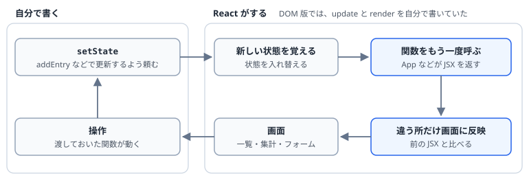

# React 編 第1章 全体像と JSX の入口

- **この章で学ぶこと**
  - React 版の家計簿と DOM 版の家計簿で、どのファイルがどのファイルにあたるか
  - `.tsx` のファイルに書く、タグに似た書き方（JSX）の読み方
  - 入力した文字を画面に出すときに、React が何をしているか

---

## 1.1 React 編の進め方

**この章からは、React 編の詳細版です。** 標準の道は 1 ページの [React 編](R00-digest.md) で、詳細版は、その要点を詳しく読みたい人が読みます。そこで済ませた改修（第3〜6章）は、飛ばして構いません。React 編では、実践編で読んだ家計簿を **React** で書き直したものを読みます。実践編を終えていることが前提です。実践編の家計簿を「DOM 版」、React で書き直した家計簿を「React 版」と呼びます。機能と見た目は同じで、違いは React の書き方だけです。

**React は、画面を作るための JavaScript のライブラリ（よく使う機能をまとめた部品集）です。** 「この状態なら、画面はこの形」という関数（**コンポーネント**）を書くと、実際の画面をその形に合わせる仕事を、React が引き受けます。広く使われていて、実務のフロントエンドのコードでよく出会います。

DOM 版では、画面を変える仕事を、すべて自分で書いていました。画面が大きくなるほど、書く場所と、直し忘れる場所が増えます。React を使うと、次の所が変わります。その代わりに、React の書き方の決まりを守って書きます（第3章から読みます）。

| | DOM 版（自分で書く） | React 版 |
| --- | --- | --- |
| 画面の形を書く場所 | `index.html` の骨組みと、`render.ts` の書き換えに分かれる | コンポーネントの中の 1 か所 |
| 画面の直し方 | どの要素をどう書き換えるかを 1 つずつ書き、状態を変えるたびに `render` を自分で呼ぶ | 状態から画面の形を返すだけ。コンポーネントを呼び直すのも、前と違う所を直すのも React |
| 画面の分け方 | 関数に分ける | 部品（コンポーネント）に分け、タグのように組み合わせる |

### 1 章の流れ

1. 解説の節を読む。新しい書き方は、DOM 版の同じ場所と並べて説明します
2. 問題の答えを自分の言葉で書き留めてから、「答えと解説」を開く
3. 章末の改修をする（途中は `npm test`、最後に `npm run check`）
4. 自分の変更を `git diff` で読み、コミットする

### 決まり

| フォルダ | 使い方 |
| --- | --- |
| `react/app/` | 読む用の完成版（React 版） |
| `react/exercises/R01-overview/` | この章の改修用（完成版のコピー）。フォルダの名前は、章ID（`R01` など）で始まります |
| `react/solutions/R01-overview/` | 改修の解答例。`npm run dev R01 answer` で、解答例を当てはめた版を起動できます |
| `practice/app/` | DOM 版の完成版。見比べるために開きます |

- 完成版（`react/app/` と `practice/app/`）は書き換えません（本文が行番号で場所を示すため）。試しに書き換えるときは、改修用フォルダを使います。答えを読んだ後は、`git restore ファイルのパス` で元に戻します（例：`git restore react/exercises/R02-components/src/components/EntryList.tsx`）。この決まりは、どの章の問題でも同じです。
- 画面を起動したターミナルは、そのままにします。ほかのコマンドは、メニュー「ターミナル」→「新しいターミナル」で開いたターミナルで打ちます（本編第10章）。実践編と違い、画面は止めずに進め、改修の最後に `Ctrl` + `C` で止めます。
- `console.log` の表示と React の警告は開発者ツールの Console のタブで、通信は Network のタブで見ます（実践編 第4章・第6章）。
- 完成版の画面は `npm run dev rapp`（DOM 版は `npm run dev app`）、この章の改修用フォルダの画面は `npm run dev R01` で起動します。テストは `npm test R01`、型チェックは `npm run typecheck R01`、両方は `npm run check R01` で実行します。第3章からは、React の決まりに合わない書き方を `npm run lint R01` の形で調べます。

## 1.2 動かして、DOM 版と見比べる

React 版の完成版を起動します。止めるときは `Ctrl` + `C` を押します。

```sh
npm run dev rapp
```

明細を 1 件追加し、絞り込みと削除を試します。動きは DOM 版と同じです。DOM 版と見比べるときは、片方を止めてから、もう片方を同じアドレスで開きます。

## 問題 1：ファイルの対応

見比べるのは、家計簿を動かすファイルです。`.test.ts` で終わるファイル、`testdata.ts`、`test-render.ts` は、テストのためのファイルなので数えません。エディタで、`practice/app/`（DOM 版）と `react/app/`（React 版）のフォルダを開いて見比べます。ファイルの名前と中身を見て答えてください。`.tsx` のファイルは、`return` の後ろに HTML に似た部分があるので、そこも見ます。

1. DOM 版の `src/` のファイルのうち、React 版の `src/` に同じ名前（拡張子まで同じ）のファイルがないものはどれですか。
2. React 版の `index.html` の `<body>` には、何が書いてありますか。DOM 版の `<body>` に書いてあったフォームや一覧の骨組みは、どこへ移りましたか。
3. DOM 版の `render.ts` の `renderForm`・`renderFilter`・`renderSummary`・`renderList`・`createEntryItem` は、React 版ではそれぞれどのファイルにあたりますか。どれも、画面の部分ごとの表示を受け持つ関数です。

<details>
<summary>答えと解説</summary>

1. **`main.ts`・`elements.ts`・`render.ts` の 3 つ**。`main.ts` の代わりに、`main.tsx` と `App.tsx` があります（`main.tsx` の中身は、第3章で読みます）。ほかのファイルは、DOM 版と同じ内容です。
2. **`<div id="root"></div>` と、`main.tsx` を読み込む `<script>` だけ**。`<h1>` と 3 つの `<section>` は `App.tsx` に、その中身は `components/` のファイルに移りました。`main.tsx` が取得するのは `#root` だけです。フォームや一覧の要素は React が作るので、DOM 版の `elements.ts` のように 1 つずつ探しておく必要はありません。
3. 5 つの関数は、それぞれ次のコンポーネントにあたります。関数 1 つが、ファイル 1 つになっています。

| DOM 版 | React 版 |
| --- | --- |
| `renderForm` | `components/EntryForm.tsx` |
| `renderFilter` | `components/FilterBar.tsx` |
| `renderSummary` | `components/Summary.tsx` |
| `renderList` | `components/EntryList.tsx` |
| `createEntryItem` | `components/EntryItem.tsx` |

**確かめ方**：次のコマンドは、2 つのファイルの違いを表示します。同じ内容なので、何も表示されません。

```sh
git diff --no-index practice/app/src/state.ts react/app/src/state.ts
```

</details>

## 1.3 JSX：タグを値として書く

`.tsx` のファイルでは、画面に出したい形を、HTML のタグに似た書き方で書けます。この書き方を **JSX** と呼びます。JSX は値なので、関数の戻り値にできます。JSX を返す関数を、**コンポーネント**と呼びます。

DOM 版の集計は、HTML に骨組みを書いておき、`render.ts` が要素を 1 つずつ書き換えていました。React 版では、骨組みと中身を 1 か所に書きます。

`react/app/src/components/Summary.tsx`（9〜32行目）

```tsx
export function Summary({ entries }: SummaryProps) {
  const balance = balanceOf(entries);

  return (
    <>
      <dl className="totals">
        <dt>収入</dt>
        <dd>{formatYen(totalOf(entries, "income"))}</dd>
        <dt>支出</dt>
        <dd>{formatYen(totalOf(entries, "expense"))}</dd>
        <dt>収支</dt>
        <dd className={balance < 0 ? "negative" : "positive"}>{formatYen(balance)}</dd>
      </dl>
      <h3>分類ごとの支出</h3>
      <ul className="plain-list">
        {totalsByCategory(entries).map(({ category, total }) => (
          <li key={category}>
            {category}: {formatYen(total)}
          </li>
        ))}
      </ul>
    </>
  );
}
```

- **`{ }` の中には、式を書きます。** 式の値が、その場所に入ります。テンプレートリテラルの `${ }` と同じ役目です。タグの中身にも、属性の値にも書けます。
- 属性の値は、決まった文字列なら `className="totals"` のように `" "` で囲み、式なら `className={balance < 0 ? "negative" : "positive"}` のように `{ }` で囲みます。
- タグの中身に `{ }` で囲まずに書いた式は、文字としてそのまま表示されます。`<dd>formatYen(total)</dd>` と書くと、関数は呼ばれず、`formatYen(total)` という文字が出ます。
- `class` は `className` と書きます。DOM の `要素.className` と同じ名前です。
- タグは必ず閉じます。中身のないタグは、`<input />` のように `/>` で閉じます。
- `return (` の中にタグを並べて書くときは、全体を 1 つの要素か、`<>` と `</>` で囲みます。`<>` は、画面に要素を増やしません。`map` で並べる書き方と `key`、引数の `{ entries }: SummaryProps` は、第2章で読みます。

JSX は「画面をこの形にしてください」という、React への注文です。タグを書いても、その場で画面の要素ができるわけではありません。React が、注文に合わせて画面の要素を作ります。

## 問題 2：`{ }` の中の式

1.3 の `Summary`（`react/app/src/components/Summary.tsx`。問いの行番号はこのファイルのもの）に、次の 2 件の明細を渡します。

| 種別 | 金額 | 分類 |
| --- | ---: | --- |
| 支出 | 500 | 食費 |
| 支出 | 1,200 | 交通費 |

`formatYen(500)` は `"500円"` を返します。

1. 20 行目の `<dd>` は、画面ではどんな HTML になりますか。`<dd` から `</dd>` までを書いてください。
2. 25〜27 行目からできる 2 つの `<li>` のうち、1 つ目の `<li>` の中の文字は何になりますか。`<li>` は、金額の大きい順に並びます。

<details>
<summary>答えと解説</summary>

1. **`<dd class="negative">-1,700円</dd>`**。収入は 0、支出は 1,700 なので、`balance` は `-1700` です。`{ }` の中の三項演算子の値は `"negative"` で、これが `class` になります。
2. **`交通費: 1,200円`**。`{category}` と `{formatYen(total)}` の所に値が入り、間の `: ` はそのまま出ます。

**確かめ方**：

1. 完成版の画面で、明細がまだない月の日付で、表と同じ 2 件の支出を追加します。金額はカンマを付けずに `1200` と入れます（`1,200` は金額として受け付けられません）。
2. 「集計」の月をその月に、種別を「すべて」にして、この 2 件だけが見えるようにします。
3. 開発者ツールの Elements で、「収支」の `<dd>` を見ます。HTML では、`className` ではなく `class` になっています。
4. 画面で、「分類ごとの支出」の 1 行目を見ます。

</details>

## 問題 3：メモに書いたタグ

`react/app/src/components/EntryItem.tsx`（15行目）

```tsx
        {entry.memo !== undefined && <span className="memo"> {entry.memo}</span>}
```

この問題では、`<span>` の中の `{entry.memo}` に注目します（`&&` の書き方は第2章で読みます）。

実践編 第4章の `textContent` と `innerHTML` の違いを思い出して、メモの欄に `<b>昼食</b>` と入れて明細を追加した場合を考えます。

1. 一覧のメモは、太字の「昼食」になりますか。それとも、`<b>昼食</b>` という文字がそのまま出ますか。
2. 開発者ツールの Elements でその `<span>` を見ると、中に `<b>` の要素はありますか。

予測を書いたら、完成版の画面で試します。「集計」の月と種別を「すべて」にします。日付と金額も入れて、メモが `<b>昼食</b>` の明細を追加します。

<details>
<summary>答えと解説</summary>

1. **`<b>昼食</b>` という文字が、そのまま出ます。**
2. **ありません。** `<span>` の中にあるのは、文字だけです（理由は 1.4）。

> **DOM 版では**
> メモは `textContent` で表示していました（`render.ts` の `createText`）。`innerHTML` に入れると、入力した文字がタグとして働いてしまうためです（実践編 第4章）。

</details>

## 1.4 `{ }` に入れた文字列は、文字として表示される

React 版では、`{ }` に入れた文字列は、`textContent` と同じく文字として表示されます。React は、`{ }` の値を HTML として読まず、文字のまま要素の中に入れます。

## 1.5 React の動き

1. コンポーネントは、状態から JSX を返します。
2. 状態を更新すると、React がその関数をもう一度呼びます。
3. React が、前の JSX と違う所だけを、画面に反映します。



---

## 改修：明細の件数を表示する

明細の一覧の上に、表示している明細の件数を「3 件」の形で表示します。実践編 第1章と同じ改修です。

**進め方**

#### 件数の文字を作る

1. `react/exercises/R01-overview/src/format.ts` の、一番下の `formatCount` の `throw` の行を書き換える
   - `3` なら `"3 件"` を返します（数と「件」の間に半角の空白）
   ```sh
   npm test R01
   ```
   - **こうなれば OK**：テストの表示で、`formatCount` の行に `✔` が付く（`EntryList` の 2 行は `✖` のまま。「失敗の内容」にも、同じ名前がもう一度出ます）

#### 画面につなぐ

2. 画面を起動したままにする
   - 完成版の画面（`npm run dev rapp`）を起動したままなら、先に `Ctrl` + `C` で止めます
   - 保存すると、画面は自動で読み込み直されます
   ```sh
   npm run dev R01
   ```
   - **こうなれば OK**：家計簿の画面が表示される
3. `src/components/EntryList.tsx` の `<ul className="entries">` の開始タグの直前に、件数を表示する `<p>` を足す
   - `<>` と `</>` の内側に足します
   - 画面に明細がなければ、先に 1 件追加しておきます
   - `<p>` には `className="status"` を付けます。「明細はまだありません。」と同じ見た目になります
   - 件数の文字は、`{ }` の中で `formatCount` を呼んで作ります。数えるのは、`EntryList` が受け取った、絞り込み後の `entries` です
   - ほかのファイルの関数は、先頭の `import` に 1 行足すと使えます（本編第8章の 8.1）
   - **こうなれば OK**：「明細」の見出しの下、一覧の上に「3 件」の形で件数が表示される
4. 画面で次を 1 つずつ試す
   - 月で絞り込んで、その月の最後の 1 件を削除すると、月の絞り込みは「すべて」に戻ります
   - [ ] 明細を追加・削除すると、件数が変わる
   - [ ] 月や種別で絞り込むと、件数が、表示されている明細の数に変わる
   - [ ] 明細がないときは「0 件」と表示される

#### 仕上げる

5. 画面を `Ctrl` + `C` で止め、型チェックとテストを実行する
   ```sh
   npm run check R01
   ```
   - **こうなれば OK**：「型チェック: OK」「テスト: OK」
6. 自分の変更を差分で読む
   ```sh
   git diff react/exercises/R01-overview
   ```
   - **こうなれば OK**：`format.ts` と `EntryList.tsx` の 2 つのファイルが表示される
7. コミットする
   ```sh
   git add react/exercises/R01-overview
   git commit -m "React 編 第1章 改修: 明細の件数を表示する"
   ```
   - **こうなれば OK**：表示の 1 行目に、付けたメッセージが出る

**テストで確かめるもの**

| 呼び出し・表示するもの | 返す値・画面の HTML |
| --- | --- |
| `formatCount(3)` | `"3 件"` |
| `formatCount(0)` | `"0 件"` |
| 明細が 2 件の `EntryList` | 一覧（`<ul class="entries">`）の前に `<p class="status">2 件</p>` |
| 明細が 0 件の `EntryList` | 一覧の前に `<p class="status">0 件</p>` |

<details>
<summary>ヒント 1：どこを見ればよいか</summary>

- `{ }` の中で関数を呼んでいる例：`Summary.tsx` の 16 行目

</details>

<details>
<summary>ヒント 2：書き出し</summary>

- `format.ts`：`` return `${count} 件`; ``
- `EntryList.tsx`：`<ul className="entries">` の上に `<p className="status">{formatCount(entries.length)}</p>` を足し、先頭に `import { formatCount } from "../format.ts";` を足します。

</details>

<details>
<summary>テストや画面がうまくいかないとき</summary>

テストの表示で、`-` で始まる行は「テストが期待しているのに、画面にない行」、`+` で始まる行は「画面にあるのに、テストが期待していない行」です。

このアプリでは、画面を作る途中（コンポーネントの関数の中）でエラーが起きると、画面全体が真っ白になります。真っ白になったら、開発者ツールの Console でエラーを読みます。

| 表示 | よくある原因 |
| --- | --- |
| テストで `+ '<p class="status">formatCount(entries.length)</p>'` | `{ }` で囲んでいません。囲まないと、式ではなく文字として表示されます |
| テストで、`- '<p class="status">2 件</p>'` が `<ul class="entries">` の前に、`+ '<p class="status">2 件</p>'` が `</ul>` の後ろに出る | `<p>` を一覧の後ろに足しています。`<ul className="entries">` の上に移します |
| 画面が真っ白になる。テストで `ReferenceError [Error]: formatCount is not defined` が出て、`App` のテストも `✖` になる | `EntryList.tsx` で `formatCount` を `import` していません。型チェックでは `Cannot find name 'formatCount'.` と出ます |
| 型チェックで `Property 'class' does not exist on type ...  Did you mean 'className'?`。Console に ``Invalid DOM property `class`. Did you mean `className`?`` | `class="status"` と書いています。JSX では `className` と書きます。見た目は変わらず、テストも合格するので、型チェックか Console で見つけます |
| 型チェックで `JSX expressions must have one parent element.` | `<p>` を `<>` の外に足しています。`<>` と `</>` の内側に移します |

表示の読み方は、[つまずき集](../../troubleshooting.md) にあります。

</details>

解答例：[react/solutions/R01-overview/src/format.ts](../solutions/R01-overview/src/format.ts)、[react/solutions/R01-overview/src/components/EntryList.tsx](../solutions/R01-overview/src/components/EntryList.tsx)

---

## チェックリスト

- [ ] DOM 版の `index.html` の骨組みと `elements.ts` が、React 版でどうなったかを説明できる
- [ ] JSX の `{ }` の中に書けるものと、`{ }` で囲まなかったときの表示を説明できる
- [ ] 入力した文字に `<b>` のようなタグが書いてあっても、太字にならない理由を説明できる

## 詳しく学ぶ

- React 公式ドキュメント：[クイックスタート](https://ja.react.dev/learn)、[React の流儀](https://ja.react.dev/learn/thinking-in-react)、[JSX でマークアップを記述する](https://ja.react.dev/learn/writing-markup-with-jsx)、[JSX に波括弧で JavaScript を含める](https://ja.react.dev/learn/javascript-in-jsx-with-curly-braces)
