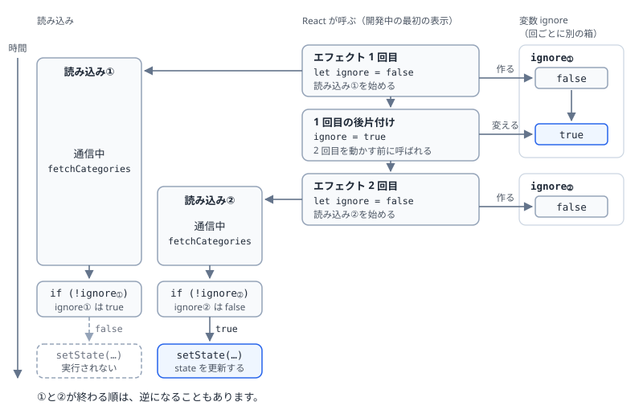

# React 編 第6章 副作用

- **この章で学ぶこと**
  - 保存や通信のような、React の外にあるものを扱う処理を、React 版ではどこに書くか
  - その処理が、いつ、何回動くか
  - 通信の結果を待っている間に、状態が変わっていた場合に起きること

---

## 6.1 読む範囲

| ファイル | 読む場所 | DOM 版の対応 |
| --- | --- | --- |
| `react/app/src/App.tsx` | 2 つの `useEffect`（27〜57行目） | `practice/app/src/main.ts` の `update` の保存（22〜24行目）、`loadCategories`（29〜38・92行目） |
| `react/app/src/storage.ts`、`react/app/src/categories.ts` | `saveEntries`、`fetchCategories` | 同じ内容のファイル |

- 問題 1・2 は、完成版（`react/app/`）のコードを読んで、予測だけをします。問題 1 は、章の最後の改修（手順 6）で、画面でも答え合わせします。
- 改修用フォルダ（`react/exercises/R06-effects/`）には、不具合を 1 つ入れてあります。改修で直します。問題 3 は、改修用フォルダで試します。

```sh
npm run dev R06
```

## 6.2 エフェクト：画面を表示した後に動かす処理

**エフェクト**は、`useEffect` に渡した関数です。React が、更新を画面に反映した後に呼びます。

**副作用**は、React の外にあるもの（保存先や通信）とやり取りする処理です。state を保存先に書き出す、外から読み込んで state に入れる、などです。

コンポーネントの関数そのものは、props と state から JSX を作って返すだけにします。副作用を関数の中で直接呼ぶと、再描画のたび（関数が呼ばれるたび）に動きます。

副作用の置き場所は、何をきっかけに動かしたいかで決めます。

- 表示したときや state が変わったときに合わせる処理（ページを開いたら読み込む、明細が変わったら保存する）は、エフェクトに書きます。
- 利用者の操作のその場で行う処理（ボタンを押したら、など）は、これまでどおりイベントの処理に書きます。

`react/app/src/App.tsx`（27〜30行目）

```tsx
  // 明細が変わったら保存する
  useEffect(() => {
    saveEntries(state.entries);
  }, [state.entries]);
```

- 2 つ目の引数の配列（**依存配列**）の値を、前の回と `===` で比べます。1 つでも違えば、エフェクトが動きます。同じなら、動かしません。
- 最初に表示したときは、比べる相手がないので、必ず動きます。
- 開発中は、最初に表示したときだけ、エフェクトが 2 回動きます（`<StrictMode>` の働き。第3章の 3.2）。

`{ ...state, 変えるもの }` で作った新しい state では、書いていないプロパティに、前と同じ配列やオブジェクトがそのまま入ります（本編第4章の 4.6）。`state.ts` の `addEntry` や `setFilter` などは、この形で作ります。依存配列の値が前と同じものかは、この作り方で決まります。

DOM 版では、状態を入れ替える `update` の中で、明細が変わったかを自分で比べて、保存していました。

`practice/app/src/main.ts`（21〜27行目）

```ts
function update(next: AppState): void {
  if (next.entries !== state.entries) {
    saveEntries(next.entries);
  }
  state = next;
  render(state, elements);
}
```

React 版では、「何が変わったら動かすか」を依存配列に書き、比べるのは React に任せます。`handleAdd` や `handleRemove` には保存の処理を書かず、保存はこのエフェクトの 1 か所で済ませます。

依存配列の書き方は、次のとおりです。

- **依存配列には、エフェクトの中で使っている props や state を、そのまま書きます。** このエフェクトが使っているのは `state.entries` なので、`[state.entries]` です。
- `setState` と、`import` した関数（`saveEntries` など）は書きません。どの回でも同じものなので、比べる意味がありません。
- 依存配列を書かないと、React は比べません。そのエフェクトを書いたコンポーネント（ここでは `App`）の更新を画面に反映するたびに、エフェクトを動かします。

## 問題 1：保存のエフェクトは、いつ動くか

完成版の `App.tsx` の 29 行目の上に、`console.log("保存した");` が書いてあるとします。

```tsx
  useEffect(() => {
    console.log("保存した");
    saveEntries(state.entries);
  }, [state.entries]);
```

次のとき、Console に「保存した」は何行出ますか。

1. ページを開いてから、分類の選択肢が出るまで（分類の読み込みが終わると、`setState` が 1 回呼ばれます）
2. 明細を 1 件追加したとき
3. 「集計」の種別を「支出」に変えたとき

<details>
<summary>答えと解説</summary>

1. **2 行**。最初に表示したときに動きます。開発中なので 2 回です。分類の読み込みが終わると `App` がもう一度呼ばれますが、`state.entries` は前と同じ配列なので、エフェクトは動きません。
2. **1 行**。`addEntry` が新しい配列を作るので、`state.entries` が前と違うものになります。
3. **0 行**。`setFilter` が作る新しい状態でも、`entries` は前と同じ配列です。

> **DOM 版では**
> ページを開いたときには、保存しませんでした。`update` の `if` は、明細が変わったときだけ `true` になります。React 版は、開いたときにも保存します（読み込むときの検査を通った明細を保存し直すので、正しく保存されていた明細は変わりません）。

</details>

## 問題 2：依存配列を変える

問題 1 のエフェクトの、依存配列だけを変えます。

1. 依存配列を `[state]` にした場合、「集計」の種別を「支出」に変えると、「保存した」は出ますか。

   ```tsx
     }, [state]);
   ```

2. 依存配列を `[state.filter]` にした場合、明細を 1 件追加すると、「保存した」は出ますか。

   ```tsx
     }, [state.filter]);
   ```

<details>
<summary>答えと解説</summary>

1. **出ます**。種別を変えると、`setFilter` が新しい `state` を作ります。`state` が前と違うオブジェクトなので、エフェクトが動きます。明細は変わっていないので、むだな保存です。
2. **出ません**。`addEntry` は、`filter` を前と同じオブジェクトのまま引き継ぎます。`state.filter` が前と同じなので、エフェクトは動きません。追加した明細が、保存されません。

問題 1・2 の操作で、それぞれの値が前と違うものになるかをまとめると、次のとおりです。依存配列に書いた値が「新しい」になる操作で、エフェクトが動きます。

| 操作 | `state` | `state.entries` | `state.filter` |
| --- | --- | --- | --- |
| 分類の読み込みが終わる（`setCategories`） | 新しい | 前と同じ | 前と同じ |
| 明細を 1 件追加する（`addEntry`） | 新しい | 新しい | 前と同じ |
| 「集計」の種別を変える（`setFilter`） | 新しい | 前と同じ | 新しい |

</details>

## 6.3 依存配列が空のエフェクト：分類の読み込み

**依存配列を空（`[]`）にすると、エフェクトは最初に表示したときだけ動きます。** 比べる値が 1 つもないので、React はいつも「前と同じ」と判断し、その後の更新では動かしません。ページを開いたときの読み込みに使います。

`react/app/src/App.tsx`（32〜57行目）

```tsx
  // 最初に 1 回、分類の一覧を読み込む
  useEffect(() => {
    let ignore = false;

    async function loadCategories(): Promise<void> {
      try {
        const items = await fetchCategories();
        if (!ignore) {
          setState((prev) => setCategories(prev, { status: "ready", items }));
        }
      } catch (e) {
        console.error(e);
        const message = "分類を読み込めませんでした。ページを読み込み直してください。";
        if (!ignore) {
          setState((prev) => setCategories(prev, { status: "error", message }));
        }
      }
    }

    loadCategories();

    // 後片付け。この読み込みの結果は、もう使わない
    return () => {
      ignore = true;
    };
  }, []);
```

`ignore` の行と、`setState` の書き方（6.4）を除くと、中の `loadCategories` は、DOM 版の `loadCategories`（`main.ts` の 29〜38行目）と同じ形です。読み込み中・成功・失敗を `CategoriesState` で表す所も同じです（実践編 第6章）。

**エフェクトが返す関数を、後片付けと呼びます。** React は、同じエフェクトを次に動かす前に、後片付けを呼びます。コンポーネントが画面からなくなるときにも呼びます。後片付けで、「前のエフェクトが始めた仕事は、もう要らない」と伝えます。

`ignore` は、エフェクトが動くたびに作られる変数です。その回の `loadCategories` と後片付けの関数は、どちらもその回のエフェクトの中で作られるので、同じ `ignore` を覚えています（第3章の 3.3 のクロージャ）。後片付けで `true` にすると、その回の読み込みが終わったとき `if (!ignore)` を通らず、`setState` を呼びません。

## 問題 3：2 回の読み込みと、後片付け

改修用フォルダの `src/App.tsx` の 38 行目の下に、次の 1 行を足した場合を考えます。

```tsx
        const items = await fetchCategories();
        console.log("読み込みが終わった", ignore);
```

1. ページを開くと、「読み込みが終わった」は何行出ますか。それぞれ、`ignore` の値は何ですか。
2. `if (!ignore)` の中の `setState` が実行されるのは、何回ですか。

予測を書いたら、38 行目の下に上の 1 行を足して、ページを読み込み直します。Console では、「読み込みが終わった」の行数と、各行の `ignore` の値を見ます。Network のタブでは、`categories.json` の行数を数えます。

<details>
<summary>答えと解説</summary>

1. **2 行。先に始めた読み込みでは `true`、後に始めた読み込みでは `false`**。読み込みは 2 回始まり、2 回とも終わります。先に動いたエフェクトには、2 回目が動く前に後片付けが呼ばれ、その `ignore` が `true` になります。後から動いたエフェクトの `ignore` は別の変数で、`false` のままです。Console には、読み込みが終わった順に出ます。ふつうは `true` が先ですが、逆になることもあります。
2. **1 回**。`if (!ignore)` で、1 回目の読み込みの結果は使われません。

Network のタブには、`categories.json` が 2 行出ます。

図6-1 は、2 回の読み込みと、それぞれの `ignore` を、時間の順に並べたものです。



公開用に作った画面（開発中でない画面）では、`<StrictMode>` が働かないので、この分類の読み込みは、最初に表示したときに 1 回だけ始まります。それでも、読み込みの途中でコンポーネントが画面からなくなることがあるので、後片付けは要ります。

> **`async` の関数の置き方**
> `useEffect` に渡す関数は、`async` にしません。`async` の関数は Promise を返すので、後片付けの関数を返せません。`await` を使う処理は、中で `async` の関数を作って、それを呼びます（36〜51行目）。`async` にすると、リンターが警告します。51 行目の `loadCategories();` に `await` を付けていないのは、エフェクトが読み込みの終わりを待たずに戻るためです。結果は、終わったときに 40 行目の `setState` で state に入ります。

</details>

## 6.4 エフェクトの中では、古い state に注意する

読み込みのエフェクトの中から見える `state` は、ページを開いたときの値のままです。エフェクトの関数も、`handleAdd` と同じように、その回の `state` を覚えています（第3章の 3.3）。依存配列が `[]` なので、明細を追加しても、このエフェクトは動き直しません。

完成版の 40 行目では、`setState` に関数を渡しています。

```tsx
          setState((prev) => setCategories(prev, { status: "ready", items }));
```

`prev` には、読み込みが終わった時点の、いちばん新しい state が入ります（第3章の 3.4）。

> **DOM 版では**
> `update(setCategories(state, { status: "ready", items }));` と、変数の `state` をそのまま使っていました（`main.ts` の 32 行目）。`state` は、`update` のたびに代入し直される 1 つの変数なので、読み込みが終わった時点で読めば、いつも最新でした。

## 問題 4：リンターの表示を読む

この問題は、表示を読んで答えます。3 は、画面で試しません。

完成版の `App.tsx` の 40 行目を、DOM 版と同じように、`state` をそのまま使う形に書き換えたとします。

```tsx
          setState(setCategories(state, { status: "ready", items }));
```

リンターは、次の警告を出します（途中の行は省いています）。

```text
  ! react-hooks(exhaustive-deps): React Hook useEffect has a missing dependency: 'state'
    ,-[react/app/src/App.tsx:57:6]
 39 |         if (!ignore) {
 40 |           setState(setCategories(state, { status: "ready", items }));
    :                                  ^^|^^
    :                                    `-- useEffect uses `state` here
 41 |         }
    ...
 57 |   }, []);
    :      ^^
    `----
  help: Either include it or remove the dependency array.
```

`missing dependency` は「依存配列に足りないもの」、最後の `help` の行は「それを依存配列に入れるか、依存配列を消してください」という意味です。

1. 警告は、何行目の依存配列に、何が足りないと言っていますか。
2. 分類の読み込みに 5 秒かかる間に収入を 1 件追加すると、読み込みが終わったとき、その明細はどうなりますか。通信が遅く、ページを開いてすぐフォームの種別を「収入」に変え、読み込みが終わる前に追加した場合です（支出は、分類が届くまで追加できません）。
3. `help` に従って、57 行目の依存配列を `[state]` にすると、何が起きますか。

<details>
<summary>答えと解説</summary>

1. **57 行目の依存配列（`[]`）に、`state` が足りない**。エフェクトの中で `state` を使っているのに（40 行目）、依存配列が空です。
2. **画面から消えます。保存からも消えます。** `setCategories(state, …)` が使うのは、ページを開いたときの `state` で、追加した明細が入っていません。そこに分類を入れて state 全体を置き換えるので、明細の配列も追加前のものに戻ります（フォームの種別なども、開いたときの値に戻ります）。明細の配列が変わったので、保存のエフェクトも動き、保存先からも消えます。
3. **読み込みが止まらなくなります。** 依存配列が `[state]` なら、`state` が変わるたびにエフェクトが動きます。エフェクトは読み込みの後で `setState` を呼び、`state` が変わるので、またエフェクトが動きます。これが繰り返されます。

分類を読み込むのは、ページを開いたときだけです。40 行目を `setState((prev) => setCategories(prev, …))` に戻すと、エフェクトの中で `state` を読まずに済み、依存配列は `[]` のまま使えます。警告も出ません。

**確かめ方**：2 は、改修をコミットした後に、改修用フォルダで試せます。

1. `src/App.tsx` の 40 行目を、問いのとおりに書き換えます。
2. `src/categories.ts` の 14 行目（`const response = await fetch(…)`）のすぐ上に、`await new Promise((resolve) => setTimeout(resolve, 10000));` を足します。分類が届くまで、10 秒かかるようになります。
3. `npm run dev R06` で画面をもう一度起動します。
4. 画面が開いたら、10 秒のうちに、フォームの種別を「収入」にして、日付・金額・入金元を入れて追加します。
5. 読み込みが終わったら、一覧とフォームを見ます。追加した明細が一覧から消え、フォームの種別も「支出」に戻ります。ページを読み込み直しても、明細は戻りません。
6. `git restore react/exercises/R06-effects/src/App.tsx react/exercises/R06-effects/src/categories.ts` で、2 つのファイルを元に戻します（改修をコミットした後なので、改修の直しは残ります）。

</details>

---

## 改修：明細が保存されない不具合を直す

利用者から、次の報告がありました。

- 明細を追加しても、ページを読み込み直すと消えている。
- 明細を削除しても、ページを読み込み直すと戻っている。

**進め方**

#### 症状を見る

1. 画面を起動したままにする（止めていたら、次を実行する）
   ```sh
   npm run dev R06
   ```
   - **こうなれば OK**：家計簿の画面が表示される
2. 明細を 1 件追加し、ページを読み込み直す
   - **こうなれば OK**：追加した明細が、消えている

#### 原因を探す

3. リンターを実行し、警告を読む
   - この不具合は、型チェックとテストでは見つかりません（どちらも「OK」のままです）。依存配列の書き忘れを見つけるのは、リンターです
   - 指している行と、`missing dependency` の後ろの名前を見ます
   ```sh
   npm run lint R06
   ```
   - **こうなれば OK**：どのエフェクトの依存配列に、何が足りないのかを言える
4. そのエフェクトが、今の依存配列だといつ動くかを考える
   - 6.2 と 6.3 で読んだ、依存配列の決まりを当てはめます
   - **こうなれば OK**：明細を追加しても保存されない理由を、自分の言葉で言える

#### 直す

5. 依存配列を直す
   - 警告の `help` は、2 つの直し方を挙げています。このエフェクトを「いつ動かしたいか」に合うほうを選びます（問題 2、問題 4）
   ```sh
   npm run lint R06
   ```
   - **こうなれば OK**：「lint: OK（警告はありません）」
6. 保存のエフェクトの 1 行目に `console.log("保存した");` を足し、エフェクトが動く回数を画面で見る
   - ページを読み込み直してから数えます
   - [ ] ページを開くと、「保存した」が 2 行出る
   - [ ] 明細を 1 件追加すると、1 行出る
   - [ ] 「集計」の種別を変えても、出ない
   - **こうなれば OK**：3 つとも合っている
7. 足した `console.log` を消し、画面で次を 1 つずつ試す
   - [ ] 明細を追加し、ページを読み込み直しても、残っている
   - [ ] 明細を削除し、ページを読み込み直しても、戻らない

#### 仕上げる

8. 画面を `Ctrl` + `C` で止め、型チェックとテスト、リンターを実行する
   - 直す前から「テスト: OK」と出ます。直せたかは、手順 6・7 の画面で判断します
   ```sh
   npm run check R06
   npm run lint R06
   ```
   - **こうなれば OK**：「型チェック: OK」「テスト: OK」「lint: OK（警告はありません）」
9. 自分の変更を差分で読む
   ```sh
   git diff react/exercises/R06-effects
   ```
   - **こうなれば OK**：`App.tsx` の 30 行目の、依存配列の 1 行だけが変わっている（`console.log` や、問題で書き換えた行が出たら、消してから、もう一度見る）

<details>
<summary>ヒント 1：どこを見ればよいか</summary>

- リンターが指すエフェクト：`App.tsx` の 28〜30 行目の、保存のエフェクト

</details>

<details>
<summary>ヒント 2：書き出し</summary>

- 原因：保存のエフェクトの依存配列が `[]` なので、最初に表示したときにしか動きません。明細を追加・削除しても、保存されません。
- 直し方：30 行目の `}, []);` を、`}, [state.entries]);` に変えます。エフェクトの中で使っている値を、そのまま依存配列に書きます。

</details>

<details>
<summary>画面やリンターがうまくいかないとき</summary>

| 表示 | よくある原因 |
| --- | --- |
| リンターは「lint: OK」だが、手順 6 で、種別を変えたときにも「保存した」が出る（ページを開いたときも 3 行出る） | 依存配列を消したか、`[state]` にしています。保存はされますが、明細が変わっていないときにも動きます。`[state.entries]` にします |
| 画面が真っ白になる。リンターで `unnecessary dependency: entries`。型チェックで `Cannot find name 'entries'.` | `[entries]` と書いています。明細の配列は、`state.entries` です |
| 手順 6 で、ページを開いたときの「保存した」が 2 行より多い | ファイルを保存した直後は、画面が自動で読み込み直され、その分も出ます。ページを読み込み直してから数えます |

</details>

解答例：[react/solutions/R06-effects/src/App.tsx](../solutions/R06-effects/src/App.tsx)

---

## チェックリスト

- [ ] 依存配列が `[state.entries]` のエフェクトが、絞り込みを変えたときに動かない理由を説明できる
- [ ] 開発中に、分類の読み込みが 2 回始まるのに、結果が 1 回しか使われない理由を説明できる
- [ ] リンターの `help` に従って依存配列に `state` を足すと、何が起きるかを説明できる

## 詳しく学ぶ

- React 公式ドキュメント：[エフェクトを使って同期を行う](https://ja.react.dev/learn/synchronizing-with-effects)、[`useEffect`](https://ja.react.dev/reference/react/useEffect)、[そのエフェクトは不要かも](https://ja.react.dev/learn/you-might-not-need-an-effect)、[リアクティブなエフェクトのライフサイクル](https://ja.react.dev/learn/lifecycle-of-reactive-effects)
