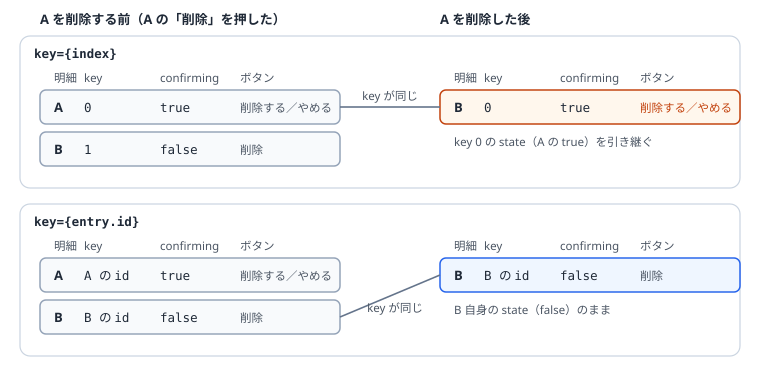

# React 編 第7章 変更を読む・総合

- **この章で学ぶこと**
  - ほかの人が React 版に入れた変更を、差分から読む読み方
  - React でよく起きる不具合を、差分と症状から見つける手順
  - 見つけた不具合を直し、小さな機能を足す流れ

---

## 7.1 この章の進め方

この章では、どのファイルをどの順で読むかを自分で選びます。これまでの章の読み方（DOM 版と並べる、props をたどる、`console.log` で回数を見る、リンター、Network のタブ、差分を読む、`debugger;` など）を使います。

**場面の設定**：同僚が、React 版の家計簿に「削除の確認」の機能を足しました。「削除」を押すと、すぐには消えず、「削除する」「やめる」の 2 つのボタンに変わります。同僚は、ついでに、ほかの所にも手を入れています。あなたは、この変更を読んで点検する役です。

変更の前は完成版（`react/app/`）、変更の後はこの章の改修用フォルダ（`react/exercises/R07-changes/`）です。

問題 1〜4 では、本文に載せた差分を読みます。本文の差分は、ファイル名を示す行（`diff --git`〜`+++`）と、`import` の行の差分を省いて載せています。

## 問題 1：変更されたファイル

変更されたファイルの一覧は、次のとおりです（テストと `tsconfig.json` を除いています）。右の数は、変わった行数です。

```text
 src/App.tsx                    |  7 ++-----
 src/components/EntryForm.tsx   |  6 ++++--
 src/components/EntryItem.tsx   | 20 +++++++++++++++++---
 src/components/EntryList.tsx   |  4 ++--
 src/state.ts                   |  3 ++-
 src/useSaveEntries.ts          | 10 ++++++++++
```

1. 「削除の確認」の機能（「削除」が 2 つのボタンに変わる）の本体は、どのファイルにあると思いますか。
2. 新しく増えたファイルは、どれですか（`react/app/src/` と見比べます）。名前から、何をするファイルだと思いますか。
3. `state.ts` の変更は、「削除の確認」の機能の本体だと思いますか、ついでの変更だと思いますか。理由も書きます。

<details>
<summary>答えと解説</summary>

1. **`EntryItem.tsx`**。「削除」ボタンがあるのは、明細の 1 行を表示する `EntryItem` です。変わった行数も、いちばん多くなっています。
2. **`useSaveEntries.ts`**。`use` で始まる名前なので、フック（第3章の 3.6）に関係するファイルです。名前のとおり、明細を保存する処理です（問題 2 で読みます）。
3. **ついでの変更です**。確認中かどうかは行ごとの表示の話で、明細の state を作る `state.ts` の関数を変えなくても作れます。ただし、ファイルの名前と行数だけでは、変更の中身は決まりません（中身は改修で読みます）。

</details>

## 7.2 この章で初めて出る書き方

**カスタムフック**は、中で `useState` や `useEffect` を呼ぶ、自分で書いた関数です。名前は `use` で始めます。

- コンポーネントの中の、フックを使った処理を、関数に切り出すときに使います。
- カスタムフックは、コンポーネントか、ほかのカスタムフックの一番上で、毎回同じ順番で呼びます（第3章の 3.6）。

**`useRef`** は、画面の要素を直接つかむための入れ物を作るフックです。

- `const dateRef = useRef<HTMLInputElement>(null);` で入れ物を作り（`< >` は型引数。本編第8章の 8.3）、JSX の要素に `ref={dateRef}` と書きます。
- React が画面に要素を作ると、その要素が `dateRef.current` に入ります。それまでは `null` です。
- 入力欄にフォーカスを当てるなど、state では表せない操作に使います。欄の文字やクラスのように画面に表示するものは、これまでどおり state で変えます。

## 問題 2：カスタムフックの差分

`src/App.tsx` の差分の一部と、新しいファイルです。

```diff
@@ -26,6 +26,3 @@ export function App({ initialEntries }: AppProps) {
 
-  // 明細が変わったら保存する
-  useEffect(() => {
-    saveEntries(state.entries);
-  }, [state.entries]);
+  useSaveEntries(state.entries);
 
```

`react/exercises/R07-changes/src/useSaveEntries.ts`（1〜10行目）

```ts
import { useEffect } from "react";
import { saveEntries } from "./storage.ts";
import type { Entry } from "./types.ts";

// 明細が変わったら保存する
export function useSaveEntries(entries: Entry[]): void {
  useEffect(() => {
    saveEntries(entries);
  }, [entries]);
}
```

1. この変更で、保存の動きは変わりますか。エフェクトがいつ動くかを、変更の前と後で比べてください。
2. `useSaveEntries(state.entries);` を、`handleAdd` と `handleRemove` の中で呼ぶ形に書き換えてもよいですか。保存が要るのは、明細を追加・削除したときです。

<details>
<summary>答えと解説</summary>

1. **変わりません。この変更に、不具合はありません。** 変更の前の依存配列は `[state.entries]`、後は `[entries]` で、`entries` には `state.entries` が渡っています。どちらも、最初に表示したときに動き（開発中は 2 回）、その後は、明細の配列が前と違うものになったときに動きます（第6章の 6.2）。
2. **いけません。フックは、イベントの処理の中では呼べません。** `useSaveEntries` は、中で `useEffect` を呼ぶフックです。フックは、コンポーネントかカスタムフックの一番上で呼びます（第3章の 3.6）。

</details>

## 問題 3：`useRef` の差分

`src/components/EntryForm.tsx` の差分です。

```diff
@@ -30,2 +30,3 @@ export function EntryForm({ kind, categories, errors, onKindChange, onAdd, onErr
   const [memo, setMemo] = useState("");
+  const dateRef = useRef<HTMLInputElement>(null);
 
@@ -60,2 +61,3 @@ export function EntryForm({ kind, categories, errors, onKindChange, onAdd, onErr
     onAdd(result.entry);
+    dateRef.current?.focus();
   }
@@ -74,3 +76,3 @@ export function EntryForm({ kind, categories, errors, onKindChange, onAdd, onErr
           日付
-          <input type="date" value={date} onChange={(event) => setDate(event.target.value)} />
+          <input ref={dateRef} type="date" value={date} onChange={(event) => setDate(event.target.value)} />
         </label>
```

`要素.focus()` は、その入力欄にフォーカスを当てます（クリックしなくても、キーボードで入力できるようにします）。

1. この変更で、画面の動きは、いつ、どう変わりますか。
2. 62 行目の `dateRef.current?.focus()` に、`?.` が付いているのは、なぜですか。

<details>
<summary>答えと解説</summary>

1. **明細を追加した後、日付の欄にフォーカスが移ります。この変更にも、不具合はありません。** 続けて次の明細を入力しやすくするための変更です。
2. **`dateRef.current` の型が、`HTMLInputElement | null` だからです。** 入れ物を作ったときの値は `null` で、React が要素を画面に作った後に、要素が入ります。`?.` は、`null` のときは何もしません（本編第6章）。

ref で欄の `value` を書き換えても、state（`date` など）は変わりません。送信には state の値が使われます。state と違い、`current` を変えても、コンポーネントはもう一度呼ばれません。

> **DOM 版では**
> `elements.date.focus();` と書きます。要素は、ページを開いたときに `elements.ts` で取得してあります。

</details>

## 問題 4：削除の確認と `key`

`src/components/EntryItem.tsx` と `src/components/EntryList.tsx` の差分です。

```diff
@@ -9,2 +10,4 @@ interface EntryItemProps {
 export function EntryItem({ entry, onRemove }: EntryItemProps) {
+  const [confirming, setConfirming] = useState(false);
+
   return (
@@ -17,5 +20,16 @@ export function EntryItem({ entry, onRemove }: EntryItemProps) {
       <span className={`amount amount-${entry.kind}`}>{formatSignedYen(entry)}</span>
-      <button className="remove" onClick={() => onRemove(entry.id)}>
-        削除
-      </button>
+      {confirming ? (
+        <span>
+          <button className="remove" onClick={() => onRemove(entry.id)}>
+            削除する
+          </button>
+          <button className="remove" onClick={() => setConfirming(false)}>
+            やめる
+          </button>
+        </span>
+      ) : (
+        <button className="remove" onClick={() => setConfirming(true)}>
+          削除
+        </button>
+      )}
     </li>
```

```diff
@@ -13,4 +13,4 @@ export function EntryList({ entries, onRemove }: EntryListProps) {
       <ul className="entries">
-        {sortByDate(entries).map((entry) => (
-          <EntryItem key={entry.id} entry={entry} onRemove={onRemove} />
+        {sortByDate(entries).map((entry, index) => (
+          <EntryItem key={index} entry={entry} onRemove={onRemove} />
         ))}
```

- `map` に渡す関数の 2 つ目の引数（`index`）は、その要素が何番目かを表す数です。先頭が `0` です。
- 同じコンポーネントを画面の 2 か所に表示すると、React はそれぞれの state を別に覚えます（第3章の 3.6）。
- React は、`key` が同じ行を「前と同じ行」と見て、その行の state を次の表示でも使い続けます（`key` で行を見分けることは、第2章の 2.3）。

一覧に、上から A・B の 2 件の明細があるとします。

1. 差分では、`confirming` を `EntryItem` の state にしています。A の「削除」を押すと、A と B の表示は、それぞれどうなりますか。`confirming` を `EntryList` の state 1 つにして、全部の行に props で渡した場合と比べて答えてください。
2. 続けて A の「削除する」を押し、A が一覧から消えると、残った B の行はどう表示されますか。
3. `key` が、変更の前の `entry.id` のままだったら、2 の B はどう表示されますか。

<details>
<summary>答えと解説</summary>

1. **差分のとおりなら、A の行だけが「削除する」「やめる」の 2 つのボタンに変わり、B は「削除」のままです。** 行ごとに、別の `confirming` があるからです。`EntryList` に 1 つだけ置くと、全部の行が同じ値を読むので、A も B も確認の表示になります。確認中かどうかを使うのはその行だけなので、その行のコンポーネントに置きます（第5章の 5.2）。
2. **B の行が、「削除する」「やめる」の 2 つのボタンになっています。** 押していないのに、確認の表示になります。A が消えると B が先頭に移り、B の `key` が `0` に変わります。直前まで `key` が `0` だったのは A の行なので、React は A の `confirming`（`true`）を B に引き継ぎます。
3. **「削除」のボタン 1 つ**。正しい表示です。`key` が `entry.id` なら、B が先頭に移っても B の `key` は変わりません。B の行は、B 自身の `confirming`（`false`）のままです。

図7-1 は、`key` ごとに React が覚えている `confirming` です。



`key={index}` でも、型チェック、Console、リンターには警告が出ません。`key` を付けなかったときも同じことが起き、第2章の問題 2 の「表示がずれる不具合の原因になる」は、この不具合を指しています。

</details>

---

## 改修：同僚の変更を仕上げる

**明細を追加したときの不具合**（利用者からの報告）：次の報告が届いています。原因の場所は、自分で探してください。

- 明細を 1 件追加すると、同じ明細が 2 行、一覧に出ます。
- しかも、ページを読み込み直すと、その明細が消えています。

**確認の表示が別の行に移る不具合**（差分で入ったもの）：問題 4 で見つけた不具合を直します。

**絞り込みを解除するボタン**（小さな機能）：月か種別で絞り込んでいるときだけ、「絞り込みを解除」のボタンを表示します。押すと、月も種別も「すべて」に戻ります。

**進め方**

#### 準備

1. テストを実行し、失敗しているテストを見る
   ```sh
   npm test R07
   ```
   - **こうなれば OK**：「--- 失敗の内容 ---」より上に、`✖` で始まる行が 4 つある

#### 明細を追加したときの不具合を直す

2. 症状を、画面で見る
   ```sh
   npm run dev R07
   ```
   - 明細を 1 件追加し、一覧の行数を見ます。続けて、ページを読み込み直します
   - **こうなれば OK**：報告のとおり、同じ明細が 2 行出て、読み込み直すと消える
3. 原因の場所を探す
   - 「追加」を押してから、state が変わるまでの道をたどります（第5章の問題 1 と同じたどり方）
   - 手順 1 で `✖` になったテストの名前も、手がかりになります
   - 同僚の変更の差分は、次のコマンドで読めます（実践編 第7章）。`-U1` は、変わった行の前後を 1 行ずつ表示する指定です。`state.test.ts`、`FilterBar.test.ts`、`tsconfig.json` は読み飛ばします。表示が長いので、読み終えたら `q` キーで終わります
   ```sh
   git diff --no-index -U1 react/app react/exercises/R07-changes
   ```
   - **こうなれば OK**：原因の関数と、その関数のどの行が、第3章のどの決まりに合わないかを言える
4. 原因の関数を直す
   - 完成版（`react/app/`）の同じ関数と同じ形に戻します
   ```sh
   npm test R07
   ```
   - **こうなれば OK**：「--- 失敗の内容 ---」より上の `✖` が、`FilterBar` の 3 つだけになる
5. 画面で次を 1 つずつ試す
   - 直す前に、ちょうど 2 行出た理由は、章の終わりの近くの折りたたみ「同じ明細が 2 行出た理由」で読めます
   - [ ] 明細を 1 件追加すると、一覧に 1 行だけ増える
   - [ ] ページを読み込み直しても、追加した明細が残っている

#### 確認の表示が別の行に移る不具合を直す

6. 直す前に、問題 4 の予測を画面で見る
   - 明細を 2 件にします。シークレットウィンドウで画面を開き、明細のない状態から 2 件追加します（第5章の問題 3 と同じ）
   - 1 行目の「削除」を押し、続けて「削除する」を押します
   - **こうなれば OK**：残った行が、押していないのに「削除する」「やめる」の 2 つのボタンになっている
7. `src/components/EntryList.tsx` の `key` を直す
   - `map` の 2 つ目の引数の `index` は、使わなくなるので消します
   - **こうなれば OK**：手順 6 と同じ操作をしても、残った行が「削除」のボタン 1 つのまま

#### 絞り込みを解除するボタンを足す

8. `src/components/FilterBar.tsx` に、「絞り込みを解除」のボタンを足す
   - 置く場所は、種別の `</label>` の後、`</div>` の前です
   - 表示するのは、月か種別のどちらかが `"all"` でないときだけです。`return` の前で、この条件を `const isFiltering = 月の条件 || 種別の条件;` と変数にしておきます
   - 押されたら、`onFilterChange` に、月と種別を両方 `"all"` にする変更を渡します。`onFilterChange` は、`Partial<Filter>` を受け取ります（第5章の 5.3）
   - `onClick` には、関数を渡します（第4章の 4.2）
   - ボタンの文字は「絞り込みを解除」です。`className` は付けません
   ```sh
   npm run check R07
   ```
   - **こうなれば OK**：「型チェック: OK」「テスト: OK」
9. 画面で次を 1 つずつ試す
   - [ ] 絞り込んでいないときは、ボタンが表示されない
   - [ ] 月だけを選ぶと、ボタンが表示される
   - [ ] ボタンで戻した後、種別だけを選んでも、ボタンが表示される
   - [ ] 月と種別の両方を選んでからボタンを押すと、両方が「すべて」に戻り、ボタンが消える

#### 仕上げる

10. 画面を `Ctrl` + `C` で止め、型チェックとテスト、リンターを実行する
    ```sh
    npm run check R07
    npm run lint R07
    ```
    - **こうなれば OK**：「型チェック: OK」「テスト: OK」「lint: OK（警告はありません）」
11. 自分の変更を差分で読む
    ```sh
    git diff react/exercises/R07-changes
    ```
    - **こうなれば OK**：3 つのファイルが表示される

**テストで確かめるもの**

| 呼び出し・表示するもの | 返す値・画面の HTML |
| --- | --- |
| `addEntry(before, 明細)` | 明細が 1 件増えた状態。`before` の明細は増えない。`entries` は、`before` とは別の配列 |
| 月と種別の両方、月だけ、種別だけで絞り込んでいる `FilterBar` | 種別の `</label>` の後に `<button>絞り込みを解除</button>` |
| 絞り込んでいない `FilterBar` | ボタンを含まない |

<details>
<summary>ヒント 1：どこを見ればよいか</summary>

- 明細を追加したときの不具合：「追加」→ `EntryForm` の `onAdd` → `App.tsx` の `handleAdd` → `state.ts` の `addEntry`
- 確認の表示が移る不具合：`EntryList.tsx` の 14〜15 行目（問題 4）
- ボタンを足す場所と、`onFilterChange` の呼び方：`FilterBar.tsx` の 15〜20 行目と 26 行目

</details>

<details>
<summary>ヒント 2：書き出し</summary>

- 明細を追加したときの不具合の原因：`addEntry` が、`state.entries.push(entry)` で、受け取った state の配列を書き換えています。`return { ...state, entries: [...state.entries, entry], formErrors: [] };` に戻します。
- `key`：`key={index}` を `key={entry.id}` に戻し、`(entry, index)` を `(entry)` に戻します。
- ボタン：`</label>` の下に、次を足します。

  ```tsx
        {isFiltering && <button onClick={() => onFilterChange({ month: "all", kind: "all" })}>絞り込みを解除</button>}
  ```

  `isFiltering` は、`return` の前に `const isFiltering = filter.month !== "all" || filter.kind !== "all";` と書きます。

</details>

<details>
<summary>テストや画面がうまくいかないとき</summary>

テストの表示で、`-` で始まる行は「テストが期待しているのに、画面にない行」、`+` で始まる行は「画面にあるのに、テストが期待していない行」です。

| 表示 | よくある原因 |
| --- | --- |
| テスト「addEntry は明細を足した新しい状態を返し、入力エラーを消す」で `5 !== 4` か `6 !== 5` | `push` が残っています。受け取った state の配列を書き換えずに、新しい配列を作ります |
| `key` を直したのに、同じ明細が 2 行出たり、消した行が残ったりする。Console に `Encountered two children with the same key` | 明細を追加したときの不具合を、まだ直していません。同じ `id` の明細が 2 つあります。先に手順 2〜5 を行います |
| テスト「FilterBar は絞り込んでいないとき、絞り込みを解除するボタンを表示しない」が `✖` | 条件を付けずに、ボタンを足しています |
| テスト「FilterBar は明細のある月を選択肢にし、…解除するボタンを表示する」と「月だけで…」が `✖`（「種別だけで…」は合格） | `月の条件 \|\| 種別の条件 && (…)` と、1 つの式に並べています。`&&` が先に計算され、月で絞り込んでいるときに `true` だけが残ります。条件を変数（`isFiltering`）にしてから `&&` を使います |
| テスト「FilterBar は種別だけで絞り込んでいるときも…」か「月だけで…」が `✖` | 条件が、片方だけを見ているか、`&&` でつないでいます。月か種別のどちらかが `"all"` でなければ、表示します（`\|\|`） |
| テストで `+ '<button class="remove">絞り込みを解除</button>'` のように、`<button>` の中身が違う | ボタンの文字か、`className` が違います。文字は「絞り込みを解除」、`className` は付けません |
| 絞り込みを変えると、すぐ「すべて」に戻り、ボタンが出ない（テストは合格する）。Console に「Cannot update a component … while rendering a different component …」で始まる赤い字。型チェックで `Type 'void' is not assignable to type 'MouseEventHandler<HTMLButtonElement> \| undefined'.` | `onClick={onFilterChange(…)}` と、呼んだ結果を渡しています。`() =>` で包みます（第4章の問題 1） |
| ボタンを押しても、月だけ（または種別だけ）が「すべて」に戻る | `onFilterChange` に、片方だけを渡しています。`{ month: "all", kind: "all" }` と、両方を渡します |

表示の読み方は、[つまずき集](../../troubleshooting.md) にあります。

</details>

解答例：[react/solutions/R07-changes/src/state.ts](../solutions/R07-changes/src/state.ts)、[react/solutions/R07-changes/src/components/EntryList.tsx](../solutions/R07-changes/src/components/EntryList.tsx)、[react/solutions/R07-changes/src/components/FilterBar.tsx](../solutions/R07-changes/src/components/FilterBar.tsx)

<details>
<summary>同じ明細が 2 行出た理由</summary>

開発中は、`setState` に渡した関数を React が同じ `prev` で 2 回呼び、片方の結果だけを使います。`push` は、1 回目に書き換えた `prev.entries` の配列に、2 回目も明細を足します。どちらの結果を使っても、同じ明細が 2 つ入った配列です。

- 元の `addEntry` なら、2 回とも同じ「1 件増えた結果」なので、1 件だけ増えます。
- React は開発中に 2 回呼んで、state を書き換える書き方を早く見つけられるようにしています。1 回しか呼ばれなければ、画面には正しく 1 行出て、「保存されない」ことに気づくのが遅れます。
- 第3章の問題 4 では、`push` の後に同じ state を渡したので、画面が変わりませんでした。今回は、`{ ...state, formErrors: [] }` で新しいオブジェクトを返しているので、画面は変わります。しかし、明細の配列は同じものなので、保存のエフェクトは動きません（第6章の 6.2）。

</details>

---

## チェックリスト

- [ ] `key` に `index` を使うと、行を削除したときに何が起きるかを説明できる
- [ ] state の配列に `push` すると、開発中に同じ明細が 2 つ入る理由を説明できる
- [ ] 差分の中の「機能の本体」と「ついでの変更」を分けて読む理由を説明できる

## React 編を終えて

DOM 版で自分で書いていた「状態を入れ替える」「画面を作り直す」を、React が引き受けています。その代わりに、次の 3 つの決まりを守ります。

- state は書き換えずに、新しく作る
- 表示する値は、state から計算する
- React の外にあるもの（保存先など）を state に合わせる処理は、エフェクトに書く

実務の React のコードでは、この講座で扱っていない道具にも出会います。ページを切り替える仕組み、サーバーのデータを扱うライブラリ、React を土台にしたフレームワークなどです。名前と役割は、[ツール一覧](../../tools.md) にまとめてあります。

## 詳しく学ぶ

- React 公式ドキュメント：[state の保持とリセット](https://ja.react.dev/learn/preserving-and-resetting-state)（`key` と、行の state の関係）、[カスタムフックでロジックを再利用する](https://ja.react.dev/learn/reusing-logic-with-custom-hooks)、[ref で DOM を操作する](https://ja.react.dev/learn/manipulating-the-dom-with-refs)、[React のルール](https://ja.react.dev/reference/rules)
